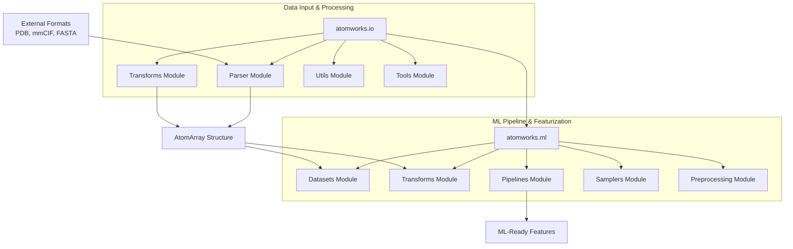

AtomWorks is an open-source platform designed to maximize research velocity for biomolecular modeling tasks. Much like how Torchdata enables rapid prototyping within vision and language domains, AtomWorks accelerates development and experimentation in computational biology and structural bioinformatics.


## Architecture Overview

AtomWorks is composed of two symbiotic libraries that work together to provide a complete pipeline for biological data processing and machine learning:



## Core Components

### atomworks.io: Universal Data Toolkit

**atomworks.io** serves as the foundation for all biological data operations, built upon the robust [biotite](https://www.biotite-python.org/) API. It provides a universal Python toolkit for parsing, cleaning, manipulating, and converting biological data including structures, sequences, and small molecules.

Key capabilities include:
- **Universal parsing** of common biological file formats (mmCIF, PDB, FASTA, etc.)
- **Structure cleaning and validation** including identification and removal of leaving groups, bond order correction, charge fixing, and proper handling of multiple occupancies
- **Consistent AtomArray representation** that transforms all data to a unified format for downstream analysis
- **Missing atom modeling** for atoms implied by sequence but not represented in coordinates
- **Assembly generation** and symmetry operations for biological complexes

The module is organized into several key components:

| Module | Purpose | Key Features |
|--------|---------|--------------|
| **parser** | File format parsing | Multi-format support, assembly building, metadata extraction |
| **transforms** | Data transformation | AtomArray operations, category management |
| **utils** | Utility functions | Assembly operations, visualization, testing, selection tools |
| **tools** | Specialized operations | FASTA processing, RDKit integration, inference tools |

### atomworks.ml: Machine Learning Pipeline Framework

**atomworks.ml** provides a modular, component-based library for dataset featurization within biomolecular deep learning workflows. It uses `atomworks.io` as its structural backbone and maintains a consistent vocabulary throughout the pipeline.

Key capabilities include:
- **Pre-built Transform library** with well-tested components for common ML tasks
- **Extensible framework** for writing custom transforms for arbitrary use cases
- **Database preprocessing** scripts for PDB and other biological databases
- **Efficient sampling and batching** utilities for training machine learning models

The ML module structure includes:

| Module | Purpose | Key Features |
|--------|---------|--------------|
| **datasets** | Data loading and management | Database parsers, dataset classes |
| **transforms** | Feature engineering | Atomization, encoding, featurization, augmentation |
| **pipelines** | End-to-end workflows | AF3, RF2AA integration |
| **samplers** | Data sampling strategies | Efficient batching strategies |
| **preprocessing** | Data preparation | Constants, utilities, preprocessing scripts |

## Key Design Principles

### Unified Structural Representation

At the heart of AtomWorks is the **AtomArray** data structure from Biotite, which provides a consistent representation regardless of the input source. This unified approach ensures that operations within and between pipelines maintain a common vocabulary, eliminating the need for format-specific conversions.

### Transform-Based Architecture

Both `atomworks.io` and `atomworks.ml` utilize a transform-based architecture where each operation updates the AtomArray representation. This design pattern enables:

- **Composable pipelines** where transforms can be easily combined
- **Transparent data flow** with clear input/output relationships
- **Extensible framework** for custom operations
- **Consistent interface** across different processing stages

### Research Velocity Focus

AtomWorks is designed specifically for research environments where rapid prototyping and experimentation are crucial. The framework emphasizes:

- **Minimal boilerplate** for common operations
- **Rich metadata preservation** throughout the pipeline
- **Flexible configuration** for different experimental setups
- **Integration-ready** outputs for downstream ML frameworks

## When to Use AtomWorks

| Use Case | Recommended Component | Example Applications |
|----------|----------------------|---------------------|
| **File format conversion** | atomworks.io | PDB → mmCIF, structure cleaning, format standardization |
| **Structure analysis** | atomworks.io | Distance calculations, neighbor searches, geometric analysis |
| **Dataset preparation** | atomworks.io + atomworks.ml | Large-scale PDB processing, feature extraction |
| **ML model training** | atomworks.ml | Dataset sampling, batching, feature pipelines |
| **Custom pipeline development** | Both modules | Novel featurization schemes, specialized preprocessing |

## Getting Started

The quickest way to begin using AtomWorks is through the unified parser interface:

```python
from atomworks.io.parser import parse

# Parse a structure with common preprocessing options
result = parse(
    filename="protein.cif",
    build_assembly=["1"],        # Build biological assembly
    add_missing_atoms=True,      # Model missing atoms
    remove_waters=True,          # Clean up structure
    hydrogen_policy="remove"     # Handle hydrogens
)

# Access parsed components
asym_unit = result["asym_unit"][0]      # Asymmetric unit
assembly = result["assemblies"]["1"][0]  # Built assembly
chain_info = result["chain_info"]       # Chain metadata
ligand_info = result["ligand_info"]     # Ligand information
```

## Integration with ModelForge

For researchers looking for pre-trained models (RF3, MPNN, etc.) that integrate with AtomWorks, the companion [ModelForge](https://github.com/RosettaCommons/modelforge) repository provides model implementations and training scripts specifically designed to work with AtomWorks data pipelines.

## Next Steps

To continue your AtomWorks journey:

- **[Quick Start](2-quick-start)** - Hands-on tutorial with practical examples
- **[Installation Guide](3-installation-guide)** - Detailed setup instructions for different environments  
- **[Basic Usage Examples](4-basic-usage-examples)** - Common workflows and patterns
- **[AtomWorks Framework Architecture](5-atomworks-framework-architecture)** - Deep dive into system design

For researchers ready to explore specific capabilities, the documentation is organized into comprehensive guides covering everything from basic file parsing to advanced machine learning pipeline construction.

---

*AtomWorks is developed by the Institute for Protein Design and built upon the excellent Biotite library. We welcome contributions and feedback from the computational biology community.*