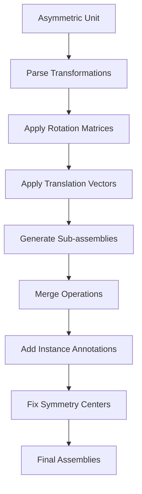
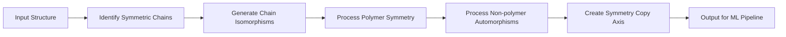

Assembly generation and symmetry operations are fundamental capabilities in AtomWorks for reconstructing complete biological macromolecular complexes from their asymmetric units. These operations enable the transformation of crystallographic data into biologically relevant assemblies through the application of symmetry operations defined in PDB and mmCIF files.

## Core Assembly Generation Framework

The assembly generation system in AtomWorks is built around the principle of applying rototranslation operations to asymmetric unit coordinates. The main entry point is the `build_assemblies_from_asym_unit` function in [`assembly.py`](src/atomworks/io/utils/assembly.py#L163-L200), which orchestrates the entire assembly construction process.



### Transformation Operations

The system parses transformation operations from the `pdbx_struct_oper_list` category in mmCIF files, extracting rotation matrices and translation vectors for each operation ID. The [`_parse_transformations`](src/atomworks/io/utils/assembly.py#L45-L61) function converts these into mathematical operations:

- **Rotation matrices**: 3×3 matrices defining rotational transformations
- **Translation vectors**: 3D vectors defining translational components
- **Operation expressions**: Combinations of multiple transformation steps

Each transformation is applied sequentially using the [`_apply_assembly_transformation`](src/atomworks/io/utils/assembly.py#L62-L86) function, which performs matrix rotations followed by vector translations on atomic coordinates.

### Assembly Building Process

The core assembly construction occurs in [`_build_bioassembly_from_asym_unit`](src/atomworks/io/utils/assembly.py#L87-L162), which:

1. **Filters affected chains** based on `asym_id_list` specifications
2. **Applies operation expressions** parsed from `oper_expression` fields
3. **Merges transformed coordinates** into complete assemblies
4. **Adds transformation annotations** for tracking applied operations

The system supports flexible assembly selection through the `assembly_ids` parameter, allowing construction of specific assemblies, the first assembly only, or all available assemblies.

## Symmetry Resolution and Automorphisms

Beyond basic assembly generation, AtomWorks provides sophisticated symmetry resolution capabilities for machine learning applications, particularly for protein structure prediction models like AlphaFold-Multimer and RoseTTAFold2.

### Graph-Based Symmetry Detection

The [`symmetry.py`](src/atomworks/ml/transforms/symmetry.py) module implements graph-based automorphism detection using NetworkX:

```python
def generate_automorphisms_from_atom_array_with_networkx(
    atom_array: AtomArray,
    max_automorphs: int = 1000,
    node_features: str | list = "element",
    ignore_bond_type: bool = True
) -> np.ndarray
```

This function constructs molecular graphs and identifies automorphisms—symmetry operations that map the molecule onto itself while preserving connectivity.

### Instance-Level Symmetry Mapping

The system creates mappings between molecular entities and their instances through [`instance_to_token_lvl_isomorphisms`](src/atomworks/ml/transforms/symmetry.py#L237-L288), enabling:

- **Chain-level isomorphisms** for symmetric polymer chains
- **Ligand-level automorphisms** for symmetric small molecules
- **Token-level mappings** for ML model integration

### RF2AA-Style Symmetry Integration

The [`CreateSymmetryCopyAxisLikeRF2AA`](src/atomworks/ml/transforms/symmetry.py#L399-L854) transform implements RoseTTAFold2-style symmetry resolution:



This transform handles both polymer chain symmetry and non-polymer ligand automorphisms, creating the symmetry-aware representations needed for structure prediction models.

## Symmetry Center Conflict Resolution

A critical challenge in assembly generation is handling non-polymer molecules placed at symmetry centers that clash with themselves during symmetry operations. AtomWorks addresses this through [`maybe_fix_non_polymer_at_symmetry_center`](src/atomworks/io/transforms/atom_array.py#L197-L294).

### Conflict Detection Algorithm

The system identifies clashing non-polymers using:

1. **Cell list construction** for efficient distance calculations
2. **Clash matrix generation** comparing atoms within `clash_distance` threshold
3. **Transformation ID analysis** to identify problematic symmetry operations
4. **Clash ratio evaluation** using configurable `clash_ratio` threshold

### Resolution Strategy

When conflicts are detected, the system:

- **Preserves identity transformations** (transformation ID "1")
- **Removes clashing copies** that exceed the clash ratio threshold
- **Maintains chain instance IDs** for proper annotation tracking

This approach handles real-world cases like PDB entries `7mub` (potassium ion at symmetry center) and `1xan` (ligand symmetry center clashes).

## Instance Annotation System

Assembly generation includes comprehensive instance-level annotation through [`add_iid_annotations_to_assemblies`](src/atomworks/io/transforms/atom_array.py#L719-L742):

| Annotation Level | ID Type | Entity Type | Purpose |
|------------------|---------|-------------|---------|
| Chain | `chain_id`, `chain_iid` | `chain_entity` | Track chain instances and entities |
| PN Unit | `pn_unit_id`, `pn_unit_iid` | `pn_unit_entity` | Polymer/non-polymer unit tracking |
| Molecule | `molecule_id`, `molecule_iid` | `molecule_entity` | Chemical molecule identification |

These annotations enable precise tracking of how asymmetric units map to assembly positions, essential for downstream analysis and machine learning applications.

## Testing and Validation

The assembly generation system is thoroughly validated through comprehensive test suites:

### Assembly Count Validation
[`test_assembly_counts`](tests/io/components/test_bioassemblies.py#L17-L36) verifies correct assembly enumeration across multiple PDB entries with varying assembly counts.

### Coordinate Accuracy Validation
[`test_assembly_atom_coordinates`](tests/io/components/test_bioassemblies.py#L37-L74) compares AtomWorks-generated assemblies against Biotite reference implementations, ensuring coordinate accuracy and proper transformation application.

### Symmetry Center Testing
Dedicated tests validate symmetry center conflict resolution, ensuring proper handling of edge cases where molecules clash with their symmetric copies.

## Integration with ML Pipelines

The symmetry operations integrate seamlessly with AtomWorks' machine learning transforms:

- **Preprocessing transforms** prepare structures for symmetry analysis
- **Encoding transforms** incorporate symmetry information into ML features  
- **Dataset transforms** ensure consistent symmetry handling across training data

This integration enables the development of symmetry-aware machine learning models for protein structure prediction and design applications.

## Next Steps

For understanding how assembly generation fits into the broader data processing workflow, explore the [AtomArray Data Structure](9-atomarray-data-structure) documentation. To learn about the transform system that enables these operations, see the [Transform Pipeline System](7-transform-pipeline-system). For machine learning applications, the [Transform System Fundamentals](12-transform-system-fundamentals) provides the theoretical foundation for symmetry-aware processing.