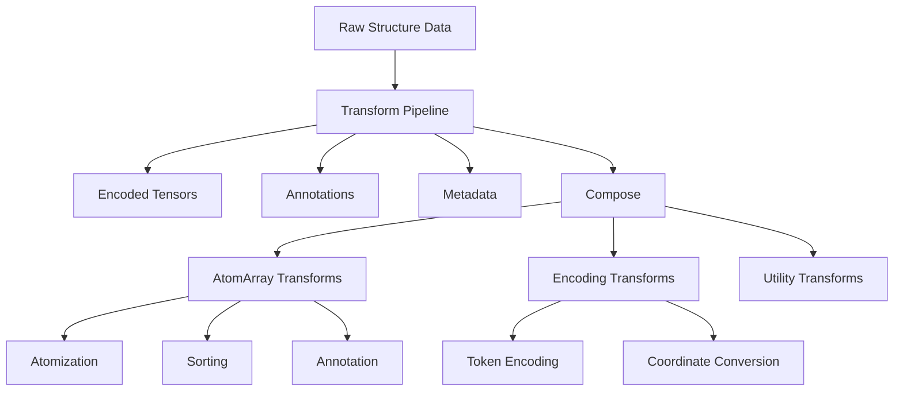

The AtomWorks transform system provides a powerful, composable framework for processing biological structure data through a pipeline of modular operations. This system enables systematic data preprocessing for machine learning applications while maintaining transparency, reproducibility, and error handling throughout the transformation pipeline.

## Core Architecture

### Transform Base Class

All transforms inherit from the abstract `Transform` base class [base.py#L81-L120](src/atomworks/ml/transforms/base.py#L81-L120), which establishes the fundamental interface and behavior:

```python
class Transform(ABC):
    validate_input: bool = True
    raise_if_invalid_input: bool = True
    requires_previous_transforms: ClassVar[list[str]] = []
    incompatible_previous_transforms: ClassVar[list[str]] = []
    previous_transforms_order_matters: bool = False
    _track_transform_history: bool = True
```

Each transform implements two key methods:
- `check_input(data: dict)`: Validates input data and raises errors if invalid
- `forward(data: dict)`: Applies the transformation and returns transformed data

The transform lifecycle follows a structured pattern [base.py#L245-L295](src/atomworks/ml/transforms/base.py#L245-L295):

1. **History Tracking**: Ensures data is wrapped in `TransformedDict` for tracking
2. **Input Validation**: Checks both transform history compatibility and data validity
3. **History Update**: Records the current transform in the execution history
4. **Transformation**: Applies the `forward` method
5. **History Restoration**: Ensures transform history persists even if data is copied
6. **Performance Tracking**: Records processing time for optimization

### Data Flow and History Tracking

The system uses `TransformedDict` [base.py#L42-L80](src/atomworks/ml/transforms/base.py#L42-L80) to maintain an immutable history of all applied transformations:

```python
class TransformedDict(dict):
    """A thin wrapper around a dictionary that can be used to track the transform history."""
```

This enables complete reproducibility by tracking exactly which transforms were applied in what order, crucial for debugging complex pipelines and ensuring consistent preprocessing across training and inference.

## Pipeline Composition

### Compose Transform

The `Compose` class [base.py#L323-L380](src/atomworks/ml/transforms/base.py#L323-L380) enables chaining multiple transforms into a single pipeline:

```python
class Compose(Transform):
    def __init__(self, transforms: list[Transform], track_rng_state: bool = True, print_rng_state: bool = False):
```

Key features include:
- **Sequential Execution**: Transforms are applied in order
- **RNG State Tracking**: Essential for reproducible stochastic transformations
- **Error Propagation**: Failed transforms include RNG state for debugging
- **Flexible Composition**: Supports adding transforms with `+` operator

### Routing and Control Flow

The system provides sophisticated routing capabilities:

**RandomRoute** [base.py#L636-L700](src/atomworks/ml/transforms/base.py#L636-L700): Probabilistically selects between transforms, useful for data augmentation strategies like different cropping approaches.

**ConditionalRoute** [base.py#L704-L740](src/atomworks/ml/transforms/base.py#L704-L740): Routes based on conditions, enabling different processing paths for training vs inference.

## Transform Categories

### Atom Array Operations

Atom array transforms manipulate the core biological structure representation:

**Annotation Management**: 
- `AddGlobalAtomIdAnnotation` [atom_array.py#L479-L500](src/atomworks/ml/transforms/atom_array.py#L479-L500): Tracks atoms across operations
- `AddGlobalTokenIdAnnotation` [atom_array.py#L523-L536](src/atomworks/ml/transforms/atom_array.py#L523-L536): Maintains token-level tracking
- `CopyAnnotation` [atom_array.py#L381-L398](src/atomworks/ml/transforms/atom_array.py#L381-L398): Duplicates annotations with new names

**Structural Organization**:
- `SortLikeRF2AA` [atom_array.py#L660-L683](src/atomworks/ml/transforms/atom_array.py#L660-L683): Organizes atoms for RF2AA compatibility
- `SortPolyThenNonPoly` [atom_array.py#L690-L717](src/atomworks/ml/transforms/atom_array.py#L690-L717): Separates polymer and non-polymer components

### Atomization and Tokenization

**AtomizeByCCDName** [atomize.py#L119-L200](src/atomworks/ml/transforms/atomize.py#L119-L200): Converts residues to atomic representation based on Chemical Component Dictionary names, enabling detailed atomic-level analysis.

**FlagNonPolymersForAtomization** [atomize.py#L16-L34](src/atomworks/ml/transforms/atomize.py#L16-L34): Identifies non-polymer residues that should be atomized, handling edge cases like individual amino acids bonded to sugars.

### Encoding Transforms

**EncodeAtomArray** [encoding.py#L299-L350](src/atomworks/ml/transforms/encoding.py#L299-L350): Converts AtomArray objects to numerical representations suitable for machine learning models:

```python
def atom_array_to_encoding(
    atom_array: AtomArray,
    encoding: TokenEncoding,
    default_coord: np.ndarray | float = float("nan"),
    occupancy_threshold: float = 0.0,
    extra_annotations: list[str] = [...]
) -> dict:
```

This transform handles the critical conversion from biological structure data to tensor format, managing coordinates, masks, and sequence encoding while preserving structural relationships.

## Validation and Compatibility

### Transform Dependencies

The system enforces strict compatibility through class attributes:

- `requires_previous_transforms`: Specifies prerequisite transforms
- `incompatible_previous_transforms`: Prevents conflicting operations
- `previous_transforms_order_matters`: Ensures correct sequencing

For example, `SortLikeRF2AA` requires `AtomizeByCCDName` [atom_array.py#L668](src/atomworks/ml/transforms/atom_array.py#L668), ensuring proper atomization before sorting.

### Error Handling

Custom `TransformPipelineError` [base.py#L33-L36](src/atomworks/ml/transforms/base.py#L33-L36) provides detailed error reporting with RNG state for stochastic transforms, enabling precise debugging of complex pipelines.

## Utility Transforms

The system includes essential utility transforms:

- `RemoveKeys` [base.py#L483-L497](src/atomworks/ml/transforms/base.py#L483-L497): Cleans up unnecessary data
- `AddData` [base.py#L518-L532](src/atomworks/ml/transforms/base.py#L518-L532): Injects additional information
- `LogData` [base.py#L535-L553](src/atomworks/ml/transforms/base.py#L535-L553): Debugging support with configurable logging
- `ConvertToTorch` [base.py#L804-L818](src/atomworks/ml/transforms/base.py#L804-L818): Converts data to PyTorch tensors

## Integration Patterns

The transform system seamlessly integrates with the broader AtomWorks ecosystem:



The transform system serves as the backbone of AtomWorks' machine learning pipeline, providing a robust, extensible framework for biological structure preprocessing. Its modular design enables custom transform development while maintaining compatibility with existing components.

## Next Steps

To deepen your understanding of the transform system:

- Explore [Atomization and Tokenization](13-atomization-and-tokenization) for detailed conversion strategies
- Learn about [Feature Encoding Schemes](14-feature-encoding-schemes) for ML-specific representations
- Study [Custom Transform Development](16-custom-transform-development) to extend the system
- Review [Pipeline Composition and Routing](17-pipeline-composition-and-routing) for advanced patterns