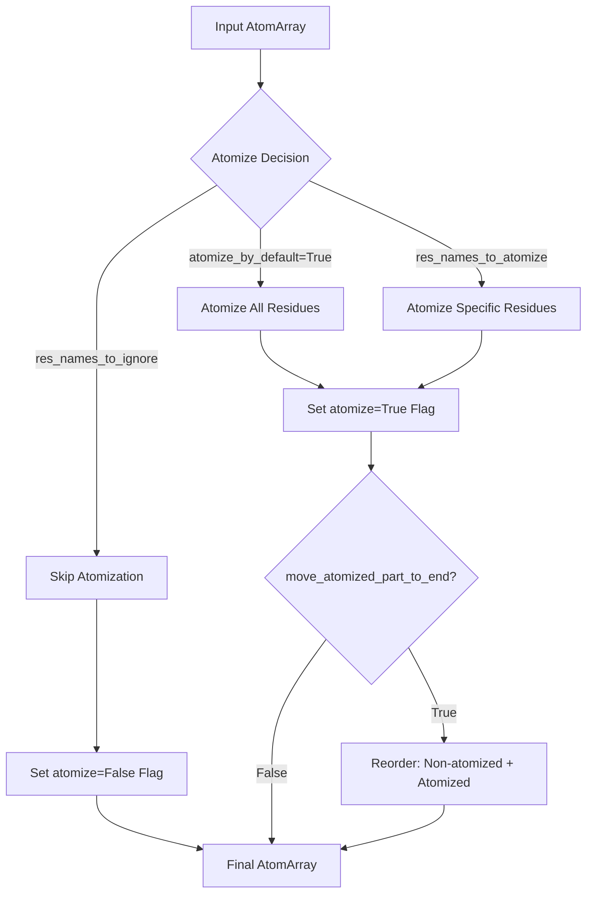
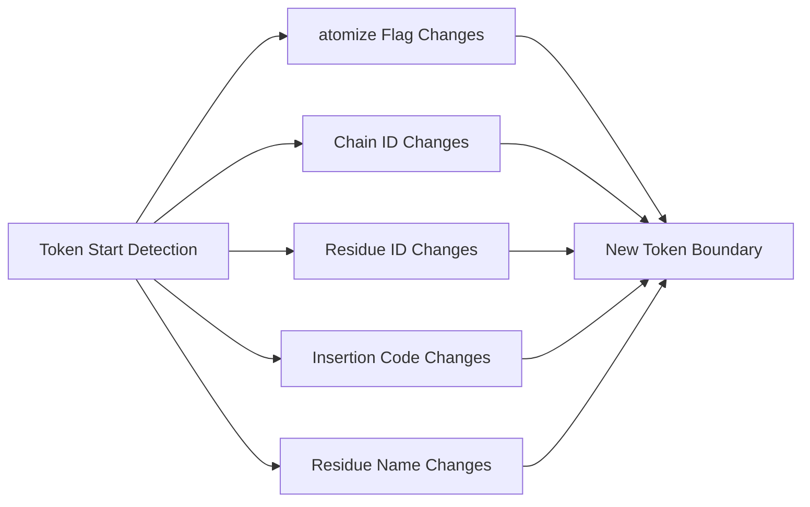

Atomization and tokenization are fundamental processes in AtomWorks that transform biological structures into machine-readable formats suitable for deep learning models. These processes bridge the gap between atomic-level structural data and the token-based representations required by modern protein and nucleic acid prediction models.

## Understanding the Atomization Process

Atomization is the process of breaking down complex molecular residues into their constituent atoms or maintaining them as unified tokens depending on the model requirements. This flexible approach enables compatibility with different machine learning architectures that operate at varying levels of molecular granularity.

The core atomization functionality is implemented in the `AtomizeByCCDName` transform, which processes residues based on the Chemical Component Dictionary (CCD) naming convention [src/atomworks/ml/transforms/atomize.py](src/atomworks/ml/transforms/atomize.py#L119-L212). This transform determines whether each residue should be treated as a single token or broken down into individual atoms.

### Key Atomization Components

The `FlagNonPolymersForAtomization` transform provides a complementary approach by automatically flagging all non-polymer residues for atomization [src/atomworks/ml/transforms/atomize.py](src/atomworks/ml/transforms/atomize.py#L16-L45). This is particularly useful for structures like PDB entry `6w12`, which contains protein residues outside of polymers that should be atomized for proper model input.

The atomization process respects several important constraints:
- **Residue Consistency**: All atoms within a given residue must either be atomized or not atomized - partial atomization is prohibited [src/atomworks/ml/transforms/atomize.py](src/atomworks/ml/transforms/atomize.py#L98-L100)
- **Precedence Handling**: Previously set `atomize` flags take precedence over default settings, enabling manual control for data augmentation scenarios [src/atomworks/ml/transforms/atomize.py](src/atomworks/ml/transforms/atomize.py#L94-L96)
- **RF2AA Compatibility**: The option to move atomized parts to the end of the array supports RF2AA's convention of grouping atomized components [src/atomworks/ml/transforms/atomize.py](src/atomworks/ml/transforms/atomize.py#L105-L114)

## Tokenization Fundamentals

Tokenization defines the boundaries between meaningful units in molecular structures. Unlike traditional residue-based approaches, AtomWorks implements a flexible tokenization system that can operate at both residue and atom levels.

The `get_token_starts` function determines token boundaries based on multiple criteria [src/atomworks/ml/utils/token.py](src/atomworks/ml/utils/token.py#L17-L72):

A new token begins when any of these conditions are met:
- The `atomize` flag transitions from False to True
- Chain identifier changes
- Residue ID changes  
- Insertion code changes
- Residue name changes

This approach ensures that atomized residues become individual tokens while maintaining traditional residue boundaries for non-atomized components.

## Token Operations and Utilities

AtomWorks provides comprehensive utilities for working with tokenized structures:

### Token Iteration and Processing

The `token_iter` function enables iteration over tokens in an AtomArray, seamlessly handling both atomized and non-atomized scenarios [src/atomworks/ml/utils/token.py](src/atomworks/ml/utils/token.py#L141-L150). This matches the behavior of `biotite.structure.residue_iter` when no atomization is present.

### Token-wise Operations

Several functions enable token-level data manipulation:
- **`spread_token_wise`**: Distributes token-level data to constituent atoms [src/atomworks/ml/utils/token.py](src/atomworks/ml/utils/token.py#L153-L157)
- **`apply_token_wise`**: Applies functions token-wise and returns token-level results [src/atomworks/ml/utils/token.py](src/atomworks/ml/utils/token.py#L160-L170)
- **`apply_and_spread_token_wise`**: Combines token-wise function application with atom-level distribution [src/atomworks/ml/utils/token.py](src/atomworks/ml/utils/token.py#L173-L180)

## Model-Specific Token Representations

### AlphaFold 3 Token Representatives

AtomWorks implements AlphaFold 3's token representation scheme, which uses specific atoms as representatives for different molecular types [src/atomworks/ml/utils/token.py](src/atomworks/ml/utils/token.py#L233-L282):

| Molecular Type | Representative Atom | Rationale |
|----------------|-------------------|-----------|
| Standard Amino Acids | CB (CA for glycine) | Side chain center for distance calculations |
| Pyrimidines | C2 | Consistent position in pyrimidine ring |
| Purines | C4 | Consistent position in purine ring |
| Atomized Ligands | All atoms | Each atom is its own token |

> [!TIP]
> The distinction between "representative" atoms (used for distance calculations) and "center" atoms (used during cropping) is crucial for understanding AF3's token processing pipeline.

## Encoding Schemes and Token Integration

The encoding system transforms tokenized structures into numerical representations suitable for machine learning models. The `TokenEncoding` class defines the mapping between tokens and their atomic composition [src/atomworks/ml/encoding_definitions.py](src/atomworks/ml/encoding_definitions.py#L36-L250).

### Standard Encoding Conventions

AtomWorks follows CCD-compatible conventions for token definitions:
- **Residue Tokens**: Use standardized 3-letter CCD names (e.g., 'ALA' for Alanine, 'DA' for Deoxyadenosine)
- **Atom Tokens**: Use atomic numbers as strings (e.g., '6' for Carbon, '8' for Oxygen)
- **Unknown Tokens**: Use angle bracket syntax (e.g., '<M>' for generic mask, '<MP>' for protein mask)
- **Mask Tokens**: Follow `<...>` format to avoid conflicts with existing residue names

### Supported Encoding Schemes

AtomWorks provides multiple encoding schemes optimized for different model architectures:

| Encoding Scheme | Target Model | Atom Coverage | Unknown Tokens |
|----------------|-------------|---------------|----------------|
| `AF2_ATOM14_ENCODING` | AlphaFold 2 | 14 heavy atoms per residue | Single UNK token |
| `RF2AA_ATOM36_ENCODING` | RoseTTAFold2AA | 36 atoms (heavy + H) per residue | UNK, DN, N tokens |
| `AF3_TOKENS` | AlphaFold 3 | Variable based on atomization | Multiple unknown types |

## Pipeline Integration

Atomization and tokenization integrate seamlessly into AtomWorks' transform pipeline system. The `EncodeAtomArray` transform converts tokenized AtomArrays into numerical encodings [src/atomworks/ml/transforms/encoding.py](src/atomworks/ml/transforms/encoding.py#L299-L348), supporting various downstream tasks.

> [!TIP]
> Transform compatibility is crucial - atomization must occur before transforms that depend on established tokens, such as `AddTokenBondAdjacency` or encoding transforms.

The pipeline enforces strict ordering constraints to ensure data integrity:
1. Atomization transforms must run before token-dependent transforms
2. Encoding transforms must run after token boundaries are established
3. Validation ensures consistent token-to-atom relationships

## Practical Applications

### Data Augmentation

The atomization system enables sophisticated data augmentation strategies. By manually setting the `atomize` flag before applying `AtomizeByCCDName`, users can selectively atomize residues for augmentation while preserving overall structure [src/atomworks/ml/transforms/atomize.py](src/atomworks/ml/transforms/atomize.py#L160-L164).

### Multi-Model Compatibility

The flexible tokenization approach enables compatibility across different model architectures:
- **Residue-level models**: Use traditional tokenization without atomization
- **Atom-level models**: Apply full atomization for fine-grained predictions
- **Hybrid models**: Selectively atomize specific residue types

### Structure Processing

The system handles complex biological scenarios including:
- Non-polymer residues requiring atomization
- Covalently bound ligands and polymers
- Mixed nucleic acid and protein structures
- Modified residues and chemical components

## Next Steps

To deepen your understanding of AtomWorks' tokenization system, explore these related topics:

- **[Feature Encoding Schemes](14-feature-encoding-schemes)**: Learn about the detailed encoding definitions and their applications
- **[Transform System Fundamentals](12-transform-system-fundamentals)**: Understand the transform pipeline architecture
- **[Custom Transform Development](16-custom-transform-development)**: Create custom atomization and tokenization transforms

The atomization and tokenization system provides a robust foundation for converting complex biological structures into machine-learning-ready representations while maintaining flexibility for diverse model requirements and research applications.