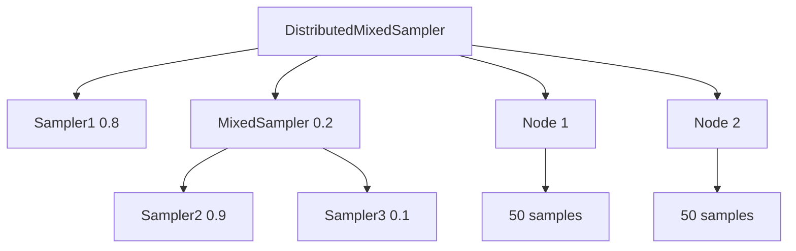
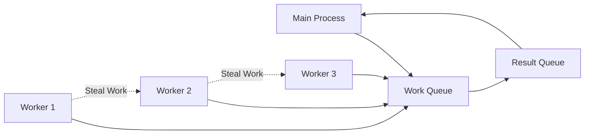

Dataset sampling and batching in AtomWorks provides sophisticated strategies for handling large-scale structural biology datasets, with specialized support for distributed training, load balancing, and weighted sampling based on biological properties.

## Core Sampling Architecture

The sampling system is built around several key components that work together to provide flexible and efficient data access patterns for machine learning pipelines.

### DistributedMixedSampler

The `DistributedMixedSampler` enables sampling from multiple datasets with specified probabilities across distributed training environments [samplers.py#L197](src/atomworks/ml/samplers.py#L197). This is particularly useful when combining datasets with different characteristics or sampling strategies.



The sampler follows a hierarchical sampling tree where child samplers can be any type of non-distributed sampler, including other `MixedSampler` instances. After collecting samples according to the specified probabilities, it shards the results across nodes to ensure each process receives a unique slice of the dataset.

### Weighted Sampling Strategies

AtomWorks implements sophisticated weighted sampling inspired by AlphaFold 3 methodology, where example weights are calculated based on multiple biological factors [samplers.py#L15](src/atomworks/ml/samplers.py#L15):

```python
w ∝ (β_r / N_clust) * (a_prot * n_prot + a_peptide * n_peptide + a_nuc * n_nuc + a_ligand * n_ligand + a_loi * is_loi)
```

The weighting considers:
- **Cluster size** (`N_clust`): Larger clusters receive lower weights to prevent over-representation
- **Molecule composition**: Separate weights for proteins, peptides, nucleic acids, and ligands
- **Ligands of Interest** (LOI): Special weighting for biologically relevant ligands
- **Interface vs Chain type**: Different β parameters for interfaces and chains

## Advanced Sampler Implementations

### LazyWeightedRandomSampler

The `LazyWeightedRandomSampler` extends PyTorch's `WeightedRandomSampler` with prefetching capabilities to improve performance [samplers.py#L439](src/atomworks/ml/samplers.py#L439):

```python
class LazyWeightedRandomSampler(WeightedRandomSampler):
    def __init__(self, weights: Sequence[float], num_samples: int, 
                 replacement: bool = True, generator: torch.Generator | None = None,
                 prefetch_buffer_size: int = 1) -> None:
```

This sampler uses a prefetch buffer to reduce the overhead of repeated `torch.multinomial` calls, particularly beneficial when sampling large numbers of examples with replacement.

### LoadBalancedDistributedSampler

For validation scenarios where processing time varies significantly between examples, the `LoadBalancedDistributedSampler` ensures even workload distribution across replicas [samplers.py#L465](src/atomworks/ml/samplers.py#L465):

```python
class LoadBalancedDistributedSampler(DistributedSampler):
    def __init__(self, dataset: Dataset, key_to_balance: str,
                 num_replicas: int | None = None, rank: int | None = None,
                 drop_last: bool = False):
```

This sampler balances examples based on a specified key (e.g., token count or structure size) to prevent situations where some GPUs process many large, slow examples while others handle small, fast ones.

## Batching Strategies

### Work-Stealing Data Loader

The `WorkStealDataLoader` implements an advanced multiprocessing strategy with work-stealing capabilities for improved load balancing [worksteal.py#L52](src/atomworks/ml/loaders/worksteal.py#L52):



Key features include:
- **Dynamic work stealing**: Idle workers can steal tasks from busy workers' queues
- **Worker health monitoring**: Tracks processing statistics and error rates
- **Graceful shutdown**: Proper cleanup of worker processes
- **Configurable timeouts**: Prevents hanging on problematic examples

### Structure Batching for Diffusion

The `BatchStructuresForDiffusionNoising` transform handles batching for diffusion-based training, where structures need to be tiled across the diffusion batch dimension [batch_structures.py#L7](src/atomworks/ml/transforms/diffusion/batch_structures.py#L7):

```python
class BatchStructuresForDiffusionNoising(Transform):
    def forward(self, data: dict[str, Any]) -> dict[str, Any]:
        # Transforms (n_atoms, 3) -> (diffusion_batch_size, n_atoms, 3)
        data["coord_atom_lvl_to_be_noised"] = data["ground_truth"]["coord_atom_lvl"].repeat(self.batch_size, 1, 1)
```

This enables differential noising and augmentation of each structure in the batch, following the AlphaFold 3 training paradigm.

## Dataset Integration

### Base Dataset Architecture

All datasets inherit from `BaseDataset`, which provides a consistent interface for indexing and ID management [datasets.py#L24](src/atomworks/ml/datasets/datasets.py#L24):

```python
class BaseDataset(Dataset):
    @abstractmethod
    def __contains__(self, example_id: str) -> bool:
        """Check if the dataset contains the example ID."""
    
    @abstractmethod
    def id_to_idx(self, example_id: str | list[str]) -> int | list[int]:
        """Convert example IDs to indices."""
    
    @abstractmethod
    def idx_to_id(self, idx: int | list[int]) -> str | list[str]:
        """Convert indices to example IDs."""
```

### Specialized Dataset Types

- **PandasDataset**: Wrapper around pandas DataFrames with filtering and column selection [datasets.py#L295](src/atomworks/ml/datasets/datasets.py#L295)
- **StructuralFileDataset**: File-based dataset with directory scanning and filtering [datasets.py#L67](src/atomworks/ml/datasets/datasets.py#L67)
- **StructuralDatasetWrapper**: Decorator that adds structural data loading and transformation capabilities [datasets.py#L119](src/atomworks/ml/datasets/datasets.py#L119)

## Configuration and Usage

### Sampler Configuration

Samplers are configured through datasets_info dictionaries that specify:

```python
datasets_info = [
    {
        "sampler": sampler_instance,
        "dataset": dataset_instance,
        "probability": 0.8,
        "name": "primary_dataset"
    },
    {
        "sampler": secondary_sampler,
        "dataset": secondary_dataset,
        "probability": 0.2,
        "name": "secondary_dataset"
    }
]
```

### Weight Calculation

AF-3 style weights are calculated using the `calculate_af3_example_weights` function [samplers.py#L15](src/atomworks/ml/samplers.py#L15):

```python
weights = calculate_af3_example_weights(
    df=dataset_df,
    alphas={"a_prot": 1.0, "a_nuc": 0.5, "a_ligand": 0.3, "a_peptide": 0.2, "a_loi": 2.0},
    beta=1.0
)
```

> [!TIP]
> The cluster-based weighting strategy prevents over-representation of similar structures while maintaining biological diversity in the training data.

## Performance Considerations

### Memory Efficiency

- **Lazy evaluation**: Samplers generate indices on-demand rather than materializing full lists
- **Prefetching**: `LazyWeightedRandomSampler` uses buffers to reduce computational overhead
- **Work stealing**: Dynamic load balancing prevents worker idle time

### Distributed Training

- **Deterministic sharding**: Each process receives a unique, non-overlapping subset of data
- **Epoch synchronization**: `set_sampler_epoch()` ensures consistent randomization across epochs
- **Load balancing**: Specialized samplers prevent GPU idle time in validation scenarios

> [!TIP]
> For large-scale distributed training, use `DistributedMixedSampler` with `LoadBalancedDistributedSampler` for validation to ensure optimal GPU utilization.

## Integration with Pipeline System

The sampling and batching system integrates seamlessly with the broader AtomWorks transform pipeline system:

1. **Dataset wrappers** handle data loading and preprocessing
2. **Samplers** control which examples are selected for each batch
3. **Data loaders** manage multiprocessing and work distribution
4. **Batch transforms** prepare data for model-specific requirements

This modular design allows for flexible composition of different sampling strategies with various dataset types and preprocessing pipelines.

## Next Steps

For comprehensive understanding of the data processing pipeline, explore:
- [Transform System Fundamentals](12-transform-system-fundamentals) for the preprocessing architecture
- [Atomization and Tokenization](13-atomization-and-tokenization) for data representation details
- [Pipeline Composition and Routing](17-pipeline-composition-and-routing) for end-to-end workflow construction