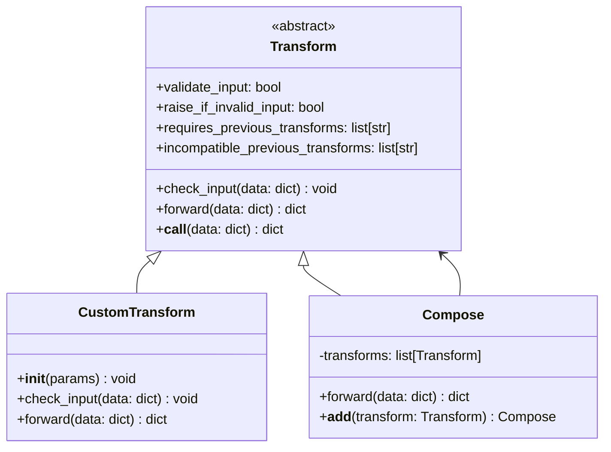

The AtomWorks transform system provides a robust framework for creating custom data processing pipelines for molecular structures. This guide covers the essential patterns and best practices for developing custom transforms that integrate seamlessly with the existing ecosystem.

## Transform Architecture Overview

The transform system is built around an abstract base class that provides standardized interfaces for data validation, processing, and pipeline integration. Every transform operates on dictionary-based data structures, enabling flexible composition and routing.



## Core Transform Interface

The `Transform` base class defines the essential contract that all custom transforms must implement. Located in [`src/atomworks/ml/transforms/base.py`](src/atomworks/ml/transforms/base.py#L81), it provides several key attributes and methods:

### Class-Level Configuration

Transforms support declarative configuration through class attributes:

- **`validate_input`**: Controls whether input validation is performed (default: `True`)
- **`raise_if_invalid_input`**: Determines whether invalid input raises exceptions (default: `True`)
- **`requires_previous_transforms`**: Lists required preceding transforms
- **`incompatible_previous_transforms`**: Lists incompatible preceding transforms
- **`previous_transforms_order_matters`**: Indicates if transform order is critical
- **`_track_transform_history`**: Controls transform history tracking (default: `True`)

### Required Methods

Every custom transform must implement:

1. **`check_input(data: dict) -> None`**: Validates input data and raises exceptions for invalid inputs
2. **`forward(data: dict) -> dict`**: Applies the transformation and returns modified data

## Creating a Basic Custom Transform

Here's the fundamental pattern for creating a custom transform:

```python
from atomworks.ml.transforms.base import Transform
from typing import Any, Dict

class CustomStructureProcessor(Transform):
    """Example transform that processes molecular structures."""
    
    def __init__(self, processing_parameter: float = 1.0):
        self.processing_parameter = processing_parameter
    
    def check_input(self, data: Dict[str, Any]) -> None:
        """Validate that required keys exist in the input data."""
        if "atom_array" not in data:
            raise ValueError("Input data must contain 'atom_array' key")
    
    def forward(self, data: Dict[str, Any]) -> Dict[str, Any]:
        """Apply the custom processing logic."""
        atom_array = data["atom_array"]
        
        # Your custom processing logic here
        processed_array = self._process_structure(atom_array)
        
        # Update the data dictionary
        data["atom_array"] = processed_array
        data["processing_applied"] = True
        
        return data
    
    def _process_structure(self, atom_array):
        """Internal method for the actual processing logic."""
        # Implementation details
        pass
```

## Advanced Transform Patterns

### Transform Dependencies and Ordering

The transform system supports dependency management through class attributes. For example, the [`FeaturizeTemplatesLikeRF2AA`](src/atomworks/ml/transforms/template.py#L462) transform demonstrates dependency specification:

```python
class FeaturizeTemplatesLikeRF2AA(Transform):
    requires_previous_transforms: ClassVar[list[str | Transform]] = [
        AddRFTemplates, 
        "AddWithinPolyResIdx"  # Can use string names or classes
    ]
    
    def forward(self, data: dict[str, Any]) -> dict[str, Any]:
        # Implementation that depends on previous transforms
        pass
```

### Conditional Processing

Transforms can implement conditional logic based on data content. The [`ConditionalRoute`](src/atomworks/ml/transforms/base.py#L704) transform provides a pattern for routing different processing paths:

```python
class ConditionalProcessing(Transform):
    """Apply different processing based on data characteristics."""
    
    def __init__(self, condition_key: str, processor_map: dict):
        self.condition_key = condition_key
        self.processor_map = processor_map
    
    def forward(self, data: dict[str, Any]) -> dict[str, Any]:
        condition_value = data.get(self.condition_key)
        processor = self.processor_map.get(condition_value)
        
        if processor:
            return processor(data)
        return data
```

### Data Validation and Error Handling

Robust error handling is essential for production transforms. The base class provides comprehensive error formatting and history tracking:

```python
class RobustProcessor(Transform):
    def check_input(self, data: dict[str, Any]) -> None:
        """Comprehensive input validation."""
        required_keys = ["atom_array", "metadata"]
        missing_keys = [key for key in required_keys if key not in data]
        
        if missing_keys:
            raise ValueError(f"Missing required keys: {missing_keys}")
        
        # Additional validation logic
        atom_array = data["atom_array"]
        if len(atom_array) == 0:
            raise ValueError("Atom array cannot be empty")
    
    def forward(self, data: dict[str, Any]) -> dict[str, Any]:
        try:
            # Processing logic with error handling
            result = self._safe_process(data)
            return result
        except Exception as e:
            # Custom error handling
            logger.error(f"Processing failed: {e}")
            raise
```

## Integration with Existing Transform Categories

### IO Transforms

For transforms that handle input/output operations, follow patterns from [`src/atomworks/io/transforms/`](src/atomworks/io/transforms/):

```python
class CustomIOTransform(Transform):
    """Transform that handles custom file formats."""
    
    def __init__(self, file_path: str, format_options: dict = None):
        self.file_path = file_path
        self.format_options = format_options or {}
    
    def forward(self, data: dict[str, Any]) -> dict[str, Any]:
        # Load or save custom format
        custom_data = self._load_custom_format()
        data.update(custom_data)
        return data
```

### ML Pipeline Transforms

For machine learning pipeline transforms, follow patterns from [`src/atomworks/ml/transforms/`](src/atomworks/ml/transforms/). The [`EncodeAtomArray`](src/atomworks/ml/transforms/encoding.py#L299) transform provides a good example:

```python
class CustomMLEncoding(Transform):
    """Custom encoding for machine learning pipelines."""
    
    requires_previous_transforms = ["AtomizeByCCDName"]
    
    def __init__(self, encoding_scheme: str, feature_dimensions: dict):
        self.encoding_scheme = encoding_scheme
        self.feature_dimensions = feature_dimensions
    
    def forward(self, data: dict[str, Any]) -> dict[str, Any]:
        atom_array = data["atom_array"]
        
        # Custom encoding logic
        encoded_features = self._encode_custom_features(atom_array)
        
        data.update(encoded_features)
        return data
```

## Testing Custom Transforms

The test suite in [`tests/ml/transforms/`](tests/ml/transforms/) provides patterns for comprehensive testing:

```python
import pytest
from atomworks.ml.transforms.base import Transform

class TestCustomTransform:
    def test_check_input_valid(self):
        """Test valid input validation."""
        transform = CustomStructureProcessor()
        valid_data = {"atom_array": mock_atom_array()}
        
        # Should not raise exception
        transform.check_input(valid_data)
    
    def test_check_input_invalid(self):
        """Test invalid input detection."""
        transform = CustomStructureProcessor()
        invalid_data = {"wrong_key": "value"}
        
        with pytest.raises(ValueError, match="atom_array"):
            transform.check_input(invalid_data)
    
    def test_forward_processing(self):
        """Test the main processing logic."""
        transform = CustomStructureProcessor(processing_parameter=2.0)
        input_data = {"atom_array": mock_atom_array()}
        
        result = transform.forward(input_data)
        
        assert "processing_applied" in result
        assert result["processing_applied"] is True
```

## Pipeline Composition

Custom transforms integrate seamlessly with the composition system. The [`Compose`](src/atomworks/ml/transforms/base.py#L323) class enables sophisticated pipeline construction:

```python
# Create custom pipeline
custom_pipeline = Compose([
    CustomStructureProcessor(processing_parameter=1.5),
    CustomMLEncoding(encoding_scheme="custom_v1"),
    ConditionalProcessing(
        condition_key="model_type",
        processor_map={
            "protein": ProteinSpecificProcessor(),
            "rna": RNASpecificProcessor()
        }
    )
])

# Use in pipeline
result = custom_pipeline(input_data)
```

## Best Practices and Guidelines

### Performance Considerations

1. **Lazy Loading**: For expensive operations, consider lazy evaluation patterns
2. **Memory Management**: Handle large structures efficiently to avoid memory issues
3. **Caching**: Implement caching for computationally expensive operations

### Documentation Standards

1. **Clear Docstrings**: Document parameters, return values, and exceptions
2. **Type Hints**: Use comprehensive type annotations for better IDE support
3. **Examples**: Provide usage examples in docstrings

### Error Handling

1. **Specific Exceptions**: Use descriptive exception types and messages
2. **Graceful Degradation**: Implement fallback behavior where appropriate
3. **Logging**: Include informative log messages for debugging

> [!TIP]
> Always implement comprehensive input validation in `check_input()` method. The transform system provides automatic error formatting and history tracking that makes debugging much easier when validation fails early.

> [!TIP]
> Consider transform dependencies carefully. Use `requires_previous_transforms` and `incompatible_previous_transforms` to ensure pipeline integrity and prevent subtle bugs from transform ordering issues.

## Next Steps

For deeper understanding of the transform system, explore:
- [Transform System Fundamentals](12-transform-system-fundamentals) for core concepts
- [Pipeline Composition and Routing](17-pipeline-composition-and-routing) for advanced patterns
- [AtomArray Data Structure](9-atomarray-data-structure) for data format details

The transform system's modular design enables rapid development of custom molecular processing workflows while maintaining compatibility with the broader AtomWorks ecosystem.