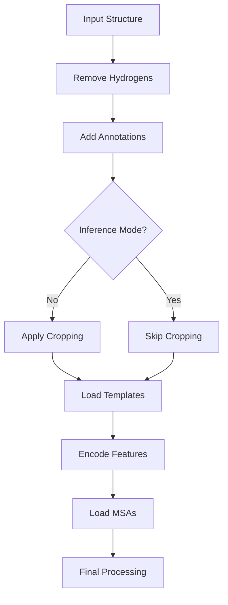

The AtomWorks framework provides a sophisticated pipeline composition and routing system that enables flexible data processing workflows for machine learning applications. This system is built around the `Transform` base class and offers powerful mechanisms for creating, combining, and conditionally executing data processing steps.

## Core Architecture

The pipeline system centers on three key components: individual transforms, sequential composition, and conditional routing. These components work together to create flexible, reusable data processing pipelines that can adapt to different scenarios such as training versus inference.

### Transform Base Class

All pipeline operations inherit from the abstract `Transform` class [src/atomworks/ml/transforms/base.py#L81](src/atomworks/ml/transforms/base.py#L81), which provides:

- **Input validation**: Automatic checking of input data compatibility
- **Transform history tracking**: Optional recording of processing steps for debugging
- **Error handling**: Comprehensive error reporting with context
- **Composability**: Native support for pipeline combination through operator overloading

```python
class Transform(ABC):
    @abstractmethod
    def forward(self, data: dict[str, Any]) -> dict[str, Any]:
        """Apply the transformation to the input data."""
        pass
```

### Sequential Composition with Compose

The `Compose` class enables sequential chaining of transforms [src/atomworks/ml/transforms/base.py#L323](src/atomworks/ml/transforms/base.py#L323). This is the primary mechanism for building linear processing pipelines:

```python
pipeline = Compose([
    RemoveHydrogens(),
    AddAnnotations(),
    AtomizeResidues(),
    EncodeFeatures()
])
```

> [!TIP]
> The `Compose` class tracks random number generator states when `track_rng_state=True`, enabling reproducible debugging of stochastic pipelines by capturing the exact RNG state at failure points.

## Conditional Routing System

AtomWorks provides two powerful routing mechanisms that enable dynamic pipeline behavior based on data content or random selection.

### ConditionalRoute: Data-Driven Branching

The `ConditionalRoute` transform enables conditional execution based on data content [src/atomworks/ml/transforms/base.py#L704](src/atomworks/ml/transforms/base.py#L704):

```python
ConditionalRoute(
    condition_func=lambda data: data.get("is_inference", False),
    transform_map={
        True: Identity(),  # Skip processing during inference
        False: CropTransform(),  # Apply cropping during training
    }
)
```

This pattern is extensively used in production pipelines to handle training/inference mode switching, as seen in the AF3 pipeline [src/atomworks/ml/pipelines/af3.py#L175-183](src/atomworks/ml/pipelines/af3.py#L175-183).

### RandomRoute: Probabilistic Branching

The `RandomRoute` transform enables probabilistic selection between different processing paths [src/atomworks/ml/transforms/base.py#L636](src/atomworks/ml/transforms/base.py#L636):

```python
RandomRoute(
    transforms=[
        CropContiguousLikeAF3(crop_size=384),
        CropSpatialLikeAF3(crop_size=384, cutoff_distance=15.0)
    ],
    probs=[0.5, 0.5]  # Equal probability selection
)
```

This is particularly useful for data augmentation strategies where different cropping or transformation methods should be applied randomly during training.

## Pipeline Building Patterns

### Model-Specific Pipelines

AtomWorks provides pre-built pipelines for major protein structure prediction models:

#### AlphaFold 3 Pipeline

The AF3 pipeline demonstrates advanced composition patterns with extensive conditional routing [src/atomworks/ml/pipelines/af3.py#L84](src/atomworks/ml/pipelines/af3.py#L84):



Key features include:
- **Conditional cropping**: Different strategies for training vs inference
- **Template handling**: Separate paths for template loading from disk vs structure
- **MSA processing**: Complex multi-sequence alignment workflows
- **Feature aggregation**: Model-specific feature preparation

#### RF2AA Pipeline

The RF2AA pipeline follows similar patterns but with model-specific parameter configurations [src/atomworks/ml/pipelines/rf2aa.py#L154](src/atomworks/ml/pipelines/rf2aa.py#L154):

```python
def build_rf2aa_transform_pipeline(
    *,
    protein_msa_dirs: list[dict],
    rna_msa_dirs: list[dict],
    n_recycles: int = 5,
    crop_size: int = 256,
    # ... extensive parameter list
) -> Compose:
```

### Pipeline Composition Patterns

#### Progressive Enhancement

Common pattern of building complex pipelines incrementally:

```python
transforms = [
    AddData({"is_inference": is_inference}),
    RemoveHydrogens(),
    FilterToSpecifiedPNUnits(),
    # ... base processing
]

# Conditional additions based on mode
if not is_inference:
    transforms.append(cropping_transform)

transforms.extend([
    TemplateProcessing(),
    FeatureEncoding(),
    FinalAggregation()
])
```

#### Nested Conditional Logic

Complex conditional routing can be nested for sophisticated behavior:

```python
transforms.append(
    ConditionalRoute(
        condition_func=lambda data: data["is_inference"],
        transform_map={
            False: training_template_loading_transforms,
            True: ConditionalRoute(
                condition_func=lambda data: "is_input_file_templated" in data["atom_array"].get_annotation_categories(),
                transform_map={
                    True: inference_template_load_from_structure,
                    False: inference_template_loading_from_disk,
                },
            ),
        },
    )
)
```

## Advanced Features

### Error Handling and Debugging

The pipeline system includes sophisticated error handling [src/atomworks/ml/transforms/base.py#L440-465](src/atomworks/ml/transforms/base.py#L440-465):

- **RNG state capture**: Automatically captures random generator states for reproducible debugging
- **Transform history**: Optional tracking of all applied transformations
- **Contextual error messages**: Detailed error reporting with pipeline state

### Pipeline Inspection

Pipelines support introspection operations:

```python
len(pipeline)  # Number of transforms
pipeline[2:5]  # Slice to create sub-pipeline
pipeline.__repr__()  # Human-readable representation
```

### Memory and Performance Optimization

The system includes transforms for memory management:

```python
SubsetToKeys(keys_to_keep)  # Remove unnecessary data
ConvertToTorch(keys=["feats", "coords"], device="cuda")  # Device transfer
```

## Best Practices

### Pipeline Design Principles

1. **Modular transforms**: Each transform should perform a single, well-defined operation
2. **Conditional routing**: Use `ConditionalRoute` for training/inference differences
3. **Parameter validation**: Leverage built-in input validation for robust pipelines
4. **Reproducibility**: Enable RNG state tracking for stochastic pipelines

### Common Patterns

| Pattern | Use Case | Implementation |
|---------|----------|----------------|
| **Mode switching** | Training vs inference behavior | `ConditionalRoute` with `is_inference` flag |
| **Data augmentation** | Random transformation selection | `RandomRoute` with probability weights |
| **Feature branching** | Different processing for data types | `ConditionalRoute` with data content checks |
| **Pipeline composition** | Building complex workflows | `Compose` with transform lists |

## Integration Points

The pipeline system integrates tightly with other AtomWorks components:

- **Transform ecosystem**: Extensive library of pre-built transforms for structure processing
- **Model compatibility**: Specialized pipelines for different ML models
- **Data flow**: Seamless integration with AtomArray data structures
- **Configuration**: Parameterized pipeline construction for different use cases

This composition and routing system provides the flexibility needed for complex machine learning workflows while maintaining code reusability and debugging capabilities.

## Next Steps

For practical implementation details, see [Custom Transform Development](16-custom-transform-development) to learn how to create your own transforms, or refer to [Transform System Fundamentals](12-transform-system-fundamentals) for deeper architectural understanding.