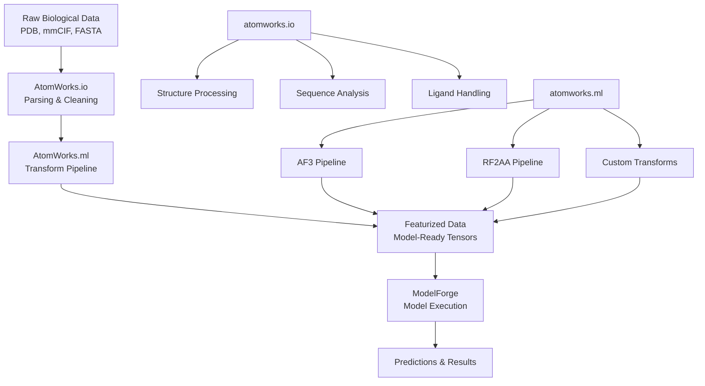

AtomWorks serves as the foundational data processing framework for ModelForge, providing the essential preprocessing and featurization capabilities that enable advanced biomolecular modeling. This integration creates a seamless workflow from raw biological data to model-ready inputs, leveraging AtomWorks' specialized transforms and data structures.

## Architecture Overview

The integration between AtomWorks and ModelForge follows a modular architecture where AtomWorks handles data preparation and ModelForge focuses on model execution. This separation of concerns allows researchers to mix and match different preprocessing pipelines with various model architectures.



## Core Integration Points

### Data Pipeline Architecture

AtomWorks provides two primary pipeline implementations that integrate with ModelForge:

**AlphaFold 3 Pipeline**: The `build_af3_transform_pipeline()` function in [src/atomworks/ml/pipelines/af3.py](src/atomworks/ml/pipelines/af3.py) creates a comprehensive preprocessing pipeline that prepares structures for AF3-style models. This includes MSA loading, template processing, and feature aggregation specifically designed for diffusion-based structure prediction.

**RF2AA Pipeline**: The `build_rf2aa_transform_pipeline()` function in [src/atomworks/ml/pipelines/rf2aa.py](src/atomworks/ml/pipelines/rf2aa.py) implements the preprocessing for RoseTTAFold2AA-style models, with specialized transforms for symmetry handling, atom frames, and bond features.

### Data Flow Integration

The integration follows this pattern:

1. **Input Processing**: AtomWorks.io parses and standardizes input files into the unified `AtomArray` format
2. **Transform Application**: AtomWorks.ml applies a sequence of transforms to convert structural data into model-ready features
3. **Model Interface**: The final output provides standardized tensors and metadata that ModelForge models can directly consume

## Supported Model Types

### AlphaFold 3 Integration

The AF3 pipeline supports:
- **MSA Processing**: Loads and processes multiple sequence alignments with configurable parameters for depth and density
- **Template Integration**: Incorporates structural templates with similarity-based filtering
- **Diffusion Preparation**: Generates coordinates and noise for diffusion-based training
- **Feature Aggregation**: Combines sequence, structure, and template information into unified features

### RF2AA Integration

The RF2AA pipeline provides:
- **Symmetry Handling**: Advanced automorphism and isomorphism detection for proper symmetry resolution
- **Atom Frames**: Order-independent atom frame prioritization for consistent coordinate systems
- **Bond Features**: Comprehensive bond adjacency and traversal distance matrices
- **Template Features**: RF2AA-specific template featurization with initialization strategies

## Configuration and Customization

### Pipeline Parameters

Both pipelines offer extensive customization through parameters:

| Parameter Category | AF3 Pipeline | RF2AA Pipeline | Description |
|-------------------|---------------|----------------|-------------|
| **Cropping** | `crop_size`, `crop_contiguous_probability` | `crop_size`, `crop_spatial_probability` | Spatial and contiguous cropping strategies |
| **MSA** | `max_msa_sequences`, `dense_msa` | `max_msa_sequences`, `n_msa_cluster_representatives` | Multiple sequence alignment configuration |
| **Templates** | `n_template`, `template_max_seq_similarity` | `n_template`, `pick_top_templates` | Template search and selection |
| **Symmetry** | `max_automorphs` | `max_automorphs`, `max_isomorphs` | Symmetry resolution limits |
| **Training** | `sigma_data`, `diffusion_batch_size` | `black_hole_init`, `unclamp_loss_probability` | Model-specific training parameters |

### Custom Transform Development

The integration supports custom transforms through the base `Transform` class in [src/atomworks/ml/transforms/base.py](src/atomworks/ml/transforms/base.py). This allows researchers to:
- Implement domain-specific preprocessing steps
- Add novel feature extraction methods
- Create model-specific data augmentation strategies
- Integrate external computational chemistry tools

## Data Format Compatibility

### Input Formats

AtomWorks supports all major biological file formats:
- **Structures**: PDB, mmCIF, mmCIF.gz
- **Sequences**: FASTA, custom sequence formats
- **Ligands**: SDF, MOL2 with RDKit integration
- **Annotations**: Custom metadata files

### Output Specifications

The pipelines produce standardized outputs compatible with ModelForge:

```python
# AF3 Pipeline Output Structure
{
    "feats": "TensorDict with model features",
    "t": "Diffusion timestep",
    "noise": "Applied noise tensor", 
    "ground_truth": "Original coordinates",
    "automorphisms": "Symmetry information",
    "example_id": "Unique identifier"
}

# RF2AA Pipeline Output Structure  
{
    "feats": "RF2AAInputs named tuple",
    "ground_truth": "Original structure data",
    "example_id": "Unique identifier"
}
```

## Performance Optimizations

### Caching Strategies

The integration implements intelligent caching:
- **MSA Caching**: Pre-computed MSAs stored in configurable cache directories
- **Template Caching**: Template search results cached for rapid reuse
- **Transform Caching**: Intermediate results cached where computationally expensive

### Memory Management

- **Lazy Loading**: Large datasets loaded incrementally to minimize memory footprint
- **Batch Processing**: Configurable batch sizes for memory-constrained environments
- **Garbage Collection**: Automatic cleanup of intermediate data structures

## Installation and Setup

### Required Dependencies

For full ModelForge integration, install with ML dependencies:

```bash
pip install "atomworks[ml]"
```

Additional optional dependencies:
```bash
pip install "atomworks[openbabel]"  # For advanced small molecule processing
pip install "atomworks[dev]"         # For development and testing
```

### Environment Configuration

Key environment variables:
- `ATOMWORKS_LOG_LEVEL`: Control logging verbosity
- `MSA_CACHE_DIR`: Configure MSA caching location
- `TEMPLATE_BASE_DIR`: Set template database location

## Best Practices

### Pipeline Selection

Choose the appropriate pipeline based on your model architecture:
- Use **AF3 pipeline** for diffusion-based structure prediction models
- Use **RF2AA pipeline** for end-to-end sequence-to-structure models
- Consider **custom pipelines** for specialized model architectures

### Parameter Tuning

- Start with default parameters and gradually adjust based on model performance
- Monitor memory usage and batch size for optimal throughput
- Validate symmetry resolution settings for complex molecular systems

### Testing and Validation

- Use the provided test suites in [tests/ml/](tests/ml/) to validate integration
- Verify output formats match ModelForge expectations
- Profile performance on representative datasets

## Advanced Features

### Multi-Modal Integration

The pipelines support simultaneous processing of:
- Protein sequences and structures
- Nucleic acids (DNA/RNA) with specialized handling
- Small molecules and ligands with atomization
- Covalent modifications and cross-links

### Extensibility Framework

The integration provides hooks for:
- Custom encoding schemes through `encoding_definitions.py`
- Novel transform compositions via the `Compose` class
- Model-specific feature aggregation strategies
- External tool integration (RDKit, OpenBabel)

## Troubleshooting

### Common Issues

1. **Memory Errors**: Reduce batch size or enable memory-efficient transforms
2. **Template Loading**: Verify template database configuration and paths
3. **MSA Processing**: Check MSA directory structure and file naming conventions
4. **Symmetry Resolution**: Adjust `max_automorphs` and `max_isomorphs` parameters

### Debug Support

Enable detailed logging for troubleshooting:
```python
import logging
logging.getLogger("atomworks").setLevel("DEBUG")
```

## Future Development

The AtomWorks-ModelForge integration is actively evolving with planned enhancements:
- Support for additional model architectures
- Enhanced GPU acceleration for transform pipelines
- Real-time data streaming capabilities
- Advanced visualization and analysis tools

This integration represents a powerful foundation for biomolecular modeling research, combining the robust data processing capabilities of AtomWorks with the advanced modeling features of ModelForge. The modular design ensures flexibility while maintaining standardized interfaces for seamless workflow integration.