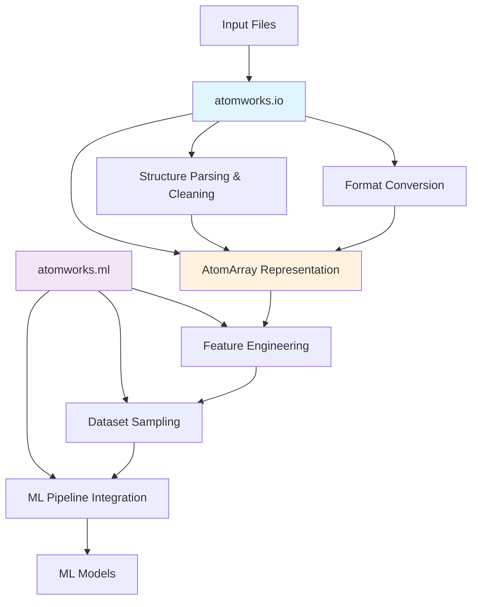

**AtomWorks** is a unified Python platform that accelerates biomolecular modeling research by providing seamless data I/O and machine learning capabilities. This guide will get you up and running with basic structure parsing and analysis in minutes.


## Installation

Choose the installation that matches your needs:

```bash
# Basic installation (I/O operations only)
pip install atomworks

# Full installation with ML dependencies
pip install "atomworks[ml]"

# Development installation
pip install "atomworks[dev]"

# All dependencies
pip install "atomworks[ml,dev]"
```

For users with [uv](https://docs.astral.sh/uv/) package manager:
```bash
uv pip install "atomworks[ml,openbabel,dev]"
```

## Architecture Overview

AtomWorks consists of two symbiotic modules that work together to provide a complete biomolecular data processing pipeline:



## Your First Structure Analysis

Let's start with a simple example that demonstrates the core functionality of AtomWorks:

```python
from atomworks.io.parser import parse

# Parse a structure file (supports PDB, mmCIF, and compressed formats)
result = parse(filename="3nez.cif.gz")

# Explore the results
for chain_id, info in result["chain_info"].items():
    print(f"Chain {chain_id}: {info['sequence']}")
```

### Understanding the Output

The `parse()` function returns a comprehensive dictionary containing:

| Key | Description | Use Case |
|-----|-------------|----------|
| **chain_info** | Chain sequences and metadata | Sequence analysis, chain selection |
| **ligand_info** | Ligand annotations and metrics | Small molecule analysis |
| **asym_unit** | Asymmetric unit as AtomArrayStack | Basic structure analysis |
| **assemblies** | Biological assemblies | Functional structure analysis |
| **metadata** | Experimental and source information | Data provenance |

## Working with AtomArrays

AtomWorks uses Biotite's `AtomArray` and `AtomArrayStack` as the unified data structure for all molecular representations:

```python
# Access the first biological assembly
assembly = result["assemblies"]["1"][0]

# Filter for high-occupancy atoms
assembly = assembly[assembly.occupancy > 0]

# Extract specific atom types
ca_atoms = assembly[assembly.atom_name == "CA"]
print(f"C-alpha coordinates shape: {ca_atoms.coord.shape}")

# Extract specific chains
chain_a = assembly[assembly.chain_id == "A"]
print(f"Chain A coordinates shape: {chain_a.coord.shape}")
```

## Basic Structure Operations

### Distance Calculations

```python
import biotite.structure as struc

# Distance between two atoms
distance = struc.distance(ca_atoms.coord[0], ca_atoms.coord[1])
print(f"Distance: {distance:.2f} Å")

# Distance from one atom to all others
distances = struc.distance(ca_atoms[0], ca_atoms)
```

### Efficient Spatial Queries

```python
# Create a cell list for neighbor searching
cell_list = struc.CellList(assembly, cell_size=5.0)

# Find atoms within radius
near_atoms = cell_list.get_atoms(assembly[0].coord, radius=4.0)
print(f"Found {near_atoms.shape[0]} atoms within 4 Å")

# Access neighbor information
print(f"Chains: {assembly.chain_id[near_atoms]}")
print(f"Residues: {assembly.res_name[near_atoms]}")
```

## Common Parsing Options

Customize your parsing with these frequently used options:

```python
result = parse(
    filename="structure.cif",
    add_missing_atoms=True,      # Add unresolved atoms
    remove_waters=True,           # Remove water molecules
    build_assembly="all",         # Build all biological assemblies
    hydrogen_policy="keep",        # Keep, remove, or infer hydrogens
    fix_formal_charges=True,      # Fix charge assignments
    convert_mse_to_met=False      # Keep selenomethionine as MSE
)
```

> [!TIP]
> The `add_missing_atoms=True` option is particularly useful for incomplete structures, as it adds unresolved atoms and creates proper intra- and inter-residue bonds based on sequence information.

## When to Use Each Module

| Task | Use atomworks.io | Use atomworks.ml |
|------|------------------|------------------|
| Parse PDB/mmCIF files | ✅ | ❌ |
| Convert between formats | ✅ | ❌ |
| Clean and validate structures | ✅ | ❌ |
| Generate biological assemblies | ✅ | ❌ |
| Feature engineering for ML | ❌ | ✅ |
| Dataset sampling and batching | ❌ | ✅ |
| Pipeline composition | ❌ | ✅ |

## Next Steps

Now that you've mastered the basics, explore these advanced topics:

- **[Installation Guide](3-installation-guide)** - Advanced setup options and environment configuration
- **[Basic Usage Examples](4-basic-usage-examples)** - More comprehensive examples and workflows  
- **[AtomWorks Framework Architecture](5-atomworks-framework-architecture)** - Deep dive into the system design
- **[atomworks.io vs atomworks.ml Modules](6-atomworks-io-vs-atomworks-ml-modules)** - Detailed module comparison

## Resources

- **Documentation**: [https://baker-laboratory.github.io/atomworks-dev/latest](https://baker-laboratory.github.io/atomworks-dev/latest)
- **Examples**: Browse the [examples gallery](https://baker-laboratory.github.io/atomworks-dev/latest/auto_examples/) for more use cases
- **GitHub Repository**: [RosettaCommons/atomworks](https://github.com/RosettaCommons/atomworks)

> [!TIP]
> For production workflows, consider enabling caching with `save_to_cache=True` and `load_from_cache=True` to dramatically speed up repeated parsing of the same files.