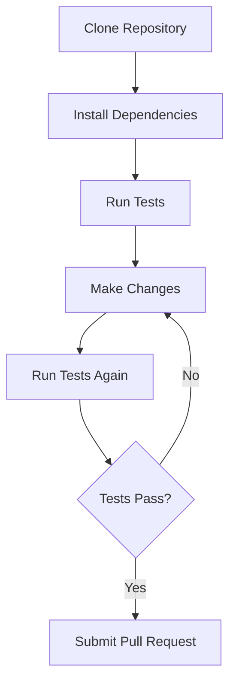
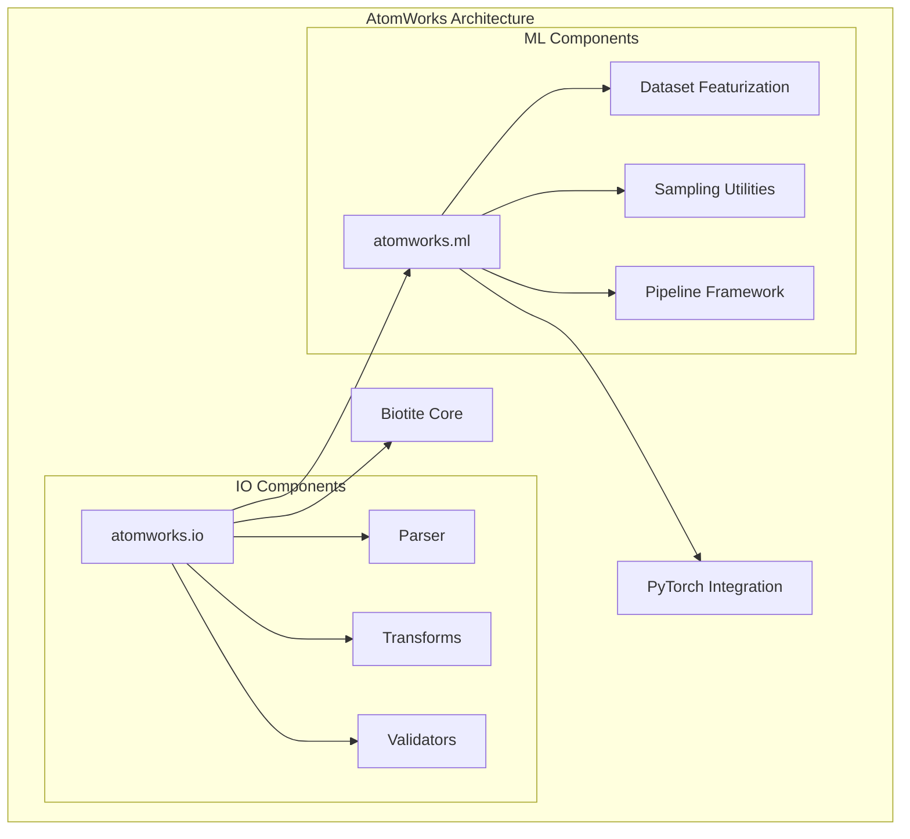

This guide covers all available installation methods for AtomWorks, from quick pip installations to development setups and containerized deployments. AtomWorks is a research-oriented data toolkit for training biomolecular deep-learning foundation models, composed of two symbiotic libraries: `atomworks.io` for biological data processing and `atomworks.ml` for machine learning workflows [README.md](README.md#L13-L18).

## System Requirements

Before installing AtomWorks, ensure your system meets these requirements:

| Requirement | Minimum Version | Recommended |
|-------------|-----------------|-------------|
| Python | 3.12+ | Latest 3.12.x |
| Operating System | Linux, macOS, Windows | Linux for optimal performance |
| Memory | 4GB RAM | 8GB+ for large datasets |
| Storage | 1GB free space | 5GB+ for development |

> [!TIP]
> AtomWorks requires Python 3.12 or higher. Use `pyenv` or conda to manage Python versions if your system defaults to an older version.

## Installation Methods

### 1. Quick Installation via pip (Recommended)

The fastest way to get started with AtomWorks is through pip. Choose the installation variant based on your needs:

```bash
# Base installation (atomworks.io only)
pip install atomworks

# Full ML installation (includes PyTorch and ML dependencies)
pip install "atomworks[ml]"

# Development installation (includes testing and linting tools)
pip install "atomworks[dev]"

# Complete installation (all dependencies)
pip install "atomworks[ml,dev]"
```


#### Installation Variants

| Variant | Includes | Use Case |
|---------|----------|----------|
| `atomworks` | Core IO functionality [pyproject.toml](pyproject.toml#L17-L50) | Basic file parsing and data manipulation |
| `atomworks[ml]` | Core + PyTorch, ML transforms [pyproject.toml](pyproject.toml#L52-L56) | Deep learning pipeline development |
| `atomworks[dev]` | Core + development tools [pyproject.toml](pyproject.toml#L58-L72) | Contributing to AtomWorks |
| `atomworks[openbabel]` | Core + OpenBabel [pyproject.toml](pyproject.toml#L74-L77) | Advanced chemistry operations |

### 2. UV Package Manager Installation

For users preferring [uv](https://docs.astral.sh/uv/) for faster package management:

```bash
# Install with all optional dependencies
uv pip install "atomworks[ml,openbabel,dev]"

# Install specific variant
uv pip install "atomworks[ml]"
```

> [!TIP]
> UV provides significantly faster installation times and better dependency resolution compared to pip, especially for complex ML environments.

### 3. Local Development Installation

For developers who want to modify AtomWorks or contribute to the project:

```bash
# Clone the repository
git clone https://github.com/RosettaCommons/atomworks.git
cd atomworks

# Install in development mode with all dependencies
make install
# or manually:
pip install -e ".[dev,ml,openbabel]"
```

The development installation creates an editable install that links to your local source code, allowing immediate testing of changes [Makefile](Makefile#L35-L38).

#### Development Workflow



### 4. Containerized Installation

#### Standalone Apptainer

For production environments or HPC systems, use the pre-built Apptainer container:

```bash
# Set up IPD-specific environment variables (if applicable)
source ./.ipd/setup.sh

# Run the provided apptainer image
./.ipd/atomworks.sif
```

This method provides a controlled environment ideal for dataset parsing and generation [docs/installation.rst](docs/installation.rst#L25-L31).

#### Integration in Custom Apptainer

To include AtomWorks in your own container:

```bash
# Add to PYTHONPATH
export PYTHONPATH=$PWD/src:$PYTHONPATH

# Or use IPD setup script
source ./.ipd/setup.sh
```

See the `apptainer.spec` file for detailed integration instructions [docs/installation.rst](docs/installation.rst#L55-L61).

## Post-Installation Setup

### Environment Configuration

Create a `.env` file for custom paths and configurations (see `.env.sample` for template):

```bash
# Example .env file
CCD_PATH=/path/to/chemical/component/directory
PDB_PATH=/path/to/pdb/files
```

### Verification

Test your installation with the following Python code:

```python
from atomworks.io.parser import parse

# Test basic parsing functionality
result = parse(filename="example.pdb")  # Replace with actual file
print("Installation successful!")
print(f"Found {len(result['chain_info'])} chains")
```

## Architecture Overview

AtomWorks follows a modular architecture that separates concerns between data processing and machine learning:



## Troubleshooting

### Common Issues

| Issue | Solution |
|-------|----------|
| Python version error | Upgrade to Python 3.12+ using pyenv or conda |
| Missing dependencies | Install with `pip install "atomworks[ml,dev]"` for complete setup |
| Permission errors | Use `pip install --user` or virtual environments |
| Import errors | Verify installation with `pip show atomworks` |

### Performance Optimization

For optimal performance with large datasets:

1. **Use Linux**: Better performance for file I/O operations
2. **SSD Storage**: Faster file parsing for large structure files
3. **Sufficient RAM**: 8GB+ recommended for processing multiple structures
4. **Parallel Processing**: Leverage built-in parallelization in atomworks.ml

## Next Steps

After successful installation, explore these resources:

- **[Quick Start](2-quick-start)**: Learn basic usage patterns and get hands-on experience
- **[Basic Usage Examples](4-basic-usage-examples)**: Practical examples for common workflows
- **[AtomWorks Framework Architecture](5-atomworks-framework-architecture)**: Deep dive into the system design

For detailed API documentation and advanced tutorials, visit the [official documentation](https://baker-laboratory.github.io/atomworks-dev/latest).