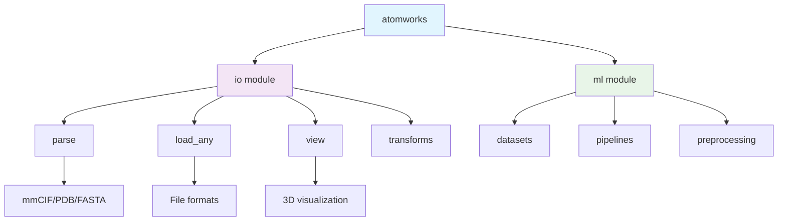

Welcome to the basic usage examples for **atomworks**! This page provides hands-on examples to help you get started with parsing, visualizing, and manipulating biological structure data. These examples demonstrate the core functionality of atomworks and serve as a foundation for more advanced workflows.

## Core Architecture Overview

AtomWorks provides a unified interface for biological data processing through two main modules:



## Example 1: Loading and Visualizing mmCIF Structures

This example demonstrates how to load a protein structure from an mmCIF file and visualize it using atomworks.io [`plot_basics.py`](docs/examples/plot_basics.py#L1-L119).

### Loading Structures

The primary entry point for parsing biological structures is the `parse` function:

```python
from atomworks.io import parse
from atomworks.io.utils.testing import get_pdb_path
from atomworks.io.utils.visualize import view
from biotite.database import rcsb
import io

def get_example_path_or_buffer(pdb_id: str) -> str | io.StringIO:
    try:
        return get_pdb_path(pdb_id)
    except FileNotFoundError:
        return rcsb.fetch(pdb_id, format="cif")

# Parse structure with various options
result_dict = parse(
    filename=get_example_path_or_buffer("6lyz"),
    build_assembly=["1"],
    add_missing_atoms=True,
    remove_waters=True,
    hydrogen_policy="remove",
    model=1,
)
```

### Visualization

AtomWorks provides built-in 3D visualization capabilities:

```python
# Visualize asymmetric unit
asym_unit = result_dict["asym_unit"][0]
asym_unit = asym_unit[asym_unit.occupancy > 0]
view(asym_unit)

# Visualize assembly
assembly = result_dict["assemblies"]["1"][0]
assembly = assembly[assembly.occupancy > 0]
view(assembly)
```

## Example 2: Structure Inspection and Manipulation

### Accessing Metadata

The parsed result contains rich metadata for downstream analysis:

```python
print("Chain info:", result_dict["chain_info"])
print("Ligand info:", result_dict["ligand_info"])
print("Metadata:", result_dict["metadata"])
print("Annotation categories:", result_dict["asym_unit"][0].get_annotation_categories())
```

### AtomArray Manipulation

AtomWorks extends biotite's AtomArray with powerful manipulation capabilities:

```python
# Extract specific atoms
ca = assembly[(assembly.atom_name == "CA") & (assembly.occupancy > 0)]
print("Coordinates of all resolved CA atoms:", ca.coord.shape)

# Extract specific chains
chain = assembly[assembly.chain_id == "A"]
print("Coordinates of chain A (all heavy atoms):", chain.coord.shape)

# Access bond information
print("Bond array:", assembly.bonds.as_array())
```

## Example 3: Distance Computations and Spatial Queries

### Distance Calculations

```python
import biotite.structure as struc

# Distance between specific atoms
distance = struc.distance(ca.coord[0], ca.coord[1])
print(f"Distance between first two C-alpha atoms: {distance:.2f} Å")

# Distance from one atom to all others
distance = struc.distance(ca[0], ca)
print(f"Distances between first C-alpha atom and all other C-alpha atoms: {distance}")
```

### Efficient Neighbor Search

For performance-critical spatial queries, use CellList:

```python
resolved_atom_array = assembly[assembly.occupancy > 0]
cell_list = struc.CellList(resolved_atom_array, cell_size=5.0)

near_atoms = cell_list.get_atoms(resolved_atom_array[0].coord, radius=4)
print(f"Number of atoms within 4 Å of the first atom: {near_atoms.shape[0]}")
print(f"Atom indices: {near_atoms}")
print(f"Chain IDs: {resolved_atom_array.chain_id[near_atoms]}")
print(f"Residue IDs: {resolved_atom_array.res_id[near_atoms]}")
print(f"Residue names: {resolved_atom_array.res_name[near_atoms]}")
```

## Example 4: Simple Structure Loading

For quick structure loading without the full parsing options, use `load_any`:

```python
from atomworks.io.utils.io_utils import load_any

example = get_example_path_or_buffer("6lyz")
atom_array = load_any(example, model=1, extra_fields=["charge", "occupancy"])

print(f"Structure has {atom_array.array_length()} atoms. First 15 atoms:")
atom_array[:15]

# Visualize specific chain
view(atom_array[atom_array.chain_id == "A"])
```

## Common Usage Patterns

| Task | Function | Key Parameters |
|------|----------|----------------|
| Load structure | `parse()` | `build_assembly`, `add_missing_atoms`, `remove_waters` |
| Quick load | `load_any()` | `model`, `extra_fields` |
| Visualize | `view()` | AtomArray object |
| Distance calc | `struc.distance()` | coordinates |
| Neighbor search | `CellList()` | `cell_size`, `radius` |

> [!TIP]
> The `parse()` function returns a comprehensive dictionary with multiple data structures including asymmetric units, assemblies, chain info, and ligand info. Use specific keys based on your analysis needs.

> [!TIP]
> Always filter by occupancy (`occupancy > 0`) when working with experimental structures to exclude alternative conformations and low-occupancy atoms.

## Next Steps

Now that you've mastered the basics, explore these advanced topics:

- **[AtomWorks Framework Architecture](5-atomworks-framework-architecture)** - Understand the complete system design
- **[Parsing Biological Files](8-parsing-biological-files-pdb-mmcif-fasta)** - Deep dive into file format support
- **[AtomArray Data Structure](9-atomarray-data-structure)** - Learn about the core data representation
- **[Transform System Fundamentals](12-transform-system-fundamentals)** - Discover the machine learning pipeline system

