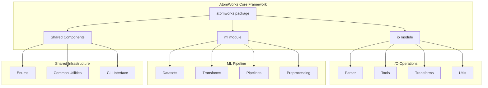
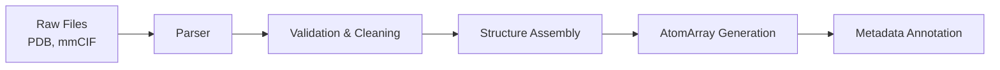
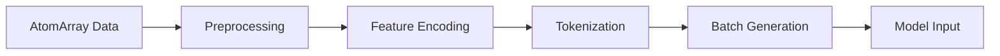

AtomWorks is a research-oriented data toolkit specifically designed for training biomolecular deep-learning foundation models. The framework provides a unified interface that combines robust I/O operations for biological data structures with comprehensive machine learning utilities, enabling seamless data processing pipelines from raw biological files to ML-ready datasets.

## Core Architecture Overview

The AtomWorks framework follows a **dual-module architecture** that cleanly separates concerns between data input/output operations and machine learning processing:

## Module Organization

### Primary Modules

The framework is organized into two main functional areas:

- **`atomworks.io`**: Handles biological data parsing, conversion, and manipulation operations [src/atomworks/io/__init__.py](src/atomworks/io/__init__.py#L1-L6)
- **`atomworks.ml`**: Provides machine learning utilities, datasets, and preprocessing pipelines [src/atomworks/ml/__init__.py](src/atomworks/ml/__init__.py#L1-L6)

### Supporting Infrastructure

- **`enums.py`**: Centralized enumeration definitions used across the entire framework [src/atomworks/enums.py](src/atomworks/enums.py#L1)
- **`cli/`**: Command-line interface tools for various operations
- **Shared utilities**: Common functionality accessible from both modules

## Transform System Architecture

At the heart of AtomWorks lies a sophisticated **transform-based architecture** that enables flexible, composable data processing pipelines:

### Base Transform Framework

The transform system is built on an abstract base class that provides:

- **Input validation**: Automatic checking of data validity before processing
- **Transform history tracking**: Complete audit trail of applied transformations
- **Error handling**: Comprehensive error reporting with debugging information
- **Composability**: Easy chaining and combination of transforms [src/atomworks/ml/transforms/base.py](src/atomworks/ml/transforms/base.py#L81-L252)

### Pipeline Composition

The `Compose` class enables sophisticated pipeline creation with features like:

- **Random routing**: Probabilistic selection between different transform paths
- **Conditional routing**: Decision-based pipeline branching
- **State management**: RNG state tracking for reproducible results [src/atomworks/ml/transforms/base.py](src/atomworks/ml/transforms/base.py#L323-L475)

## Data Flow Architecture

### I/O Pipeline

The I/O module processes biological data through a structured pipeline:

The main entry point is the `parse()` function which handles:
- Multiple file formats (PDB, CIF) with automatic detection
- Comprehensive structure validation and cleaning
- Assembly generation and symmetry operations
- Rich metadata annotation [src/atomworks/io/parser.py](src/atomworks/io/parser.py#L73-L96)

### ML Pipeline

The ML module transforms I/O output into ML-ready datasets:

## Key Design Patterns

### Enum-Driven Configuration

The framework extensively uses enums for type safety and configuration:

- **`ChainType`**: Comprehensive classification of biological molecule types [src/atomworks/enums.py](src/atomworks/enums.py#L19-L142)
- **`HydrogenPolicy`**: Standardized hydrogen handling strategies [src/atomworks/enums.py](src/atomworks/enums.py#L269-L280)
- **`GroundTruthConformerPolicy`**: Conformer handling options [src/atomworks/enums.py](src/atomworks/enums.py#L252-L266)

### Unified Data Dictionary

All transforms operate on a standardized dictionary structure that:
- Maintains data provenance through transform history
- Supports flexible key-value storage for diverse data types
- Enables easy debugging and inspection [src/atomworks/ml/transforms/base.py](src/atomworks/ml/transforms/base.py#L42-L80)

## Technology Stack

### Core Dependencies

The framework builds upon a carefully selected technology stack:

| Category | Libraries | Purpose |
|----------|-----------|---------|
| **Bioinformatics** | biotite, hydride | Core biological data structures |
| **Chemistry** | rdkit | Small molecule processing |
| **ML/Data** | numpy, scipy, pandas, pyarrow | Numerical computing and data handling |
| **CLI** | typer, fire | Command-line interfaces |

### Integration Architecture

AtomWorks is designed to integrate seamlessly with the broader bioinformatics ecosystem while providing a consistent, opinionated interface for ML workflows.

## Extensibility Model

The framework supports several extension points:

1. **Custom Transforms**: Inherit from the base `Transform` class
2. **New Parsers**: Extend the parsing system for additional file formats
3. **Pipeline Components**: Add new preprocessing and encoding strategies
4. **CLI Commands**: Extend the command-line interface with new operations

## Logging and Debugging

Comprehensive logging infrastructure provides:
- Module-level log configuration
- Transform history tracking
- Performance monitoring
- Debug mode with detailed tracebacks [src/atomworks/__init__.py](src/atomworks/__init__.py#L19-L25)

## Next Steps

To understand how the architectural components work together in practice, continue with:

- **[atomworks.io vs atomworks.ml Modules](6-atomworks-io-vs-atomworks-ml-modules)**: Detailed comparison of the two primary modules
- **[Transform Pipeline System](7-transform-pipeline-system)**: In-depth exploration of the transform architecture
- **[Parsing Biological Files](8-parsing-biological-files-pdb-mmcif-fasta)**: Practical guide to file parsing capabilities