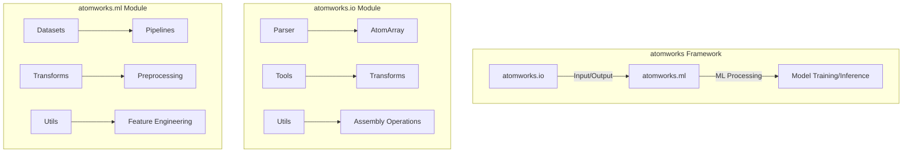

The atomworks framework is organized into two primary modules that serve distinct but complementary purposes in the biological data processing pipeline. Understanding the separation and interaction between these modules is crucial for effective utilization of the framework.

## Module Architecture Overview

## atomworks.io Module: Data Foundation

The `atomworks.io` module serves as the **data ingestion and structural processing layer** of the framework. It focuses on parsing, validating, and transforming biological structure files into standardized data representations.

### Core Responsibilities

**File Parsing and Structure Processing**
- Primary entry point through the `parse()` function [src/atomworks/io/parser.py](src/atomworks/io/parser.py#L73-L96)
- Supports PDB and CIF file formats with comprehensive parsing options
- Handles assembly generation, symmetry operations, and structure cleaning

**Data Structure Management**
- Utilizes Biotite's `AtomArray` and `AtomArrayStack` as core data structures
- Provides utilities for bond detection, chain operations, and assembly generation [src/atomworks/io/utils/](src/atomworks/io/utils/)
- Implements structure validation and cleaning protocols

**Tooling and Transformations**
- Chemical structure tools including RDKit integration [src/atomworks/io/tools/](src/atomworks/io/tools/)
- Structure-specific transforms for biological data [src/atomworks/io/transforms/](src/atomworks/io/transforms/)
- Common utilities for data manipulation and validation [src/atomworks/io/common.py](src/atomworks/io/common.py#L14-L52)

## atomworks.ml Module: Machine Learning Pipeline

The `atomworks.ml` module provides the **machine learning infrastructure** built upon the data foundation established by `atomworks.io`. It implements datasets, transforms, and pipelines specifically designed for ML workflows.

### Core Responsibilities

**Dataset Management**
- Abstract base classes for flexible dataset implementations [src/atomworks/ml/datasets/datasets.py](src/atomworks/ml/datasets/datasets.py#L28-L58)
- Specialized datasets for structural files and pandas data integration
- Support for concatenated datasets with ID-based access patterns

**Transform System**
- Comprehensive transform framework with history tracking [src/atomworks/ml/transforms/base.py](src/atomworks/ml/transforms/base.py#L81-L252)
- Composable transforms using the `Compose` class for pipeline construction
- Specialized transforms for atomization, encoding, and feature extraction

**Pipeline Infrastructure**
- Preprocessing utilities for ML-specific data preparation [src/atomworks/ml/preprocessing/](src/atomworks/ml/preprocessing/)
- Integration with popular ML frameworks through standardized interfaces
- Sampling strategies and batching utilities for training workflows

## Key Differences and Integration Patterns

| Aspect | atomworks.io | atomworks.ml |
|--------|-------------|-------------|
| **Primary Focus** | Data ingestion and structure processing | ML pipeline and dataset management |
| **Core Data Types** | AtomArray, AtomArrayStack | PyTorch tensors, ML-ready datasets |
| **Transform Types** | Structure-specific transformations | ML feature engineering transforms |
| **Dependencies** | Biotite, RDKit for chemistry | PyTorch, pandas for ML workflows |

### Data Flow Integration

The modules follow a **layered architecture** where `atomworks.io` provides the foundation and `atomworks.ml` builds upon it:

1. **Input Layer**: `atomworks.io` parses raw biological files into structured `AtomArray` objects
2. **Processing Layer**: `atomworks.io` transforms clean and validate structures
3. **ML Preparation Layer**: `atomworks.ml` converts structures into ML-ready features
4. **Training Layer**: `atomworks.ml` manages datasets and training pipelines

> [!TIP]
> The unified interface in the main `atomworks` package [src/atomworks/__init__.py](src/atomworks/__init__.py#L42-L48) re-exports key functionality from both modules, providing convenient access to commonly used functions like `parse()` from `atomworks.io` while maintaining clear module boundaries.

## Usage Patterns and Best Practices

### When to Use Each Module

**Use atomworks.io directly when:**
- Parsing and analyzing biological structures
- Performing structure validation and cleaning
- Working with assembly generation and symmetry operations
- Implementing custom structure-specific transformations

**Use atomworks.ml directly when:**
- Building ML datasets from structural data
- Creating training pipelines with feature engineering
- Implementing custom ML transforms
- Managing large-scale dataset operations

**Use both modules together when:**
- Building end-to-end ML workflows for structural biology
- Converting parsed structures into ML-ready features
- Implementing custom data augmentation strategies
- Creating specialized datasets for specific ML tasks

### Logging and Configuration

Both modules implement independent logging configurations:
- `atomworks.io` uses `ATOMWORKS_IO_LOG_LEVEL` environment variable [src/atomworks/io/__init__.py](src/atomworks/io/__init__.py#L14-L15)
- `atomworks.ml` uses `ATOMWORKS_ML_LOG_LEVEL` environment variable [src/atomworks/ml/__init__.py](src/atomworks/ml/__init__.py#L15-L16)

This allows fine-grained control over logging output for each module independently.

> [!TIP]
> The transform systems in both modules share similar architectural patterns but serve different purposes. `atomworks.io` transforms focus on structural correctness, while `atomworks.ml` transforms emphasize feature engineering and ML pipeline compatibility.

## Next Steps

To deepen your understanding of the AtomWorks architecture:

- Explore the [Transform Pipeline System](7-transform-pipeline-system) for detailed pipeline construction patterns
- Learn about [Parsing Biological Files](8-parsing-biological-files-pdb-mmcif-fasta) for comprehensive file format handling
- Dive into [Transform System Fundamentals](12-transform-system-fundamentals) for ML-specific transform implementations
- Review [AtomArray Data Structure](9-atomarray-data-structure) for the core data representation that bridges both modules

The modular design ensures that you can use either module independently or combine them for comprehensive biological data processing and machine learning workflows.