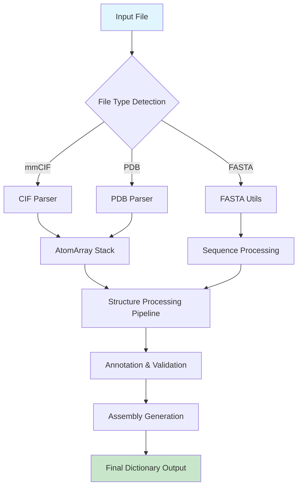

AtomWorks provides a comprehensive parsing system for biological structure files, supporting the most common formats used in structural biology and computational chemistry. The parsing functionality is centered around a unified interface that converts various file formats into Biotite's AtomArray data structure, enabling consistent downstream processing.

## Supported File Formats

AtomWorks supports parsing of three primary biological file formats, each with specific use cases and capabilities:

| Format | Extension | Primary Use | Recommended For |
|--------|-----------|-------------|-----------------|
| **mmCIF** | .cif, .cif.gz, .bcif | Modern crystallographic data exchange | Production structures, detailed metadata |
| **PDB** | .pdb | Legacy protein structure format | Historical data, simple structures |
| **FASTA** | .fasta, .fa | Sequence information | Sequence-only workflows, custom pipelines |

> [!TIP]
> While PDB files are supported for compatibility, mmCIF format is strongly recommended for all new work as it provides better handling of complex structures, more comprehensive metadata, and superior support for modern structural biology data.

## Core Parser Architecture

The parsing system follows a unified architecture where all file formats ultimately converge to the same internal representation:



The main entry point is the `parse()` function in `src/atomworks/io/parser.py` [src/atomworks/io/parser.py#L73-L96], which handles file type detection and routes to appropriate parsers. This unified approach ensures consistent behavior regardless of input format.

## PDB and mmCIF Structure Parsing

### Basic Usage

The core parsing functionality is accessed through the `parse()` function:

```python
from atomworks.io.parser import parse

# Parse a structure file
result = parse("/path/to/structure.cif")
print(result["chain_info"])
```

The parser returns a comprehensive dictionary containing:

- **chain_info**: Chain metadata, sequences, and entity information
- **ligand_info**: Detailed ligand data and annotations  
- **asym_unit**: AtomArrayStack representing the asymmetric unit
- **assemblies**: Dictionary of built biological assemblies
- **metadata**: Structure-level metadata (resolution, deposition date, etc.)
- **extra_info**: Internal caching and compatibility data

### Advanced Parsing Options

The parser supports extensive customization through keyword arguments:

#### Structure Processing Options
- `add_missing_atoms`: Automatically add missing atoms from unresolved residues
- `add_id_and_entity_annotations`: Include chain and entity-level annotations
- `remove_waters`: Filter out water molecules (default: True)
- `fix_ligands_at_symmetry_centers`: Patch ligands at symmetry centers
- `fix_arginines`: Resolve arginine naming ambiguities
- `convert_mse_to_met`: Convert selenomethionine to methionine

#### Bond and Chemical Features
- `add_bond_types_from_struct_conn`: Specify bond types to include from struct_conn
- `fix_formal_charges`: Correct charges on inter-residue bonds
- `fix_bond_types`: Fix nucleophilic additions on bonded atoms

#### Assembly and Model Control
- `build_assembly`: Control which assemblies to build ("first", "all", specific IDs)
- `model`: Select specific model for NMR structures
- `extra_fields`: Include additional CIF fields in the output

> [!TIP]
> The parser includes intelligent defaults for most use cases. Start with default settings and gradually add specific options based on your workflow requirements.

### File Type Specific Considerations

#### mmCIF Files
mmCIF files are parsed using the `_parse_from_cif()` function [src/atomworks/io/parser.py#L591-L598], which directly reads CIF blocks and extracts comprehensive structural information. This format supports:

- Complete metadata preservation
- Advanced bond information from struct_conn
- Multiple model handling
- Detailed assembly instructions

#### PDB Files
PDB files are handled by `_parse_from_pdb()` [src/atomworks/io/parser.py#L677-L710], which converts PDB format to CIF internally. Important limitations:

- Requires single-chain polymer/non-polymer separation
- Assumes all residues are resolved
- Limited metadata compared to mmCIF

## FASTA Sequence Processing

FASTA file support is provided through utilities in `src/atomworks/io/tools/fasta.py` [src/atomworks/io/tools/fasta.py#L1-L3], focusing on sequence-to-structure conversion workflows.

### Sequence Processing Functions

#### Generalized FASTA Handling
The `split_generalized_fasta_sequence()` function handles complex FASTA formats with parenthesized groups:

```python
from atomworks.io.tools.fasta import split_generalized_fasta_sequence

sequence = "ABC(DEF)GH(IJ)K"
tokens = split_generalized_fasta_sequence(sequence)
# Returns: ['A', 'B', 'C', '(DEF)', 'G', 'H', '(IJ)', 'K']
```

#### One-Letter to CCD Code Conversion
The `one_letter_to_ccd_code()` function converts sequences to Chemical Component Dictionary codes:

```python
from atomworks.io.tools.fasta import one_letter_to_ccd_code
from atomworks.enums import ChainType

sequence = ['A', 'B', 'C', '(HEM)']
ccd_codes = one_letter_to_ccd_code(sequence, ChainType.POLYPEPTIDE_L)
```

This function handles both standard amino acids and non-standard chemical components, making it suitable for complex protein engineering workflows.

## Caching and Performance

For large-scale processing, the parser includes built-in caching capabilities:

- `save_to_cache`: Store parsed results for faster retrieval
- `load_from_cache`: Load pre-compiled results from cache
- `cache_dir`: Specify cache storage location

> [!TIP]
> Enable caching when processing large datasets or frequently accessed structures. The cache stores processed AtomArray objects, significantly reducing parsing time for repeated access.

## Integration with Workflows

The parsed structures integrate seamlessly with other AtomWorks components:

- **Transform Pipeline**: Parsed structures can be processed through transform pipelines
- **ML Datasets**: Structures can be converted to ML-ready formats
- **Visualization**: AtomArray objects support direct visualization

## Next Steps

After mastering file parsing, explore these related topics:

- [AtomArray Data Structure](9-atomarray-data-structure) - Understanding the core data representation
- [Structure Cleaning and Validation](10-structure-cleaning-and-validation) - Advanced structure processing
- [Assembly Generation and Symmetry Operations](11-assembly-generation-and-symmetry-operations) - Working with biological assemblies
- [Transform System Fundamentals](12-transform-system-fundamentals) - Processing parsed structures

The parsing system provides the foundation for all structure-based workflows in AtomWorks, enabling consistent and reliable access to biological structure data across multiple formats and use cases.