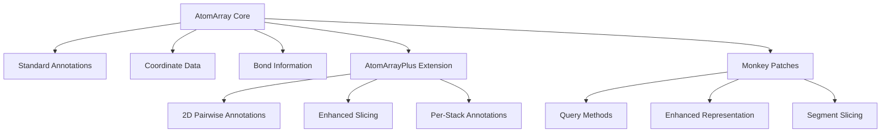

The AtomArray data structure is the fundamental container for molecular structure data in AtomWorks, built as an extension of Biotite's AtomArray with enhanced capabilities for biological data processing and machine learning applications.

## Core Architecture

AtomArray represents molecular structures as collections of atoms with associated annotations and coordinates. The architecture follows a layered approach:



### Base AtomArray Structure

The core AtomArray extends Biotite's foundation with enhanced functionality through monkey patching [biotite_patch.py](src/atomworks/biotite_patch.py#L1-L422):

- **Query Interface**: Pandas-like syntax for atom selection with methods like `query()`, `mask()`, and `idxs()`
- **Enhanced Representation**: Lean display showing at most 20 atoms for improved debugging
- **Segment Slicing**: Support for `SegmentSlice` objects in array indexing
- **Preserved Data Types**: Improved array function that maintains annotation data types

### AtomArrayPlus Extension

For advanced use cases requiring pairwise data, AtomArrayPlus provides 2D annotation support [atom_array_plus.py](src/atomworks/io/utils/atom_array_plus.py#L359-L400):

```python
class AtomArrayPlus(_AtomArrayPlusBase, AtomArray):
    """
    Extension of AtomArray supporting arbitrary 2D (pairwise) annotations.
    
    2D annotations are stored as sparse lists of (i, j, value), accessible via set/get_annotation_2d methods.
    Automatically filters 2D annotations on slicing, following BondList semantics.
    """
```

Key features include:
- **Sparse 2D Annotations**: Efficient storage of pairwise data like distances, interactions, or custom features
- **Automatic Filtering**: 2D annotations are properly filtered when slicing, similar to BondList behavior
- **Conversion Methods**: Seamless conversion between AtomArray and AtomArrayPlus formats

## Annotation System

### Standard Annotations

AtomArray supports a comprehensive set of biological annotations:

| Annotation | Description | Type | Example |
|------------|-------------|------|---------|
| `chain_id` | Chain identifier | str | "A", "B" |
| `res_id` | Residue sequence number | int | 1, 2, 3 |
| `res_name` | Residue name | str | "ALA", "GLY" |
| `atom_name` | Atom name | str | "CA", "N", "C" |
| `element` | Chemical element | str | "C", "N", "O" |
| `b_factor` | Temperature factor | float | 20.5 |

### Enhanced Annotations

AtomWorks adds ML-specific annotations through transforms:

#### Instance Annotations
- `chain_iid`: Chain instance ID for distinguishing symmetry copies
- `pn_unit_iid`: Polymer/non-polymer unit instance ID
- `molecule_iid`: Molecule instance ID

#### Entity Annotations
- `chain_entity`: Chain entity type
- `pn_unit_entity`: Polymer/non-polymer unit entity
- `molecule_entity`: Molecule entity type

#### Global Identifiers
- `atom_id`: Global atom identifier for tracking after transformations
- `token_id`: Token identifier for ML applications
- `res_id`: Global residue identifier

## Transform Operations

### I/O Transforms

The `io.transforms.atom_array` module provides fundamental structure operations [io/transforms/atom_array.py](src/atomworks/io/transforms/atom_array.py#L34-L85):

```python
def subset_atom_array(atom_array: AtomArray | AtomArrayStack, keep: np.ndarray) -> AtomArray | AtomArrayStack:
    """Subsets an AtomArray or AtomArrayStack by a boolean mask."""

def remove_nan_coords(atom_array: AtomArray | AtomArrayStack) -> AtomArray | AtomArrayStack:
    """Returns a copy with rows where any coordinate is NaN removed."""

def remove_hydrogens(atom_array: AtomArray | AtomArrayStack) -> AtomArray | AtomArrayStack:
    """Removes hydrogens from the AtomArray or AtomArrayStack."""
```

### ML Transforms

The `ml.transforms.atom_array` module provides ML-specific operations [ml/transforms/atom_array.py](src/atomworks/ml/transforms/atom_array.py#L35-L67):

```python
def get_chain_instance_starts(array: AtomArray, add_exclusive_stop: bool = False) -> np.ndarray:
    """Get indices indicating the beginning of each chain instance."""

def chain_instance_iter(array: AtomArray) -> Iterator[AtomArray]:
    """Returns an iterator over chain instances in the atom array."""
```

## Selection and Querying

### String-Based Selection

AtomArray supports powerful string-based selection syntax:

```python
# Function calls and attribute combinations
array.query("~has_nan_coord() & has_bonds() & (chain_id == 'A') & (atom_name == 'CA')")

# PyMOL-style selections
array.query("A/ASP`37/OD2")
```

### Programmatic Selection

The selection system provides structured classes for precise atom selection [selection.py](src/atomworks/io/utils/selection.py#L211-L304):

```python
class AtomSelection:
    def __init__(self, chain_id: str = "*", res_name: str = "*", 
                 res_id: int | str = "*", atom_name: str = "*"):
        # Selection criteria
```

## Data Processing Patterns

### Residue-wise Operations

```python
def apply_and_spread_residue_wise(
    atom_array: AtomArray, data: np.ndarray, 
    function: Callable[[np.ndarray], np.generic], axis: int | None = None
) -> np.ndarray:
    """Apply a function residue wise and then spread the result to atoms."""
```

### Chain-wise Operations

```python
def apply_and_spread_chain_wise(
    atom_array: AtomArray, data: np.ndarray,
    function: Callable[[np.ndarray], np.generic], axis: int | None = None
) -> np.ndarray:
    """Apply a function chain wise and then spread the result to atoms."""
```

## Integration with ML Pipeline

AtomArray serves as the primary data structure throughout the ML pipeline:

1. **Parsing**: Raw PDB/mmCIF files are parsed into AtomArray objects
2. **Preprocessing**: Transforms clean and annotate the structure
3. **Featurization**: Atomic and residue-level features are extracted
4. **Tokenization**: Structures are converted to token sequences for models
5. **Batching**: Multiple structures are combined for training

> [!TIP]
> The AtomArray design emphasizes compatibility with both traditional structural biology workflows and modern ML pipelines. All transforms maintain the core AtomArray interface while adding ML-specific annotations and capabilities.

> [!TIP]
> For memory-intensive applications, consider using AtomArrayPlus only when 2D annotations are required, as the sparse storage format provides significant memory savings for pairwise data.

## Next Steps

To understand how AtomArray fits into the broader AtomWorks architecture:

- **[Parsing Biological Files](8-parsing-biological-files-pdb-mmcif-fasta)**: Learn how files are converted to AtomArray objects
- **[Transform System Fundamentals](12-transform-system-fundamentals)**: Understand the transform pipeline that processes AtomArray data
- **[Atomization and Tokenization](13-atomization-and-tokenization)**: See how AtomArray structures are converted to ML-ready tokens