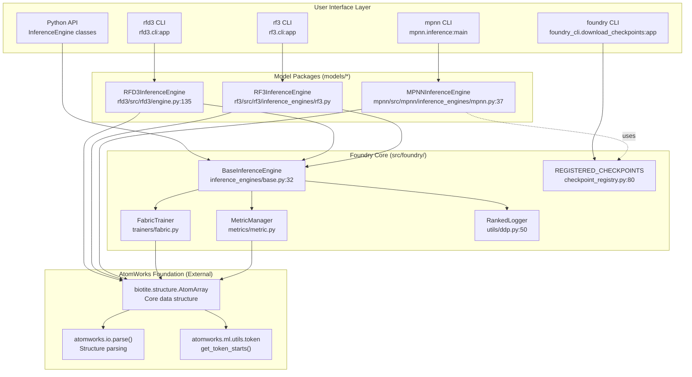
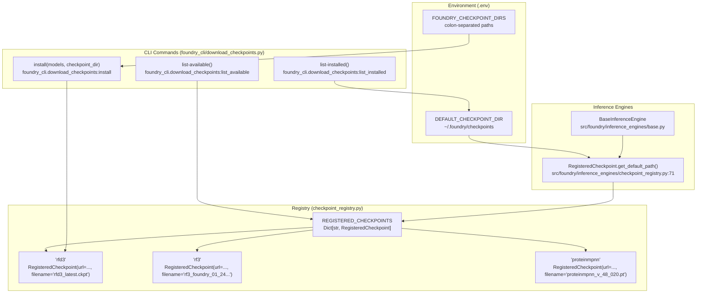
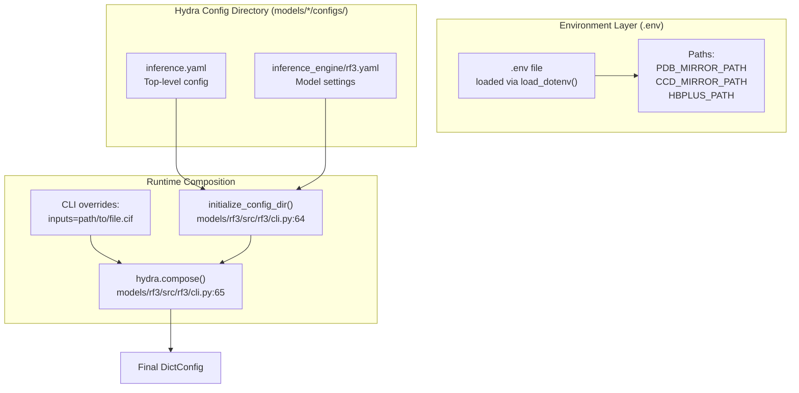

# Overview

<details>
<summary>Relevant source files</summary>

The following files were used as context for generating this wiki page:

- [.env](.env)
- [CONTRIBUTING.md](CONTRIBUTING.md)
- [README.md](README.md)
- [docs/docs_requirements.txt](docs/docs_requirements.txt)
- [docs/source/_static/ga.js](docs/source/_static/ga.js)
- [docs/source/conf.py](docs/source/conf.py)
- [docs/source/contributing_link.rst](docs/source/contributing_link.rst)
- [docs/source/index.rst](docs/source/index.rst)
- [models/rf3/configs/experiment/pretrained/rf3.yaml](models/rf3/configs/experiment/pretrained/rf3.yaml)
- [models/rf3/src/rf3/callbacks/dump_validation_structures.py](models/rf3/src/rf3/callbacks/dump_validation_structures.py)
- [models/rf3/src/rf3/cli.py](models/rf3/src/rf3/cli.py)
- [models/rf3/src/rf3/utils/io.py](models/rf3/src/rf3/utils/io.py)
- [models/rfd3/README.md](models/rfd3/README.md)
- [models/rfd3/src/rfd3/cli.py](models/rfd3/src/rfd3/cli.py)
- [pyproject.toml](pyproject.toml)
- [src/foundry/inference_engines/base.py](src/foundry/inference_engines/base.py)
- [src/foundry/inference_engines/checkpoint_registry.py](src/foundry/inference_engines/checkpoint_registry.py)
- [src/foundry_cli/__init__.py](src/foundry_cli/__init__.py)
- [src/foundry_cli/download_checkpoints.py](src/foundry_cli/download_checkpoints.py)

</details>


## Purpose and Scope

Foundry is a unified platform for training and deploying protein design models, providing infrastructure for three complementary deep learning systems: **RFdiffusion3 (RFD3)** for all-atom generative design, **RosettaFold3 (RF3)** for structure prediction, and **ProteinMPNN/LigandMPNN** for sequence design. All models share a common foundation built on [AtomWorks](https://github.com/RosettaCommons/atomworks), ensuring consistent biomolecular structure handling across training and inference workflows.

This page provides an architectural overview of the Foundry ecosystem. For installation instructions, see [Getting Started](#2). For model-specific documentation, see [RFdiffusion3 (RFD3)](#4), [RosettaFold3 (RF3)](#5), and [ProteinMPNN and LigandMPNN](#6). For infrastructure details, see [Infrastructure and Configuration](#8) and [Advanced Topics](#9).

Sources: [README.md:1-6]()

---

## Core Architecture

Foundry follows a strict dependency hierarchy where all model packages depend on a shared core, which in turn depends on AtomWorks for structure handling. This architecture enables independent model installation while maintaining consistency across the platform.

### System Dependency Hierarchy



**Dependency Flow**: `models` → `foundry` → `atomworks` → `biotite`

The strict dependency hierarchy ensures:
- **No circular dependencies**: Models depend on foundry core, not vice versa [README.md:112-117]().
- **Shared infrastructure**: All models use the same `BaseInferenceEngine` [src/foundry/inference_engines/base.py:32-35]().
- **Consistent data structures**: All models operate on `biotite.structure.AtomArray` objects via AtomWorks [README.md:5-6]().
- **Independent installation**: Each model can be installed separately or as a group [pyproject.toml:54-70]().

| Component | Location | Key Classes | Purpose |
|-----------|----------|-------------|---------|
| **foundry** | `src/foundry/` | `BaseInferenceEngine`, `FabricTrainer` | Shared training/inference infrastructure [pyproject.toml:118]() |
| **AtomWorks** | External | `AtomArray` (via Biotite) | Structure I/O, preprocessing, featurization [README.md:5]() |
| **rfd3** | `models/rfd3/` | `RFD3InferenceEngine` | All-atom generative protein design [README.md:71-73]() |
| **rf3** | `models/rf3/` | `RF3InferenceEngine` | Structure prediction with confidence scores [README.md:91-93]() |
| **mpnn** | `models/mpnn/` | `MPNNInferenceEngine` | Fixed-backbone sequence design [README.md:101-102]() |

Sources: [README.md:1-117](), [pyproject.toml:54-124](), [src/foundry/inference_engines/base.py:32-35]()

---

## The Three Models

### RFdiffusion3 (RFD3)

**All-atom generative design** via conditional diffusion. Generates novel protein backbones under complex constraints including small molecule binding, enzyme active sites, protein-protein interfaces, and nucleic acid interactions [models/rfd3/README.md:1-4]().

**Key capabilities**:
- Small molecule binder design [models/rfd3/README.md:82-84]().
- Enzyme design [models/rfd3/README.md:92-94]().
- Protein binder design with hotspot targeting [models/rfd3/README.md:86-88]().
- Nucleic acid complex design (via RFD3NA) [README.md:81-83]().
- Symmetric oligomer design [models/rfd3/README.md:96-98]().

**Entry point**: `rfd3` CLI mapping to `rfd3.cli:app` [pyproject.toml:91]().

Sources: [README.md:71-90](), [models/rfd3/README.md:1-100](), [pyproject.toml:91]()

### RosettaFold3 (RF3)

**All-atom structure prediction** for proteins, nucleic acids, small molecules, and their complexes [README.md:91-93]().

**Key capabilities**:
- Protein-DNA/RNA complex prediction [README.md:95-97]().
- Confidence scoring for designability validation [README.md:93]().
- MSA processing and template selection [models/rf3/src/rf3/cli.py:12-18]().

**Entry point**: `rf3` CLI mapping to `rf3.cli:app` [pyproject.toml:90]().

Sources: [README.md:91-99](), [pyproject.toml:90](), [models/rf3/src/rf3/cli.py:1-86]()

### ProteinMPNN and LigandMPNN

**Inverse folding** models that design amino acid sequences to fold into target backbone structures [README.md:101-102]().

**Key capabilities**:
- Sequence design for fixed backbones [README.md:102]().
- Ligand-aware design (LigandMPNN) [README.md:102]().
- Soluble protein optimization (SolubleMPNN) [src/foundry/inference_engines/checkpoint_registry.py:117-121]().

**Entry point**: `mpnn` CLI mapping to `mpnn.inference:main` [pyproject.toml:93]().

Sources: [README.md:101-105](), [pyproject.toml:93](), [src/foundry/inference_engines/checkpoint_registry.py:96-121]()

---

## Checkpoint Management

Foundry provides centralized checkpoint management through the `foundry` CLI and a registry system. All checkpoints are tracked in `REGISTERED_CHECKPOINTS` and resolved automatically.

### Checkpoint Registry System



**CLI Usage**:
```bash
# Install latest RFD3, RF3 and MPNN variants
foundry install base-models

# List available models in registry
foundry list-available

# List installed checkpoints and search paths
foundry list-installed
```

**Checkpoint Resolution**: Foundry searches `~/.foundry/checkpoints` plus any colon-separated entries in `$FOUNDRY_CHECKPOINT_DIRS` [README.md:44-48]().

Sources: [README.md:44-56](), [src/foundry/inference_engines/checkpoint_registry.py:1-122](), [src/foundry_cli/download_checkpoints.py:1-198](), [pyproject.toml:94]()

---

## Configuration System

Foundry uses **Hydra** for configuration management. Models define configs in `models/*/configs/`, composed at runtime with CLI overrides.

### Configuration Composition Flow



**Environment Configuration**: The `.env` file stores paths to external tools (e.g., `HBPLUS_PATH`) and data mirrors (`PDB_MIRROR_PATH`, `CCD_MIRROR_PATH`) [.env:1-63]().

Sources: [.env:1-63](), [models/rf3/src/rf3/cli.py:4-69](), [models/rfd3/src/rfd3/cli.py:1-48]()

---

## External Dependencies

Foundry relies on several external tools for specialized functionality:

| Tool | Purpose | Environment Variable |
|------|---------|----------------------|
| **HBPLUS** | Hydrogen bond calculation during training and metrics [models/rfd3/README.md:32-38]() | `HBPLUS_PATH` [.env:29-32]() |
| **x3dna** | DNA structure analysis [.env:34-36]() | `X3DNA_PATH` [.env:36]() |
| **mmseqs2** | Fast sequence searching [.env:46-48]() | `MMSEQS2_PATH` [.env:48]() |
| **hhfilter** | Filtering MSAs to reduce redundancy [.env:41-44]() | `HHFILTER_PATH` [.env:44]() |

Sources: [.env:1-63](), [models/rfd3/README.md:32-38]()

---