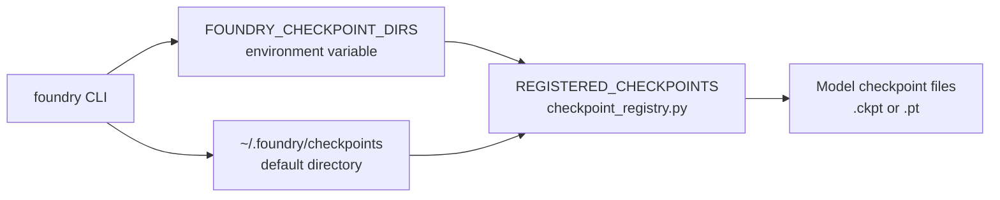
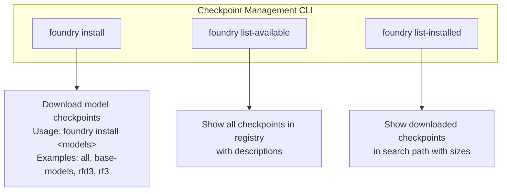
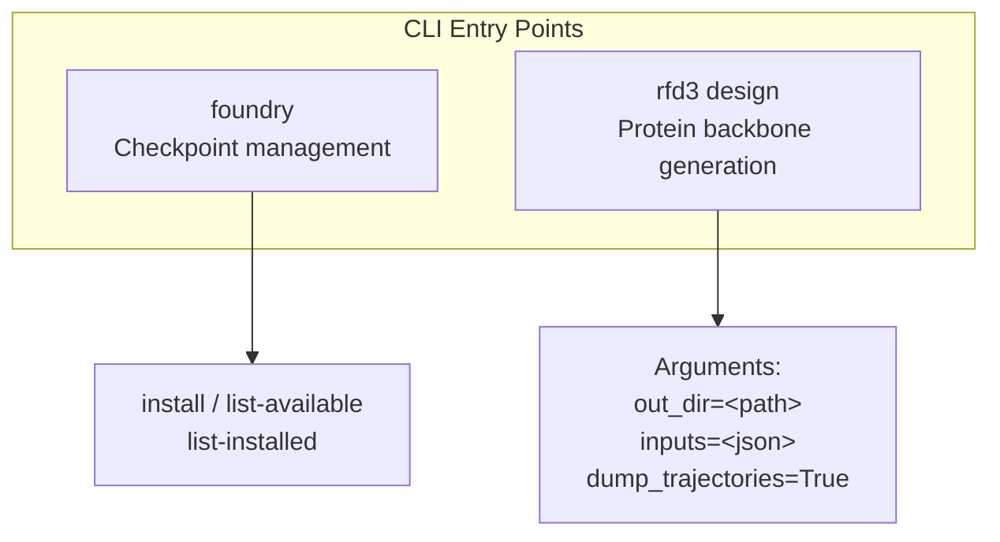
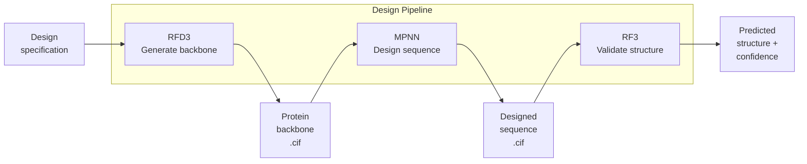

# Getting Started

<details>
<summary>Relevant source files</summary>

The following files were used as context for generating this wiki page:

- [.env](.env)
- [README.md](README.md)
- [examples/docker/Dockerfile](examples/docker/Dockerfile)
- [models/rfd3/README.md](models/rfd3/README.md)
- [models/rfd3/docs/index.rst](models/rfd3/docs/index.rst)
- [models/rfd3/docs/tutorials/RFdiffusion3_installation_tutorial.md](models/rfd3/docs/tutorials/RFdiffusion3_installation_tutorial.md)
- [models/rfd3/docs/tutorials/installation_tutorial/inputs.zip](models/rfd3/docs/tutorials/installation_tutorial/inputs.zip)
- [models/rfd3/docs/tutorials/installation_tutorial/outputs.zip](models/rfd3/docs/tutorials/installation_tutorial/outputs.zip)
- [src/foundry/inference_engines/base.py](src/foundry/inference_engines/base.py)
- [src/foundry/inference_engines/checkpoint_registry.py](src/foundry/inference_engines/checkpoint_registry.py)
- [src/foundry_cli/__init__.py](src/foundry_cli/__init__.py)
- [src/foundry_cli/download_checkpoints.py](src/foundry_cli/download_checkpoints.py)

</details>


This page provides an introduction to the Foundry system and guides you through initial setup and basic usage. For detailed installation instructions, see [Installation](#2.1). For a complete end-to-end protein design workflow example, see [Quick Start Tutorial](#2.2).

## Overview

Foundry is a unified framework for protein design models including:

- **RFdiffusion3 (RFD3)**: All-atom generative protein backbone design with complex constraints [README.md:71-80]().
- **RFdiffusion3NA (RFD3NA)**: Extension for multi-polymer (Protein-DNA-RNA) design [README.md:81-90]().
- **RosettaFold3 (RF3)**: Structure prediction and design validation with confidence scoring [README.md:91-99]().
- **ProteinMPNN/LigandMPNN**: Sequence design for protein backbones with ligand awareness [README.md:101-105]().

All models in Foundry depend on [AtomWorks](https://github.com/RosettaCommons/atomworks), which provides structure I/O, preprocessing, and featurization capabilities [README.md:5-6](). Models share a common infrastructure through the `foundry` package while remaining independently installable [README.md:112-117]().

**Sources:** [README.md:1-11](), [README.md:71-105](), [README.md:112-117]()

## Installation Options

Foundry can be installed via pip in several configurations:

| Installation Command | Description |
|---------------------|-------------|
| `pip install "rc-foundry[all]"` | All models (recommended) [README.md:15]() |
| `pip install "rc-foundry[rfd3]"` | Core + RFD3 only [models/rfd3/README.md:23]() |
| `pip install rc-foundry` | Core utilities only |

**Hardware Support:**
- **Intel XPU:** Install PyTorch with XPU support first, then install Foundry using `pip` [README.md:18-27]().
- **macOS (Apple Silicon):** MPS support is available via a community fork [README.md:28-42]().

For development installations from source, see [Development Setup](#11.2).

**Sources:** [README.md:13-42](), [models/rfd3/README.md:21-24]()

## Checkpoint Management System

Foundry uses a centralized checkpoint registry to manage model weights. The `foundry` CLI provides commands for downloading, listing, and managing checkpoints [src/foundry_cli/download_checkpoints.py:1-29]().

### Checkpoint Directory Search Path

Foundry searches for checkpoints in the following order:



**Checkpoint Search Path Resolution**

1. Directories specified in `FOUNDRY_CHECKPOINT_DIRS` (colon-separated list) [src/foundry/inference_engines/checkpoint_registry.py:25-41]().
2. Default directory `~/.foundry/checkpoints` [src/foundry/inference_engines/checkpoint_registry.py:10]().

The `foundry install` command automatically updates `FOUNDRY_CHECKPOINT_DIRS` in your `.env` file if present [src/foundry_cli/download_checkpoints.py:45-51]().

**Sources:** [src/foundry/inference_engines/checkpoint_registry.py:10-41](), [src/foundry_cli/download_checkpoints.py:33-51]()

### Available Commands



### Basic Checkpoint Commands

Download all base models (includes latest RFD3, RF3, and MPNN variants) [README.md:48]():
```bash
foundry install base-models --checkpoint-dir <path/to/ckpt/dir>
```

Download specific models:
```bash
foundry install rfd3 rf3
```

List available models in registry [src/foundry_cli/download_checkpoints.py:188-194]():
```bash
foundry list-available
```

Check installed checkpoints [src/foundry_cli/download_checkpoints.py:196-208]():
```bash
foundry list-installed
```

The `--checkpoint-dir` option is optional and defaults to `~/.foundry/checkpoints`. When specified, it is added to your checkpoint search path and persisted to `.env` [src/foundry_cli/download_checkpoints.py:150-168]().

**Sources:** [README.md:44-56](), [src/foundry_cli/download_checkpoints.py:144-208]()

### Checkpoint Registry

Model checkpoints are registered in `REGISTERED_CHECKPOINTS` with metadata including URL, filename, and description [src/foundry/inference_engines/checkpoint_registry.py:64-122]():

| Model Key | Checkpoint Filename | Description |
|-----------|-------------------|-------------|
| `rfd3` | `rfd3_latest.ckpt` | RFdiffusion3 checkpoint |
| `rfd3na` | `rfd3na_1190.ckpt` | RFdiffusion3NA checkpoint |
| `rf3` | `rf3_foundry_01_24_latest_remapped.ckpt` | Latest RF3 (data until 1/2024) |
| `proteinmpnn` | `proteinmpnn_v_48_020.pt` | ProteinMPNN checkpoint |
| `ligandmpnn` | `ligandmpnn_v_32_010_25.pt` | LigandMPNN checkpoint |

**Sources:** [src/foundry/inference_engines/checkpoint_registry.py:80-122]()

## Environment Configuration

Foundry uses a `.env` file to configure paths to external resources. Copy the template and configure paths as needed [.env:1-6]().

### Key Environment Variables

| Variable | Purpose | Required For |
|----------|---------|-------------|
| `PDB_MIRROR_PATH` | Local PDB database mirror | Training [.env:9-13]() |
| `CCD_MIRROR_PATH` | Local CCD mirror | Training, custom ligands [.env:15-22]() |
| `FOUNDRY_CHECKPOINT_DIRS` | Colon-separated checkpoint directories | Checkpoint discovery [.env:61-63]() |
| `HBPLUS_PATH` | Path to HBPLUS executable | H-bond conditioning [models/rfd3/README.md:38]() |
| `X3DNA_PATH` | Path to x3dna tool | DNA structure analysis [.env:34-36]() |
| `MMSEQS2_PATH` | Path to mmseqs2 tool | Sequence searching [.env:46-48]() |

**Hydrogen Bond Conditioning:** If using H-bond conditioning in RFD3, you must install `HBPLUS` and set `HBPLUS_PATH` in your `.env` [models/rfd3/README.md:32-39]().

**Sources:** [.env:1-63](), [models/rfd3/README.md:32-39]()

## Command-Line Interface Overview

Foundry provides CLI entry points for model operations and checkpoint management:



### Basic Usage Examples

**RFdiffusion3 (Protein Backbone Design):**
```bash
rfd3 design out_dir=logs/inference_outs/demo inputs=models/rfd3/docs/examples/demo.json
```
*Note: `dump_trajectories=True` can be added to output trajectory structures [models/rfd3/README.md:47-52]().*

**RosettaFold3 (Structure Prediction):**
RF3 can be run via the `rf3 fold` command (see documentation in [RosettaFold3 (RF3)](#5)).

**Sources:** [models/rfd3/README.md:40-55](), [README.md:44-56]()

## Typical Workflow

A complete protein design workflow typically follows this sequence:



**Pipeline Steps:**

1. **Generate backbone with RFD3**: Create protein structure under constraints [models/rfd3/README.md:3-4]().
2. **Design sequence with MPNN**: Generate amino acid sequences for the backbone [README.md:101-102]().
3. **Validate with RF3**: Predict structure from sequence and compute confidence metrics (pLDDT, pTM) [README.md:91-93]().

The [Quick Start Tutorial](#2.2) provides a complete working example of this pipeline.

**Sources:** [README.md:3](), [README.md:71-105]()

## Next Steps

- **[Installation](#2.1)**: Detailed installation instructions including development setup and external tool configuration.
- **[Quick Start Tutorial](#2.2)**: Complete end-to-end protein design workflow with code examples.
- **[RFdiffusion3 (RFD3)](#4)**: Comprehensive RFD3 capabilities and usage.
- **[RosettaFold3 (RF3)](#5)**: Complete RF3 prediction and validation guide.
- **[ProteinMPNN and LigandMPNN](#6)**: MPNN sequence design reference.

For questions and support, join the [Protein Model Foundry Slack](https://join.slack.com/t/proteinmodelfoundry/shared_invite/zt-3pj032444-jC8MRqsV8nhpKX0PGowQ4A) [README.md:9]().

**Sources:** [README.md:9](), [README.md:58-69]()

---