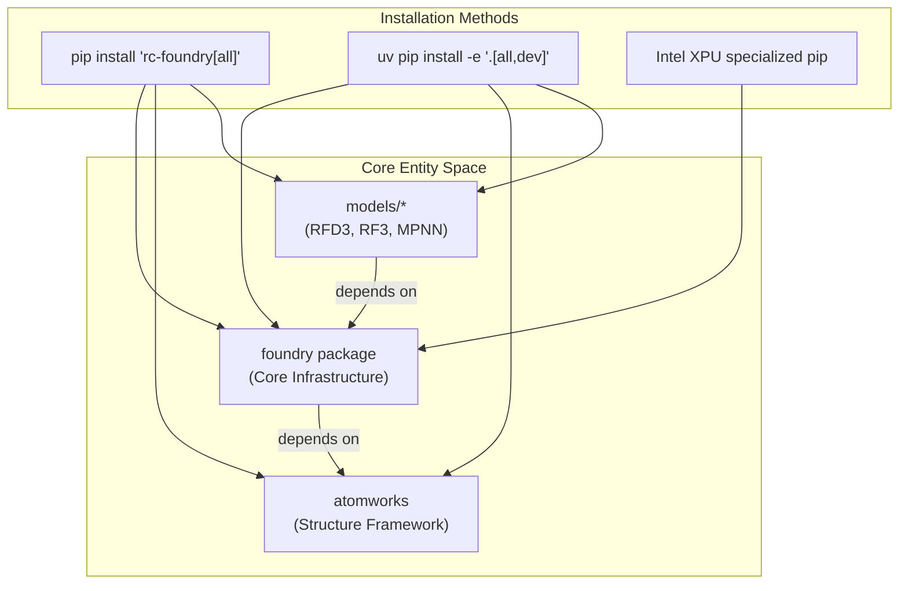
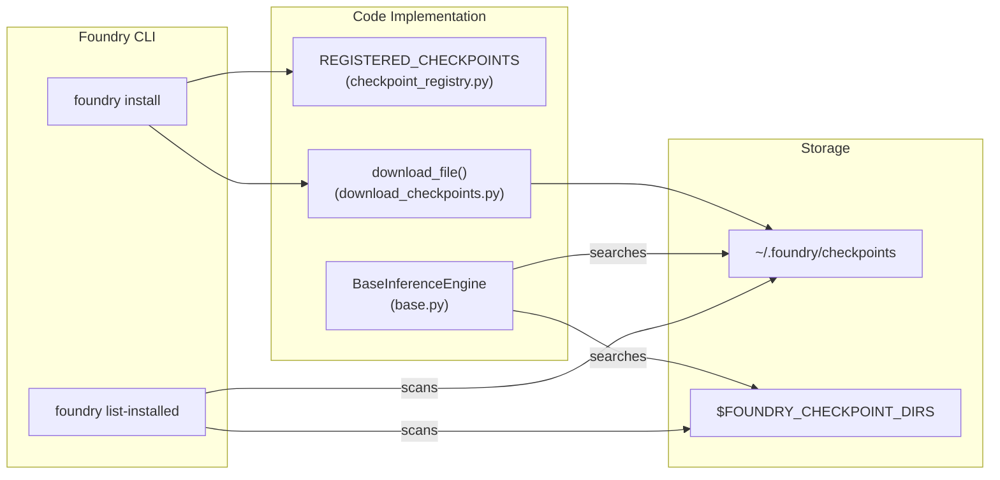

# Installation

<details>
<summary>Relevant source files</summary>

The following files were used as context for generating this wiki page:

- [.env](.env)
- [README.md](README.md)
- [examples/docker/Dockerfile](examples/docker/Dockerfile)
- [models/rfd3/README.md](models/rfd3/README.md)
- [models/rfd3/docs/index.rst](models/rfd3/docs/index.rst)
- [models/rfd3/docs/tutorials/RFdiffusion3_installation_tutorial.md](models/rfd3/docs/tutorials/RFdiffusion3_installation_tutorial.md)
- [models/rfd3/docs/tutorials/installation_tutorial/inputs.zip](models/rfd3/docs/tutorials/installation_tutorial/inputs.zip)
- [models/rfd3/docs/tutorials/installation_tutorial/outputs.zip](models/rfd3/docs/tutorials/installation_tutorial/outputs.zip)
- [src/foundry/inference_engines/base.py](src/foundry/inference_engines/base.py)
- [src/foundry/inference_engines/checkpoint_registry.py](src/foundry/inference_engines/checkpoint_registry.py)
- [src/foundry_cli/__init__.py](src/foundry_cli/__init__.py)
- [src/foundry_cli/download_checkpoints.py](src/foundry_cli/download_checkpoints.py)

</details>


This page covers installing the Foundry platform, including the core package, individual model packages (RFD3, RF3, MPNN), model checkpoints, and environment setup. Foundry is a unified framework that relies on **AtomWorks** for structure manipulation and processing.

## Overview

Foundry installation consists of four main components:

1.  **Package Installation** - Installing Python packages via `pip` or `uv`.
2.  **Hardware-Specific Setup** - Specialized instructions for Intel XPU and Apple Silicon (MPS).
3.  **Checkpoint Management** - Downloading pre-trained model weights via the `foundry` CLI.
4.  **Environment Configuration** - Setting up the `.env` file for external tools and data mirrors.

**Sources:** [README.md:1-5]()

## Package Installation

### Standard Installation

The recommended installation for most users installs the core framework along with all supported models (RFD3, RF3, and MPNN variants).

```bash
pip install "rc-foundry[all]"
```

This command installs:
*   `foundry`: Core architectures, training infrastructure, and inference endpoints [README.md:115]().
*   `atomworks`: The underlying framework for structure I/O and featurization [README.md:114]().
*   `rfd3`, `rf3`, `mpnn`: Specific model implementations located in the `models/` directory [README.md:116]().

**Sources:** [README.md:13-16](), [README.md:112-116]()

### Hardware-Specific Installation

#### Intel XPU Support
For Intel XPU devices, PyTorch must be installed with XPU support before installing Foundry. Use `pip` instead of `uv` to prevent dependency re-resolution from replacing the XPU-specific torch version.

```bash
pip install torch --index-url https://download.pytorch.org/whl/xpu
pip install "rc-foundry[all]"
```

**Sources:** [README.md:18-26]()

#### macOS (Apple Silicon / MPS)
Inference for RFD3, RF3, and MPNN is supported on Apple Silicon via Metal Performance Shaders (MPS). Note that `bfloat16` is not supported on MPS; Foundry automatically enforces `float32` precision on these devices.

```bash
pip install torch
pip install "rc-foundry[all] @ git+https://github.com/fnachon/foundry.git"
```

**Sources:** [README.md:28-43]()

### Developer / Editable Installation
Core developers working on multiple packages should install in editable mode to ensure changes to shared utilities or model-specific code are reflected immediately.

```bash
uv pip install -e '.[all,dev]'
```

**Sources:** [README.md:118-124]()


**Diagram: Association of Installation Commands to Code Entities**
**Sources:** [README.md:112-116](), [README.md:123-124]()

## Checkpoint Management

Pre-trained weights are managed via the `foundry` CLI, which interacts with a centralized `REGISTERED_CHECKPOINTS` registry.

### The Foundry CLI
The `foundry` command (implemented in `src/foundry_cli/download_checkpoints.py`) allows users to install, list, and verify model weights.

*   **Install Base Models:** Downloads the latest RFD3, RF3, and MPNN variants.
    ```bash
    foundry install base-models --checkpoint-dir <path/to/ckpt/dir>
    ```
*   **List Available:** Shows all models in the registry [src/foundry_cli/download_checkpoints.py:188-193]().
    ```bash
    foundry list-available
    ```
*   **List Installed:** Scans `~/.foundry/checkpoints` and `$FOUNDRY_CHECKPOINT_DIRS` [src/foundry_cli/download_checkpoints.py:196-198]().
    ```bash
    foundry list-installed
    ```

**Sources:** [README.md:44-56](), [src/foundry_cli/download_checkpoints.py:1-29]()

### Checkpoint Registry
The registry maps model keys to their download metadata, including URLs and filenames.

| Model Key | Filename | Description |
| :--- | :--- | :--- |
| `rfd3` | `rfd3_latest.ckpt` | RFdiffusion3 checkpoint [src/foundry/inference_engines/checkpoint_registry.py:86-90]() |
| `rf3` | `rf3_foundry_01_24_latest_remapped.ckpt` | Latest RF3 (best performance) [src/foundry/inference_engines/checkpoint_registry.py:91-95]() |
| `proteinmpnn` | `proteinmpnn_v_48_020.pt` | Standard ProteinMPNN [src/foundry/inference_engines/checkpoint_registry.py:96-100]() |
| `rfd3na` | `rfd3na_1190.ckpt` | RFdiffusion3 Nucleic Acid extension [src/foundry/inference_engines/checkpoint_registry.py:81-85]() |

**Sources:** [src/foundry/inference_engines/checkpoint_registry.py:80-122]()

### Checkpoint Resolution Logic
When an inference engine is initialized (e.g., `BaseInferenceEngine`), it resolves the checkpoint path. If a registered name is provided instead of a path, it searches the default directory (`~/.foundry/checkpoints`) and any directories defined in the `FOUNDRY_CHECKPOINT_DIRS` environment variable.

**Sources:** [src/foundry/inference_engines/base.py:72-91](), [src/foundry/inference_engines/checkpoint_registry.py:25-41]()


**Diagram: Checkpoint Data Flow from Registry to Local Storage**
**Sources:** [src/foundry_cli/download_checkpoints.py:33-51](), [src/foundry/inference_engines/checkpoint_registry.py:71-78](), [src/foundry/inference_engines/base.py:72-85]()

## Environment Configuration

Foundry uses a `.env` file to manage paths for external tools and data mirrors. A template is provided in the repository root.

### Data Mirrors (Training/Validation)
For training or advanced validation, Foundry requires mirrors of the PDB and CCD (Chemical Component Dictionary).
*   **PDB_MIRROR_PATH**: Local mirror of PDB CIF files [ .env:9-13]().
*   **CCD_MIRROR_PATH**: Local mirror of CCD CIF files [ .env:15-22]().

### External Tools
Certain features require external executables. Paths to these must be defined in the `.env` file:
*   **HBPLUS_PATH**: Path to `hbplus` for hydrogen bond calculation [ .env:29-32](). Required for RFD3 hydrogen bond conditioning [models/rfd3/README.md:32-38]().
*   **X3DNA_PATH**: Path to `x3dna` for DNA structure analysis [ .env:34-36]().
*   **MMSEQS2_PATH**: Path to `mmseqs` for sequence searching [ .env:46-48]().
*   **HHFILTER_PATH**: Path to `hhfilter` for MSA filtering [ .env:41-44]().

**Sources:** [ .env:1-63](), [models/rfd3/README.md:32-38]()

## Docker Installation

For containerized environments, an official Docker image is available. The `slim` tag is recommended if you intend to mount your own checkpoints.

```bash
docker pull rosettacommons/foundry:latest
```

The Dockerfile (located in `examples/docker/Dockerfile`) uses `uv` to manage the virtual environment and pre-installs the `base-models` to `/app/foundry/checkpoints`.

**Sources:** [README.md:60-66](), [examples/docker/Dockerfile:30-40]()

---