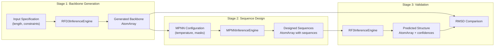
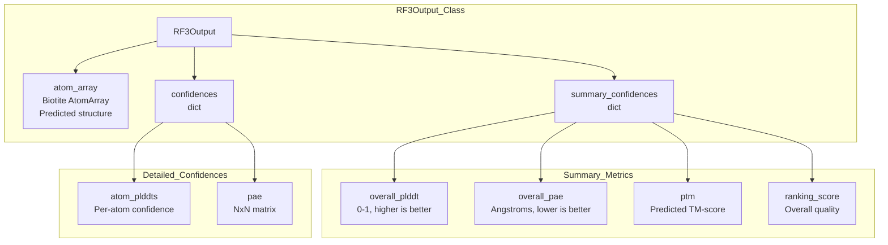
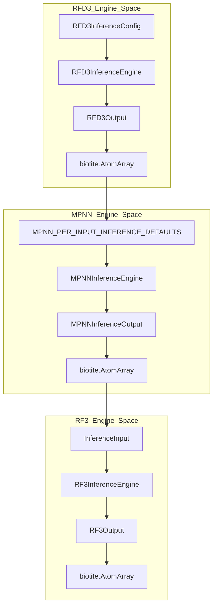

# Quick Start Tutorial

<details>
<summary>Relevant source files</summary>

The following files were used as context for generating this wiki page:

- [docs/_static/superimposed_80_residue_protein.png](docs/_static/superimposed_80_residue_protein.png)
- [examples/all.ipynb](examples/all.ipynb)
- [examples/ipd_design_pipeline_collab.ipynb](examples/ipd_design_pipeline_collab.ipynb)
- [models/mpnn/README.md](models/mpnn/README.md)
- [models/mpnn/src/mpnn/__init__.py](models/mpnn/src/mpnn/__init__.py)
- [models/mpnn/src/mpnn/loss/nll_loss.py](models/mpnn/src/mpnn/loss/nll_loss.py)
- [models/mpnn/src/mpnn/utils/inference.py](models/mpnn/src/mpnn/utils/inference.py)
- [models/rfd3/src/rfd3/engine.py](models/rfd3/src/rfd3/engine.py)
- [models/rfd3/src/rfd3/inference/datasets.py](models/rfd3/src/rfd3/inference/datasets.py)
- [models/rfd3/src/rfd3/utils/inference.py](models/rfd3/src/rfd3/utils/inference.py)
- [models/rfd3na/src/rfd3na/utils/inference.py](models/rfd3na/src/rfd3na/utils/inference.py)

</details>


This tutorial demonstrates a complete *de novo* protein design workflow using Foundry's three core models: RFdiffusion3 (RFD3) for backbone generation, ProteinMPNN/LigandMPNN for sequence design, and RosettaFold3 (RF3) for structure validation. You will learn how to install the platform, download model checkpoints, and execute each step of the design pipeline programmatically.

For detailed model-specific usage patterns and advanced design applications, see:
- RFD3 design constraints and applications: [4.4]()
- MPNN configuration options: [6.2]()
- RF3 confidence metrics and interpretation: [5.4]()

---

## Installation

Install Foundry with all model dependencies:

```bash
pip install 'rc-foundry[all]'
```

For model-specific installations, use `rc-foundry[rfd3]`, `rc-foundry[rf3]`, or `rc-foundry[mpnn]` individually.

**Sources:** [examples/all.ipynb:30-36](), [models/mpnn/README.md:18-27]()

---

## Checkpoint Management

Download pre-trained model weights to a checkpoint directory. The default location is `~/.foundry/checkpoints`, configurable via the `FOUNDRY_CHECKPOINTS_DIR` environment variable.

```bash
# Download all models (recommended for this tutorial)
foundry install rfd3 ligandmpnn rf3
```

The `foundry` CLI provides checkpoint management commands:
- `foundry install <model>` - Download and verify checkpoints
- `foundry list-available` - Show available models
- `foundry list-installed` - Display installed checkpoints
- `foundry clean` - Remove downloaded checkpoints

**Sources:** [examples/all.ipynb:38-44](), [examples/ipd_design_pipeline_collab.ipynb:29-47]()

---

## Pipeline Overview

The complete protein design workflow follows a three-stage pipeline where `AtomArray` objects flow between models:

Title: Foundry Design Pipeline Flow


**Sources:** [examples/all.ipynb:8-27]()

---

## Step 1: Generate Backbone with RFD3

RFdiffusion3 generates novel protein backbones using conditional diffusion. The inference engine is configured via `RFD3InferenceConfig` and returns `RFD3Output` objects containing `AtomArray` structures.

### Python API

```python
from rfd3.engine import RFD3InferenceConfig, RFD3InferenceEngine
from lightning.fabric import seed_everything

# Set reproducible seed
seed_everything(0)

# Configure backbone generation
config = RFD3InferenceConfig(
    specification={
        'length': 80,  # Generate 80-residue protein
    },
    diffusion_batch_size=2,  # Number of structures per batch
)

# Initialize engine and generate
model = RFD3InferenceEngine(**config)
outputs = model.run(
    inputs=None,        # None for unconditional generation
    out_dir=None,       # None to return in-memory
    n_batches=1,
)

# Extract generated backbone
first_key = next(iter(outputs.keys()))
atom_array = outputs[first_key][0].atom_array
```

**Key Classes:**
- `RFD3InferenceEngine` ([models/rfd3/src/rfd3/engine.py:139-140]()): Main inference interface.
- `RFD3InferenceConfig` ([models/rfd3/src/rfd3/engine.py:44-45]()): Configuration dataclass.
- `RFD3Output` ([models/rfd3/src/rfd3/engine.py:91-92]()): Output container with `atom_array` and `metadata`.

**Sources:** [examples/all.ipynb:84-106](), [models/rfd3/src/rfd3/engine.py:43-138]()

---

## Step 2: Design Sequence with MPNN

ProteinMPNN/LigandMPNN designs amino acid sequences that fold into the generated backbone. The engine processes `AtomArray` inputs and returns outputs with designed sequences.

### Python API

```python
from mpnn.inference_engines.mpnn import MPNNInferenceEngine

# Configure MPNN inference
engine_config = {
    "model_type": "ligand_mpnn",      # or "protein_mpnn"
    "is_legacy_weights": True,        # Required for current checkpoints
    "out_directory": None,            # Return in-memory
    "write_structures": False,
    "write_fasta": False,
}

# Per-input configuration
input_configs = [{
    "batch_size": 10,                 # Generate 10 sequences
    "remove_waters": True,
    "temperature": 0.1,               # Sampling temperature
}]

# Design sequences
model = MPNNInferenceEngine(**engine_config)
mpnn_outputs = model.run(
    input_dicts=input_configs,
    atom_arrays=[atom_array]
)
```

### Configuration Options

| Parameter | Type | Description |
|-----------|------|-------------|
| `batch_size` | `int` | Number of sequences to generate per structure ([models/mpnn/src/mpnn/utils/inference.py:203]()) |
| `temperature` | `float` | Sampling temperature (default: 0.1) ([models/mpnn/src/mpnn/utils/inference.py:84]()) |
| `fixed_residues` | `list` | Residue IDs to keep fixed ([models/mpnn/src/mpnn/utils/inference.py:72]()) |
| `designed_chains` | `list` | Chain IDs to redesign ([models/mpnn/src/mpnn/utils/inference.py:75]()) |

**Key Entities:**
- `MPNNInferenceEngine`: Main inference interface ([models/mpnn/src/mpnn/inference_engines/mpnn.py]()).
- `MPNN_GLOBAL_INFERENCE_DEFAULTS`: Global settings like `model_type` and `checkpoint_path` ([models/mpnn/src/mpnn/utils/inference.py:35-46]()).
- `MPNN_PER_INPUT_INFERENCE_DEFAULTS`: Per-structure settings like `seed` and `batch_size` ([models/mpnn/src/mpnn/utils/inference.py:48-90]()).

**Sources:** [examples/all.ipynb:169-192](), [models/mpnn/src/mpnn/utils/inference.py:35-90]()

---

## Step 3: Validate with RF3

RosettaFold3 predicts the structure from the designed sequence to validate designability.

### Python API

```python
from rf3.inference_engines.rf3 import RF3InferenceEngine
from rf3.utils.inference import InferenceInput

# Initialize RF3 inference engine
inference_engine = RF3InferenceEngine(
    ckpt_path='rf3',
    verbose=False
)

# Create input from MPNN-designed structure
input_structure = InferenceInput.from_atom_array(
    atom_array,
    example_id="designed_protein"
)

# Predict structure
rf3_outputs = inference_engine.run(inputs=input_structure)

# Extract top-ranked prediction
rf3_output = rf3_outputs["designed_protein"][0]
predicted_structure = rf3_output.atom_array
```

### Understanding RF3 Outputs

Title: RF3 Output Data Structure


**Sources:** [examples/all.ipynb:243-300](), [models/rf3/README.md]()

---

## Step 4: Analyze Results

Validate the design by comparing the RF3-predicted structure against the RFD3-generated backbone using RMSD.

### RMSD Calculation

```python
from biotite.structure import rmsd, superimpose
from atomworks.constants import PROTEIN_BACKBONE_ATOM_NAMES
import numpy as np

# Filter to backbone atoms (N, CA, C, O)
aa_generated = atom_array  # Original RFD3 backbone
aa_refolded = rf3_output.atom_array  # RF3 prediction

bb_generated = aa_generated[
    np.isin(aa_generated.atom_name, PROTEIN_BACKBONE_ATOM_NAMES)
]
bb_refolded = aa_refolded[
    np.isin(aa_refolded.atom_name, PROTEIN_BACKBONE_ATOM_NAMES)
]

# Superimpose and calculate RMSD
bb_refolded_fitted, _ = superimpose(bb_generated, bb_refolded)
rmsd_value = rmsd(bb_generated, bb_refolded_fitted)

print(f"Backbone RMSD: {rmsd_value:.2f} Å")
```

| RMSD (Å) | Interpretation |
|----------|----------------|
| < 1.0 | Excellent designability |
| 1.0-2.0 | Good designability |
| > 2.0 | Moderate to poor designability |

**Sources:** [examples/all.ipynb:341-383]()

---

## Complete Workflow Diagram

Title: End-to-End Code Entity Flow


**Sources:** [models/rfd3/src/rfd3/engine.py:44-140](), [models/mpnn/src/mpnn/utils/inference.py:48-90](), [examples/all.ipynb:1-426]()

---