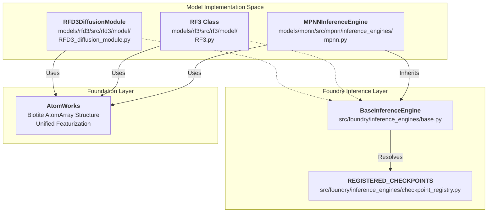
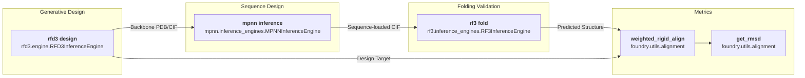

# Model Architecture

Relevant source files

The following files were used as context for generating this wiki page:

- [.env](.env)
- [README.md](README.md)
- [models/rf3/src/rf3/model/RF3.py](models/rf3/src/rf3/model/RF3.py)
- [models/rf3/src/rf3/model/layers/af3_diffusion_transformer.py](models/rf3/src/rf3/model/layers/af3_diffusion_transformer.py)
- [models/rf3/src/rf3/model/layers/attention.py](models/rf3/src/rf3/model/layers/attention.py)
- [models/rf3/src/rf3/model/layers/pairformer_layers.py](models/rf3/src/rf3/model/layers/pairformer_layers.py)
- [models/rfd3/README.md](models/rfd3/README.md)
- [models/rfd3/configs/inference_engine/rfdiffusion3.yaml](models/rfd3/configs/inference_engine/rfdiffusion3.yaml)
- [models/rfd3/configs/trainer/loss/losses/diffusion_loss.yaml](models/rfd3/configs/trainer/loss/losses/diffusion_loss.yaml)
- [models/rfd3/docs/.assets/input_selection_large.png](models/rfd3/docs/.assets/input_selection_large.png)
- [models/rfd3/docs/input.md](models/rfd3/docs/input.md)
- [models/rfd3/src/rfd3/model/RFD3_diffusion_module.py](models/rfd3/src/rfd3/model/RFD3_diffusion_module.py)
- [src/foundry/inference_engines/base.py](src/foundry/inference_engines/base.py)
- [src/foundry/inference_engines/checkpoint_registry.py](src/foundry/inference_engines/checkpoint_registry.py)
- [src/foundry/utils/alignment.py](src/foundry/utils/alignment.py)
- [src/foundry_cli/__init__.py](src/foundry_cli/__init__.py)
- [src/foundry_cli/download_checkpoints.py](src/foundry_cli/download_checkpoints.py)

This page provides an overview of the three core models in the Foundry framework: RFdiffusion3 (RFD3), RosettaFold3 (RF3), and ProteinMPNN/LigandMPNN (MPNN), along with the specialized RFdiffusion3NA (RFD3NA). It explains their individual purposes, capabilities, and how they complement each other in protein design workflows.

## The Core Model Packages

Foundry integrates three independently trained deep learning models, each solving a distinct problem in computational protein design. These models are packaged as separate modules under `models/` but share common infrastructure through the `foundry` core package and the **AtomWorks** foundation.

| Model | Primary Purpose | Key Capability | Package Location |
|-------|----------------|----------------|------------------|
| **RFdiffusion3 (RFD3)** | Generative backbone design | Generate novel all-atom protein structures under complex constraints | `models/rfd3/` |
| **RFdiffusion3NA (RFD3NA)** | Nucleic Acid design | Extended generative model for protein-DNA-RNA complexes | `models/rfd3na/` |
| **RosettaFold3 (RF3)** | Structure prediction | Predict 3D structure from sequence and validate designs | `models/rf3/` |
| **ProteinMPNN/LigandMPNN** | Sequence design | Design amino acid sequences for fixed backbone structures | `models/mpnn/` |

**Sources:** [README.md:1-106](), [models/rfd3/README.md:1-12]()

## Model Architecture Hierarchy

The following diagram bridges the logical model components to their specific code entities and implementation files.

**Diagram: Logical to Code Entity Mapping**

All models within Foundry rely on AtomWorks for structure manipulation, preprocessing, and featurization [README.md:5-7](). The `BaseInferenceEngine` provides a consistent interface for loading `REGISTERED_CHECKPOINTS` [src/foundry/inference_engines/checkpoint_registry.py:80-122]().

**Sources:** [README.md:112-117](), [src/foundry/inference_engines/base.py:1-155](), [src/foundry/inference_engines/checkpoint_registry.py:80-122]()

## RFdiffusion3 (RFD3): Generative Backbone Design

RFD3 is an all-atom generative model capable of designing protein structures under complex constraints [models/rfd3/README.md:3-4](). It utilizes a diffusion transformer architecture to iteratively denoise atomic coordinates.

### Implementation Details
The core logic resides in `RFD3DiffusionModule`, which implements a diffusion forward pass with recycling [models/rfd3/src/rfd3/model/RFD3_diffusion_module.py:32-191](). It processes inputs through:
1.  **Atom Transformer Encoder**: Local processing of atomic features [models/rfd3/src/rfd3/model/RFD3_diffusion_module.py:99-101]().
2.  **Diffusion Token Encoder**: Pooling atomic representations to token level [models/rfd3/src/rfd3/model/RFD3_diffusion_module.py:103-109]().
3.  **Local Token Transformer**: Processing token-level interactions [models/rfd3/src/rfd3/model/RFD3_diffusion_module.py:111-116]().
4.  **Streaming Decoder**: Mapping token features back to atomic coordinate updates [models/rfd3/src/rfd3/model/RFD3_diffusion_module.py:118-125]().

### Diffusion Sampling and Guidance
The `RFD3InferenceEngine` manages the sampling process [models/rfd3/configs/inference_engine/rfdiffusion3.yaml:6-38](). It supports **Classifier-Free Guidance (CFG)** to steer designs toward specific conditions like hydrogen bond donors/acceptors without training separate classifiers [models/rfd3/docs/input.md:85-88]().

**Sources:** [models/rfd3/src/rfd3/model/RFD3_diffusion_module.py:32-220](), [models/rfd3/configs/inference_engine/rfdiffusion3.yaml:24-51](), [models/rfd3/docs/input.md:81-101]()

## RosettaFold3 (RF3): Structure Prediction and Validation

RF3 is a structure prediction neural network that narrows the gap between closed-source AF-3 and open-source alternatives [README.md:93-94](). In design workflows, it serves as the primary validation tool.

### Architecture Components
The `RF3` class integrates several specialized modules [models/rf3/src/rf3/model/RF3.py:56-123]():
*   **FeatureInitializer**: Creates initial token-level representations and embeddings from sequence and MSA inputs [models/rf3/src/rf3/model/RF3.py:98-105]().
*   **Recycler**: Runs the trunk (Evoformer-like blocks) repeatedly with shared weights to refine representations [models/rf3/src/rf3/model/RF3.py:108]().
*   **DiffusionModule**: A denoising module that predicts atomic coordinates [models/rf3/src/rf3/model/RF3.py:109-115]().
*   **DistogramHead**: Predicts pairwise distance distributions for confidence assessment [models/rf3/src/rf3/model/RF3.py:116]().

### Confidence Metrics
RF3 produces critical metrics for design validation, including **pLDDT** (per-residue confidence), **pTM**, **ipTM** (interface confidence), and **PAE** (Predicted Aligned Error).

**Sources:** [models/rf3/src/rf3/model/RF3.py:56-177](), [models/rf3/src/rf3/model/layers/af3_diffusion_transformer.py:18-105](), [models/rf3/src/rf3/model/layers/pairformer_layers.py:27-124]()

## ProteinMPNN and LigandMPNN: Sequence Design

ProteinMPNN and LigandMPNN are lightweight inverse-folding models used to design diverse sequences for fixed backbones [README.md:101-102]().

*   **ProteinMPNN**: Optimized for protein-only sequence design.
*   **LigandMPNN**: Ligand-aware design that considers the atomic environment of small molecules, ions, and nucleic acids.
*   **SolubleMPNN**: A variant optimized for soluble protein design [src/foundry/inference_engines/checkpoint_registry.py:117-121]().

The models use a message-passing architecture to propose sequences that maximize the likelihood of the input backbone structure.

**Sources:** [README.md:101-105](), [src/foundry/inference_engines/checkpoint_registry.py:96-122]()

## Complementary Workflow Architecture

The Foundry framework is designed for a sequential "Design-Build-Test" workflow where models pass data via AtomWorks `AtomArray` objects.

**Diagram: End-to-End Model Integration and Validation**

### Integration Points
*   **Data Flow**: Models output structures in PDB/CIF format which are re-loaded by subsequent engines.
*   **Validation**: The `weighted_rigid_align` function in `src/foundry/utils/alignment.py` allows for comparing the generated backbone (RFD3) with the predicted structure (RF3) to calculate RMSD [src/foundry/utils/alignment.py:8-79]().
*   **Refinement**: Low-confidence designs (low pLDDT/pTM) or high RMSD designs can be sent back to MPNN for sequence re-sampling or RFD3 for backbone modification.

**Sources:** [README.md:58-69](), [src/foundry/utils/alignment.py:8-85](), [models/rfd3/README.md:40-54]()

---