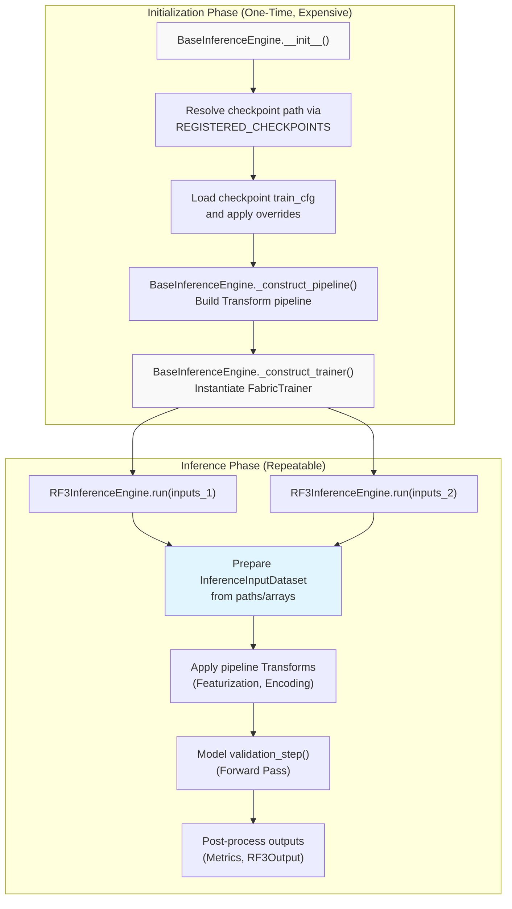
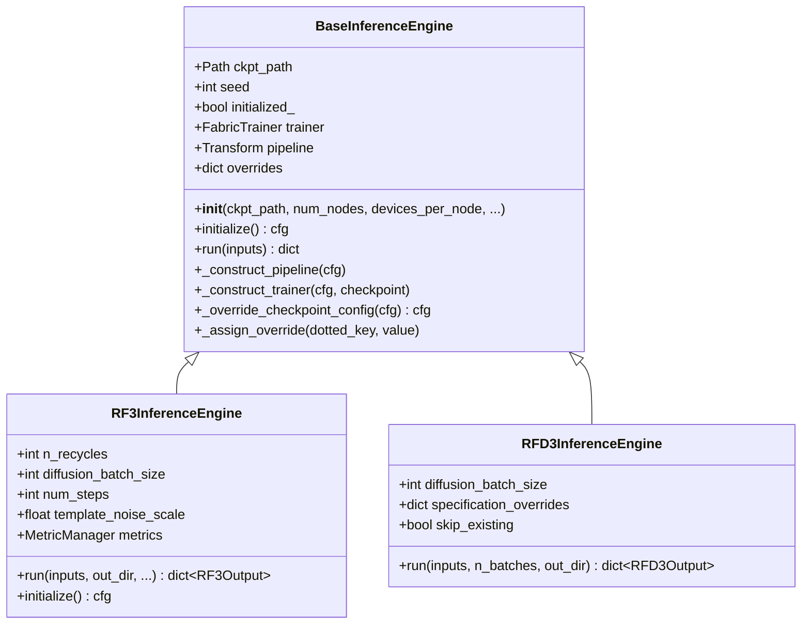
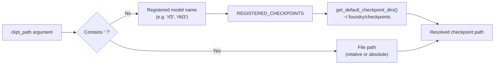
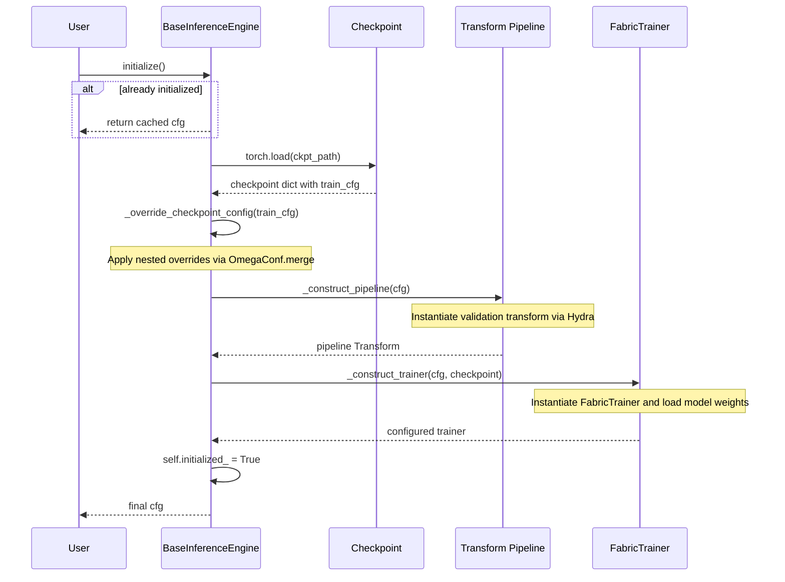
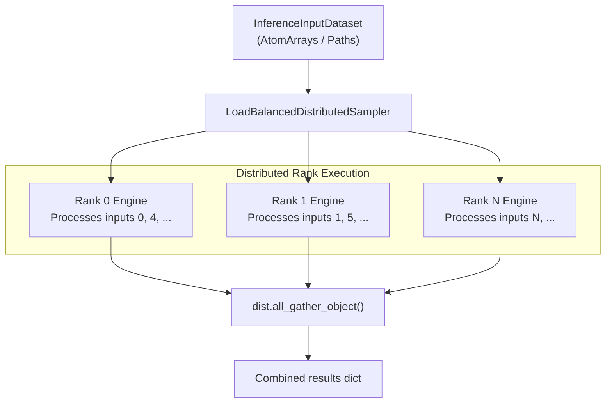

# Inference Engines

Relevant source files

The following files were used as context for generating this wiki page:

- [.env](.env)
- [README.md](README.md)
- [models/rf3/configs/experiment/pretrained/rf3.yaml](models/rf3/configs/experiment/pretrained/rf3.yaml)
- [models/rf3/configs/inference_engine/base.yaml](models/rf3/configs/inference_engine/base.yaml)
- [models/rf3/configs/inference_engine/rf3.yaml](models/rf3/configs/inference_engine/rf3.yaml)
- [models/rf3/src/rf3/callbacks/dump_validation_structures.py](models/rf3/src/rf3/callbacks/dump_validation_structures.py)
- [models/rf3/src/rf3/cli.py](models/rf3/src/rf3/cli.py)
- [models/rf3/src/rf3/data/extra_xforms.py](models/rf3/src/rf3/data/extra_xforms.py)
- [models/rf3/src/rf3/data/pipelines.py](models/rf3/src/rf3/data/pipelines.py)
- [models/rf3/src/rf3/inference.py](models/rf3/src/rf3/inference.py)
- [models/rf3/src/rf3/inference_engines/rf3.py](models/rf3/src/rf3/inference_engines/rf3.py)
- [models/rf3/src/rf3/symmetry/resolve.py](models/rf3/src/rf3/symmetry/resolve.py)
- [models/rf3/src/rf3/utils/inference.py](models/rf3/src/rf3/utils/inference.py)
- [models/rf3/src/rf3/utils/io.py](models/rf3/src/rf3/utils/io.py)
- [models/rfd3/README.md](models/rfd3/README.md)
- [models/rfd3/src/rfd3/cli.py](models/rfd3/src/rfd3/cli.py)
- [pyproject.toml](pyproject.toml)
- [src/foundry/inference_engines/base.py](src/foundry/inference_engines/base.py)
- [src/foundry/inference_engines/checkpoint_registry.py](src/foundry/inference_engines/checkpoint_registry.py)
- [src/foundry_cli/__init__.py](src/foundry_cli/__init__.py)
- [src/foundry_cli/download_checkpoints.py](src/foundry_cli/download_checkpoints.py)

## Overview

Inference engines provide a unified interface for running model predictions across the Foundry ecosystem. They separate expensive one-time model setup from inference execution, enabling efficient repeated predictions with different inputs. Each model (RF3, RFD3, MPNN) implements its own inference engine that inherits from `BaseInferenceEngine`.

For information about training infrastructure, see **Infrastructure and Configuration (8.4)**. For checkpoint management utilities, see **Infrastructure and Configuration (8.1)**.

**Sources:** [src/foundry/inference_engines/base.py:32-36](), [models/rf3/src/rf3/inference_engines/rf3.py:222-239]()

---

## Architecture and Lifecycle

**Diagram: Inference Engine Lifecycle** - Initialization occurs once and is expensive (loading weights, building pipeline). The `run()` method can be called multiple times with different inputs after initialization.

**Sources:** [src/foundry/inference_engines/base.py:38-100](), [src/foundry/inference_engines/base.py:125-142](), [models/rf3/src/rf3/inference_engines/rf3.py:440-525]()

---

## BaseInferenceEngine

The `BaseInferenceEngine` class provides the foundational pattern that all model-specific engines inherit. It handles checkpoint loading, configuration management, pipeline construction, and distributed inference setup via Lightning Fabric.

**Diagram: Inheritance Hierarchy** - RF3 and RFD3 inherit from `BaseInferenceEngine` to leverage shared checkpoint and pipeline logic.

**Sources:** [src/foundry/inference_engines/base.py:32-246](), [models/rf3/src/rf3/inference_engines/rf3.py:222-240]()

---

## Checkpoint Resolution

Inference engines support multiple ways to specify checkpoints: registered model names, absolute paths, or relative paths. The `REGISTERED_CHECKPOINTS` registry provides default installation locations and metadata.

**Diagram: Checkpoint Path Resolution** - The engine resolves checkpoint paths through the registry system or direct file paths.

**Sources:** [src/foundry/inference_engines/base.py:71-91](), [src/foundry/inference_engines/checkpoint_registry.py:25-41](), [src/foundry/inference_engines/checkpoint_registry.py:80-122]()

### Registered Checkpoints

| Model Name | Filename | Description |
|------------|----------|-------------|
| `rfd3` | `rfd3_latest.ckpt` | RFdiffusion3 checkpoint |
| `rfd3na` | `rfd3na_1190.ckpt` | RFdiffusion3NA checkpoint |
| `rf3` | `rf3_foundry_01_24_latest_remapped.ckpt` | RF3 trained until 1/2024 |
| `proteinmpnn` | `proteinmpnn_v_48_020.pt` | ProteinMPNN checkpoint |
| `ligandmpnn` | `ligandmpnn_v_32_010_25.pt` | LigandMPNN checkpoint |

**Sources:** [src/foundry/inference_engines/checkpoint_registry.py:80-122]()

---

## Configuration Override System

Configuration overrides allow runtime modification of checkpoint settings without altering the saved configuration. Overrides use dotted-path notation and are applied hierarchically during `_override_checkpoint_config`.

**Key Override Patterns:**

- **Transform overrides:** `transform_overrides={"diffusion_batch_size": 5}`
  - Applied to: `cfg.datasets.val.<dataset>.dataset.transform` [src/foundry/inference_engines/base.py:160-163]()
- **Sampler overrides:** `inference_sampler_overrides={"num_timesteps": 50}`
  - Applied to: `cfg.model.net.inference_sampler` [src/foundry/inference_engines/base.py:199-208]()
- **Trainer overrides:** `trainer_overrides={"cleanup_guideposts": True}`
  - Applied to: `cfg.trainer` [src/foundry/inference_engines/base.py:102-120]()

**Sources:** [src/foundry/inference_engines/base.py:102-120](), [src/foundry/inference_engines/base.py:199-208](), [src/foundry/inference_engines/base.py:160-163]()

---

## Initialization Process

The `initialize()` method performs one-time setup. It is called automatically on the first `run()` invocation if not already initialized.

**Sources:** [src/foundry/inference_engines/base.py:125-142](), [src/foundry/inference_engines/base.py:165-197](), [src/foundry/inference_engines/base.py:209-229]()

---

## Model-Specific Implementations

### RF3InferenceEngine

`RF3InferenceEngine` predicts all-atom biomolecular structures from sequences or structure templates. It uses the `InferenceInputDataset` to manage data flow.

**Key Parameters:**
- `n_recycles` (int): Number of recycling iterations (default: 10) [models/rf3/configs/inference_engine/rf3.yaml:12]()
- `diffusion_batch_size` (int): Structures generated per input (default: 5) [models/rf3/configs/inference_engine/rf3.yaml:13]()
- `num_steps` (int): Diffusion sampling steps (default: 50) [models/rf3/configs/inference_engine/rf3.yaml:16]()
- `early_stopping_plddt_threshold` (float): Stop if mean pLDDT below threshold [models/rf3/configs/inference_engine/rf3.yaml:20]()

**Output Structure:**
The engine returns `RF3Output` objects containing the `atom_array` and AlphaFold3-compatible confidence metrics. [models/rf3/src/rf3/inference_engines/rf3.py:98-147]()

**Sources:** [models/rf3/src/rf3/inference_engines/rf3.py:240-327](), [models/rf3/src/rf3/inference_engines/rf3.py:98-147](), [models/rf3/configs/inference_engine/rf3.yaml:1-33]()

---

### RFD3InferenceEngine

`RFD3InferenceEngine` generates novel protein backbones via conditional diffusion. It processes `DesignInputSpecification` objects which define constraints like motifs or hotspots.

**Key Features:**
- **Input Validation:** Supports `prevalidate_inputs` to check JSON/YAML schemas before model loading. [models/rfd3/README.md:53]()
- **Trajectory Management:** Can `dump_trajectories` to save the full diffusion denoising process. [models/rfd3/README.md:52]()

**Sources:** [models/rfd3/README.md:41-64](), [models/rfd3/src/rfd3/cli.py:1-48]()

---

## Distributed Inference

Inference engines support multi-GPU and multi-node execution through Lightning Fabric. The `LoadBalancedDistributedSampler` from `atomworks` ensures work is distributed evenly across ranks by balancing sequence lengths.

**Sources:** [models/rf3/src/rf3/inference_engines/rf3.py:487-505](), [models/rf3/src/rf3/inference_engines/rf3.py:723-733]()

---