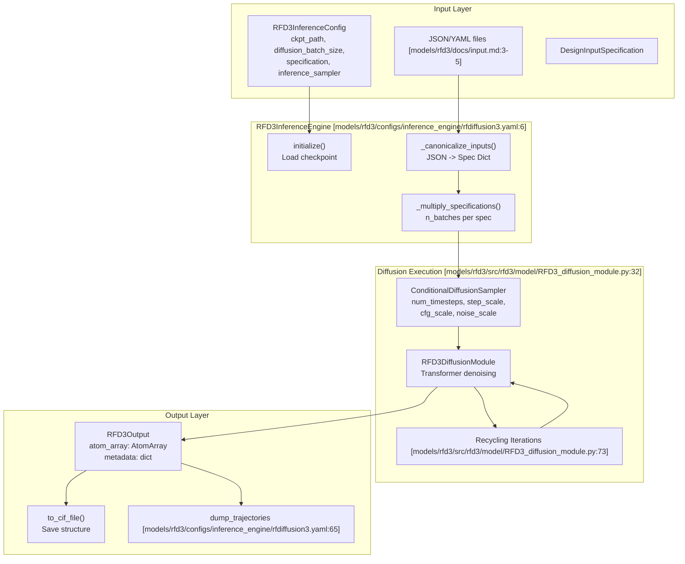

# RFD3 Overview and Capabilities

<details>
<summary>Relevant source files</summary>

The following files were used as context for generating this wiki page:

- [models/rfd3/configs/inference_engine/rfdiffusion3.yaml](models/rfd3/configs/inference_engine/rfdiffusion3.yaml)
- [models/rfd3/configs/trainer/loss/losses/diffusion_loss.yaml](models/rfd3/configs/trainer/loss/losses/diffusion_loss.yaml)
- [models/rfd3/docs/.assets/input_selection_large.png](models/rfd3/docs/.assets/input_selection_large.png)
- [models/rfd3/docs/.assets/overview.png](models/rfd3/docs/.assets/overview.png)
- [models/rfd3/docs/designability_vs_diversity.md](models/rfd3/docs/designability_vs_diversity.md)
- [models/rfd3/docs/input.md](models/rfd3/docs/input.md)
- [models/rfd3/src/rfd3/model/RFD3_diffusion_module.py](models/rfd3/src/rfd3/model/RFD3_diffusion_module.py)

</details>


## Purpose and Scope

This page provides a technical overview of RFdiffusion3 (RFD3), an all-atom generative model for biomolecular design. It covers the model's capabilities, core architecture, supported design applications, and conditioning mechanisms. For detailed information about the InputSpecification system and configuration syntax, see [InputSpecification System](4.2). For specific design application guides and examples, see [Design Applications](4.4). For training details, see [RFD3 Training](4.6).

## What is RFdiffusion3?

RFdiffusion3 is an all-atom diffusion-based generative model that designs protein structures under complex constraints. Unlike backbone-only methods, RFD3 operates at full atomic resolution, enabling precise control over sidechain placement, ligand interactions, and interface design.

**Key Characteristics:**
- **All-atom generation**: Models complete atomic structures including sidechains with 14 heavy atoms per residue (Atom14 representation).
- **Conditional diffusion**: Supports multiple conditioning modalities via `DesignInputSpecification` (coordinates, sequence, RASA bins, hydrogen bonds, hotspots) [models/rfd3/docs/input.md:17-24]().
- **Flexible motif scaffolding**: Handles both indexed (`contig`) and unindexed (`unindex`) motifs with sequence-specified or sequence-free placement [models/rfd3/docs/input.md:18-21]().
- **Multi-modal compatibility**: Designs proteins, nucleic acids (DNA/RNA), and small molecule complexes.
- **Partial diffusion**: Refines existing structures by adding controlled noise via `partial_t` parameter [models/rfd3/docs/input.md:22]().

Sources: [models/rfd3/docs/input.md:1-47](), [models/rfd3/configs/inference_engine/rfdiffusion3.yaml:6-51]()

## Core Architecture

### Diffusion Module Implementation

The core of RFD3 is the `RFD3DiffusionModule`, which implements a UNet-like architecture processing both token (residue) and atom levels.

**Key Components of RFD3DiffusionModule:**
- **LocalAtomTransformer**: Processes atom-level features and pairwise interactions [models/rfd3/src/rfd3/model/RFD3_diffusion_module.py:99-101]().
- **DiffusionTokenEncoder**: Pools atom-level information to the token (residue) level [models/rfd3/src/rfd3/model/RFD3_diffusion_module.py:103-109]().
- **LocalTokenTransformer**: Processes sequence-level relationships [models/rfd3/src/rfd3/model/RFD3_diffusion_module.py:111-116]().
- **CompactStreamingDecoder**: Maps token-level updates back to atomic coordinate refinements [models/rfd3/src/rfd3/model/RFD3_diffusion_module.py:118-125]().

**Data Flow in Forward Pass:**
1. **Time Processing**: Diffusion time `t` is embedded using `FourierEmbedding` and mapped to atom and token features [models/rfd3/src/rfd3/model/RFD3_diffusion_module.py:84-92]().
2. **Position Scaling**: Input noisy coordinates `X_noisy_L` are scaled based on the prediction target (e.g., EDM scaling) [models/rfd3/src/rfd3/model/RFD3_diffusion_module.py:127-142]().
3. **Recycling**: The module supports iterative refinement (recycling) where predictions are fed back to improve the denoising step [models/rfd3/src/rfd3/model/RFD3_diffusion_module.py:182-191]().

Sources: [models/rfd3/src/rfd3/model/RFD3_diffusion_module.py:32-125](), [models/rfd3/src/rfd3/model/RFD3_diffusion_module.py:187-222]()

### Inference Engine Components

**RFD3InferenceEngine Architecture**


Sources: [models/rfd3/configs/inference_engine/rfdiffusion3.yaml:1-69](), [models/rfd3/src/rfd3/model/RFD3_diffusion_module.py:171-222]()

## Design Capabilities

### Balancing Designability and Diversity

RFD3 allows users to tune the balance between the "novelty" of a fold and how easily it can be realized (designability).

- **Low Temperature Sampling**: By increasing `inference_sampler.step_scale` (default 1.5) and decreasing `inference_sampler.gamma_0` (default 0.6), the model is biased toward high-probability, more designable structures at the cost of diversity [models/rfd3/docs/designability_vs_diversity.md:6-12]().
- **Secondary Structure Control**: The `is_non_loopy` setting biases the model away from disordered regions, increasing designability [models/rfd3/docs/designability_vs_diversity.md:13-15]().

Sources: [models/rfd3/docs/designability_vs_diversity.md:1-15](), [models/rfd3/configs/inference_engine/rfdiffusion3.yaml:44-48]()

### Supported Design Applications

| Application | Key Parameters | Purpose |
|-------------|----------------|---------|
| **Unconditional Generation** | `length` | Generate novel protein backbones [models/rfd3/docs/input.md:39](). |
| **Motif Scaffolding** | `contig`, `select_fixed_atoms` | Fix specific coordinates and sequence [models/rfd3/docs/input.md:39](). |
| **Unindexed Scaffolding** | `unindex` | Sequence-free placement of motifs. |
| **Partial Diffusion** | `partial_t` | Refine existing structures by adding noise [models/rfd3/docs/input.md:22](). |
| **Symmetry Support** | `inference_sampler.kind: "symmetry"` | Design cyclic, dihedral, or higher-order assemblies [models/rfd3/configs/inference_engine/rfdiffusion3.yaml:25](). |
| **Ligand Binding** | `ligand`, `select_buried`, `select_exposed` | Design pockets around small molecules [models/rfd3/docs/input.md:41](). |

Sources: [models/rfd3/docs/input.md:17-24](), [models/rfd3/configs/inference_engine/rfdiffusion3.yaml:24-35]()

### Conditioning and Classifier-Free Guidance (CFG)

RFD3 uses Classifier-Free Guidance to steer generation toward specific conditions without requiring a separate classifier model.

- **CFG Features**: Supported features for guidance include `active_donor`, `active_acceptor`, and `ref_atomwise_rasa` [models/rfd3/configs/inference_engine/rfdiffusion3.yaml:27-30]().
- **Control Parameters**: 
    - `use_classifier_free_guidance`: Set to `True` to enable [models/rfd3/configs/inference_engine/rfdiffusion3.yaml:32]().
    - `cfg_scale`: Controls the strength of the guidance (default 1.5) [models/rfd3/configs/inference_engine/rfdiffusion3.yaml:34]().
    - `cfg_t_max`: Maximum diffusion time to apply guidance [models/rfd3/configs/inference_engine/rfdiffusion3.yaml:33]().

Sources: [models/rfd3/configs/inference_engine/rfdiffusion3.yaml:24-34](), [models/rfd3/docs/input.md:85-88]()

## Example Configuration

### JSON Input Specification
The JSON input defines the physical constraints of the design task.

```json
{
    "spec-1": {
      "input": "path/to/pdb",
      "contig": "50-80,/0,A1-100",
      "select_unfixed_sequence": "A20-35",
      "ligand": "HAX,OAA"
    }
}
```
Sources: [models/rfd3/docs/input.md:34-47]()

### CLI Execution
The CLI manages job parameters like batch size and output directory.

```bash
rfd3 design \
  out_dir=<path/to/outdir> \
  inputs=<path/to/inputs.json> \
  diffusion_batch_size=8 \
  n_batches=1
```
Sources: [models/rfd3/docs/input.md:49-66]()

## Implementation Details

### Coordinate Scaling
RFD3 implements multiple scaling strategies for coordinates during the diffusion process in `RFD3DiffusionModule`:
- **EDM Scaling**: Scales positions based on `sigma_data` and time `t` [models/rfd3/src/rfd3/model/RFD3_diffusion_module.py:133-134]().
- **Noise Prediction**: Direct prediction of added noise [models/rfd3/src/rfd3/model/RFD3_diffusion_module.py:137-138]().

### Loss Function
The training objective is defined in `DiffusionLoss`, which includes weights for:
- **All-atom coordinates**: Weight of 4.0 [models/rfd3/configs/trainer/loss/losses/diffusion_loss.yaml:3]().
- **Ligands**: Weight of 10.0 [models/rfd3/configs/trainer/loss/losses/diffusion_loss.yaml:12]().
- **pLDDT**: Confidence prediction weight of 0.25 [models/rfd3/configs/trainer/loss/losses/diffusion_loss.yaml:4]().

Sources: [models/rfd3/src/rfd3/model/RFD3_diffusion_module.py:127-159](), [models/rfd3/configs/trainer/loss/losses/diffusion_loss.yaml:1-12]()

---