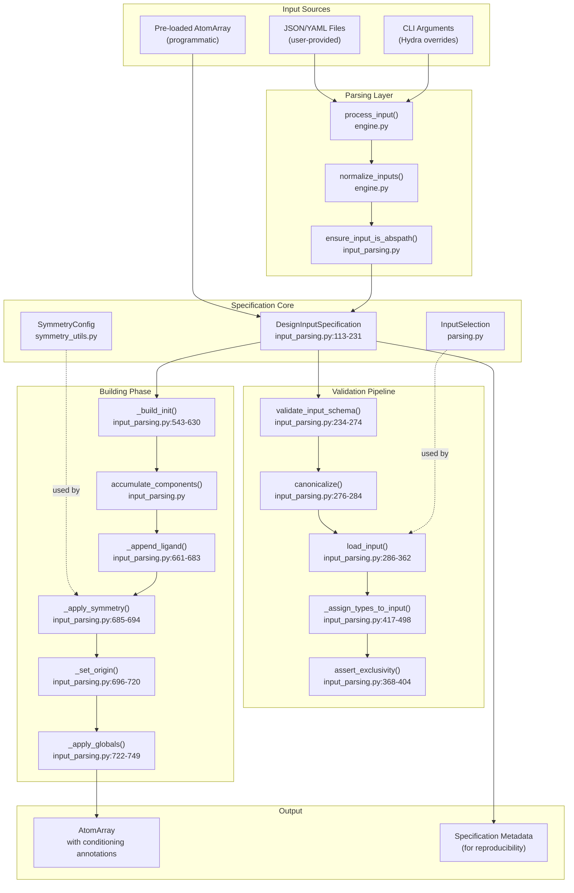
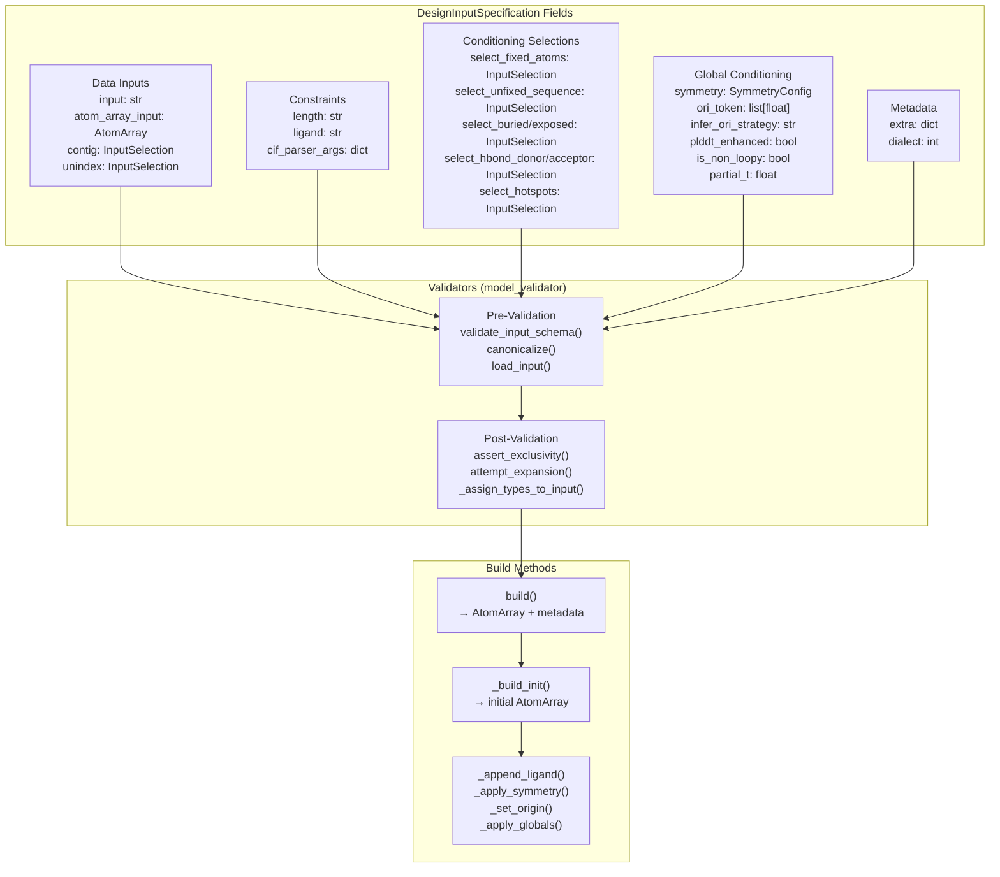
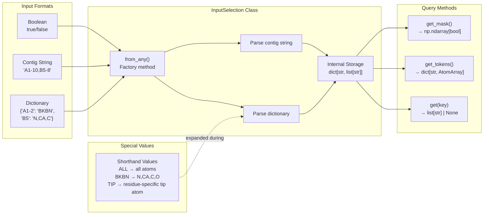
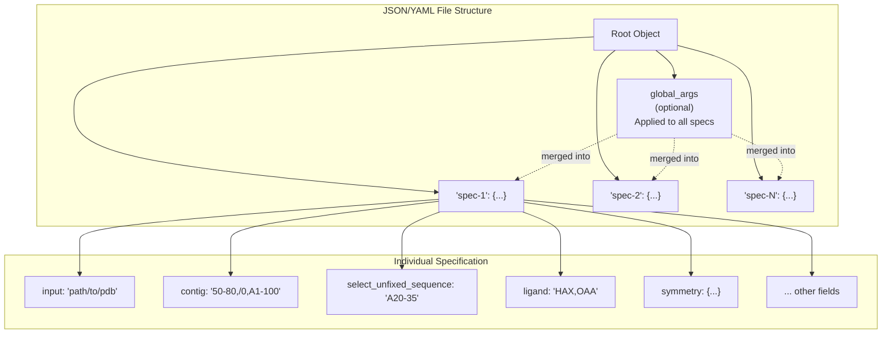
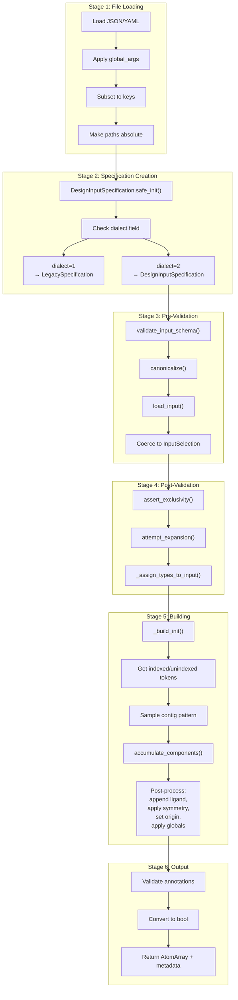
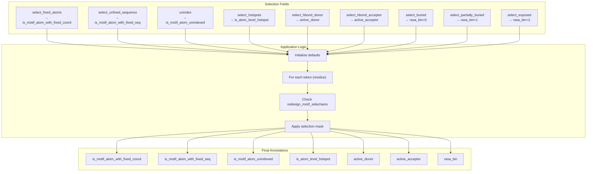
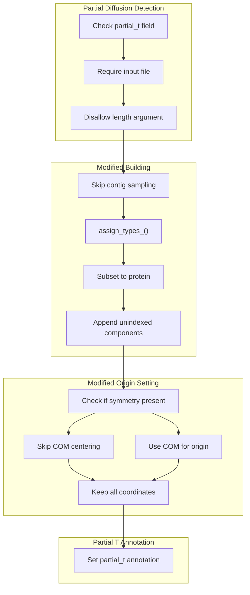
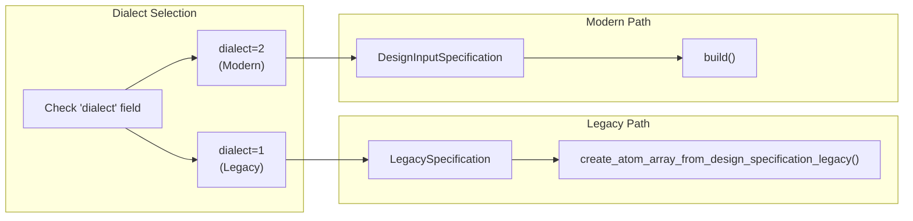

# InputSpecification System

<details>
<summary>Relevant source files</summary>

The following files were used as context for generating this wiki page:

- [models/rfd3/configs/inference_engine/rfdiffusion3.yaml](models/rfd3/configs/inference_engine/rfdiffusion3.yaml)
- [models/rfd3/configs/trainer/loss/losses/diffusion_loss.yaml](models/rfd3/configs/trainer/loss/losses/diffusion_loss.yaml)
- [models/rfd3/docs/.assets/input_selection_large.png](models/rfd3/docs/.assets/input_selection_large.png)
- [models/rfd3/docs/examples/demo.json](models/rfd3/docs/examples/demo.json)
- [models/rfd3/docs/input.md](models/rfd3/docs/input.md)
- [models/rfd3/src/rfd3/inference/input_parsing.py](models/rfd3/src/rfd3/inference/input_parsing.py)
- [models/rfd3/src/rfd3/inference/legacy_input_parsing.py](models/rfd3/src/rfd3/inference/legacy_input_parsing.py)
- [models/rfd3/src/rfd3/model/RFD3_diffusion_module.py](models/rfd3/src/rfd3/model/RFD3_diffusion_module.py)
- [models/rfd3/tests/test_bond_preservation_cases.py](models/rfd3/tests/test_bond_preservation_cases.py)
- [models/rfd3/tests/test_conditioning.py](models/rfd3/tests/test_conditioning.py)
- [models/rfd3/tests/test_legacy_ptm_bonds.py](models/rfd3/tests/test_legacy_ptm_bonds.py)

</details>


## Purpose and Scope

The InputSpecification System is RFdiffusion3's declarative interface for defining protein design tasks. It provides a validated, type-safe specification language for describing what structures to generate, what constraints to apply, and how to condition the diffusion process. The system translates user-provided JSON/YAML configurations into annotated `AtomArray` objects ready for model inference.

This page covers the specification schema, validation pipeline, and the `InputSelection` mini-language. For information about running inference with these specifications, see [4.5](). For training-time usage, see [4.6](). For symmetry configuration details, see [4.3]().

---

## System Architecture

The InputSpecification System consists of three major components: specification parsing, validation, and atom array construction.



**Sources:** [models/rfd3/src/rfd3/inference/input_parsing.py:113-777](), [models/rfd3/docs/input.md:1-25]()

---

## Core Components

### DesignInputSpecification Class

The `DesignInputSpecification` is a Pydantic `BaseModel` that defines the complete schema for RFD3 input specifications [models/rfd3/src/rfd3/inference/input_parsing.py:113-123](). It enforces strict validation at initialization time and provides methods for building annotated atom arrays.



**Key Validation Rules:**

| Validator | Purpose | File Location |
|-----------|---------|---------------|
| `validate_input_schema` | Ensures either `input` or `contig`/`length` provided; validates usage consistency | [models/rfd3/src/rfd3/inference/input_parsing.py:234-274]() |
| `canonicalize` | Normalizes `length` to string format, `input` to absolute path | [models/rfd3/src/rfd3/inference/input_parsing.py:276-284]() |
| `load_input` | Loads atom array from file, initializes `InputSelection` objects | [models/rfd3/src/rfd3/inference/input_parsing.py:286-362]() |
| `assert_exclusivity` | Validates mutually exclusive selections (RASA bins, motifs) | [models/rfd3/src/rfd3/inference/input_parsing.py:368-404]() |
| `_assign_types_to_input` | Applies selection masks to atom array annotations | [models/rfd3/src/rfd3/inference/input_parsing.py:417-498]() |

**Sources:** [models/rfd3/src/rfd3/inference/input_parsing.py:113-231](), [models/rfd3/src/rfd3/inference/input_parsing.py:234-404]()

---

### InputSelection Mini-Language

The `InputSelection` class provides a flexible mini-language for selecting atoms and residues within input structures [models/rfd3/src/rfd3/inference/parsing.py](). It accepts three input formats: booleans, contig strings, or dictionaries with atom-level granularity.



**Example Usage:**

```python
# Boolean: select all/none
select_fixed_atoms = InputSelection.from_any(True, atom_array)

# Contig string: select residues
select_fixed_atoms = InputSelection.from_any("A1-10,B5-8", atom_array)

# Dictionary: atom-level control
select_fixed_atoms = InputSelection.from_any({
    "A1-2": "BKBN",      # N,CA,C,O for residues A1-2
    "A3": "N,CA,C,O,CB", # Explicit atom list
    "B5-7": "ALL",       # All atoms
    "B10": "TIP"         # Residue-specific tip atom
}, atom_array)
```

**Sources:** [models/rfd3/src/rfd3/inference/input_parsing.py:150-165](), [models/rfd3/docs/input.md:95-110]()

---

## Input File Format

The InputSpecification System accepts JSON or YAML files containing one or more design specifications. Each top-level key becomes an independent design task [models/rfd3/docs/input.md:34-47]().

### JSON Structure



**Example JSON:**

```json
{
  "M0255_1mg5_unfixed": {
    "input": "../input_pdbs/M0255_1mg5.pdb", 
    "ligand": "NAI,ACT",    
    "unindex": "A108,A139,A152,A156",
    "length": "180-200",
    "select_fixed_atoms": {
      "A108": "ND2,CG",
      "A139": "OG,CB,CA",
      "A152": "OH,CZ",
      "A156": "NZ,CE,CD",
      "ACT": "OXT",
      "NAI": ""
    },
    "allow_ligand_on_existing_chain": true
  }
}
```

**Sources:** [models/rfd3/docs/examples/demo.json:1-16](), [models/rfd3/docs/input.md:34-47]()

---

## Processing Pipeline

The InputSpecification System processes inputs through a multi-stage pipeline that validates, loads, and constructs annotated atom arrays.



**Key Functions:**

| Function | Purpose | Location |
|----------|---------|----------|
| `DesignInputSpecification.safe_init()` | Factory method handling legacy/modern dialects | [models/rfd3/src/rfd3/inference/input_parsing.py:752-762]() |
| `validate_input_schema()` | Validates field requirements and usage | [models/rfd3/src/rfd3/inference/input_parsing.py:234-274]() |
| `load_input()` | Loads atom array and initializes selections | [models/rfd3/src/rfd3/inference/input_parsing.py:286-362]() |
| `_assign_types_to_input()` | Applies selection masks to annotations | [models/rfd3/src/rfd3/inference/input_parsing.py:417-498]() |
| `build()` | Orchestrates atom array construction | [models/rfd3/src/rfd3/inference/input_parsing.py:504-537]() |

**Sources:** [models/rfd3/src/rfd3/inference/input_parsing.py:504-777]()

---

## Conditioning Annotations

The InputSpecification System assigns conditioning annotations to atoms based on the provided selections [models/rfd3/src/rfd3/inference/input_parsing.py:417-498](). These annotations control the diffusion process.



**Required Annotations:**

| Annotation | Type | Purpose |
|------------|------|---------|
| `is_motif_atom_with_fixed_coord` | `int` (bool) | Whether atom coordinates are fixed during diffusion |
| `is_motif_atom_with_fixed_seq` | `int` (bool) | Whether atom sequence identity is fixed |
| `is_motif_atom_unindexed` | `int` (bool) | Whether motif position is unknown to model |
| `is_atom_level_hotspot` | `int` (bool) | PPI hotspot conditioning |
| `active_donor` | `int` (bool) | Hydrogen bond donor atom |
| `active_acceptor` | `int` (bool) | Hydrogen bond acceptor atom |
| `rasa_bin` | `int` | Solvent accessibility: 0=buried, 1=partial, 2=exposed, 3=unconditioned |

**Sources:** [models/rfd3/src/rfd3/inference/input_parsing.py:417-498](), [models/rfd3/src/rfd3/constants.py:30-34]()

---

## Partial Diffusion Mode

When `partial_t` is specified, the InputSpecification System operates in partial diffusion mode [models/rfd3/docs/input.md:121-147]().



**Sources:** [models/rfd3/src/rfd3/inference/input_parsing.py:195-198](), [models/rfd3/docs/input.md:121-147]()

---

## Legacy Compatibility

The system maintains backwards compatibility with original input formats through the `LegacySpecification` class [models/rfd3/src/rfd3/inference/input_parsing.py:78-105]().



**Migration Guide:**

| Legacy Field | Modern Field | Notes |
|--------------|--------------|-------|
| `unfix_sequence` | `select_unfixed_sequence` | Now uses `InputSelection` |
| `contig_atoms` | `select_fixed_atoms` | Now uses `InputSelection` |
| `atomwise_rasa` | `select_buried`/`select_exposed` | Split into explicit fields |

**Sources:** [models/rfd3/src/rfd3/inference/input_parsing.py:78-105](), [models/rfd3/src/rfd3/inference/legacy_input_parsing.py:416-611]()

---

## Field Reference

### Complete Field Table

| Field | Type | Description |
|-------|------|-------------|
| `input` | `str` | Path to input PDB/CIF file [models/rfd3/src/rfd3/inference/input_parsing.py:130]() |
| `contig` | `InputSelection` | Contig specification string [models/rfd3/src/rfd3/inference/input_parsing.py:132]() |
| `unindex` | `InputSelection` | Unindexed components selection [models/rfd3/src/rfd3/inference/input_parsing.py:133]() |
| `length` | `str` | Length range as 'min-max' or int [models/rfd3/src/rfd3/inference/input_parsing.py:139]() |
| `ligand` | `str` | Ligand name or index to include [models/rfd3/src/rfd3/inference/input_parsing.py:140]() |
| `select_fixed_atoms` | `InputSelection` | Atoms to fix coordinates for [models/rfd3/src/rfd3/inference/input_parsing.py:150]() |
| `select_unfixed_sequence` | `InputSelection` | Components to unfix sequence for [models/rfd3/src/rfd3/inference/input_parsing.py:158]() |
| `select_buried` | `InputSelection` | Selection of RASA buried conditioning [models/rfd3/src/rfd3/inference/input_parsing.py:168]() |
| `select_hotspots` | `InputSelection` | Selection of hotspot residues [models/rfd3/src/rfd3/inference/input_parsing.py:182]() |
| `partial_t` | `float` | Partial diffusion noise level [models/rfd3/src/rfd3/inference/input_parsing.py:198]() |
| `dialect` | `int` | RFdiffusion3 input dialect (1: legacy, 2: release) [models/rfd3/src/rfd3/inference/input_parsing.py:144]() |

**Sources:** [models/rfd3/src/rfd3/inference/input_parsing.py:121-229]()

---