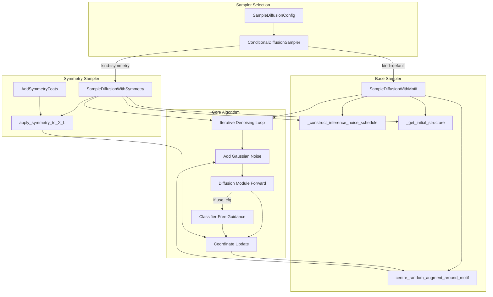
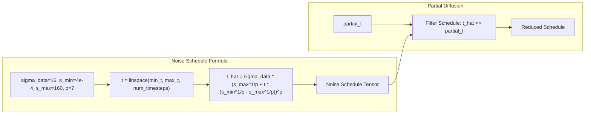
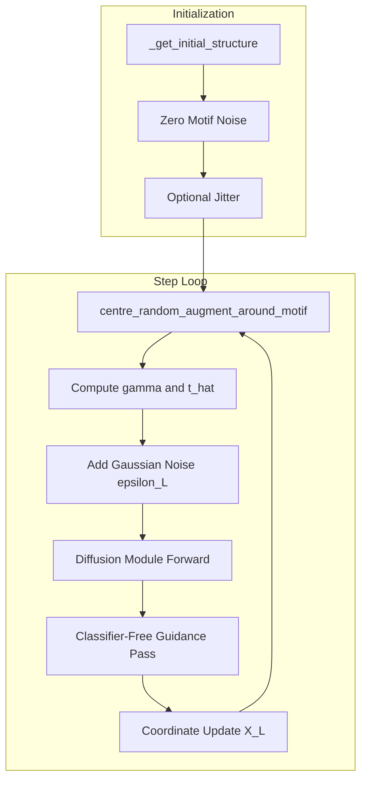
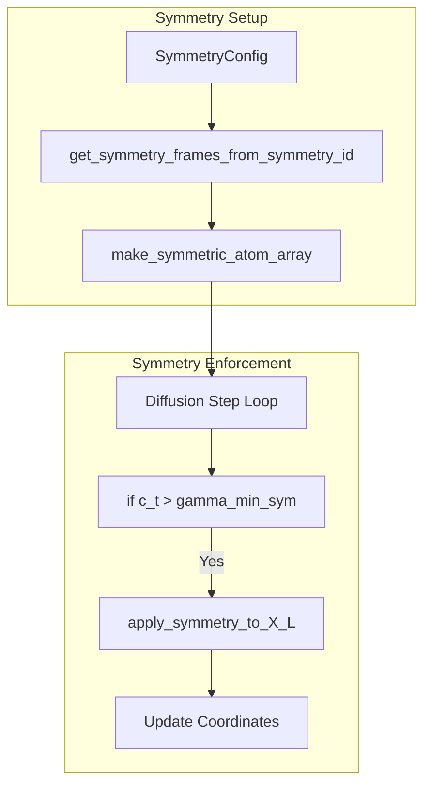

# Diffusion Sampling and Symmetry

<details>
<summary>Relevant source files</summary>

The following files were used as context for generating this wiki page:

- [models/rfd3/.gitignore](models/rfd3/.gitignore)
- [models/rfd3/configs/model/samplers/symmetry.yaml](models/rfd3/configs/model/samplers/symmetry.yaml)
- [models/rfd3/src/rfd3/inference/parsing.py](models/rfd3/src/rfd3/inference/parsing.py)
- [models/rfd3/src/rfd3/inference/symmetry/atom_array.py](models/rfd3/src/rfd3/inference/symmetry/atom_array.py)
- [models/rfd3/src/rfd3/inference/symmetry/checks.py](models/rfd3/src/rfd3/inference/symmetry/checks.py)
- [models/rfd3/src/rfd3/inference/symmetry/frames.py](models/rfd3/src/rfd3/inference/symmetry/frames.py)
- [models/rfd3/src/rfd3/inference/symmetry/symmetry_utils.py](models/rfd3/src/rfd3/inference/symmetry/symmetry_utils.py)
- [models/rfd3/src/rfd3/model/inference_sampler.py](models/rfd3/src/rfd3/model/inference_sampler.py)
- [models/rfd3/src/rfd3/model/layers/block_utils.py](models/rfd3/src/rfd3/model/layers/block_utils.py)
- [models/rfd3/src/rfd3/transforms/symmetry.py](models/rfd3/src/rfd3/transforms/symmetry.py)

</details>


This page documents the diffusion sampling process in RFdiffusion3, including the iterative denoising algorithm, noise schedule construction, motif alignment, classifier-free guidance, and comprehensive symmetry support for generating multimeric protein complexes. For information about input specifications and contig parsing, see [InputSpecification System](#4.2). For training details, see [RFD3 Training](#4.6).

## Overview

RFdiffusion3 uses a conditional diffusion process based on the AlphaFold 3 sampling approach to generate protein backbone structures. The sampling system supports:

- **Standard diffusion sampling** with motif scaffolding [models/rfd3/src/rfd3/model/inference_sampler.py:58-60]()
- **Partial diffusion** starting from intermediate noise levels [models/rfd3/src/rfd3/model/inference_sampler.py:89-131]()
- **Motif realignment** at each diffusion step [models/rfd3/src/rfd3/model/inference_sampler.py:593-605]()
- **Classifier-free guidance** for conditional generation [models/rfd3/src/rfd3/model/inference_sampler.py:265-295]()
- **Symmetry constraints** for cyclic, dihedral, and polyhedral multimers [models/rfd3/src/rfd3/inference/symmetry/symmetry_utils.py:66-153]()

The core implementation consists of two main sampler classes: `SampleDiffusionWithMotif` (standard) and `SampleDiffusionWithSymmetry` (symmetry-aware), both orchestrated by `ConditionalDiffusionSampler`.

**Sources:** [models/rfd3/src/rfd3/model/inference_sampler.py:1-646](), [models/rfd3/src/rfd3/inference/symmetry/symmetry_utils.py:1-153]()

## Sampler Architecture

The sampling system uses a registry pattern to select between different sampling strategies at runtime.



**Sources:** [models/rfd3/src/rfd3/model/inference_sampler.py:24-51, 58-343, 345-547, 550-591](), [models/rfd3/src/rfd3/transforms/symmetry.py:10-38]()

| Component | Purpose | Key Parameters |
|-----------|---------|----------------|
| `ConditionalDiffusionSampler` | Registry that selects sampler based on `kind` | `kind="default"` or `kind="symmetry"` [models/rfd3/src/rfd3/model/inference_sampler.py:550-591]() |
| `SampleDiffusionConfig` | Configuration dataclass | `num_timesteps=200`, `gamma_0=0.6`, `step_scale=1.5`, `cfg_scale=2.0` [models/rfd3/src/rfd3/model/inference_sampler.py:24-51]() |
| `SampleDiffusionWithMotif` | Base sampler implementation | Motif alignment, CFG support [models/rfd3/src/rfd3/model/inference_sampler.py:58-343]() |
| `SampleDiffusionWithSymmetry` | Symmetry-constrained sampler | `sym_step_frac=0.9`, symmetry enforcement [models/rfd3/src/rfd3/model/inference_sampler.py:345-547]() |

**Sources:** [models/rfd3/src/rfd3/model/inference_sampler.py:24-51, 550-591]()

## Noise Schedule Construction

The diffusion process uses an AlphaFold 3-style noise schedule that determines the noise levels at each timestep.



The noise schedule is constructed using the formula from AF3 supplement Section 3.7.1:

```python
t_hat = self.sigma_data * ((self.s_max) ** (1 / self.p) + t * (self.s_min ** (1 / self.p) - self.s_max ** (1 / self.p))) ** self.p
```
[models/rfd3/src/rfd3/model/inference_sampler.py:80-87]()

**Partial Diffusion:** When `partial_t` is provided, the noise schedule is filtered to only include timesteps where `t_hat <= partial_t`, enabling diffusion from partially noised structures [models/rfd3/src/rfd3/model/inference_sampler.py:89-131]().

**Sources:** [models/rfd3/src/rfd3/model/inference_sampler.py:61-131]()

## Diffusion Sampling Loop

The core sampling algorithm performs iterative denoising following the AF3 approach with stochastic differential equation (SDE) integration [models/rfd3/src/rfd3/model/inference_sampler.py:192-342]().



**Sources:** [models/rfd3/src/rfd3/model/inference_sampler.py:133-342]()

### Key Algorithm Parameters

| Parameter | Default | Description |
|-----------|---------|-------------|
| `num_timesteps` | 200 | Number of diffusion steps [models/rfd3/src/rfd3/model/inference_sampler.py:29]() |
| `gamma_0` | 0.6 | Noise injection parameter [models/rfd3/src/rfd3/model/inference_sampler.py:36]() |
| `noise_scale` | 1.003 | Scaling factor for noise injection [models/rfd3/src/rfd3/model/inference_sampler.py:38]() |
| `step_scale` | 1.5 | Scaling factor for coordinate updates [models/rfd3/src/rfd3/model/inference_sampler.py:39]() |

**Sources:** [models/rfd3/src/rfd3/model/inference_sampler.py:25-40](), [models/rfd3/configs/model/samplers/symmetry.yaml:6-10]()

## Motif Alignment and Centering

At each diffusion step, the structure can be realigned to maintain motif constraints through `centre_random_augment_around_motif` [models/rfd3/src/rfd3/model/inference_sampler.py:593-646]().

### Centering Options

The `center_option` parameter controls the centering strategy [models/rfd3/src/rfd3/model/inference_sampler.py:43, 611-631]():

| Option | Description |
|--------|-------------|
| `"motif"` | Center on motif center-of-mass |
| `"diffuse"` | Center on diffused region COM |
| `"all"` | Center on entire structure COM |

### Alignment Control

- **`fraction_of_steps_to_fix_motif`**: Fraction of steps during which motif position is fixed relative to origin [models/rfd3/src/rfd3/model/inference_sampler.py:46, 190]().
- **`allow_realignment`**: If `True`, applies recentering and random augmentation at each step [models/rfd3/src/rfd3/model/inference_sampler.py:48, 200]().
- **`insert_motif_at_end`**: If `True`, performs final motif insertion after diffusion [models/rfd3/src/rfd3/model/inference_sampler.py:49, 341]().

**Sources:** [models/rfd3/src/rfd3/model/inference_sampler.py:43-49, 593-646]()

## Classifier-Free Guidance

Classifier-free guidance (CFG) combines conditional and unconditional predictions to strengthen conditioning [models/rfd3/src/rfd3/model/inference_sampler.py:265-295]().

The CFG formula combines gradients:
`delta_L += (self.cfg_scale - 1) * (delta_L - delta_L_ref)` [models/rfd3/src/rfd3/model/inference_sampler.py:291]().

- `delta_L`: Gradient from conditional forward pass.
- `delta_L_ref`: Gradient from unconditional pass (using `strip_X` to remove conditioning) [models/rfd3/src/rfd3/model/cfg_utils.py]().
- `cfg_scale`: Guidance strength (default 2.0) [models/rfd3/src/rfd3/model/inference_sampler.py:51]().

**Sources:** [models/rfd3/src/rfd3/model/inference_sampler.py:50-52, 265-295](), [models/rfd3/src/rfd3/model/cfg_utils.py:10]()

## Symmetry Sampling

`SampleDiffusionWithSymmetry` enforces symmetry constraints during diffusion [models/rfd3/src/rfd3/model/inference_sampler.py:345-547]().



**Sources:** [models/rfd3/src/rfd3/model/inference_sampler.py:345-547](), [models/rfd3/src/rfd3/inference/symmetry/symmetry_utils.py:66-153]()

### Symmetry Application to Coordinates

The `apply_symmetry_to_xyz_atomwise` function enforces symmetry by copying the ASU coordinates to all symmetric subunits [models/rfd3/src/rfd3/inference/symmetry/symmetry_utils.py:328-376]().

1.  **COM Correction**: Centers the structure while respecting fixed motifs [models/rfd3/src/rfd3/inference/symmetry/symmetry_utils.py:344-348]().
2.  **ASU Extraction**: Identifies the asymmetric unit coordinates [models/rfd3/src/rfd3/inference/symmetry/symmetry_utils.py:355-356]().
3.  **Symmetry Expansion**: Applies rotation matrices `R` and translations `T` to the ASU to populate all subunits [models/rfd3/src/rfd3/inference/symmetry/symmetry_utils.py:365-373]().

**Sources:** [models/rfd3/src/rfd3/inference/symmetry/symmetry_utils.py:328-376]()

## Supported Symmetry Types

RFdiffusion3 supports various point group symmetries [models/rfd3/src/rfd3/inference/symmetry/frames.py:5-39]().

| Symmetry | ID Prefix | Number of Frames | Implementation |
|----------|-----------|------------------|----------------|
| Cyclic | `C` | n | `get_cyclic_frames(n)` [models/rfd3/src/rfd3/inference/symmetry/frames.py:21-23]() |
| Dihedral | `D` | 2n | `get_dihedral_frames(n)` [models/rfd3/src/rfd3/inference/symmetry/frames.py:24-26]() |
| Tetrahedral | `T` | 12 | `get_tetrahedral_frames()` [models/rfd3/src/rfd3/inference/symmetry/frames.py:270-305]() |
| Octahedral | `O` | 24 | `get_octahedral_frames()` [models/rfd3/src/rfd3/inference/symmetry/frames.py:308-364]() |
| Icosahedral | `I` | 60 | `get_icosahedral_frames()` [models/rfd3/src/rfd3/inference/symmetry/frames.py:367-506]() |

**Sources:** [models/rfd3/src/rfd3/inference/symmetry/frames.py:5-506]()

## Unsymmetrized Motifs

The `is_unsym_motif` configuration allows specific chains (like DNA or ligands) to remain as single copies in a symmetric assembly [models/rfd3/src/rfd3/inference/symmetry/symmetry_utils.py:50-54, 115-125]().

- **Extraction**: Un-symmetrized elements are extracted from the ASU atom array before symmetry frames are applied [models/rfd3/src/rfd3/inference/symmetry/symmetry_utils.py:118-122]().
- **Annotation**: These elements are annotated with `FIXED_TRANSFORM_ID` (-1) and `FIXED_ENTITY_ID` (-1) [models/rfd3/src/rfd3/inference/symmetry/atom_array.py:7-8, 170-184]().
- **Concatenation**: They are appended back to the final symmetrized atom array [models/rfd3/src/rfd3/inference/symmetry/symmetry_utils.py:133-139]().

**Sources:** [models/rfd3/src/rfd3/inference/symmetry/symmetry_utils.py:50-54, 114-139](), [models/rfd3/src/rfd3/inference/symmetry/atom_array.py:7-8, 170-184]()

---