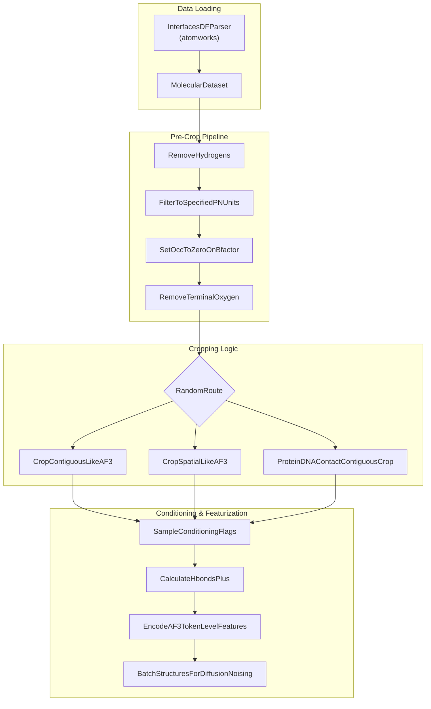
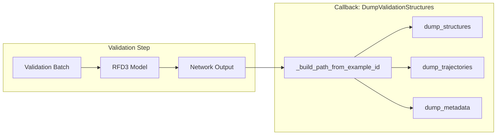

# RFD3 Training

<details>
<summary>Relevant source files</summary>

The following files were used as context for generating this wiki page:

- [models/mpnn/tests/conftest.py](models/mpnn/tests/conftest.py)
- [models/rf3/configs/inference.yaml](models/rf3/configs/inference.yaml)
- [models/rf3/configs/train.yaml](models/rf3/configs/train.yaml)
- [models/rf3/configs/validate.yaml](models/rf3/configs/validate.yaml)
- [models/rfd3/configs/datasets/train/pdb/af3_train_interface.yaml](models/rfd3/configs/datasets/train/pdb/af3_train_interface.yaml)
- [models/rfd3/configs/datasets/train/pdb/af3_train_pn_unit.yaml](models/rfd3/configs/datasets/train/pdb/af3_train_pn_unit.yaml)
- [models/rfd3/configs/dev.yaml](models/rfd3/configs/dev.yaml)
- [models/rfd3/configs/experiment/pretrain.yaml](models/rfd3/configs/experiment/pretrain.yaml)
- [models/rfd3/configs/inference.yaml](models/rfd3/configs/inference.yaml)
- [models/rfd3/configs/logger/default.yaml](models/rfd3/configs/logger/default.yaml)
- [models/rfd3/configs/paths/data/default.yaml](models/rfd3/configs/paths/data/default.yaml)
- [models/rfd3/configs/train.yaml](models/rfd3/configs/train.yaml)
- [models/rfd3/configs/validate.yaml](models/rfd3/configs/validate.yaml)
- [models/rfd3/src/rfd3/trainer/dump_validation_structures.py](models/rfd3/src/rfd3/trainer/dump_validation_structures.py)
- [models/rfd3/src/rfd3/transforms/conditioning_base.py](models/rfd3/src/rfd3/transforms/conditioning_base.py)
- [models/rfd3/src/rfd3/transforms/hbonds_hbplus.py](models/rfd3/src/rfd3/transforms/hbonds_hbplus.py)
- [models/rfd3/src/rfd3/transforms/pipelines.py](models/rfd3/src/rfd3/transforms/pipelines.py)

</details>


This page provides a comprehensive guide to training RFdiffusion3 models, including dataset configuration, conditioning strategies, hyperparameters, and distributed training setup. For information about running RFD3 inference, see [RFD3 Inference Pipeline](#4.5). For general training infrastructure details applicable to all models, see [Training Infrastructure](#8.4).

---

## Overview

RFD3 training uses **Lightning Fabric** for distributed training orchestration, **Hydra** for hierarchical configuration management, and **AtomWorks** for unified biomolecular data processing. The training system supports:

- **PDB-scale training** on millions of structures with specialized filters for resolution and polymer units [models/rfd3/configs/datasets/train/pdb/af3_train_interface.yaml:13-15]().
- **Conditional diffusion** with multiple conditioning strategies (unconditional, island, PPI, etc.) [models/rfd3/configs/experiment/pretrain.yaml:13-23]().
- **Multi-GPU/multi-node** distributed training via DDP using the `FabricTrainer`.
- **Hydrogen bond conditioning** via HBPLUS integration for motif-scaffolding tasks [models/rfd3/src/rfd3/transforms/hbonds_hbplus.py:177-186]().
- **Validation dumping** of predicted structures and trajectories during training [models/rfd3/src/rfd3/trainer/dump_validation_structures.py:19-34]().

---

## Training Pipeline Architecture

The RFD3 training pipeline uses a complex series of transforms to prepare raw PDB data for diffusion training.

### Data Flow and Transform Pipeline



**Figure 1: RFD3 Training Transform Pipeline**
The pipeline filters structures based on B-factors [models/rfd3/src/rfd3/transforms/pipelines.py:156](), performs stochastic cropping (contiguous vs. spatial) [models/rfd3/src/rfd3/transforms/pipelines.py:187-213](), and calculates hydrogen bonds [models/rfd3/src/rfd3/transforms/hbonds_hbplus.py:197-202]() before batching for diffusion noising.

**Sources:** [models/rfd3/src/rfd3/transforms/pipelines.py:144-213](), [models/rfd3/src/rfd3/transforms/hbonds_hbplus.py:177-202]()

---

## Dataset Configuration

### PDB Training
Training on the PDB uses specific filters to ensure data quality. The `InterfacesDFParser` loads metadata from parquet files [models/rfd3/configs/datasets/train/pdb/af3_train_interface.yaml:6-10]().

Key filters applied during training:
- **Deposition Date**: Typically `< '2021-09-30'` to match RosettaFold2/3 benchmarks [models/rfd3/configs/datasets/train/pdb/af3_train_interface.yaml:13]().
- **Resolution**: Structures with resolution `> 9.0` are excluded [models/rfd3/configs/datasets/train/pdb/af3_train_interface.yaml:14]().
- **Polymer Size**: Maximum of 300 polymer units [models/rfd3/configs/datasets/train/pdb/af3_train_interface.yaml:15]().
- **Ligand Filtering**: Excludes common solvents and undesired ligands using `AF3_EXCLUDED_LIGANDS_REGEX` [models/rfd3/configs/datasets/train/pdb/af3_train_interface.yaml:18-19]().

### Path Configuration
Paths for training data and caches are managed in `models/rfd3/configs/paths/data/default.yaml`:
- `pdb_data_dir`: Path to raw structure files [models/rfd3/configs/paths/data/default.yaml:2]().
- `residue_cache_dir`: Directory for pre-computed embeddings (e.g., MACE/Egret) [models/rfd3/configs/paths/data/default.yaml:16]().

---

## Conditioning Strategies

RFD3 is trained using a multi-task approach where different design scenarios are sampled with varying frequencies [models/rfd3/configs/experiment/pretrain.yaml:13-23]().

| Condition | Frequency | Purpose |
| :--- | :--- | :--- |
| `unconditional` | 2.0 | General protein backbone generation |
| `island` | 2.0 | Partial diffusion/motif scaffolding |
| `tipatom` | 5.0 | High-frequency training for sparse atom conditioning |
| `sequence_design` | 0.5 | Sequence-constrained diffusion |
| `ppi` | 0.0 | (Configurable) Protein-protein interface design |

**Sources:** [models/rfd3/configs/experiment/pretrain.yaml:13-23]()

### Hydrogen Bond Conditioning (HBPLUS)
During training, hydrogen bonds are calculated to provide conditioning signals for polar atom interactions. The `CalculateHbondsPlus` transform [models/rfd3/src/rfd3/transforms/hbonds_hbplus.py:177]() uses the `hbplus` executable to identify donor and acceptor atoms between the motif and diffused regions [models/rfd3/src/rfd3/transforms/hbonds_hbplus.py:162-167]().

This requires the `HBPLUS_PATH` environment variable to be set [models/rfd3/src/rfd3/transforms/hbonds_hbplus.py:70-76]().

---

## Training and Validation Execution

### Configuration System
RFD3 uses Hydra for configuration composition. The `train.yaml` and `validate.yaml` files define the default stacks:
- **Model**: `rfd3_base` [models/rfd3/configs/train.yaml:8]()
- **Trainer**: `rfd3_base` [models/rfd3/configs/train.yaml:9]()
- **Dataloader**: `fast` [models/rfd3/configs/train.yaml:12]()

### Validation Structure Dumping
To monitor training progress, the `DumpValidationStructuresCallback` saves predicted structures as CIF files [models/rfd3/src/rfd3/trainer/dump_validation_structures.py:19-34]().



**Figure 2: Validation Structure Dumping Process**
The callback builds file paths based on PDB IDs and assembly IDs extracted from the `example_id` [models/rfd3/src/rfd3/trainer/dump_validation_structures.py:56-71](). It can dump full denoising trajectories (`X_denoised_L_traj`) or just final predictions [models/rfd3/src/rfd3/trainer/dump_validation_structures.py:132-135]().

**Sources:** [models/rfd3/src/rfd3/trainer/dump_validation_structures.py:56-155](), [models/rfd3/configs/validate.yaml:28-33]()

### Running Training
Training is typically initiated via the `train.py` entry point (inherited from the Foundry framework structure):
```bash
# Example training command
python models/rfd3/src/rfd3/train.py experiment=pretrain
```

Validation can be run independently to assess a checkpoint:
```bash
python models/rfd3/src/rfd3/train.py task_name=validate experiment=pretrain ckpt_path=/path/to/model.ckpt
```

**Sources:** [models/rfd3/configs/train.yaml:21-25](), [models/rfd3/configs/validate.yaml:21-35]()

---