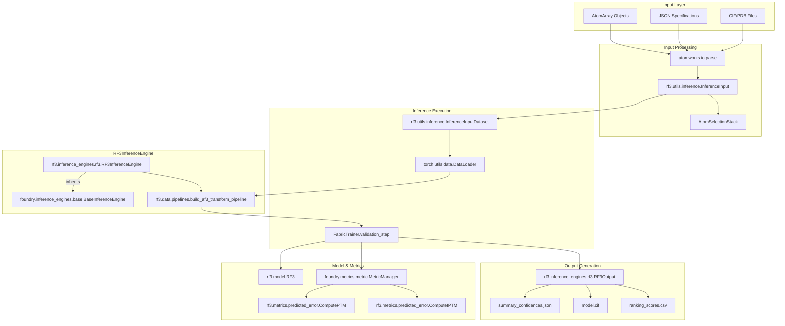
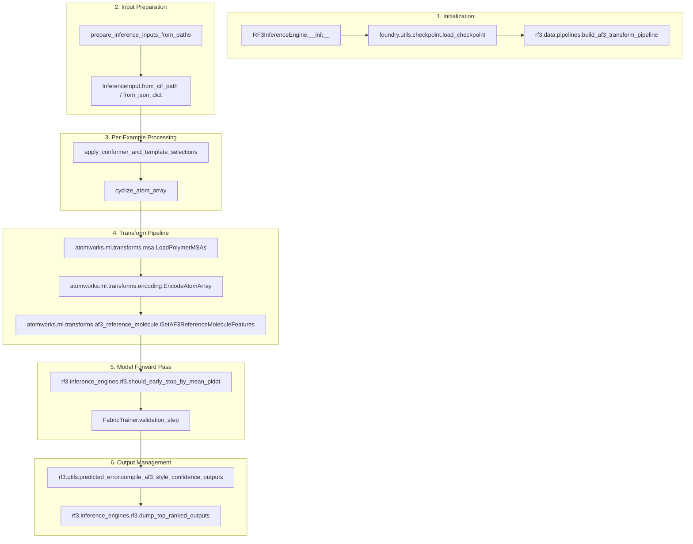

# RosettaFold3 (RF3)

Relevant source files

The following files were used as context for generating this wiki page:

- [models/rf3/README.md](models/rf3/README.md)
- [models/rf3/configs/inference_engine/base.yaml](models/rf3/configs/inference_engine/base.yaml)
- [models/rf3/configs/inference_engine/rf3.yaml](models/rf3/configs/inference_engine/rf3.yaml)
- [models/rf3/docs/examples/3en2_from_file.cif](models/rf3/docs/examples/3en2_from_file.cif)
- [models/rf3/docs/examples/3en2_from_json_with_msa.json](models/rf3/docs/examples/3en2_from_json_with_msa.json)
- [models/rf3/docs/examples/5hkn_from_file.cif](models/rf3/docs/examples/5hkn_from_file.cif)
- [models/rf3/docs/examples/7o1r_from_json.json](models/rf3/docs/examples/7o1r_from_json.json)
- [models/rf3/docs/examples/7xli_template_antigen_and_framework.json](models/rf3/docs/examples/7xli_template_antigen_and_framework.json)
- [models/rf3/docs/examples/9dfn.cif](models/rf3/docs/examples/9dfn.cif)
- [models/rf3/docs/examples/9dfn_template_ligand_and_protein.json](models/rf3/docs/examples/9dfn_template_ligand_and_protein.json)
- [models/rf3/docs/examples/ligands/HEM.sdf](models/rf3/docs/examples/ligands/HEM.sdf)
- [models/rf3/docs/examples/ligands/NAG.cif](models/rf3/docs/examples/ligands/NAG.cif)
- [models/rf3/src/rf3/data/extra_xforms.py](models/rf3/src/rf3/data/extra_xforms.py)
- [models/rf3/src/rf3/data/pipelines.py](models/rf3/src/rf3/data/pipelines.py)
- [models/rf3/src/rf3/inference.py](models/rf3/src/rf3/inference.py)
- [models/rf3/src/rf3/inference_engines/rf3.py](models/rf3/src/rf3/inference_engines/rf3.py)
- [models/rf3/src/rf3/symmetry/resolve.py](models/rf3/src/rf3/symmetry/resolve.py)
- [models/rf3/src/rf3/utils/inference.py](models/rf3/src/rf3/utils/inference.py)

**Purpose**: RosettaFold3 (RF3) is an all-atom biomolecular structure prediction and validation model competitive with leading open-source models. It incorporates implicit chirality representations and atom-level geometric conditioning to improve performance on tasks like chiral ligand prediction and fixed-conformer docking [models/rf3/README.md:10-12](). RF3 serves as the validation step in end-to-end protein design workflows, taking sequences designed by MPNN and predicting their structures to assess designability [models/rf3/src/rf3/inference_engines/rf3.py:222-281]().

**Scope**: This page covers RF3's inference system, input preparation, confidence metrics, and output formats.

---

## RF3 Capabilities

RF3 provides structure prediction with detailed confidence assessment:

| Capability | Description |
|------------|-------------|
| **Structure Prediction** | Predicts all-atom structures from amino acid sequences [models/rf3/README.md:10-12]() |
| **Confidence Scoring** | Provides pLDDT, pTM, ipTM, PAE metrics [models/rf3/src/rf3/inference_engines/rf3.py:49-56]() |
| **MSA Processing** | Supports `.a3m` and `.fasta` inputs for protein chains [models/rf3/README.md:93-95]() |
| **Template Support** | Optional template-guided prediction via geometric conditioning [models/rf3/src/rf3/utils/inference.py:67-69]() |
| **Multi-Chain** | Handles protein complexes with interface metrics [models/rf3/src/rf3/inference_engines/rf3.py:80-95]() |
| **Cyclic Chains** | Supports cyclic protein structures [models/rf3/src/rf3/inference.py:52-52]() |
| **Ground Truth Conformers** | Incorporates experimental conformers during validation [models/rf3/src/rf3/utils/inference.py:68-68]() |
| **Symmetry Resolution** | Resolves residue and subunit symmetries for RMSD comparison [models/rf3/src/rf3/symmetry/resolve.py:23-28]() |
| **Early Stopping** | Optional pLDDT-based early termination to save compute [models/rf3/src/rf3/inference_engines/rf3.py:203-219]() |

**Sources**: [models/rf3/README.md:10-112](), [models/rf3/src/rf3/inference_engines/rf3.py:49-219]()

---

## System Architecture

### RF3 Component Diagram

**Sources**: [models/rf3/src/rf3/inference_engines/rf3.py:98-370](), [models/rf3/src/rf3/utils/inference.py:60-142](), [models/rf3/src/rf3/data/pipelines.py:128-160]()

---

## Inference Flow

### Execution Pipeline Diagram

**Sources**: [models/rf3/src/rf3/inference_engines/rf3.py:372-735](), [models/rf3/src/rf3/utils/inference.py:359-426](), [models/rf3/src/rf3/data/pipelines.py:128-200]()

---

## InferenceInput System

The `InferenceInput` class provides a unified interface for preparing inputs from various sources [models/rf3/src/rf3/utils/inference.py:60-70]().

### Creating InferenceInput Objects

#### From CIF/PDB Files
Loads structure data and extracts metadata (like template selections) directly from CIF blocks [models/rf3/src/rf3/utils/inference.py:72-142]().

#### From JSON Specifications
Creates inputs from component-based JSON dictionaries, common in design workflows [models/rf3/src/rf3/utils/inference.py:144-211]().

### Selection Syntax
Both `template_selection` and `ground_truth_conformer_selection` accept lists of selection strings using the `AtomSelectionStack` syntax [models/rf3/src/rf3/utils/inference.py:67-68]().

- **Template Selection**: Enables template-guided prediction for selected atoms [models/rf3/src/rf3/utils/inference.py:113-115]().
- **Ground Truth Conformer Selection**: Incorporates experimental conformers for validation [models/rf3/src/rf3/utils/inference.py:118-123]().

**Sources**: [models/rf3/src/rf3/utils/inference.py:60-258]()

---

## RF3InferenceEngine

The `RF3InferenceEngine` manages the model lifecycle, data pipeline construction, and distributed execution [models/rf3/src/rf3/inference_engines/rf3.py:222-240]().

### Configuration Parameters

| Parameter | Type | Default | Description |
|-----------|------|---------|-------------|
| `ckpt_path` | str | "rf3" | Path to model checkpoint [models/rf3/configs/inference_engine/rf3.yaml:9]() |
| `n_recycles` | int | 10 | Number of recycling iterations [models/rf3/configs/inference_engine/rf3.yaml:12]() |
| `diffusion_batch_size` | int | 5 | Number of structures generated per input [models/rf3/configs/inference_engine/rf3.yaml:13]() |
| `num_steps` | int | 50 | Diffusion denoising steps [models/rf3/configs/inference_engine/rf3.yaml:16]() |
| `early_stopping_plddt_threshold` | float | 0.5 | Stop if mean pLDDT below threshold [models/rf3/configs/inference_engine/rf3.yaml:20]() |

For details on execution flow, see [RF3 Inference](#5.2).

**Sources**: [models/rf3/src/rf3/inference_engines/rf3.py:241-370](), [models/rf3/configs/inference_engine/rf3.yaml:1-33]()

---

## Confidence Metrics

RF3 provides comprehensive confidence assessment through multiple metrics.

| Metric | Formula / Source | Description |
|--------|------------------|-------------|
| **pLDDT** | `get_mean_atomwise_plddt` | Per-atom local distance difference test [models/rf3/src/rf3/utils/predicted_error.py:39-40]() |
| **pTM** | `rf3.metrics.predicted_error.ComputePTM` | Predicted TM-score [models/rf3/src/rf3/inference_engines/rf3.py:51]() |
| **ipTM** | `rf3.metrics.predicted_error.ComputeIPTM` | Interface predicted TM-score [models/rf3/src/rf3/inference_engines/rf3.py:52]() |
| **ranking_score** | `0.8 * ipTM + 0.2 * pTM - 100 * has_clash` | Weighted score for ranking multiple samples [models/rf3/src/rf3/inference_engines/rf3.py:79-95]() |

For details, see [Confidence Metrics](#5.4).

**Sources**: [models/rf3/src/rf3/inference_engines/rf3.py:49-95](), [models/rf3/src/rf3/utils/predicted_error.py:36-40]()

---

## Output Management

RF3 organizes outputs into an AlphaFold3-compatible format, including structure files and JSON confidence summaries [models/rf3/src/rf3/inference_engines/rf3.py:98-103]().

- **Structure**: Saved as `.cif` or `.cif.gz` [models/rf3/src/rf3/inference_engines/rf3.py:115-137]().
- **Summary**: `summary_confidences.json` contains aggregate metrics [models/rf3/src/rf3/inference_engines/rf3.py:139-141]().
- **Full**: `confidences.json` contains per-atom data [models/rf3/src/rf3/inference_engines/rf3.py:144-146]().
- **Ranking**: `ranking_scores.csv` lists scores for all generated samples [models/rf3/src/rf3/inference_engines/rf3.py:149-164]().

For details, see [Output Management](#5.5).

**Sources**: [models/rf3/src/rf3/inference_engines/rf3.py:98-200]()

---

## Symmetry Resolution

RF3 includes symmetry resolution capabilities to ensure accurate RMSD comparison against ground truth structures that have symmetric residues or subunits [models/rf3/src/rf3/symmetry/resolve.py:1-5]().

- **Residue Level**: Resolves atom permutations in symmetric residues (e.g., PHE, TYR) [models/rf3/src/rf3/symmetry/resolve.py:15-16]().
- **Subunit Level**: Resolves chain permutations in homo-oligomers [models/rf3/src/rf3/symmetry/resolve.py:17-18]().

For details, see [Symmetry Resolution](#5.7).

**Sources**: [models/rf3/src/rf3/symmetry/resolve.py:1-112]()

---

## Child Pages
- [RF3 Overview](#5.1) — Capabilities for structure prediction and validation.
- [RF3 Inference](#5.2) — Detailed documentation of the `RF3InferenceEngine`.
- [Input Preparation and Selection](#5.3) — `InferenceInput` creation and selection syntax.
- [Confidence Metrics](#5.4) — pLDDT, pTM, ipTM, and ranking scores.
- [Output Management](#5.5) — `RF3Output` structure and sharding.
- [RF3 Data Pipeline](#5.6) — MSA processing and dataset configuration.
- [Symmetry Resolution](#5.7) — Resolving residue and subunit symmetries.
- [RF3 Training](#5.8) — Training configuration and distributed setup.

---