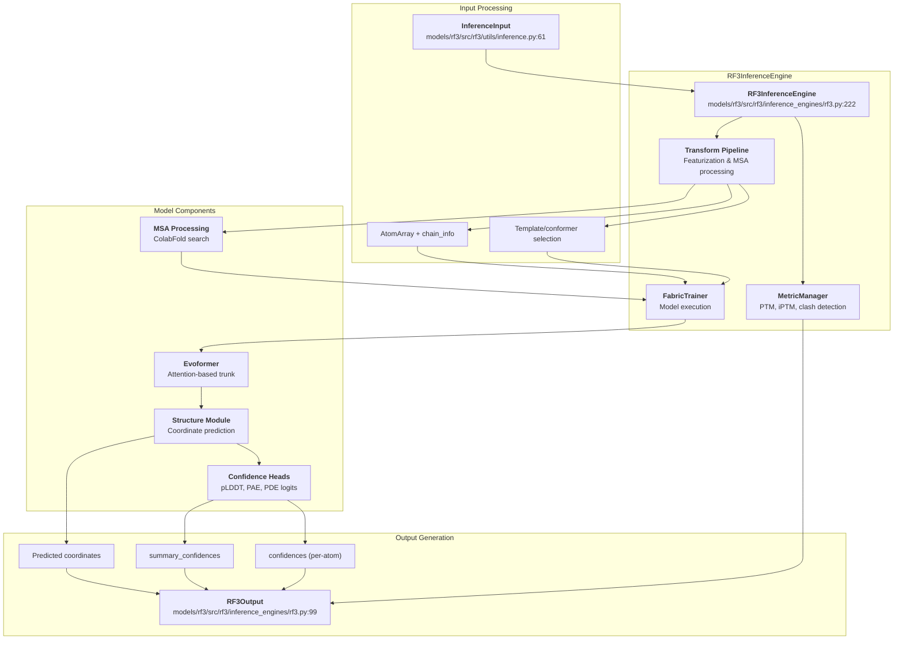
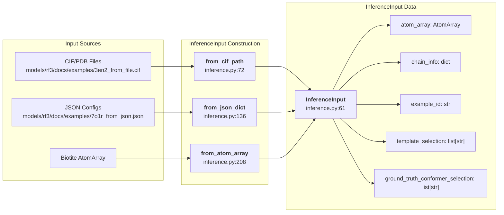
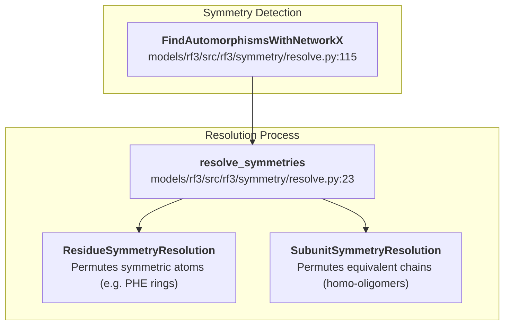

# RF3 Overview

Relevant source files

The following files were used as context for generating this wiki page:

- [models/rf3/README.md](models/rf3/README.md)
- [models/rf3/docs/examples/3en2_from_file.cif](models/rf3/docs/examples/3en2_from_file.cif)
- [models/rf3/docs/examples/3en2_from_json_with_msa.json](models/rf3/docs/examples/3en2_from_json_with_msa.json)
- [models/rf3/docs/examples/5hkn_from_file.cif](models/rf3/docs/examples/5hkn_from_file.cif)
- [models/rf3/docs/examples/7o1r_from_json.json](models/rf3/docs/examples/7o1r_from_json.json)
- [models/rf3/docs/examples/7xli_template_antigen_and_framework.json](models/rf3/docs/examples/7xli_template_antigen_and_framework.json)
- [models/rf3/docs/examples/9dfn.cif](models/rf3/docs/examples/9dfn.cif)
- [models/rf3/docs/examples/9dfn_template_ligand_and_protein.json](models/rf3/docs/examples/9dfn_template_ligand_and_protein.json)
- [models/rf3/docs/examples/ligands/HEM.sdf](models/rf3/docs/examples/ligands/HEM.sdf)
- [models/rf3/docs/examples/ligands/NAG.cif](models/rf3/docs/examples/ligands/NAG.cif)
- [models/rf3/docs/index.md](models/rf3/docs/index.md)

RosettaFold3 (RF3) is a deep learning model for all-atom biomolecular structure prediction and design validation. Competitive with leading open-source models, RF3 predicts three-dimensional structures from sequences and produces comprehensive confidence metrics. Within the Foundry ecosystem, RF3 serves as the primary validation component in end-to-end protein design workflows, re-folding sequences designed by ProteinMPNN to verify they adopt the intended backbone structure generated by RFdiffusion3.

RF3 includes features such as implicit chirality representations and atom-level geometric conditioning, improving performance on tasks like prediction of chiral ligands and fixed-conformer docking [models/rf3/README.md:10-12]().

---

## Purpose and Capabilities

RF3 provides three primary capabilities:

| Capability | Description | Use Case |
|------------|-------------|----------|
| **Structure Prediction** | Predicts 3D coordinates from sequences and MSAs | *De novo* structure prediction and complex modeling [models/rf3/README.md:92-109]() |
| **Design Validation** | Re-folds designed sequences to verify designability | Validates RFD3→MPNN design pipeline outputs [models/rf3/README.md:8-10]() |
| **Confidence Scoring** | Computes per-atom and summary confidence metrics | Quality assessment and model ranking [models/rf3/README.md:81-87]() |

RF3 supports a wide range of biomolecules, including proteins, DNA, RNA, and small molecule ligands [models/rf3/README.md:4-5](). It handles Multiple Sequence Alignments (MSAs) in `.a3m` and `.fasta` formats and supports template-based prediction [models/rf3/README.md:92-94]().

**Sources:** [models/rf3/README.md:1-115](), [models/rf3/docs/index.md:8-12]()

---

## Core Architecture

RF3's inference architecture is centered around the `RF3InferenceEngine` class, which manages the transition from raw input to predicted 3D coordinates.

**Component Descriptions:**

- **RF3InferenceEngine**: The main entry point inheriting from `BaseInferenceEngine`. It handles checkpoint loading (e.g., Latest, Preprint, or Benchmark models) and orchestrates the inference pipeline [models/rf3/src/rf3/inference_engines/rf3.py:222-371](), [models/rf3/README.md:35-56]().
- **InferenceInput**: A unified data structure that encapsulates structure data, MSA paths, and selection metadata [models/rf3/src/rf3/utils/inference.py:61-69]().
- **MetricManager**: Computes structural metrics including PTM (predicted TM-score) and iPTM (interface PTM) [models/rf3/src/rf3/inference_engines/rf3.py:49-56]().
- **Early Stopping**: A resource-saving feature where the model stops computation if pLDDT falls below a threshold (controlled by `early_stopping_plddt_threshold`) [models/rf3/README.md:137-138]().

**Sources:** [models/rf3/src/rf3/inference_engines/rf3.py:49-371](), [models/rf3/README.md:35-56](), [models/rf3/src/rf3/utils/inference.py:61-69]()

---

## Input Specification System

RF3 accepts inputs via JSON configuration files or CIF/PDB files. These are converted into `InferenceInput` objects.

**Common Input Examples:**

- **JSON with MSA**: Specifies sequences and explicit paths to `.a3m.gz` files [models/rf3/docs/examples/3en2_from_json_with_msa.json:1-15]().
- **JSON with Ligands**: Supports SMILES, CCD codes (e.g., `MG`, `NAG`), or external `.sdf`/`.cif` files for ligands [models/rf3/docs/examples/7o1r_from_json.json:1-32]().
- **CIF with MSA headers**: Uses custom CIF categories like `_msa_paths_by_chain_id` to link MSAs to structural data [models/rf3/docs/examples/3en2_from_file.cif:3-4]().
- **Bonds**: Explicit covalent bonds between chains (e.g., protein-ligand) can be specified in JSON [models/rf3/docs/examples/7o1r_from_json.json:27-30]().

**Sources:** [models/rf3/src/rf3/utils/inference.py:72-258](), [models/rf3/docs/examples/7o1r_from_json.json:1-32](), [models/rf3/docs/examples/3en2_from_file.cif:1-5]()

---

## Confidence Metrics and Ranking

RF3 produces comprehensive confidence outputs. The model ranks multiple samples for a single input using a weighted score.

**Summary Confidences:**
- **pLDDT**: Local confidence score (0-100 scale) [models/rf3/README.md:81-87]().
- **pTM / ipTM**: Global and interface confidence scores [models/rf3/src/rf3/inference_engines/rf3.py:79-95]().
- **Ranking Score**: Calculated as `0.8 * iptm + 0.2 * ptm - 100 * has_clash`. For single chains, `iptm` is set to `ptm` [models/rf3/src/rf3/inference_engines/rf3.py:79-95]().

**Output Files:**
When running `rf3 fold`, the following files are produced:
- `{name}_model.cif`: The highest-ranked predicted structure [models/rf3/README.md:83]().
- `{name}_ranking_scores.csv`: Granular metrics for all generated samples [models/rf3/README.md:82]().
- `{name}_summary_confidences.json`: High-level metrics for the top sample [models/rf3/README.md:84]().
- `{name}_confidences.csv`: Per-residue/atom metrics [models/rf3/README.md:81]().

**Sources:** [models/rf3/src/rf3/inference_engines/rf3.py:79-200](), [models/rf3/README.md:80-87]()

---

## Template and Conformer Selection

RF3 allows users to specify specific regions of a structure to be treated as templates or ground truth conformers.

- **Template Selection**: Users can select specific chains or residue ranges (e.g., `"B/*/1-42"`) to act as structural templates [models/rf3/docs/examples/7xli_template_antigen_and_framework.json:12]().
- **Ground Truth Conformer Selection**: Specifies which chains in a multi-component input should be used as reference coordinates for validation [models/rf3/docs/examples/9dfn_template_ligand_and_protein.json:10]().

**Sources:** [models/rf3/docs/examples/7xli_template_antigen_and_framework.json:1-14](), [models/rf3/docs/examples/9dfn_template_ligand_and_protein.json:1-13]()

---

## Symmetry Resolution

RF3 includes a robust symmetry resolution system to handle equivalent atoms (residue-level) and equivalent chains (subunit-level) during validation.

The `resolve_symmetries` function permutes the ground truth coordinates to minimize the RMSD against the predicted structure, ensuring that symmetric flips or chain swaps do not artificially inflate error metrics [models/rf3/src/rf3/symmetry/resolve.py:23-112]().

**Sources:** [models/rf3/src/rf3/symmetry/resolve.py:1-284]()

---