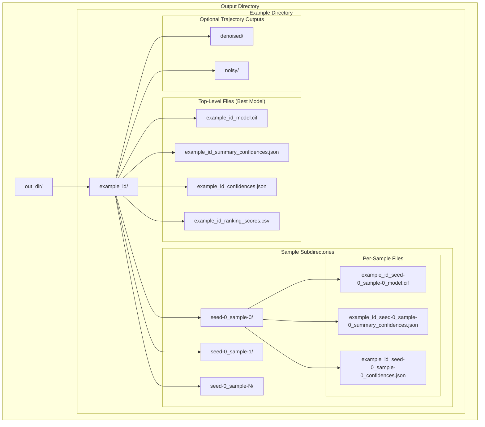
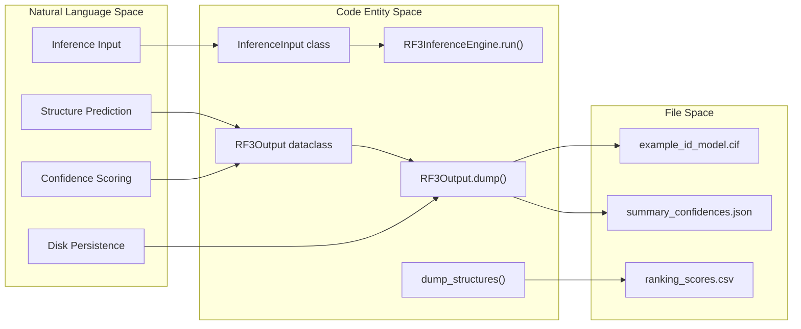

# Output Management

<details>
<summary>Relevant source files</summary>

The following files were used as context for generating this wiki page:

- [models/rf3/configs/experiment/pretrained/rf3.yaml](models/rf3/configs/experiment/pretrained/rf3.yaml)
- [models/rf3/configs/inference_engine/base.yaml](models/rf3/configs/inference_engine/base.yaml)
- [models/rf3/configs/inference_engine/rf3.yaml](models/rf3/configs/inference_engine/rf3.yaml)
- [models/rf3/src/rf3/callbacks/dump_validation_structures.py](models/rf3/src/rf3/callbacks/dump_validation_structures.py)
- [models/rf3/src/rf3/cli.py](models/rf3/src/rf3/cli.py)
- [models/rf3/src/rf3/data/extra_xforms.py](models/rf3/src/rf3/data/extra_xforms.py)
- [models/rf3/src/rf3/data/pipelines.py](models/rf3/src/rf3/data/pipelines.py)
- [models/rf3/src/rf3/inference.py](models/rf3/src/rf3/inference.py)
- [models/rf3/src/rf3/inference_engines/rf3.py](models/rf3/src/rf3/inference_engines/rf3.py)
- [models/rf3/src/rf3/symmetry/resolve.py](models/rf3/src/rf3/symmetry/resolve.py)
- [models/rf3/src/rf3/utils/inference.py](models/rf3/src/rf3/utils/inference.py)
- [models/rf3/src/rf3/utils/io.py](models/rf3/src/rf3/utils/io.py)
- [models/rfd3/src/rfd3/cli.py](models/rfd3/src/rfd3/cli.py)
- [pyproject.toml](pyproject.toml)

</details>


This page documents how RosettaFold3 (RF3) organizes and saves prediction outputs, including directory structures, file formats, and configuration options. RF3 uses an AlphaFold3-compatible output format that includes structure files, confidence metrics, and optional trajectories.

For information about running RF3 inference, see [RF3 Inference](#5.2). For details on interpreting confidence metrics, see [Confidence Metrics](#5.4).

---

## Overview

RF3 predictions generate multiple output files per input structure, organized in a hierarchical directory structure. The output system supports:

- **AlphaFold3-compatible format**: Structure files (CIF) with confidence metrics (JSON) [models/rf3/src/rf3/inference_engines/rf3.py:102-103]()
- **Multiple samples per input**: Each input can generate multiple predictions controlled by `diffusion_batch_size` [models/rf3/configs/inference_engine/rf3.yaml:13]()
- **Ranking-based selection**: Automatic selection and top-level promotion of the highest-scoring model [models/rf3/src/rf3/inference_engines/rf3.py:167-172]()
- **Optional compression**: GZIP compression for structure files [models/rf3/configs/inference_engine/base.yaml:10]()
- **Sharding support**: Hash-based directory organization for large-scale predictions [models/rf3/src/rf3/utils/io.py:34-35]()
- **Trajectory outputs**: Optional diffusion trajectory snapshots [models/rf3/src/rf3/inference_engines/rf3.py:43]()

Sources: [models/rf3/src/rf3/inference_engines/rf3.py:98-201](), [models/rf3/configs/inference_engine/rf3.yaml:1-33]()

---

## Output Directory Structure

RF3 organizes outputs in a two-level hierarchy: top-level files for the best prediction, and per-sample subdirectories for all predictions.

### Directory Hierarchy



**Directory Structure with Sharding**

When `sharding_pattern` is enabled, the example directory is placed within hash-based subdirectories to prevent directory entry limits [models/rf3/src/rf3/utils/io.py:34-58]().

```
out_dir/
├── a1/                    # First hash shard
│   ├── b2/                # Second hash shard
│   │   └── example_id/    # Example directory
│   │       ├── example_id_model.cif
│   │       └── ...
```

Sources: [models/rf3/src/rf3/inference_engines/rf3.py:128-148](), [models/rf3/src/rf3/utils/io.py:21-58]()

---

## Output File Types

RF3 generates several file types for each prediction:

| File Type | Description | Optional | Content |
|-----------|-------------|----------|---------|
| `*_model.cif[.gz]` | Structure file | No | Atomic coordinates in mmCIF format [models/rf3/src/rf3/inference_engines/rf3.py:132-137]() |
| `*_summary_confidences.json` | Summary metrics | No | pLDDT, pTM, ipTM, PAE, PDE, ranking score [models/rf3/src/rf3/inference_engines/rf3.py:139-141]() |
| `*_confidences.json` | Full confidence data | Yes | Per-atom and per-token-pair confidence arrays [models/rf3/src/rf3/inference_engines/rf3.py:144-146]() |
| `*_ranking_scores.csv` | Sample rankings | No | Ranking scores for all samples (top-level only) [models/rf3/src/rf3/inference_engines/rf3.py:149-164]() |
| `denoised/*_model_*.cif[.gz]` | Denoised trajectory | Yes | Diffusion trajectory (predicted structures) [models/rf3/callbacks/dump_validation_structures.py:89-95]() |
| `noisy/*_model_*.cif[.gz]` | Noisy trajectory | Yes | Diffusion trajectory (noisy structures) [models/rf3/callbacks/dump_validation_structures.py:96-101]() |

### Structure Files (CIF)

Structure files contain atomic coordinates. The file format is controlled by the `compress_outputs` parameter:

- **Uncompressed**: `*.cif` (text format)
- **Compressed**: `*.cif.gz` (gzipped) [models/rf3/configs/inference_engine/base.yaml:10]()

When `annotate_b_factor_with_plddt=True`, the B-factor column contains per-atom pLDDT confidence scores [models/rf3/src/rf3/inference.py:45]().

Sources: [models/rf3/src/rf3/inference_engines/rf3.py:112-148](), [models/rf3/src/rf3/utils/io.py:31-35]()

### Confidence Files (JSON)

RF3 outputs confidence metrics in AlphaFold3-compatible JSON format with compact array formatting for readability [models/rf3/src/rf3/inference_engines/rf3.py:59-76]().

**summary_confidences.json** (compact format):
```json
{
  "plddt": 85.2,
  "ptm": 0.87,
  "iptm": 0.92,
  "has_clash": false,
  "ranking_score": 0.911,
  "pae": [[1.2, 3.4], [3.4, 1.5]],
  "pde": [[2.1, 4.2], [4.2, 2.3]]
}
```

Sources: [models/rf3/src/rf3/inference_engines/rf3.py:59-76](), [models/rf3/src/rf3/inference_engines/rf3.py:139-141]()

### Ranking Scores

The `*_ranking_scores.csv` file contains ranking scores for all samples. The ranking score formula is: `0.8 * ipTM + 0.2 * pTM - 100 * has_clash` [models/rf3/src/rf3/inference_engines/rf3.py:79-95]().

For single-chain predictions where ipTM is not defined, pTM is used instead of ipTM [models/rf3/src/rf3/inference_engines/rf3.py:90-92]().

Sources: [models/rf3/src/rf3/inference_engines/rf3.py:79-96](), [models/rf3/src/rf3/inference_engines/rf3.py:149-164]()

---

## RF3Output Container

The `RF3Output` dataclass encapsulates all output data for a single prediction sample [models/rf3/src/rf3/inference_engines/rf3.py:98-110]().

### Key Methods

**dump()** - Save output to disk:
```python
output.dump(
    out_dir=Path("./results"),
    file_type="cif.gz",
    dump_full_confidences=True
)
```

This method creates:
- `{example_id}_seed-{seed}_sample-{sample_idx}_model.{file_type}`
- `{example_id}_seed-{seed}_sample-{sample_idx}_summary_confidences.json`
- `{example_id}_seed-{seed}_sample-{sample_idx}_confidences.json` (if `dump_full_confidences=True`)

Sources: [models/rf3/src/rf3/inference_engines/rf3.py:112-148]()

---

## Output Generation Pipeline

The following diagram maps the model data flow to specific code entities and output files:



Sources: [models/rf3/src/rf3/inference_engines/rf3.py:98-201](), [models/rf3/src/rf3/utils/inference.py:61-70](), [models/rf3/src/rf3/utils/io.py:31-35]()

---

## Sharding Patterns

For large-scale predictions, RF3 supports hash-based directory sharding to avoid placing too many directories in a single folder.

### Usage

The `sharding_pattern` parameter (e.g., `/0:2/2:4/`) creates nested directories using hash slices of the `example_id` [models/rf3/src/rf3/utils/io.py:34-58]().

1. Compute hash of `example_id`.
2. Create directory structure: `hash[0:2]/hash[2:4]/example_id`.
3. Distribute predictions across directories to prevent filesystem performance degradation.

Sources: [models/rf3/src/rf3/utils/io.py:21-58](), [models/rf3/configs/inference_engine/base.yaml:19]()

---

## Compression and File Types

RF3 supports optional GZIP compression for structure files to reduce disk usage [models/rf3/configs/inference_engine/base.yaml:10]().

| Setting | File Extension | Size | Read Speed |
|---------|---------------|------|------------|
| `compress_outputs=False` | `.cif` | Larger | Faster |
| `compress_outputs=True` | `.cif.gz` | ~5-10x smaller | Slower |

The compression setting affects:
- Structure files (`*_model.cif[.gz]`)
- Trajectory files (if enabled)

Sources: [models/rf3/configs/inference_engine/base.yaml:10](), [models/rf3/src/rf3/callbacks/dump_validation_structures.py:76-87]()

---

## Trajectory Outputs

RF3 can optionally save diffusion trajectories showing the denoising process over time [models/rf3/src/rf3/inference.py:43]().

### Trajectory Structure

Trajectories are saved in two subdirectories [models/rf3/callbacks/dump_validation_structures.py:89-101]():
- **denoised/**: Predicted structures at each diffusion timestep.
- **noisy/**: Noisy structures at each diffusion timestep.

Each trajectory file is an `AtomArrayStack` containing models ordered from final to initial, making them compatible with PyMOL's bond graph building [models/rf3/callbacks/dump_validation_structures.py:79-101]().

Sources: [models/rf3/src/rf3/inference.py:43](), [models/rf3/callbacks/dump_validation_structures.py:1-102]()

---

## Configuration Options

### Run Parameters

Configure output behavior via the `run()` method or CLI overrides [models/rf3/src/rf3/inference.py:39-54]():

| Parameter | Type | Default | Description |
|-----------|------|---------|-------------|
| `out_dir` | `str\|None` | `None` | Output directory [models/rf3/src/rf3/inference.py:41]() |
| `dump_predictions` | `bool` | `True` | Save predicted structures [models/rf3/src/rf3/inference.py:42]() |
| `dump_trajectories` | `bool` | `False` | Save diffusion trajectories [models/rf3/src/rf3/inference.py:43]() |
| `one_model_per_file` | `bool` | `False` | Save each sample in separate file [models/rf3/src/rf3/inference.py:44]() |
| `annotate_b_factor_with_plddt` | `bool` | `False` | Write pLDDT to B-factor column [models/rf3/src/rf3/inference.py:45]() |
| `sharding_pattern` | `str\|None` | `None` | Directory sharding pattern [models/rf3/src/rf3/inference.py:46]() |

Sources: [models/rf3/src/rf3/inference.py:39-54](), [models/rf3/configs/inference_engine/base.yaml:12-26]()

### Configuration Files

Output settings are managed via Hydra:

**models/rf3/configs/inference_engine/base.yaml**:
```yaml
compress_outputs: false
dump_predictions: true
dump_trajectories: false
one_model_per_file: false
annotate_b_factor_with_plddt: true
```

Sources: [models/rf3/configs/inference_engine/base.yaml:1-26]()

---

## Early Stopping Outputs

When early stopping is triggered (mean pLDDT falls below the specified threshold), RF3 returns a closure that triggers the stop [models/rf3/src/rf3/inference_engines/rf3.py:203-219](). The threshold is typically set via `early_stopping_plddt_threshold` [models/rf3/configs/inference_engine/rf3.yaml:20]().

Sources: [models/rf3/src/rf3/inference_engines/rf3.py:203-219](), [models/rf3/configs/inference_engine/rf3.yaml:20]()

---

## Validation Callback Outputs

During training or validation, the `DumpValidationStructuresCallback` handles structure dumping to the validation directory [models/rf3/src/rf3/callbacks/dump_validation_structures.py:15-101]().

```
save_dir/
├── predictions/
│   └── epoch_{N}/
│       └── {dataset_name}/
│           └── {identifier}.cif[.gz]
└── trajectories/
    └── epoch_{N}/
        └── {dataset_name}/
            ├── {identifier}_denoised_model_{i}.cif[.gz]
```

Sources: [models/rf3/src/rf3/callbacks/dump_validation_structures.py:15-101]()

---