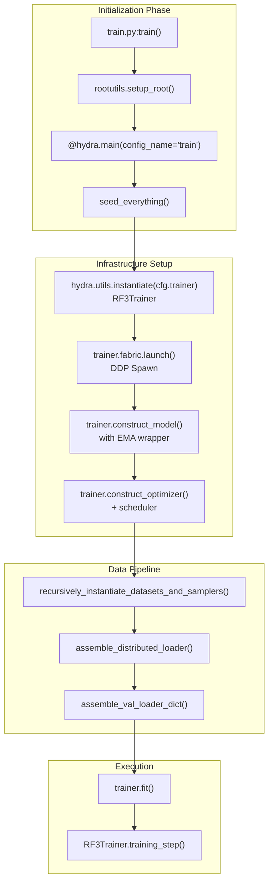
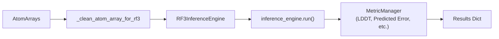

# RF3 Training

<details>
<summary>Relevant source files</summary>

The following files were used as context for generating this wiki page:

- [Makefile](Makefile)
- [models/rf3/configs/inference.yaml](models/rf3/configs/inference.yaml)
- [models/rf3/configs/train.yaml](models/rf3/configs/train.yaml)
- [models/rf3/configs/validate.yaml](models/rf3/configs/validate.yaml)
- [models/rf3/src/rf3/metrics/clashing_chains.py](models/rf3/src/rf3/metrics/clashing_chains.py)
- [models/rf3/src/rf3/metrics/distogram.py](models/rf3/src/rf3/metrics/distogram.py)
- [models/rf3/src/rf3/metrics/lddt.py](models/rf3/src/rf3/metrics/lddt.py)
- [models/rf3/src/rf3/metrics/metadata.py](models/rf3/src/rf3/metrics/metadata.py)
- [models/rf3/src/rf3/metrics/predicted_error.py](models/rf3/src/rf3/metrics/predicted_error.py)
- [models/rf3/src/rf3/metrics/rasa.py](models/rf3/src/rf3/metrics/rasa.py)
- [models/rf3/src/rf3/train.py](models/rf3/src/rf3/train.py)
- [models/rf3/src/rf3/trainers/rf3.py](models/rf3/src/rf3/trainers/rf3.py)
- [models/rf3/src/rf3/utils/predict_and_score.py](models/rf3/src/rf3/utils/predict_and_score.py)
- [models/rf3/src/rf3/validate.py](models/rf3/src/rf3/validate.py)
- [models/rf3/tests/conftest.py](models/rf3/tests/conftest.py)
- [models/rfd3/configs/dev.yaml](models/rfd3/configs/dev.yaml)
- [models/rfd3/configs/inference.yaml](models/rfd3/configs/inference.yaml)
- [models/rfd3/configs/train.yaml](models/rfd3/configs/train.yaml)
- [models/rfd3/configs/validate.yaml](models/rfd3/configs/validate.yaml)

</details>


This page documents the training and validation procedures for RosettaFold3 (RF3) models. It covers the script architecture, dataset configuration, the complex transform pipeline, and distributed training setup.

## Overview

RF3 training is built on a unified infrastructure leveraging **Lightning Fabric** for distributed execution and **Hydra** for configuration management. The pipeline processes raw structural data (PDB/mmCIF) and MSAs into model-ready tensors using a sophisticated sequence of AtomWorks transforms.

**Key Training Components:**
- **Training Orchestrator**: `train.py` handles the lifecycle from initialization to the final training loop [models/rf3/src/rf3/train.py:25-194]().
- **Trainer Class**: `RF3Trainer` extends `FabricTrainer` to implement AF3-specific logic, including symmetry resolution and recycling schedules [models/rf3/src/rf3/trainers/rf3.py:36-88]().
- **Validation Orchestrator**: `validate.py` provides a dedicated entry point for model evaluation with specialized metrics [models/rf3/src/rf3/validate.py:24-140]().

Sources: [models/rf3/src/rf3/train.py](), [models/rf3/src/rf3/trainers/rf3.py](), [models/rf3/src/rf3/validate.py]()

---

## Training Architecture

The training process follows a strict flow managed by Hydra and Lightning Fabric.

### System Flow: From Config to Training Loop



Sources: [models/rf3/src/rf3/train.py:25-168](), [models/rf3/src/rf3/trainers/rf3.py:89-105]()

---

## RF3Trainer Implementation

The `RF3Trainer` is the central class managing the training logic. It handles the specific requirements of AlphaFold3-style models, such as recycling and symmetry resolution.

### Recycling Schedule
During training, the number of recycles is sampled per-batch to ensure all GPUs in a distributed environment are synchronized. The `get_recycle_schedule` function initializes this upfront [models/rf3/src/rf3/trainers/rf3.py:64-69]().

### Symmetry Resolution
To compute accurate losses for complexes with symmetric subunits, the trainer utilizes:
- `SubunitSymmetryResolution`: Resolves symmetry at the chain/subunit level [models/rf3/src/rf3/trainers/rf3.py:86]().
- `ResidueSymmetryResolution`: Resolves symmetry for ambiguous residue types [models/rf3/src/rf3/trainers/rf3.py:87]().

### Network Input Assembly
The `_assemble_network_inputs` method prepares the final tensors for the model forward pass, specifically handling the addition of noise to coordinates [models/rf3/src/rf3/trainers/rf3.py:107-142]().

Sources: [models/rf3/src/rf3/trainers/rf3.py:36-142]()

---

## Dataset and Loader Configuration

RF3 uses a hierarchical dataset configuration system. The `StructuralDatasetWrapper` is used to wrap base datasets like `PandasDataset` with a transform pipeline.

### Training Loader Assembly
The `assemble_distributed_loader` function ensures that data is correctly sharded across multiple GPUs using a distributed sampler [models/rf3/src/rf3/train.py:149-156]().

| Feature | Description | Code Pointer |
| :--- | :--- | :--- |
| **Recycling** | Maximum recycles sampled during training | [models/rf3/src/rf3/trainers/rf3.py:63-69]() |
| **DDP Launch** | Processes spawned via Fabric | [models/rf3/src/rf3/train.py:112]() |
| **Precision** | `float32_matmul_precision` set to 'medium' | [models/rf3/src/rf3/train.py:40]() |
| **EMA** | Optional Exponential Moving Average wrapper | [models/rf3/src/rf3/trainers/rf3.py:101-103]() |

Sources: [models/rf3/src/rf3/train.py](), [models/rf3/src/rf3/trainers/rf3.py]()

---

## Configuration Hierarchy

RF3 uses Hydra's `defaults` list to compose configurations. This allows for modular overrides of models, datasets, and trainer settings.

### Base Training Config (`train.yaml`)
The root configuration defines the search paths and default components [models/rf3/configs/train.yaml:5-21]().

```yaml
# models/rf3/configs/train.yaml
defaults:
  - callbacks: default
  - logger: csv
  - trainer: ???
  - paths: default
  - datasets: ???
  - dataloader: default
  - model: ???
  - _self_
  - experiment: ???
```

### Validation Config (`validate.yaml`)
Specialized for evaluation, it includes callbacks for dumping CIF files of predictions [models/rf3/configs/validate.yaml:46-50]().

Sources: [models/rf3/configs/train.yaml](), [models/rf3/configs/validate.yaml]()

---

## Validation and Scoring Utility

The `predict_and_score_with_rf3` utility allows for high-level evaluation of model checkpoints against a set of ground truth structures [models/rf3/src/rf3/utils/predict_and_score.py:42-165]().

### Evaluation Flow



### Metrics Support
RF3 supports a variety of metrics for training and validation:
- **LDDT**: `AllAtomLDDT` and `ByTypeLDDT` [models/rf3/src/rf3/metrics/lddt.py]().
- **Error Prediction**: `PredictedError` [models/rf3/src/rf3/metrics/predicted_error.py]().
- **Geometric**: `Distogram` and `ClashingChains` [models/rf3/src/rf3/metrics/distogram.py](), [models/rf3/src/rf3/metrics/clashing_chains.py]().

Sources: [models/rf3/src/rf3/utils/predict_and_score.py](), [models/rf3/src/rf3/metrics/]()

---

## Distributed Training Details

Training is scaled across multiple nodes/GPUs using the `FabricTrainer`.

1. **Process Spawning**: `trainer.fabric.launch()` is called before model construction to allow efficient device-specific initialization using `init_module` [models/rf3/src/rf3/train.py:108-112]().
2. **Ranked Logging**: The `RankedLogger` is used to prevent duplicate log messages, ensuring only the master process (Rank 0) outputs detailed logs [models/rf3/src/rf3/train.py:59-75]().
3. **Seeding**: `seed_everything` is called with `workers=True` to ensure deterministic behavior in multi-process dataloaders [models/rf3/src/rf3/train.py:81]().

Sources: [models/rf3/src/rf3/train.py:59-112](), [models/rf3/src/rf3/trainers/rf3.py:92]()

---