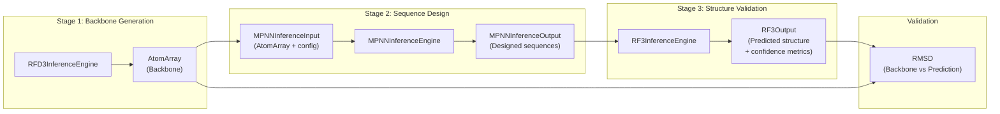
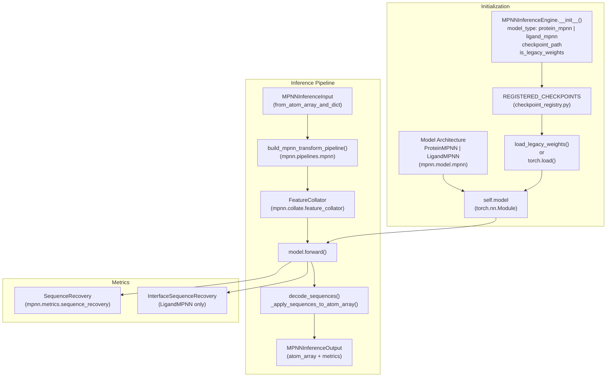
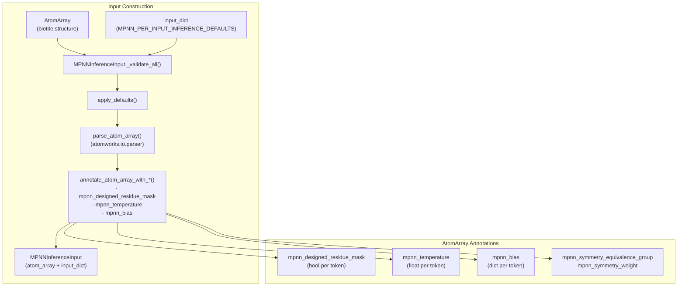
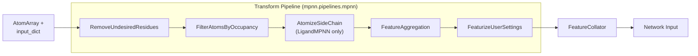

# ProteinMPNN and LigandMPNN

Relevant source files

The following files were used as context for generating this wiki page:

- [models/mpnn/README.md](models/mpnn/README.md)
- [models/mpnn/src/mpnn/__init__.py](models/mpnn/src/mpnn/__init__.py)
- [models/mpnn/src/mpnn/inference_engines/mpnn.py](models/mpnn/src/mpnn/inference_engines/mpnn.py)
- [models/mpnn/src/mpnn/loss/nll_loss.py](models/mpnn/src/mpnn/loss/nll_loss.py)
- [models/mpnn/src/mpnn/model/mpnn.py](models/mpnn/src/mpnn/model/mpnn.py)
- [models/mpnn/src/mpnn/utils/inference.py](models/mpnn/src/mpnn/utils/inference.py)
- [src/foundry/utils/ddp.py](src/foundry/utils/ddp.py)

This document provides an overview of the ProteinMPNN and LigandMPNN sequence design models in the Foundry ecosystem. These models perform inverse folding: given a protein backbone structure, they design amino acid sequences likely to fold into that structure.

For detailed configuration options, see [MPNN Configuration](#6.2). For running inference workflows, see [MPNN Inference](#6.3).

---

## Purpose and Role in Foundry

ProteinMPNN enables protein sequence design given a fixed backbone structure. LigandMPNN extends this to enable sequence design in the context of ligands (small molecules, ions, DNA/RNA, etc.) [models/mpnn/README.md:9-14](). They represent the second stage in a typical three-stage protein design workflow:

1. **Backbone Generation** (RFdiffusion3) - Generate novel protein backbones
2. **Sequence Design** (ProteinMPNN/LigandMPNN) - Design sequences for the backbone
3. **Structure Validation** (RosettaFold3) - Validate designability by predicting structure from sequence

The key difference between the two models:
- **ProteinMPNN**: Designs sequences for protein-only structures [models/mpnn/src/mpnn/model/mpnn.py:19-22]().
- **LigandMPNN**: Handles ligands, nucleic acids, and other non-protein molecules in the design context [models/mpnn/src/mpnn/model/mpnn.py:220-223]().

Sources: [models/mpnn/README.md:9-16](), [models/mpnn/src/mpnn/inference_engines/mpnn.py:37-56]()

---

## Three-Model Workflow

**MPNN's Role**: Given a fixed backbone structure, MPNN predicts amino acid sequences. The model can design all residues or selectively design certain regions while keeping others fixed [models/mpnn/src/mpnn/utils/inference.py:71-75]().

Sources: [models/mpnn/README.md:9-16](), [models/mpnn/src/mpnn/inference_engines/mpnn.py:37-56]()

---

## Model Architecture

### MPNNInferenceEngine

The `MPNNInferenceEngine` class [models/mpnn/src/mpnn/inference_engines/mpnn.py:37-40]() manages the complete inference workflow:
- **Model Selection**: `_build_and_load_model()` instantiates either `ProteinMPNN` or `LigandMPNN` [models/mpnn/src/mpnn/inference_engines/mpnn.py:156-163]().
- **Weight Loading**: Supports legacy weights via `load_legacy_weights()` [models/mpnn/src/mpnn/inference_engines/mpnn.py:166-168]() or standard Foundry checkpoints [models/mpnn/src/mpnn/inference_engines/mpnn.py:170-183]().
- **Metrics**: `_build_metrics_manager()` constructs `SequenceRecovery` and `InterfaceSequenceRecovery` metrics [models/mpnn/src/mpnn/inference_engines/mpnn.py:190-199]().

Sources: [models/mpnn/src/mpnn/inference_engines/mpnn.py:37-199](), [models/mpnn/src/mpnn/model/mpnn.py:19-223]()

---

## Key Components

### Model Types

The inference engine supports two primary model architectures:

| Model | Purpose | Input Support | Legacy Checkpoint Example |
|-------|---------|---------------|------------|
| `protein_mpnn` | Protein-only design | Protein chains | `proteinmpnn_v_48_020.pt` |
| `ligand_mpnn` | Ligand-aware design | Proteins, ligands, nucleic acids, ions | `ligandmpnn_v_32_010_25.pt` |

Sources: [models/mpnn/src/mpnn/inference_engines/mpnn.py:83-83](), [models/mpnn/README.md:31-88]()

### Input Handling: MPNNInferenceInput

The `MPNNInferenceInput` dataclass handles input preparation, including parsing structures and applying user annotations like temperature and design masks [models/mpnn/src/mpnn/utils/inference.py:677-742]().

Sources: [models/mpnn/src/mpnn/utils/inference.py:677-1180](), [models/mpnn/src/mpnn/inference_engines/mpnn.py:204-210]()

### Configuration Defaults

The inference system uses a two-tier default configuration:

**Global Defaults** (`MPNN_GLOBAL_INFERENCE_DEFAULTS`):
- `model_type`, `checkpoint_path`, `is_legacy_weights`
- `out_directory`, `write_fasta`, `write_structures` [models/mpnn/src/mpnn/utils/inference.py:35-46]().

**Per-Input Defaults** (`MPNN_PER_INPUT_INFERENCE_DEFAULTS`):
- Sampling parameters (`seed`, `batch_size`, `temperature`)
- Design scope (`fixed_residues`, `designed_residues`, etc.)
- Bias and Omission (`bias`, `omit`, `pair_bias`) [models/mpnn/src/mpnn/utils/inference.py:48-90]().

Sources: [models/mpnn/src/mpnn/utils/inference.py:35-90]()

---

## Design Control Features

### Design Scope Control

Users can control which residues are designed vs. fixed using four mutually exclusive options. If all are `None`, all residues are designed [models/mpnn/src/mpnn/utils/inference.py:71-75]().

- `fixed_residues` / `designed_residues`: List of residue IDs.
- `fixed_chains` / `designed_chains`: List of chain IDs.

Sources: [models/mpnn/src/mpnn/utils/inference.py:71-75](), [models/mpnn/src/mpnn/utils/inference.py:360-389]()

### Bias and Omission

| Feature | Description | Granularity |
|---------|-------------|-------------|
| `bias` | Additive logit bias for specific amino acids | Global or per-residue |
| `omit` | Disallow certain amino acid types (default: `["UNK"]`) | Global or per-residue |
| `pair_bias` | Bias based on neighboring residue selections | Global or per-residue-pair |
| `temperature` | Sampling temperature (default: `0.1`) | Global or per-residue |

Sources: [models/mpnn/src/mpnn/utils/inference.py:77-85](), [models/mpnn/src/mpnn/utils/inference.py:391-464]()

---

## Output Structure

### MPNNInferenceOutput

Each designed sequence is returned as an `MPNNInferenceOutput` object [models/mpnn/src/mpnn/utils/inference.py:1183-1281]():
- **atom_array**: The structure with designed sequence in `res_name`.
- **output_dict**: Contains `designed_sequence`, `sequence_recovery`, and `ligand_interface_seq_recovery`.
- **input_dict**: Original configuration for reproducibility.

Sources: [models/mpnn/src/mpnn/utils/inference.py:1183-1281](), [models/mpnn/src/mpnn/inference_engines/mpnn.py:270-276]()

---

## Transform Pipeline

The MPNN transform pipeline prepares structures for inference through `build_mpnn_transform_pipeline()` [models/mpnn/src/mpnn/pipelines/mpnn.py:20-20]():

**FeaturizeUserSettings** processes design configuration from AtomArray annotations into network input features [models/mpnn/src/mpnn/transforms/feature_aggregation/user_settings.py:21-348]().

Sources: [models/mpnn/src/mpnn/inference_engines/mpnn.py:296-315](), [models/mpnn/src/mpnn/transforms/feature_aggregation/user_settings.py:21-348]()

---

## Training and Loss

MPNN models are trained using label-smoothed negative log likelihood loss [models/mpnn/src/mpnn/loss/nll_loss.py:5-22]().

| Loss Component | Description | Default |
|----------------|-------------|---------|
| `label_smoothing_eps` | Factor for label smoothing | 0.1 |
| `normalization_constant` | Constant used to normalize the loss | 6000.0 |

The loss is computed per-residue and masked by `mask_for_loss` before aggregation [models/mpnn/src/mpnn/loss/nll_loss.py:97-114]().

Sources: [models/mpnn/src/mpnn/loss/nll_loss.py:5-122]()

---

## Checkpoint Management

MPNN models use the Foundry checkpoint registry system [src/foundry/inference_engines/checkpoint_registry.py:80-117]():

| Key | Model Type | Training Noise ($\sigma$) |
|-----|------------|---------------------------|
| `proteinmpnn` | `protein_mpnn` | 0.20 Å |
| `ligandmpnn` | `ligand_mpnn` | 0.10 Å |
| `solublempnn` | `protein_mpnn` | 0.20 Å |

When using weights from the original repositories, `is_legacy_weights` must be set to `True` [models/mpnn/README.md:127-129]().

Sources: [src/foundry/inference_engines/checkpoint_registry.py:80-117](), [models/mpnn/README.md:31-118]()

---