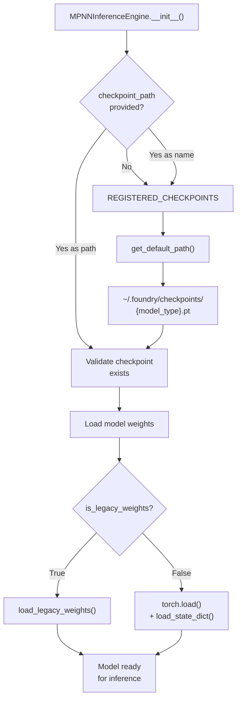
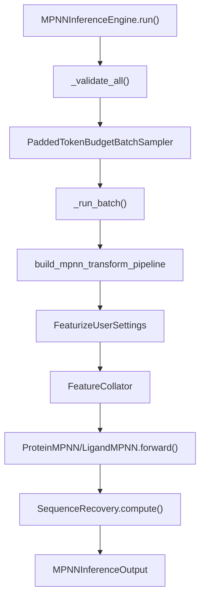

# MPNN Inference

<details>
<summary>Relevant source files</summary>

The following files were used as context for generating this wiki page:

- [models/mpnn/src/mpnn/collate/feature_collator.py](models/mpnn/src/mpnn/collate/feature_collator.py)
- [models/mpnn/src/mpnn/inference.py](models/mpnn/src/mpnn/inference.py)
- [models/mpnn/src/mpnn/inference_engines/mpnn.py](models/mpnn/src/mpnn/inference_engines/mpnn.py)
- [models/mpnn/src/mpnn/metrics/nll.py](models/mpnn/src/mpnn/metrics/nll.py)
- [models/mpnn/src/mpnn/metrics/sequence_recovery.py](models/mpnn/src/mpnn/metrics/sequence_recovery.py)
- [models/mpnn/src/mpnn/model/layers/graph_embeddings.py](models/mpnn/src/mpnn/model/layers/graph_embeddings.py)
- [models/mpnn/src/mpnn/model/layers/message_passing.py](models/mpnn/src/mpnn/model/layers/message_passing.py)
- [models/mpnn/src/mpnn/model/mpnn.py](models/mpnn/src/mpnn/model/mpnn.py)
- [models/mpnn/src/mpnn/pipelines/mpnn.py](models/mpnn/src/mpnn/pipelines/mpnn.py)
- [models/mpnn/src/mpnn/samplers/samplers.py](models/mpnn/src/mpnn/samplers/samplers.py)
- [models/mpnn/src/mpnn/train.py](models/mpnn/src/mpnn/train.py)
- [models/mpnn/tests/test_integration.py](models/mpnn/tests/test_integration.py)
- [models/mpnn/tests/test_pipeline.py](models/mpnn/tests/test_pipeline.py)
- [models/mpnn/tests/test_samplers.py](models/mpnn/tests/test_samplers.py)
- [models/mpnn/tests/test_utils.py](models/mpnn/tests/test_utils.py)
- [models/rf3/src/rf3/alignment.py](models/rf3/src/rf3/alignment.py)
- [src/foundry/utils/ddp.py](src/foundry/utils/ddp.py)

</details>


This page describes how to run inference with ProteinMPNN and LigandMPNN models using the `MPNNInferenceEngine`. For configuration options and design parameters, see [MPNN Configuration](#6.2). For an overview of MPNN capabilities, see [MPNN Overview](#6.1).

## Overview

MPNN inference executes the sequence design process on input protein structures. The inference pipeline:

1. Loads a trained ProteinMPNN or LigandMPNN model checkpoint. [models/mpnn/src/mpnn/inference_engines/mpnn.py:92]()
2. Processes input structures through the MPNN transform pipeline, including `FeaturizeUserSettings`. [models/mpnn/src/mpnn/pipelines/mpnn.py:149-153]()
3. Generates designed sequences via autoregressive sampling. [models/mpnn/src/mpnn/model/mpnn.py:152-172]()
4. Returns designed structures as `AtomArray` objects with updated residue identities. [models/mpnn/src/mpnn/inference_engines/mpnn.py:468-488]()
5. Optionally writes outputs to CIF and FASTA files. [models/mpnn/src/mpnn/inference_engines/mpnn.py:492-556]()

The inference engine handles batching via the `PaddedTokenBudgetBatchSampler`, device placement, pipeline construction, and output management automatically.

**Sources:** [models/mpnn/src/mpnn/inference_engines/mpnn.py:1-557](), [models/mpnn/src/mpnn/samplers/samplers.py:9-40]()

## MPNNInferenceEngine

The `MPNNInferenceEngine` class provides the main interface for MPNN inference.

### Initialization

```python
from mpnn.inference_engines.mpnn import MPNNInferenceEngine

engine = MPNNInferenceEngine(
    model_type="ligand_mpnn",           # or "protein_mpnn"
    checkpoint_path="ligandmpnn",       # foundry checkpoint name or path
    is_legacy_weights=True,             # required for current checkpoints
    out_directory=None,                 # optional output directory
    write_fasta=False,                  # write FASTA files
    write_structures=False,             # write CIF files
    device=None,                        # auto-detect GPU/CPU
)
```

### Constructor Parameters

| Parameter | Type | Description |
|-----------|------|-------------|
| `model_type` | `str` | Model variant: `"protein_mpnn"` or `"ligand_mpnn"` |
| `checkpoint_path` | `str` | Path to checkpoint or foundry model name (`"proteinmpnn"`, `"ligandmpnn"`) |
| `is_legacy_weights` | `bool` | Whether checkpoint uses legacy weight format (currently required) |
| `out_directory` | `str \| None` | Directory for output files; required if writing outputs |
| `write_fasta` | `bool` | Write sequences to FASTA files (one per input structure) |
| `write_structures` | `bool` | Write designed structures to CIF files (one per design) |
| `device` | `str \| torch.device \| None` | Device placement; auto-detects GPU if available |

The engine validates configuration on initialization and loads the model checkpoint. [models/mpnn/src/mpnn/inference_engines/mpnn.py:139-145]() Checkpoint paths can be resolved via the `REGISTERED_CHECKPOINTS` registry. [models/mpnn/src/mpnn/inference_engines/mpnn.py:60-68]()

**Sources:** [models/mpnn/src/mpnn/inference_engines/mpnn.py:37-89](), [models/mpnn/src/mpnn/utils/inference.py:35-46]()

### Checkpoint Resolution Flow



**Sources:** [models/mpnn/src/mpnn/inference_engines/mpnn.py:59-68](), [models/mpnn/src/mpnn/inference_engines/mpnn.py:150-182]()

## FeaturizeUserSettings Transform

A critical part of the MPNN pipeline is the `FeaturizeUserSettings` transform. This transform bridges user-provided settings (like masks, biases, and temperatures) from the input structure annotations to the model's expected feature tensors.

### Implementation Details
The transform handles:
1. **Mask Generation**: Converts user-specified designed/fixed residue strings into boolean masks. [models/mpnn/tests/test_pipeline.py:114-116]()
2. **Temperature Scheduling**: Maps scalar temperatures or per-residue temperatures to token-wise tensors. [models/mpnn/tests/test_pipeline.py:117-119]()
3. **Bias Injection**: Aggregates residue-level amino acid biases and pair-wise biases into the feature set. [models/mpnn/tests/test_pipeline.py:127-147]()
4. **Noise Application**: During training, it manages the addition of Gaussian noise to atomic coordinates. [models/mpnn/tests/test_pipeline.py:161]()

**Sources:** [models/mpnn/src/mpnn/pipelines/mpnn.py:149-153](), [models/mpnn/tests/test_pipeline.py:89-153]()

## Sequence Sampling and Output

MPNN uses an autoregressive decoding process to sample sequences based on the input structure and constraints.

### MPNNInferenceOutput Structure

The inference engine returns `MPNNInferenceOutput` objects containing the designed structure and metadata. [models/mpnn/src/mpnn/inference_engines/mpnn.py:468-488]()

| Key | Type | Description |
|-----|------|-------------|
| `designed_sequence` | `str` | The resulting one-letter amino acid sequence. [models/mpnn/src/mpnn/utils/inference.py:1086]() |
| `sequence_recovery` | `float` | Fraction of native residues recovered. [models/mpnn/src/mpnn/metrics/sequence_recovery.py:15-18]() |
| `log_probs` | `torch.Tensor` | Log probabilities of the sampled sequence. [models/mpnn/src/mpnn/metrics/nll.py:146-153]() |

### Inference Execution Flow



**Sources:** [models/mpnn/src/mpnn/inference_engines/mpnn.py:204-490](), [models/mpnn/src/mpnn/samplers/samplers.py:9-40](), [models/mpnn/src/mpnn/model/mpnn.py:19-151]()

## Writing Outputs

The engine supports writing designed structures and sequences to disk.

### CIF and FASTA Generation
- **CIF**: Structures are updated with the new sequence. For residues where the identity changed, side chains are removed to avoid clashes, leaving only the backbone (N, CA, C, O). [models/mpnn/src/mpnn/inference_engines/mpnn.py:388-450]()
- **FASTA**: Sequences are written with headers containing recovery metrics and sampling parameters. [models/mpnn/src/mpnn/inference_engines/mpnn.py:532-556]()

**Sources:** [models/mpnn/src/mpnn/inference_engines/mpnn.py:492-556](), [models/mpnn/src/mpnn/utils/inference.py:1135-1165]()

## Distributed Inference
For large-scale design tasks, the engine integrates with Foundry's DDP utilities. The `RankedLogger` ensures that logging is clean across multiple GPUs, and the `PaddedTokenBudgetBatchSampler` optimizes throughput by grouping structures of similar sizes to minimize padding overhead. [src/foundry/utils/ddp.py:58-112](), [models/mpnn/src/mpnn/samplers/samplers.py:97-129]()

**Sources:** [src/foundry/utils/ddp.py:1-112](), [models/mpnn/src/mpnn/samplers/samplers.py:1-168]()

---