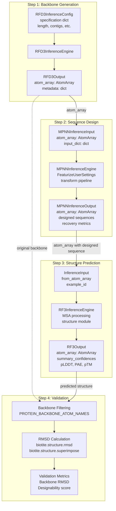
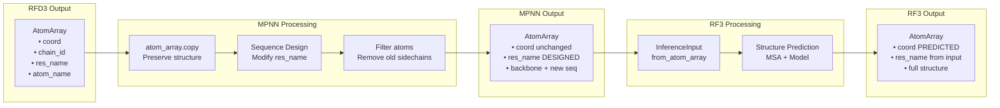
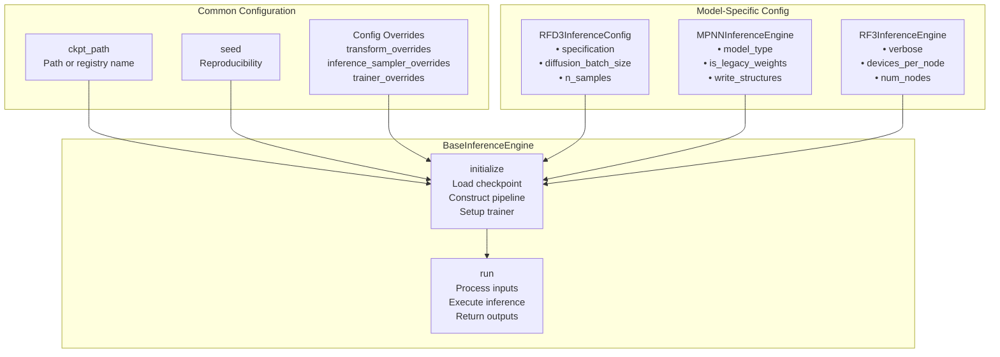

# End-to-End Workflows

<details>
<summary>Relevant source files</summary>

The following files were used as context for generating this wiki page:

- [docs/_static/superimposed_80_residue_protein.png](docs/_static/superimposed_80_residue_protein.png)
- [examples/all.ipynb](examples/all.ipynb)
- [examples/ipd_design_pipeline_collab.ipynb](examples/ipd_design_pipeline_collab.ipynb)
- [models/rfd3/src/rfd3/engine.py](models/rfd3/src/rfd3/engine.py)
- [models/rfd3/src/rfd3/inference/datasets.py](models/rfd3/src/rfd3/inference/datasets.py)
- [models/rfd3/src/rfd3/utils/inference.py](models/rfd3/src/rfd3/utils/inference.py)
- [models/rfd3na/src/rfd3na/utils/inference.py](models/rfd3na/src/rfd3na/utils/inference.py)

</details>


This page describes complete protein design workflows that combine multiple models from the Foundry ecosystem. End-to-end workflows chain together RFdiffusion3 (backbone generation), ProteinMPNN/LigandMPNN (sequence design), and RosettaFold3 (structure prediction and validation) to accomplish complex design tasks.

For detailed information about individual models, see:
- RFdiffusion3: [RFdiffusion3 (RFD3)](#4)
- ProteinMPNN/LigandMPNN: [ProteinMPNN and LigandMPNN](#6)
- RosettaFold3: [RosettaFold3 (RF3)](#5)

For a complete walkthrough of the standard design pipeline with RMSD validation, see [Complete Design Pipeline](#7.1).

---

## Overview of End-to-End Design

End-to-end workflows leverage the complementary capabilities of the three primary models in Foundry:

| Model | Purpose | Input | Output |
|-------|---------|-------|--------|
| **RFdiffusion3** | Generate novel protein backbones | Design specification (JSON) | Protein backbone structures |
| **ProteinMPNN/LigandMPNN** | Design sequences for backbones | Protein backbone + design parameters | Designed sequences (in backbone) |
| **RosettaFold3** | Validate designability | Sequence (from MPNN) | Predicted structure + confidence metrics |

The standard workflow follows the pattern: **Generate → Design → Validate**. The final validation step compares the RF3-predicted structure against the original RFD3 backbone to assess designability through backbone RMSD.

**Sources:** [examples/all.ipynb:8-28]()

---

## Pipeline Architecture

The following diagram shows the complete end-to-end pipeline with actual class names and data structures used in the codebase:



**Sources:** [examples/all.ipynb:63-73,149-160,223-241,334-366](), [models/rfd3/src/rfd3/engine.py:44-96]()

---

## AtomArray as Data Interchange Format

All models in Foundry use Biotite's `AtomArray` as the universal data structure for representing molecular structures. This enables seamless data flow between models without format conversion. `RFD3InferenceEngine` produces `RFD3Output` which encapsulates the `AtomArray` [models/rfd3/src/rfd3/engine.py:91-96]().



**Key Integration Points:**

| Step | Code Location | Key Operation |
|------|--------------|---------------|
| RFD3 → MPNN | [examples/all.ipynb:134-136]() | `atom_array = outputs[first_key][0].atom_array` |
| MPNN Processing | [examples/all.ipynb:191-192]() | `MPNNInferenceEngine.run(atom_arrays=[atom_array])` |
| MPNN → RF3 | [examples/all.ipynb:259]() | `InferenceInput.from_atom_array(atom_array, example_id)` |
| RF3 Output | [examples/all.ipynb:275-276]() | `rf3_output.atom_array` |

**Sources:** [examples/all.ipynb:128-140,164-193,244-265](), [models/rfd3/src/rfd3/engine.py:91-96]()

---

## Step-by-Step Data Transformation

The following table shows how data is transformed at each step in the pipeline:

| Stage | Input Data | Transformation | Output Data |
|-------|-----------|----------------|-------------|
| **RFD3 Initialization** | `RFD3InferenceConfig` with specification dict | Load checkpoint, build diffusion sampler | Ready inference engine |
| **RFD3 Execution** | Specification (length, contigs, etc.) | Diffusion sampling, motif alignment | `RFD3Output` with generated backbone |
| **MPNN Initialization** | `MPNNInferenceEngine` config | Load checkpoint, build transform pipeline | Ready inference engine |
| **MPNN Execution** | `atom_array` + `input_dict` (design parameters) | `FeaturizeUserSettings`, message passing | `MPNNInferenceOutput` with designed sequences |
| **RF3 Initialization** | `RF3InferenceEngine` with checkpoint path | Load model, setup MSA pipeline | Ready inference engine |
| **RF3 Execution** | `InferenceInput.from_atom_array(atom_array)` | MSA search, structure prediction | `RF3Output` with predicted structure + metrics |
| **RMSD Validation** | Original backbone + predicted structure | Filter to backbone atoms, superimpose, calculate RMSD | Designability metric (Å) |

**Sources:** [examples/all.ipynb:84-106,169-193,250-265,342-365](), [models/rfd3/src/rfd3/engine.py:142-204]()

---

## Programmatic Workflow Execution

The standard pattern for executing an end-to-end workflow programmatically:

### 1. Backbone Generation with RFD3

```python
from rfd3.engine import RFD3InferenceConfig, RFD3InferenceEngine

# Configure and run RFD3
config = RFD3InferenceConfig(
    specification={'length': 80, 'extra': {}},
    diffusion_batch_size=2,
)
model = RFD3InferenceEngine(**config)
rfd3_outputs = model.run(inputs=None, out_dir=None, n_batches=1)

# Extract generated backbone
atom_array = rfd3_outputs[next(iter(rfd3_outputs.keys()))][0].atom_array
```

**Sources:** [examples/all.ipynb:84-106,128-140](), [models/rfd3/src/rfd3/engine.py:205-230]()

### 2. Sequence Design with MPNN

```python
from mpnn.inference_engines.mpnn import MPNNInferenceEngine

# Configure MPNN
engine_config = {
    "model_type": "ligand_mpnn",
    "is_legacy_weights": True,
    "out_directory": None,
    "write_structures": False,
    "write_fasta": False,
}

# Design parameters
input_configs = [{
    "batch_size": 10,
    "remove_waters": True,
}]

# Run MPNN
model = MPNNInferenceEngine(**engine_config)
mpnn_outputs = model.run(input_dicts=input_configs, atom_arrays=[atom_array])
```

**Sources:** [examples/all.ipynb:164-193]()

### 3. Structure Prediction with RF3

```python
from rf3.inference_engines.rf3 import RF3InferenceEngine
from rf3.utils.inference import InferenceInput

# Initialize RF3
inference_engine = RF3InferenceEngine(ckpt_path='rf3', verbose=False)

# Create input from MPNN-designed structure
input_structure = InferenceInput.from_atom_array(
    atom_array, 
    example_id="example_protein"
)
rf3_outputs = inference_engine.run(inputs=input_structure)

# Extract prediction
rf3_output = rf3_outputs["example_protein"][0]
```

**Sources:** [examples/all.ipynb:244-265]()

---

## Inference Engine Configuration

All three inference engines inherit from `BaseInferenceEngine` and share common configuration patterns:



**Key Methods:**

| Method | Purpose | Location |
|--------|---------|----------|
| `RFD3InferenceEngine.__init__` | Setup RFD3 specific configuration | [models/rfd3/src/rfd3/engine.py:142-198]() |
| `RFD3InferenceEngine.run` | Execute backbone diffusion | [models/rfd3/src/rfd3/engine.py:205-230]() |
| `RFD3Output.dump` | Write structure and metadata to disk | [models/rfd3/src/rfd3/engine.py:98-137]() |

**Sources:** [models/rfd3/src/rfd3/engine.py:139-230]()

---

## Output Structure and File Export

Each model produces structured outputs that can be saved to disk or passed directly to the next model.

### RFD3 Output Structure
The `RFD3Output` class stores the resulting `AtomArray` and optional trajectory stacks [models/rfd3/src/rfd3/engine.py:91-96]().

```python
rfd3_outputs: dict[str, list[RFD3Output]]
# Key: batch identifier (e.g., "batch_0")
# Value: List of RFD3Output objects
#   - atom_array: Biotite AtomArray with generated structure
#   - metadata: Dict with generation parameters
```

### MPNN Output Structure
MPNN results include designed sequences and recovery metrics [examples/all.ipynb:206-216]().

```python
mpnn_outputs: list[MPNNInferenceOutput]
# List of MPNNInferenceOutput objects (one per design)
#   - atom_array: AtomArray with designed sequence
#   - output_dict: {
#       "designed_sequence": str (one-letter codes),
#       "sequence_recovery": float,
#       "batch_idx": int,
#       "design_idx": int
#   }
```

**Sources:** [examples/all.ipynb:115-117,129-133,206-216](), [models/rfd3/src/rfd3/engine.py:91-137]()

---

## Common Workflow Patterns

### Pattern 1: Batch Processing Multiple Designs
Generate multiple backbones, design sequences for each, and validate all:

```python
# RFD3: Generate multiple structures
rfd3_config = RFD3InferenceConfig(
    specification={'length': 80},
    diffusion_batch_size=5,
)
rfd3_outputs = rfd3_engine.run(n_batches=2)  # Total: 10 designs
```

### Pattern 2: Filtering Based on Confidence Metrics
Use RF3 confidence metrics to select high-quality designs [examples/all.ipynb:269-327]().

```python
# Filter by confidence thresholds
high_confidence_designs = []
for example_id, model_outputs in rf3_outputs.items():
    for rf3_output in model_outputs:
        metrics = rf3_output.summary_confidences
        if metrics['overall_plddt'] > 0.80:
            high_confidence_designs.append((example_id, rf3_output))
```

**Sources:** [examples/all.ipynb:84-106,269-327](), [models/rfd3/src/rfd3/engine.py:44-81]()

---

## Summary

End-to-end workflows in Foundry enable complete protein design tasks by chaining:

1. **RFD3**: Generates novel protein backbones via diffusion
2. **MPNN**: Designs amino acid sequences for generated backbones
3. **RF3**: Validates designs by predicting structures and computing confidence metrics

The universal `AtomArray` data structure enables seamless data flow between models without format conversion. All models inherit from `BaseInferenceEngine` for consistent configuration and checkpoint management.

For a complete code walkthrough of the standard design pipeline, see [Complete Design Pipeline](#7.1).

**Sources:** [examples/all.ipynb:1-116](), [models/rfd3/src/rfd3/engine.py:139-175]()

---