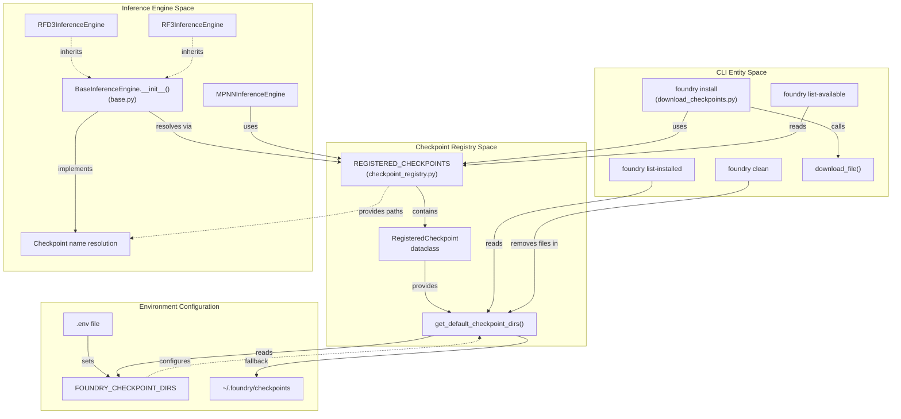
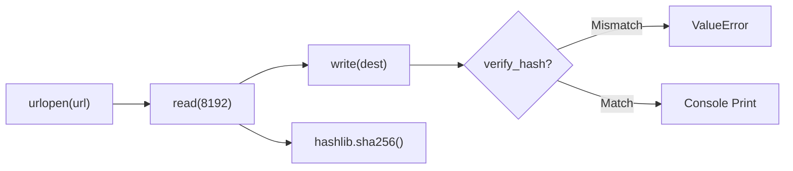

# Checkpoint Management

<details>
<summary>Relevant source files</summary>

The following files were used as context for generating this wiki page:

- [.env](.env)
- [README.md](README.md)
- [models/rfd3/README.md](models/rfd3/README.md)
- [src/foundry/inference_engines/base.py](src/foundry/inference_engines/base.py)
- [src/foundry/inference_engines/checkpoint_registry.py](src/foundry/inference_engines/checkpoint_registry.py)
- [src/foundry_cli/__init__.py](src/foundry_cli/__init__.py)
- [src/foundry_cli/download_checkpoints.py](src/foundry_cli/download_checkpoints.py)
- [tests/test_weight_loading.py](tests/test_weight_loading.py)

</details>


This page documents the checkpoint management infrastructure in Foundry, including the registry of available model checkpoints, download utilities, and how inference engines resolve checkpoint paths.

**Scope:** This page covers the `foundry` CLI commands for managing model weights, the checkpoint registry system, and checkpoint resolution logic. For information about training checkpoints and checkpoint callbacks during training, see [Training Infrastructure](#8.4). For information about using specific models with their checkpoints, see [RFD3 Inference Pipeline](#4.5), [RF3 Inference](#5.2), and [MPNN Inference](#6.3).

---

## Overview

Foundry provides a centralized checkpoint management system that handles:
- Registration of official model checkpoints with metadata (URLs, filenames, hashes).
- Download and verification of model weights via the `foundry` CLI.
- Automatic checkpoint path resolution in inference engines.
- Environment-based configuration of checkpoint storage locations.

The system allows users to reference models by name (e.g., `"rfd3"`, `"rf3"`) rather than absolute paths, with automatic resolution to the correct checkpoint file.

**Sources:** [src/foundry/inference_engines/checkpoint_registry.py:1-71](), [src/foundry_cli/download_checkpoints.py:1-186]()

---

## Architecture

The checkpoint management system consists of three main components: the checkpoint registry, the CLI management layer, and the inference engine integration.

**System Architecture and Code Entities**


**Sources:** [src/foundry/inference_engines/checkpoint_registry.py:1-71](), [src/foundry_cli/download_checkpoints.py:1-186](), [src/foundry/inference_engines/base.py:72-91]()

---

## Checkpoint Registry

The `REGISTERED_CHECKPOINTS` dictionary in [src/foundry/inference_engines/checkpoint_registry.py:80-122]() serves as the single source of truth for available model checkpoints. Each entry is a `RegisteredCheckpoint` dataclass containing:

| Field | Type | Description |
|-------|------|-------------|
| `url` | `str` | Download URL for the checkpoint file |
| `filename` | `str` | Local filename for the checkpoint |
| `description` | `str` | Human-readable description of the model |
| `sha256` | `str` (optional) | SHA256 hash for verification |

### Available Checkpoints

The following checkpoints are currently registered:

| Model Name | Filename | Description |
|------------|----------|-------------|
| `rfd3` | `rfd3_latest.ckpt` | RFdiffusion3 checkpoint [src/foundry/inference_engines/checkpoint_registry.py:86-90]() |
| `rfd3na` | `rfd3na_1190.ckpt` | RFdiffusion3NA checkpoint [src/foundry/inference_engines/checkpoint_registry.py:81-85]() |
| `rf3` | `rf3_foundry_01_24_latest_remapped.ckpt` | Latest RF3 checkpoint [src/foundry/inference_engines/checkpoint_registry.py:91-95]() |
| `proteinmpnn` | `proteinmpnn_v_48_020.pt` | ProteinMPNN checkpoint [src/foundry/inference_engines/checkpoint_registry.py:96-100]() |
| `ligandmpnn` | `ligandmpnn_v_32_010_25.pt` | LigandMPNN checkpoint [src/foundry/inference_engines/checkpoint_registry.py:101-105]() |
| `solublempnn` | `solublempnn_v_48_020.pt` | SolubleMPNN checkpoint [src/foundry/inference_engines/checkpoint_registry.py:117-121]() |

**Sources:** [src/foundry/inference_engines/checkpoint_registry.py:80-122]()

### RegisteredCheckpoint Path Resolution

The `RegisteredCheckpoint` dataclass provides a `get_default_path()` method that searches for the checkpoint across all directories in the search path [src/foundry/inference_engines/checkpoint_registry.py:71-77]().

**Behavior:**
1. Iterates through all checkpoint directories from `get_default_checkpoint_dirs()`.
2. Returns the first existing file with a matching filename.
3. If no existing file is found, it returns the target path in the primary directory (first in the list).

---

## Checkpoint Search Paths

Foundry supports multiple checkpoint directories, searched in order. The `get_default_checkpoint_dirs()` function [src/foundry/inference_engines/checkpoint_registry.py:25-41]() returns the prioritized list.

### Search Priority

1. **`FOUNDRY_CHECKPOINT_DIRS`** environment variable: A colon-separated list (e.g., `/path/to/dir1:/path/to/dir2`) [src/foundry/inference_engines/checkpoint_registry.py:32-40]().
2. **`FOUNDRY_CHECKPOINTS_DIR`**: A legacy singular environment variable checked if the plural version is missing [src/foundry/inference_engines/checkpoint_registry.py:35-36]().
3. **`~/.foundry/checkpoints`**: The default fallback location [src/foundry/inference_engines/checkpoint_registry.py:10]().

The function normalizes paths (expanding `~`, resolving absolute paths) and deduplicates entries using `_normalize_paths` [src/foundry/inference_engines/checkpoint_registry.py:13-22]().

**Sources:** [src/foundry/inference_engines/checkpoint_registry.py:10-41](), [.env:61-63]()

---

## CLI Commands

The `foundry` CLI provides commands for checkpoint management, implemented in `src/foundry_cli/download_checkpoints.py`.

### foundry install

Downloads and optionally verifies model checkpoints.

**Syntax:**
```bash
foundry install <models> [--checkpoint-dir DIR] [--force]
```

**Arguments:**
- `<models>`: List of model names, `"all"`, or `"base-models"`.
- `--checkpoint-dir, -d`: Custom directory to save checkpoints [src/foundry_cli/download_checkpoints.py:150-155]().
- `--force, -f`: Overwrite existing files [src/foundry_cli/download_checkpoints.py:156-158]().

**Behavior:**
1. Resolves the target directory via `_resolve_checkpoint_dirs()`. If a new directory is provided via CLI, it is moved to the front of the search path [src/foundry_cli/download_checkpoints.py:33-43]().
2. Persists the updated directory list to the `.env` file using `append_checkpoint_to_env()` [src/foundry_cli/download_checkpoints.py:46-49]().
3. Iterates through requested models and calls `install_model()`, which performs the download and hash verification [src/foundry_cli/download_checkpoints.py:106-142]().

**Sources:** [src/foundry_cli/download_checkpoints.py:33-51](), [src/foundry_cli/download_checkpoints.py:106-186]()

### foundry list-available & list-installed

- **`list-available`**: Lists all models defined in the `REGISTERED_CHECKPOINTS` dictionary [src/foundry_cli/download_checkpoints.py:188-194]().
- **`list-installed`**: Scans all directories in the search path for `.ckpt` and `.pt` files, displaying their locations and sizes in GB [src/foundry_cli/download_checkpoints.py:196-223]().

---

## Download and Verification Logic

The `download_file()` function manages the network transfer and data integrity [src/foundry_cli/download_checkpoints.py:54-104]().

**Data Flow: Download to Verification**


**Implementation Details:**
- **Progress Tracking**: Uses `rich.progress` to show a bar, download speed, and time remaining [src/foundry_cli/download_checkpoints.py:67-74]().
- **Integrity**: If `verify_hash` is provided, it compares the computed SHA256 against the registry value. On mismatch, the file is unlinked (deleted) [src/foundry_cli/download_checkpoints.py:96-103]().

**Sources:** [src/foundry_cli/download_checkpoints.py:54-104]()

---

## Checkpoint Resolution in Inference Engines

Inference engines resolve checkpoint names to absolute file paths during initialization.

### BaseInferenceEngine Resolution

The `BaseInferenceEngine.__init__` method handles path resolution [src/foundry/inference_engines/base.py:72-91]():

1. **Input Check**: If `ckpt_path` does not contain a dot (`.`), it is treated as a registered model name [src/foundry/inference_engines/base.py:72-74]().
2. **Registry Lookup**: It retrieves the `RegisteredCheckpoint` object from `REGISTERED_CHECKPOINTS` [src/foundry/inference_engines/base.py:78]().
3. **Search Path Traversal**: It calls `ckpt.get_default_path()`, which checks all configured search directories [src/foundry/inference_engines/base.py:80]().
4. **Validation**: It asserts that the file exists at the resolved location before proceeding [src/foundry/inference_engines/base.py:86-90]().

**Sources:** [src/foundry/inference_engines/base.py:72-91](), [src/foundry/inference_engines/checkpoint_registry.py:71-77]()

---

## Environment Configuration

The checkpoint system is highly dependent on the `.env` file and environment variables for pathing.

| Variable | File | Description |
|----------|------|-------------|
| `FOUNDRY_CHECKPOINT_DIRS` | `.env` | Colon-separated list of search paths [.env:61-63]() |
| `HBPLUS_PATH` | `.env` | Path to `hbplus` executable for H-bond metrics [models/rfd3/README.md:38]() |
| `PDB_MIRROR_PATH` | `.env` | Path to local PDB mirror [.env:13]() |

The function `append_checkpoint_to_env` [src/foundry/inference_engines/checkpoint_registry.py:49-61]() uses the `python-dotenv` library to programmatically update the `.env` file whenever a user specifies a new directory via the CLI.

**Sources:** [src/foundry/inference_engines/checkpoint_registry.py:49-61](), [.env:61-63]()

---