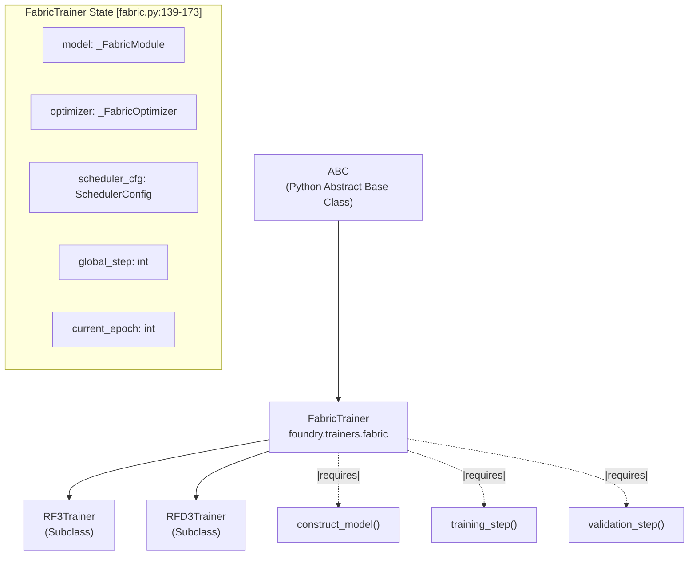
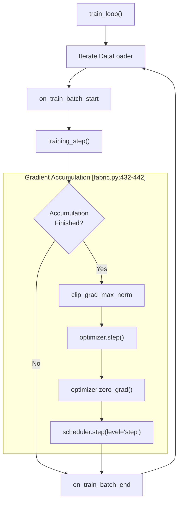

# Training Infrastructure

<details>
<summary>Relevant source files</summary>

The following files were used as context for generating this wiki page:

- [models/mpnn/src/mpnn/inference_engines/mpnn.py](models/mpnn/src/mpnn/inference_engines/mpnn.py)
- [models/mpnn/src/mpnn/model/mpnn.py](models/mpnn/src/mpnn/model/mpnn.py)
- [models/rf3/configs/trainer/xpu.yaml](models/rf3/configs/trainer/xpu.yaml)
- [models/rfd3/configs/trainer/xpu.yaml](models/rfd3/configs/trainer/xpu.yaml)
- [src/foundry/__init__.py](src/foundry/__init__.py)
- [src/foundry/metrics/metric.py](src/foundry/metrics/metric.py)
- [src/foundry/testing/__init__.py](src/foundry/testing/__init__.py)
- [src/foundry/testing/pytest_hooks.py](src/foundry/testing/pytest_hooks.py)
- [src/foundry/trainers/fabric.py](src/foundry/trainers/fabric.py)
- [src/foundry/utils/ddp.py](src/foundry/utils/ddp.py)
- [src/foundry/utils/logging.py](src/foundry/utils/logging.py)
- [src/foundry/utils/squashfs.py](src/foundry/utils/squashfs.py)
- [src/foundry/utils/xpu/__init__.py](src/foundry/utils/xpu/__init__.py)
- [src/foundry/utils/xpu/single_xpu_strategy.py](src/foundry/utils/xpu/single_xpu_strategy.py)
- [src/foundry/utils/xpu/xpu_accelerator.py](src/foundry/utils/xpu/xpu_accelerator.py)
- [src/foundry/utils/xpu/xpu_precision.py](src/foundry/utils/xpu/xpu_precision.py)

</details>


This document describes the training infrastructure built around PyTorch Lightning Fabric, including the `FabricTrainer` base class, distributed training support (DDP), logging systems, and gradient accumulation mechanisms.

## Overview

The Foundry training infrastructure provides a unified framework for training deep learning models across single or multiple GPUs, XPUs, and nodes. The core abstraction is the `FabricTrainer` class, which wraps PyTorch Lightning Fabric to handle:

- **Distributed Training**: Multi-GPU (DDP) and multi-node execution with automatic device detection [src/foundry/utils/ddp.py:22-55]().
- **Mixed Precision**: Automatic mixed precision (AMP) including custom support for Intel XPU devices [src/foundry/utils/xpu/xpu_precision.py:11-41]().
- **Gradient Accumulation**: Efficient training with limited GPU memory by stepping the optimizer every $N$ batches [src/foundry/trainers/fabric.py:69-70]().
- **Checkpointing**: Automatic checkpoint saving and loading with state management for resumable training [src/foundry/trainers/fabric.py:714-895]().
- **Logging**: Integration with W&B, TensorBoard, and a custom `RankedLogger` for clean multi-GPU output [src/foundry/utils/ddp.py:58-79]().

**Sources**: [src/foundry/trainers/fabric.py:1-128](), [src/foundry/utils/ddp.py:1-55]().

## FabricTrainer Architecture

### Class Hierarchy and State

The `FabricTrainer` is an abstract base class (ABC) that provides the boilerplate for training loops while requiring model-specific logic to be implemented in subclasses.



**Sources**: [src/foundry/trainers/fabric.py:57-128](), [src/foundry/trainers/fabric.py:222-237]().

### Hardware Acceleration and DDP

The infrastructure automatically detects hardware and configures the appropriate Lightning Fabric accelerator and strategy.

| Component | Code Entity | Description |
|-----------|-------------|-------------|
| **Accelerator** | `XPUAccelerator` | Custom accelerator for Intel GPUs [src/foundry/utils/xpu/xpu_accelerator.py:9-15](). |
| **Strategy** | `SingleXPUStrategy` | Strategy for single-device Intel XPU training [src/foundry/utils/xpu/single_xpu_strategy.py:13-20](). |
| **DDP Strategy** | `DDPStrategy` | Default strategy for multi-GPU training [src/foundry/trainers/fabric.py:62](). |
| **Precision** | `XPUMixedPrecision` | Custom plugin for XPU `bf16-mixed` or `16-mixed` [src/foundry/utils/xpu/xpu_precision.py:11-20](). |

**Sources**: [src/foundry/utils/ddp.py:22-55](), [src/foundry/utils/xpu/xpu_accelerator.py:9-91]().

## Training and Validation Flow

### Distributed Training Loop

The `train_loop` manages the iteration over the `DataLoader` and handles gradient accumulation.



**Sources**: [src/foundry/trainers/fabric.py:397-502]().

### Metric Management

Foundry uses a `MetricManager` to compute and aggregate metrics during validation.

- **MetricManager**: Orchestrates multiple `Metric` instances [src/foundry/metrics/metric.py:39-60]().
- **Tag-based Execution**: Metrics can be conditionally executed based on tags in `extra_info` (e.g., `required_tags_all`) [src/foundry/metrics/metric.py:143-157]().
- **Hydra Integration**: Managers are typically instantiated via `instantiate_metric_manager` from config [src/foundry/metrics/metric.py:17-32]().

**Sources**: [src/foundry/metrics/metric.py:39-176]().

## Logging and Debugging

### Ranked Logging

To avoid cluttered logs in distributed environments, Foundry provides `RankedLogger`. It prefixes messages with the process rank and can restrict output to rank zero only.

```python
# Example usage in MPNN Inference
from foundry.utils.ddp import RankedLogger
ranked_logger = RankedLogger(__name__, rank_zero_only=True)
ranked_logger.info("Loading MPNN weights.") # Only logs on rank 0
```
**Sources**: [src/foundry/utils/ddp.py:58-112](), [models/mpnn/src/mpnn/inference_engines/mpnn.py:34-170]().

### Configuration Tree

The `print_config_tree` function uses the `rich` library to output the Hydra configuration in a readable YAML-like structure at the start of training, but only on the master process.

**Sources**: [src/foundry/utils/logging.py:127-159]().

## Gradient Accumulation and Optimization

Gradient accumulation is controlled by the `grad_accum_steps` parameter in the `FabricTrainer`.

1. **Context Management**: Fabric handles the `no_sync()` context automatically when `grad_accum_steps > 1`.
2. **Optimizer Step**: `step_optimizer()` is called only when the accumulation buffer is full [src/foundry/trainers/fabric.py:646-685]().
3. **EMA Updates**: If the model supports Exponential Moving Average (EMA), `model.update()` is called immediately after the optimizer step [src/foundry/trainers/fabric.py:682-684]().

**Sources**: [src/foundry/trainers/fabric.py:101](), [src/foundry/trainers/fabric.py:646-685]().

---