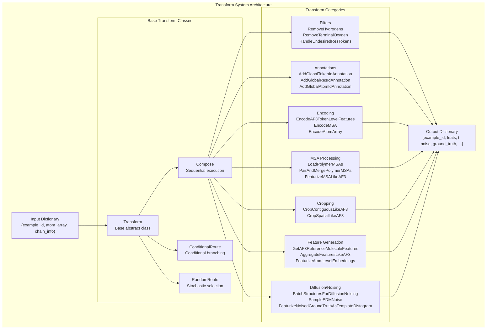
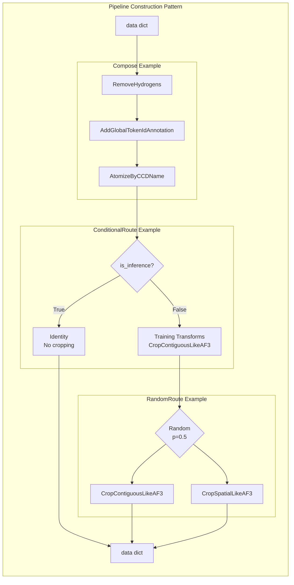
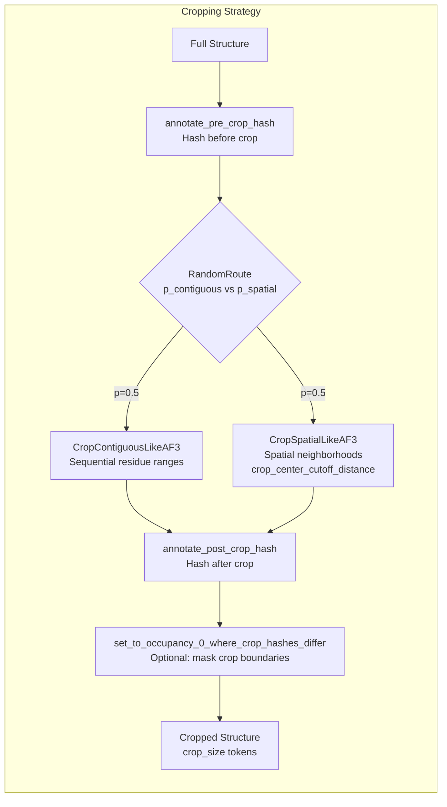
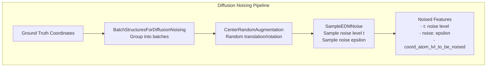
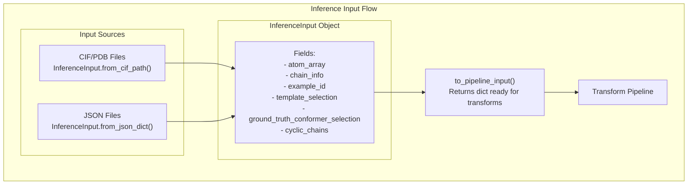
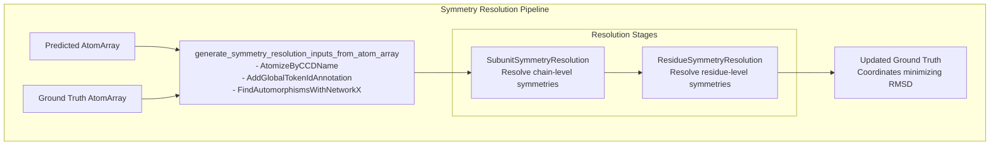

# Data Pipeline and Transforms

<details>
<summary>Relevant source files</summary>

The following files were used as context for generating this wiki page:

- [models/mpnn/tests/conftest.py](models/mpnn/tests/conftest.py)
- [models/rf3/configs/inference_engine/base.yaml](models/rf3/configs/inference_engine/base.yaml)
- [models/rf3/configs/inference_engine/rf3.yaml](models/rf3/configs/inference_engine/rf3.yaml)
- [models/rf3/src/rf3/data/extra_xforms.py](models/rf3/src/rf3/data/extra_xforms.py)
- [models/rf3/src/rf3/data/pipelines.py](models/rf3/src/rf3/data/pipelines.py)
- [models/rf3/src/rf3/inference.py](models/rf3/src/rf3/inference.py)
- [models/rf3/src/rf3/inference_engines/rf3.py](models/rf3/src/rf3/inference_engines/rf3.py)
- [models/rf3/src/rf3/symmetry/resolve.py](models/rf3/src/rf3/symmetry/resolve.py)
- [models/rf3/src/rf3/utils/inference.py](models/rf3/src/rf3/utils/inference.py)
- [models/rfd3/configs/experiment/pretrain.yaml](models/rfd3/configs/experiment/pretrain.yaml)
- [models/rfd3/src/rfd3/model/layers/blocks.py](models/rfd3/src/rfd3/model/layers/blocks.py)
- [models/rfd3/src/rfd3/model/layers/pairformer_layers.py](models/rfd3/src/rfd3/model/layers/pairformer_layers.py)
- [models/rfd3/src/rfd3/testing/debug.py](models/rfd3/src/rfd3/testing/debug.py)
- [models/rfd3/src/rfd3/trainer/dump_validation_structures.py](models/rfd3/src/rfd3/trainer/dump_validation_structures.py)
- [models/rfd3/src/rfd3/transforms/conditioning_base.py](models/rfd3/src/rfd3/transforms/conditioning_base.py)
- [models/rfd3/src/rfd3/transforms/hbonds_hbplus.py](models/rfd3/src/rfd3/transforms/hbonds_hbplus.py)
- [models/rfd3/src/rfd3/transforms/pipelines.py](models/rfd3/src/rfd3/transforms/pipelines.py)

</details>


This page documents the Transform system used throughout Foundry for data preprocessing, augmentation, and feature generation. The Transform system provides a composable, modular approach to building complex data processing pipelines for both training and inference.

For model-specific transform pipelines, see [RF3 Data Pipeline](#5.6). For training infrastructure that uses these pipelines, see [Training Infrastructure](#7.4).

## Purpose and Architecture

The Transform system in Foundry is built on AtomWorks' transform framework, which provides a composable pipeline architecture for processing biomolecular structures. Transforms take a dictionary as input (typically containing an `atom_array` and metadata), perform operations on it, and return a modified dictionary. This functional approach enables:

- **Composability**: Transforms can be chained together into complex pipelines [models/rf3/src/rf3/data/pipelines.py:41-47]()
- **Reusability**: Individual transforms can be shared across different models and tasks [models/rfd3/src/rfd3/transforms/pipelines.py:27-65]()
- **Flexibility**: Conditional and random routing enables training-time augmentation [models/rf3/src/rf3/data/pipelines.py:114-125]()
- **Type Safety**: Transforms validate their inputs and declare dependencies on previous transforms [models/rfd3/src/rfd3/transforms/hbonds_hbplus.py:188-192]()



**Diagram: Transform System Architecture showing base classes and major transform categories**

Sources: [models/rf3/src/rf3/data/pipelines.py:1-112](), [models/rfd3/src/rfd3/transforms/pipelines.py:1-103]()

## Transform Base Classes

### Core Transform Types

The transform system provides several fundamental building blocks for constructing pipelines:

| Transform Class | Purpose | Example Usage |
|----------------|---------|---------------|
| `Transform` | Base abstract class | All transforms inherit from this [models/rfd3/src/rfd3/transforms/hbonds_hbplus.py:177]() |
| `Compose` | Sequential execution | Chain multiple transforms together [models/rf3/src/rf3/data/pipelines.py:41]() |
| `ConditionalRoute` | Conditional branching | Apply different transforms based on conditions [models/rf3/src/rf3/data/pipelines.py:42]() |
| `RandomRoute` | Stochastic selection | Randomly choose between transform options [models/rf3/src/rf3/data/pipelines.py:45]() |
| `Identity` | No-op transform | Used in conditional branches as a pass-through [models/rf3/src/rf3/data/pipelines.py:44]() |
| `AddData` | Add key-value pairs | Inject metadata into the pipeline [models/rf3/src/rf3/data/pipelines.py:39]() |
| `SubsetToKeys` | Filter dictionary keys | Remove unnecessary keys before output [models/rf3/src/rf3/data/pipelines.py:46]() |
| `ConvertToTorch` | Type conversion | Convert numpy arrays to PyTorch tensors [models/rf3/src/rf3/data/pipelines.py:43]() |



**Diagram: Common pipeline construction patterns using Compose, ConditionalRoute, and RandomRoute**

Sources: [models/rf3/src/rf3/data/pipelines.py:114-125](), [models/rfd3/src/rfd3/transforms/pipelines.py:117-141]()

### Training vs Inference Routing

Foundry uses helper functions to create conditional transforms that behave differently during training vs inference:

```python
# Helper functions for conditional routing
def TrainingRoute(transform):
    return ConditionalRoute(
        condition_func=lambda data: data["is_inference"],
        transform_map={True: Identity(), False: transform}
    )

def InferenceRoute(transform):
    return ConditionalRoute(
        condition_func=lambda data: data["is_inference"],
        transform_map={False: Identity(), True: transform}
    )
```

These helpers enable clean separation of training-specific augmentations (cropping, mirroring, noise sampling) from inference behavior [models/rf3/src/rf3/data/pipelines.py:114-125]().

Sources: [models/rf3/src/rf3/data/pipelines.py:114-125](), [models/rfd3/src/rfd3/transforms/pipelines.py:117-128]()

## Transform Categories

### Structure Filtering and Preprocessing

These transforms remove unwanted atoms or structures and prepare the input for further processing:

| Transform | Purpose | Configuration |
|-----------|---------|---------------|
| `RemoveHydrogens` | Remove hydrogen atoms | Always applied [models/rfd3/src/rfd3/transforms/pipelines.py:150]() |
| `RemoveTerminalOxygen` | Remove terminal oxygen atoms | Always applied [models/rfd3/src/rfd3/transforms/pipelines.py:154]() |
| `RemoveUnresolvedPNUnits` | Remove unresolved polymer/non-polymer units | Training only [models/rfd3/src/rfd3/transforms/pipelines.py:157]() |
| `HandleUndesiredResTokens` | Remove or flag undesired residue types | Configurable list (e.g., AF3_EXCLUDED_LIGANDS) [models/rfd3/src/rfd3/transforms/pipelines.py:162]() |
| `RemovePolymersWithTooFewResolvedResidues` | Filter chains with insufficient resolved residues | min_residues parameter [models/rfd3/src/rfd3/transforms/pipelines.py:159]() |
| `RandomlyRemoveLigands` | Stochastically drop ligands during training | ligand_dropout_prob parameter [models/rf3/src/rf3/data/pipelines.py:82]() |

Sources: [models/rf3/src/rf3/data/pipelines.py:79-88](), [models/rfd3/src/rfd3/transforms/pipelines.py:144-184]()

### Annotation Transforms

These transforms add essential annotations to the `AtomArray` that are used by downstream transforms:

```mermaid
graph TB
    subgraph "Annotation Pipeline Flow"
        AA["AtomArray<br/>Raw structure"]
        
        GlobalAtom["AddGlobalAtomIdAnnotation<br/>Adds: atom_id"]
        GlobalToken["AddGlobalTokenIdAnnotation<br/>Adds: token_id"]
        GlobalRes["AddGlobalResIdAnnotation<br/>Adds: res_id"]
        WithinChain["AddWithinChainInstanceResIdx<br/>Adds: within_chain_res_idx"]
        WithinPoly["AddWithinPolyResIdxAnnotation<br/>Adds: within_poly_res_idx"]
        AtomToToken["ComputeAtomToTokenMap<br/>Creates mapping structure"]
        
        AA --> GlobalAtom
        GlobalAtom --> GlobalToken
        GlobalToken --> GlobalRes
        GlobalRes --> WithinChain
        WithinChain --> WithinPoly
        WithinPoly --> AtomToToken
        
        Output["Annotated AtomArray<br/>Ready for encoding"]
        AtomToToken --> Output
    end
```



**Diagram: Annotation transform sequence showing dependencies**

Sources: [models/rf3/src/rf3/data/pipelines.py:19-27](), [models/rfd3/src/rfd3/transforms/pipelines.py:18-26]()

### MSA Processing Pipeline

The MSA processing pipeline loads, pairs, and featurizes multiple sequence alignments for RF3:

| Transform | Purpose | Key Parameters |
|-----------|---------|----------------|
| `LoadPolymerMSAs` | Load protein and RNA MSAs from disk | protein_msa_dirs, rna_msa_dirs [models/rf3/src/rf3/data/pipelines.py:94]() |
| `PairAndMergePolymerMSAs` | Pair MSAs across chains | dense [models/rf3/src/rf3/data/pipelines.py:95]() |
| `EncodeMSA` | Encode MSAs using sequence encoding | encoding [models/rf3/src/rf3/data/pipelines.py:91]() |
| `FillFullMSAFromEncoded` | Fill MSA for cropped structures | pad_token [models/rf3/src/rf3/data/pipelines.py:93]() |
| `FeaturizeMSALikeAF3` | Generate MSA features | n_recycles, n_msa [models/rf3/src/rf3/data/pipelines.py:92]() |

Sources: [models/rf3/src/rf3/data/pipelines.py:90-96]()

### Cropping Transforms

Cropping reduces structure size for training efficiency while maintaining biological context. Foundry supports contiguous and spatial cropping [models/rf3/src/rf3/data/pipelines.py:61]().



**Diagram: Cropping pipeline with pre/post-hash tracking and optional edge masking**

Sources: [models/rf3/src/rf3/data/pipeline_utils.py:106-111](), [models/rfd3/src/rfd3/transforms/pipelines.py:187-214]()

### Ground Truth Template Conditioning

Foundry generative models (RFD3) use conditioning transforms to leak ground truth information during training:

| Transform | Purpose | Key Parameters |
|-----------|---------|----------------|
| `SampleConditioningType` | Choose conditioning mode (motif, island, etc.) | p_unconditional [models/rfd3/src/rfd3/transforms/conditioning_base.py:69]() |
| `SampleConditioningFlags` | Flag tokens for conditioning | island_frequency [models/rfd3/src/rfd3/transforms/conditioning_base.py:68]() |
| `UnindexFlaggedTokens` | Mask flagged tokens from model input | p_unindex_motif_tokens [models/rfd3/src/rfd3/transforms/conditioning_base.py:71]() |
| `CalculateHbondsPlus` | Calculate hydrogen bonds for motif conditioning | cutoff_HA_dist [models/rfd3/src/rfd3/transforms/hbonds_hbplus.py:177]() |

Sources: [models/rfd3/src/rfd3/transforms/conditioning_base.py:67-72](), [models/rfd3/src/rfd3/transforms/hbonds_hbplus.py:177-200]()

### Feature Aggregation and Encoding

These transforms prepare the final model inputs:

| Transform | Purpose | Output Keys |
|-----------|---------|-------------|
| `EncodeAF3TokenLevelFeatures` | Encode token-level features | feats["encoded"] [models/rf3/src/rf3/data/pipelines.py:67]() |
| `GetAF3ReferenceMoleculeFeatures` | Generate reference conformer features | feats["ref_pos"] [models/rf3/src/rf3/data/pipelines.py:15]() |
| `FeaturizeAtomLevelEmbeddings` | Create atom-level embeddings (e.g., MACE) | feats["atom_level_embeddings"] [models/rf3/src/rf3/data/pipelines.py:33]() |
| `AggregateFeaturesLikeAF3` | Aggregate all features into model-ready format | feats[...] [models/rf3/src/rf3/data/pipelines.py:70]() |

Sources: [models/rf3/src/rf3/data/pipelines.py:14-73](), [models/rfd3/src/rfd3/transforms/pipelines.py:98-103]()

### Diffusion Noising

For generative models like RFD3, diffusion transforms prepare noised coordinates:



**Diagram: Diffusion noising pipeline for generative models**

Sources: [models/rf3/src/rf3/data/pipelines.py:62-65](), [models/rfd3/src/rfd3/transforms/pipelines.py:47-50]()

## Dataset Integration

### InferenceInput Preparation

For inference, the `InferenceInput` class handles input preparation before applying transforms:



**Diagram: InferenceInput preparation flow showing multiple input sources**

Key methods:

- `InferenceInput.from_cif_path()`: Load from structure files [models/rf3/src/rf3/utils/inference.py:72-142]()
- `InferenceInput.from_json_dict()`: Load from JSON specification [models/rf3/src/rf3/utils/inference.py:145-205]()

Sources: [models/rf3/src/rf3/utils/inference.py:61-205]()

### InferenceInputDataset

For batch inference, `InferenceInputDataset` wraps multiple inputs and provides token counts for load balancing [models/rf3/src/rf3/inference_engines/rf3.py:28]().

Sources: [models/rf3/src/rf3/inference_engines/rf3.py:28](), [models/rf3/src/rf3/utils/inference.py:29]()

## Symmetry Resolution

Symmetry resolution is applied post-prediction to align ground truth with predicted structures:



**Diagram: Symmetry resolution pipeline for post-prediction alignment**

The `resolve_symmetries()` function provides a high-level interface [models/rf3/src/rf3/symmetry/resolve.py:23-42]().

Sources: [models/rf3/src/rf3/symmetry/resolve.py:1-112]()

---

**Summary**: The Transform system provides a flexible, composable framework for building complex data processing pipelines. By combining base transforms (Compose, ConditionalRoute, RandomRoute) with domain-specific transforms (filtering, encoding, MSA processing, cropping, noising), Foundry enables sophisticated training and inference workflows that can be easily configured and extended.

---