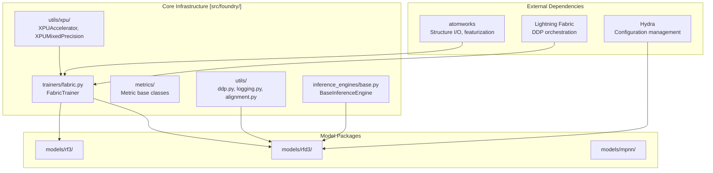

# Advanced Topics

<details>
<summary>Relevant source files</summary>

The following files were used as context for generating this wiki page:

- [models/rf3/configs/trainer/xpu.yaml](models/rf3/configs/trainer/xpu.yaml)
- [models/rfd3/configs/trainer/xpu.yaml](models/rfd3/configs/trainer/xpu.yaml)
- [models/rfd3/src/rfd3/model/inference_sampler.py](models/rfd3/src/rfd3/model/inference_sampler.py)
- [models/rfd3/src/rfd3/model/layers/block_utils.py](models/rfd3/src/rfd3/model/layers/block_utils.py)
- [src/foundry/trainers/fabric.py](src/foundry/trainers/fabric.py)
- [src/foundry/utils/xpu/__init__.py](src/foundry/utils/xpu/__init__.py)
- [src/foundry/utils/xpu/single_xpu_strategy.py](src/foundry/utils/xpu/single_xpu_strategy.py)
- [src/foundry/utils/xpu/xpu_accelerator.py](src/foundry/utils/xpu/xpu_accelerator.py)
- [src/foundry/utils/xpu/xpu_precision.py](src/foundry/utils/xpu/xpu_precision.py)

</details>


This section covers advanced usage patterns and customization options for users who need to extend beyond standard inference workflows. Topics include distributed training, custom dataset creation, and metrics implementation.

## Overview

Advanced topics in Foundry span three main areas:

- **[Distributed Training and Inference](#9.1)**: Multi-GPU and multi-node execution patterns using Lightning Fabric.
- **[Custom Datasets](#9.2)**: Creating and using custom AtomWorks datasets for specialized protein design tasks.
- **[Metrics and Evaluation](#9.3)**: Available metrics and implementation of custom evaluation protocols.

These capabilities build on the core infrastructure documented in [Infrastructure and Configuration](#8).

## System Architecture for Advanced Use Cases

Understanding Foundry's architecture is essential for advanced customization. The system separates shared infrastructure from model-specific implementations.

### Repository Structure



The strict dependency hierarchy is: `atomworks` → `foundry` → `model packages`. Models are independent packages that depend on foundry but not on each other.

**Sources:** [src/foundry/trainers/fabric.py:57-129](), [src/foundry/utils/xpu/__init__.py:1-27](), [models/rfd3/src/rfd3/model/inference_sampler.py:12-18]()

## Key Extension Points

Foundry provides primary extension points for customization:

### Training Infrastructure

The `FabricTrainer` class in [src/foundry/trainers/fabric.py:57-84]() orchestrates distributed training. It includes native support for:
- **Mixed Precision**: Supports `bf16-mixed` and `16-mixed` [src/foundry/trainers/fabric.py:65-65]().
- **Hardware Abstraction**: Includes specialized support for Intel GPUs via `XPUAccelerator` and `XPUMixedPrecision` [src/foundry/utils/xpu/xpu_precision.py:11-42]().
- **Gradient Management**: Configurable `grad_accum_steps`, `clip_grad_max_norm`, and `skip_nan_grad` [src/foundry/trainers/fabric.py:69-76]().

See [Distributed Training and Inference](#9.1) for detailed usage.

### Diffusion Sampling Customization

For generative tasks in RFD3, the `SampleDiffusionConfig` and `SampleDiffusionWithMotif` classes allow for deep control over the sampling process [models/rfd3/src/rfd3/model/inference_sampler.py:24-58]().
- **Noise Schedules**: Custom inference noise schedules following AlphaFold 3 specifications [models/rfd3/src/rfd3/model/inference_sampler.py:61-88]().
- **Partial Diffusion**: Filtering the noise schedule based on a `partial_t` parameter for motif scaffolding [models/rfd3/src/rfd3/model/inference_sampler.py:89-131]().

**Sources:** [models/rfd3/src/rfd3/model/inference_sampler.py:24-131](), [src/foundry/trainers/fabric.py:57-129]()

## Hardware-Specific Advanced Usage

### Intel XPU Support
Foundry includes a dedicated utility suite for Intel XPU devices, allowing the same training code to run on Intel hardware with minimal configuration changes.

| Component | Class | File Path |
|-----------|-------|-----------|
| Accelerator | `XPUAccelerator` | [src/foundry/utils/xpu/xpu_accelerator.py:9-14]() |
| Strategy | `SingleXPUStrategy` | [src/foundry/utils/xpu/single_xpu_strategy.py:13-20]() |
| Precision | `XPUMixedPrecision` | [src/foundry/utils/xpu/xpu_precision.py:11-16]() |

To use XPU, you can apply the `xpu` trainer configuration:
```bash
python models/rfd3/src/rfd3/train.py trainer=xpu
```
**Sources:** [models/rfd3/configs/trainer/xpu.yaml:1-7](), [src/foundry/utils/xpu/__init__.py:1-27]()

## Distributed Training Overview

Foundry uses Lightning Fabric for distributed execution. The `FabricTrainer` handles rank-aware logging and device setup.

### Rank Management
The `RankedLogger` ensures that logs are clean during multi-GPU runs by restricting output to rank zero where appropriate [models/rfd3/src/rfd3/model/inference_sampler.py:21-21]().

### Configuration Parameters

| Parameter | Purpose | Example |
|-----------|---------|---------|
| `strategy` | Distributed strategy | `"ddp"` or `"xpu_single"` |
| `devices_per_node` | Number of GPUs/XPUs | `8` |
| `num_nodes` | Number of machines | `1` |
| `precision` | Floating point mode | `"bf16-mixed"` |

**Sources:** [src/foundry/trainers/fabric.py:61-65](), [models/rf3/configs/trainer/xpu.yaml:1-7]()

## Next Steps

- **[Distributed Training and Inference](#9.1)**: Document multi-GPU training setup, DDP configuration, and rank management.
- **[Custom Datasets](#9.2)**: Guide for creating and using custom datasets with AtomWorks for both training and inference.
- **[Metrics and Evaluation](#9.3)**: Document available metrics including hydrogen bond statistics, RMSD, and sequence recovery.

---