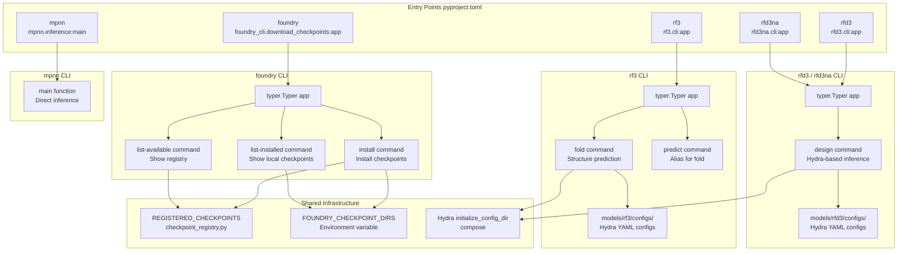

# CLI Reference

<details>
<summary>Relevant source files</summary>

The following files were used as context for generating this wiki page:

- [.env](.env)
- [README.md](README.md)
- [models/rf3/configs/experiment/pretrained/rf3.yaml](models/rf3/configs/experiment/pretrained/rf3.yaml)
- [models/rf3/src/rf3/callbacks/dump_validation_structures.py](models/rf3/src/rf3/callbacks/dump_validation_structures.py)
- [models/rf3/src/rf3/cli.py](models/rf3/src/rf3/cli.py)
- [models/rf3/src/rf3/utils/io.py](models/rf3/src/rf3/utils/io.py)
- [models/rfd3/README.md](models/rfd3/README.md)
- [models/rfd3/src/rfd3/cli.py](models/rfd3/src/rfd3/cli.py)
- [pyproject.toml](pyproject.toml)
- [src/foundry/inference_engines/base.py](src/foundry/inference_engines/base.py)
- [src/foundry/inference_engines/checkpoint_registry.py](src/foundry/inference_engines/checkpoint_registry.py)
- [src/foundry_cli/__init__.py](src/foundry_cli/__init__.py)
- [src/foundry_cli/download_checkpoints.py](src/foundry_cli/download_checkpoints.py)

</details>


This page documents the command-line interfaces for the Foundry system. Foundry provides four main CLI commands for model checkpoint management and inference across RFdiffusion3, RosettaFold3, and ProteinMPNN/LigandMPNN.

For detailed usage examples of specific design applications, see the model-specific documentation: [RFD3 Overview and Capabilities](#4.1), [RF3 Overview](#5.1), and [MPNN Overview](#6.1). For information about the underlying configuration system that powers these CLIs, see [Configuration System](#8.2).

## CLI Architecture Overview



**Sources**: [pyproject.toml:90-94](), [src/foundry_cli/download_checkpoints.py:29-30](), [models/rfd3/src/rfd3/cli.py:6-7](), [models/rf3/src/rf3/cli.py:6]()

## Command Entry Points

All CLI commands are registered as console scripts in [pyproject.toml:90-94]() and become available after package installation:

| Command | Module Path | Purpose |
|---------|-------------|---------|
| `foundry` | `foundry_cli.download_checkpoints:app` | Checkpoint management |
| `rfd3` | `rfd3.cli:app` | RFdiffusion3 design |
| `rfd3na` | `rfd3na.cli:app` | RFdiffusion3NA design |
| `rf3` | `rf3.cli:app` | RosettaFold3 structure prediction |
| `mpnn` | `mpnn.inference:main` | ProteinMPNN/LigandMPNN sequence design |

**Sources**: [pyproject.toml:90-94]()

## foundry CLI

The `foundry` command manages model checkpoint installation and discovery. It uses a checkpoint registry [src/foundry/inference_engines/checkpoint_registry.py:80-122]() and supports multiple checkpoint directories via the `FOUNDRY_CHECKPOINT_DIRS` environment variable [src/foundry/inference_engines/checkpoint_registry.py:32-41]().

### Subcommands

#### install

Install model checkpoints from the remote registry.

**Syntax:**
```bash
foundry install MODELS [OPTIONS]
```

**Arguments:**
- `MODELS` (required): Space-separated list of models to install. Options:
  - `all` - All available models [src/foundry_cli/download_checkpoints.py:173-174]()
  - `base-models` - Core models: rfd3, rfd3na, proteinmpnn, ligandmpnn, rf3 [src/foundry_cli/download_checkpoints.py:175-176]()
  - Individual model names: `rfd3`, `rfd3na`, `rf3`, `proteinmpnn`, `ligandmpnn`, etc.

**Options:**
- `--checkpoint-dir, -d PATH` - Directory to save checkpoints (default: `~/.foundry/checkpoints`) [src/foundry_cli/download_checkpoints.py:150-155]()
- `--force, -f` - Overwrite existing checkpoints [src/foundry_cli/download_checkpoints.py:156-158]()

**Implementation:** [src/foundry_cli/download_checkpoints.py:144-186]()

#### list-available

Display all models in the checkpoint registry defined in `REGISTERED_CHECKPOINTS`.

**Syntax:**
```bash
foundry list-available
```

**Implementation:** [src/foundry_cli/download_checkpoints.py:188-193]()

#### list-installed

Show checkpoints installed in search directories (defined by `FOUNDRY_CHECKPOINT_DIRS` and `~/.foundry/checkpoints`).

**Syntax:**
```bash
foundry list-installed
```

**Implementation:** [src/foundry_cli/download_checkpoints.py:196-222]()

**Sources**: [src/foundry_cli/download_checkpoints.py:1-274](), [src/foundry/inference_engines/checkpoint_registry.py:1-122]()

## rfd3 / rfd3na CLI

The `rfd3` and `rfd3na` commands provide access to RFdiffusion generative design. They use Hydra for configuration management.

### design Command

Run generative protein or nucleic acid design.

**Syntax:**
```bash
rfd3 design [HYDRA_OVERRIDES...]
rfd3na design [HYDRA_OVERRIDES...]
```

**Common Parameters:**

| Parameter | Default | Description |
|-----------|---------|-------------|
| `out_dir` | Required | Output directory for generated structures |
| `inputs` | Required | Path to input specification JSON/YAML file |
| `inference_engine` | `rfdiffusion3` | Inference engine config to use [models/rfd3/src/rfd3/cli.py:33]() |
| `dump_trajectories` | `False` | Save diffusion trajectories [models/rfd3/README.md:52]() |
| `prevalidate_inputs` | `False` | Validate inputs before loading model [models/rfd3/README.md:53]() |

**Implementation:** [models/rfd3/src/rfd3/cli.py:9-43]()

**Sources**: [models/rfd3/src/rfd3/cli.py:1-48](), [models/rfd3/README.md:40-64]()

## rf3 CLI

The `rf3` command provides structure prediction using RosettaFold3. It supports `fold` and `predict` aliases.

### fold / predict Commands

**Syntax:**
```bash
rf3 fold [OPTIONS] [ARGUMENTS...]
rf3 predict [OPTIONS] [ARGUMENTS...]
```

**Options:**
- `--verbose, -v` - Show detailed logging output [models/rf3/src/rf3/cli.py:14-16]()

**Arguments:**
The CLI supports Hydra override style (`key=value`). If a single argument without `=` is provided, it is assumed to be the `inputs` path [models/rf3/src/rf3/cli.py:46-48]().

**Implementation:** [models/rf3/src/rf3/cli.py:9-86]()

**Sources**: [models/rf3/src/rf3/cli.py:1-87]()

## mpnn CLI

The `mpnn` command provides sequence design using ProteinMPNN/LigandMPNN.

**Syntax:**
```bash
mpnn [ARGUMENTS...]
```

**Implementation:** The entry point is `mpnn.inference:main` [pyproject.toml:93](). This engine handles inverse-folding tasks for backbones under constrained conditions [README.md:102]().

**Sources**: [pyproject.toml:93](), [README.md:101-105]()

## Infrastructure Integration

### Checkpoint Resolution

When a model name is provided to an inference engine, it is resolved via `BaseInferenceEngine`:
1. If the path is a registered name, it looks up the default path from the registry [src/foundry/inference_engines/base.py:72-80]().
2. It searches all directories in the `FOUNDRY_CHECKPOINT_DIRS` search path [src/foundry/inference_engines/checkpoint_registry.py:71-77]().

### Environment Variables

Foundry uses a `.env` file to manage external tool paths and data mirrors:
- `HBPLUS_PATH`: Path to the `hbplus` executable for hydrogen bond calculation [models/rfd3/README.md:38](), [.env:29-32]().
- `FOUNDRY_CHECKPOINT_DIRS`: Colon-separated list of directories to search for model weights [.env:61-63]().
- `PDB_MIRROR_PATH` and `CCD_MIRROR_PATH`: Paths to local PDB and CCD mirrors for training and inference [.env:9-22]().

**Sources**: [src/foundry/inference_engines/base.py:71-91](), [src/foundry/inference_engines/checkpoint_registry.py:25-42](), [.env:1-63]()

---