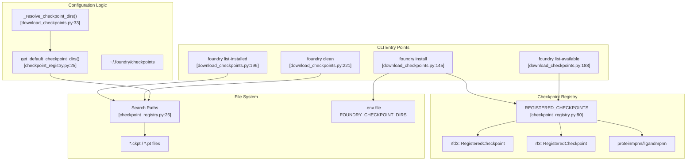
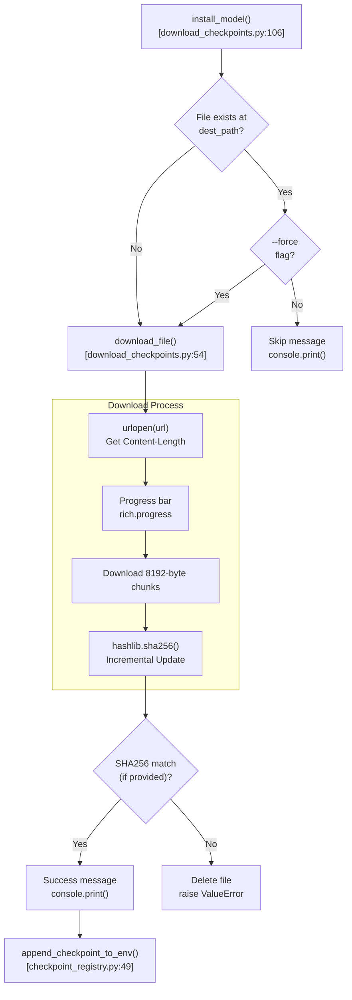

# foundry CLI

<details>
<summary>Relevant source files</summary>

The following files were used as context for generating this wiki page:

- [.env](.env)
- [README.md](README.md)
- [models/rfd3/README.md](models/rfd3/README.md)
- [src/foundry/inference_engines/base.py](src/foundry/inference_engines/base.py)
- [src/foundry/inference_engines/checkpoint_registry.py](src/foundry/inference_engines/checkpoint_registry.py)
- [src/foundry_cli/__init__.py](src/foundry_cli/__init__.py)
- [src/foundry_cli/download_checkpoints.py](src/foundry_cli/download_checkpoints.py)

</details>


The `foundry` CLI provides checkpoint management utilities for downloading, verifying, and managing model weights for RFD3, RF3, ProteinMPNN, and LigandMPNN models. This page documents the command-line interface for checkpoint installation and maintenance.

For information about using models after checkpoint installation, see model-specific CLI pages: [rfd3 CLI](), [rf3 CLI](), and [mpnn CLI]().

## Overview

The foundry CLI manages model checkpoints through four primary commands that handle the complete lifecycle of checkpoint management: discovering available models, downloading and verifying checkpoints, inspecting installed checkpoints, and cleaning up storage.

**Command Summary**

| Command | Purpose |
|---------|---------|
| `foundry install` | Download and verify model checkpoints |
| `foundry list-available` | Display available models in the remote registry |
| `foundry list-installed` | Show installed checkpoints and disk usage across search paths |
| `foundry clean` | Remove downloaded checkpoints from the primary directory |

All commands are implemented in `src/foundry_cli/download_checkpoints.py` [src/foundry_cli/download_checkpoints.py:1-240](). The CLI uses the checkpoint registry in `src/foundry/inference_engines/checkpoint_registry.py` [src/foundry/inference_engines/checkpoint_registry.py:80-122]() as the source of truth for available models, URLs, and filenames.

Sources: [src/foundry_cli/download_checkpoints.py:1-240](), [src/foundry/inference_engines/checkpoint_registry.py:1-122]()

## Architecture

### CLI and Registry System



The CLI commands interact with the `REGISTERED_CHECKPOINTS` dictionary to discover available models [src/foundry/inference_engines/checkpoint_registry.py:80-122](). Each `RegisteredCheckpoint` object contains the download URL, filename, and description [src/foundry/inference_engines/checkpoint_registry.py:65-69](). The system resolves search paths using `get_default_checkpoint_dirs()`, which combines the default `~/.foundry/checkpoints` with any paths defined in the `FOUNDRY_CHECKPOINT_DIRS` environment variable [src/foundry/inference_engines/checkpoint_registry.py:25-41]().

Sources: [src/foundry_cli/download_checkpoints.py:33-51](), [src/foundry/inference_engines/checkpoint_registry.py:25-122]()

### Download and Verification Flow



The `download_file()` function implements streaming download with progress tracking using `rich.progress` [src/foundry_cli/download_checkpoints.py:67-81](). Each 8192-byte chunk is written to disk and fed to a SHA256 hasher for verification [src/foundry_cli/download_checkpoints.py:86-93](). If the computed hash doesn't match the expected hash from the registry, the corrupted file is deleted [src/foundry_cli/download_checkpoints.py:96-103]().

Sources: [src/foundry_cli/download_checkpoints.py:54-105](), [src/foundry_cli/download_checkpoints.py:106-143]()

## Commands

### `foundry install`

Download and verify model checkpoints from the registry.

**Usage:**
```bash
foundry install <models...> [OPTIONS]
```

**Arguments:**
- `models`: One or more model names to install. 
  - `all`: Installs every registered model [src/foundry_cli/download_checkpoints.py:173-174]().
  - `base-models`: Installs `rfd3`, `rfd3na`, `proteinmpnn`, `ligandmpnn`, and `rf3` [src/foundry_cli/download_checkpoints.py:175-176]().
  - Individual names: `rfd3`, `rf3`, `proteinmpnn`, etc. [src/foundry_cli/download_checkpoints.py:178]().

**Options:**
- `--checkpoint-dir, -d PATH`: Directory to save checkpoints. Defaults to search path [src/foundry_cli/download_checkpoints.py:150-155]().
- `--force, -f`: Overwrite existing checkpoints [src/foundry_cli/download_checkpoints.py:156-158]().

**Behavior:**
1. Resolves the target directory. If a custom directory is provided, it is moved to the front of the search path and persisted to the `.env` file via `append_checkpoint_to_env()` [src/foundry_cli/download_checkpoints.py:33-51]().
2. Iterates through requested models and calls `install_model()` [src/foundry_cli/download_checkpoints.py:181-182]().
3. Downloads files using `urllib.request.urlopen` in chunks [src/foundry_cli/download_checkpoints.py:76-93]().

Sources: [src/foundry_cli/download_checkpoints.py:145-187](), [src/foundry/inference_engines/checkpoint_registry.py:49-61]()

### `foundry list-available`

Display all models registered in the Foundry registry available for download.

**Usage:**
```bash
foundry list-available
```

**Implementation:**
Iterates over `REGISTERED_CHECKPOINTS.items()` and prints each model name with its description [src/foundry_cli/download_checkpoints.py:192-193]().

Sources: [src/foundry_cli/download_checkpoints.py:188-194](), [src/foundry/inference_engines/checkpoint_registry.py:80-122]()

### `foundry list-installed`

Display checkpoints currently found in the search paths (`~/.foundry/checkpoints` and `$FOUNDRY_CHECKPOINT_DIRS`).

**Usage:**
```bash
foundry list-installed
```

**Behavior:**
1. Retrieves all active checkpoint directories [src/foundry_cli/download_checkpoints.py:199]().
2. Scans for `*.ckpt` and `*.pt` files [src/foundry_cli/download_checkpoints.py:205]().
3. Calculates and displays file sizes in GB [src/foundry_cli/download_checkpoints.py:207-217]().

Sources: [src/foundry_cli/download_checkpoints.py:196-219]()

### `foundry clean`

Remove downloaded checkpoint files from the primary directory.

**Usage:**
```bash
foundry clean [OPTIONS]
```

**Options:**
- `--checkpoint-dir, -d PATH`: Specific directory to clean [src/foundry_cli/download_checkpoints.py:226]().
- `--confirm/--no-confirm`: Toggle the interactive confirmation prompt [src/foundry_cli/download_checkpoints.py:227]().

Sources: [src/foundry_cli/download_checkpoints.py:221-240]()

## Checkpoint Registry

### Registry Structure

The `REGISTERED_CHECKPOINTS` dictionary defines the metadata for all supported models [src/foundry/inference_engines/checkpoint_registry.py:80-122]().

**RegisteredCheckpoint Dataclass:** [src/foundry/inference_engines/checkpoint_registry.py:64-69]()
```python
@dataclass
class RegisteredCheckpoint:
    url: str              # Remote URL for download
    filename: str         # Target filename on disk
    description: str      # UI description
    sha256: None = None   # Verification hash
```

**Key Registered Models:**

| Key | Filename | Description |
|-----|----------|-------------|
| `rfd3` | `rfd3_latest.ckpt` | RFdiffusion3 checkpoint [src/foundry/inference_engines/checkpoint_registry.py:86-90]() |
| `rf3` | `rf3_foundry_01_24_latest_remapped.ckpt` | Latest RF3 checkpoint [src/foundry/inference_engines/checkpoint_registry.py:91-95]() |
| `proteinmpnn` | `proteinmpnn_v_48_020.pt` | ProteinMPNN checkpoint [src/foundry/inference_engines/checkpoint_registry.py:96-100]() |

### Path Resolution Logic

The system supports multiple search paths for checkpoints to facilitate shared environments and custom installs.

1. **Default Path**: `~/.foundry/checkpoints` [src/foundry/inference_engines/checkpoint_registry.py:10]().
2. **Environment Variable**: `FOUNDRY_CHECKPOINT_DIRS` (colon-separated list) [src/foundry/inference_engines/checkpoint_registry.py:32-40]().
3. **Resolution**: `get_default_checkpoint_dirs()` returns a normalized, deduplicated list of these paths, prioritizing the environment variable entries [src/foundry/inference_engines/checkpoint_registry.py:25-41]().

**Inference Integration**:
Inference engines use `RegisteredCheckpoint.get_default_path()` to find weights. It iterates through all registered search paths and returns the first existing match, or the primary path if none are found [src/foundry/inference_engines/checkpoint_registry.py:71-77]().

Sources: [src/foundry/inference_engines/checkpoint_registry.py:1-78](), [src/foundry/inference_engines/base.py:72-91]()

## Configuration and Persistence

### Environment Variable Management

Foundry uses `.env` files to persist configuration across sessions.

- **Loading**: `load_dotenv(override=True)` is called at the CLI entry point [src/foundry_cli/download_checkpoints.py:27]().
- **Persistence**: When a user specifies a `--checkpoint-dir` during installation, the CLI calls `append_checkpoint_to_env()`. This function uses `dotenv.set_key` to write the updated search paths to the `.env` file [src/foundry/inference_engines/checkpoint_registry.py:49-61]().

### Integration with BaseInferenceEngine

The `BaseInferenceEngine` uses the CLI's registry system to allow users to specify models by shorthand names (e.g., `ckpt_path="rfd3"`) [src/foundry/inference_engines/base.py:72-85]().

```python
if "." not in str(ckpt_path):
    name = str(ckpt_path)
    if name in REGISTERED_CHECKPOINTS:
        ckpt = REGISTERED_CHECKPOINTS[name]
        ckpt_path = ckpt.get_default_path()
```

Sources: [src/foundry/inference_engines/base.py:72-92](), [src/foundry/inference_engines/checkpoint_registry.py:49-61](), [src/foundry_cli/download_checkpoints.py:27]()

---