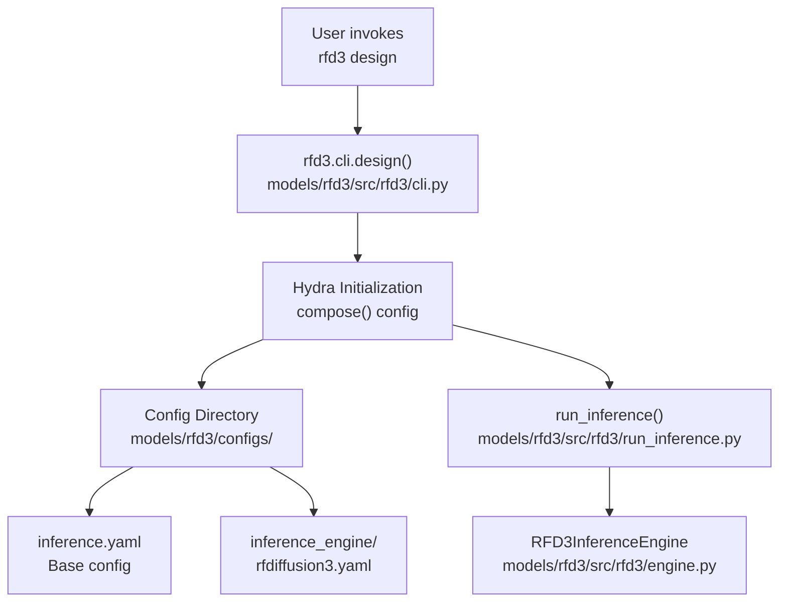
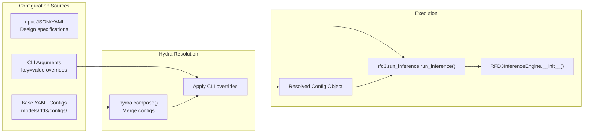

# rfd3 CLI

<details>
<summary>Relevant source files</summary>

The following files were used as context for generating this wiki page:

- [models/rf3/configs/experiment/pretrained/rf3.yaml](models/rf3/configs/experiment/pretrained/rf3.yaml)
- [models/rf3/src/rf3/callbacks/dump_validation_structures.py](models/rf3/src/rf3/callbacks/dump_validation_structures.py)
- [models/rf3/src/rf3/cli.py](models/rf3/src/rf3/cli.py)
- [models/rf3/src/rf3/utils/io.py](models/rf3/src/rf3/utils/io.py)
- [models/rfd3/configs/inference_engine/rfdiffusion3.yaml](models/rfd3/configs/inference_engine/rfdiffusion3.yaml)
- [models/rfd3/configs/trainer/loss/losses/diffusion_loss.yaml](models/rfd3/configs/trainer/loss/losses/diffusion_loss.yaml)
- [models/rfd3/docs/.assets/input_selection_large.png](models/rfd3/docs/.assets/input_selection_large.png)
- [models/rfd3/docs/input.md](models/rfd3/docs/input.md)
- [models/rfd3/src/rfd3/cli.py](models/rfd3/src/rfd3/cli.py)
- [models/rfd3/src/rfd3/model/RFD3_diffusion_module.py](models/rfd3/src/rfd3/model/RFD3_diffusion_module.py)
- [pyproject.toml](pyproject.toml)

</details>


This page documents the `rfd3` command-line interface for running RFdiffusion3 inference. For details about the InputSpecification system used to configure design tasks, see [InputSpecification System](#4.2). For the underlying inference pipeline mechanics, see [RFD3 Inference Pipeline](#4.5). For training RFD3 models, see [RFD3 Training](#4.6).

## Purpose and Scope

The `rfd3` CLI provides a simple command-line entry point for running RFdiffusion3 design tasks. It wraps the Hydra-based configuration system and routes commands to the appropriate inference engine. This page covers command syntax, configuration override patterns, and common usage workflows.

## Command Architecture

The CLI is structured as a single command with Hydra-based configuration:



**Sources:** [models/rfd3/src/rfd3/cli.py:9-43](), [pyproject.toml:91-91]()

## Entry Point Registration

The `rfd3` command is registered in the package distribution as a console script:

```toml
# From pyproject.toml
[project.scripts]
rfd3 = "rfd3.cli:app"
```

This maps the `rfd3` command to the `app` object in [models/rfd3/src/rfd3/cli.py:6](), which is a `typer.Typer()` application.

**Sources:** [pyproject.yaoml:91-91](), [models/rfd3/src/rfd3/cli.py:6-6]()

## Command: `rfd3 design`

The primary command for running RFdiffusion3 inference.

### Basic Syntax

```bash
rfd3 design [HYDRA_OVERRIDES...]
```

### Required CLI Arguments

| Parameter | Type | Description |
|-----------|------|-------------|
| `out_dir` | `str` | Output directory path where results will be written. [models/rfd3/docs/input.md:59-59]() |
| `inputs` | `str` | Path to JSON or YAML file containing design specifications. [models/rfd3/docs/input.md:60-60]() |

### Core Inference Parameters

From the default configuration in [models/rfd3/configs/inference_engine/rfdiffusion3.yaml]():

| Parameter | Type | Default | Description |
|-----------|------|---------|-------------|
| `ckpt_path` | `str` | `rfd3` | Path or registry key for the model checkpoint. [models/rfd3/docs/input.md:71-71]() |
| `n_batches` | `int` | 1 | Number of batches to generate per input key. [models/rfd3/docs/input.md:65-65]() |
| `diffusion_batch_size` | `int` | 8 | Number of diffusion samples (designs) per batch. [models/rfd3/docs/input.md:66-66]() |
| `skip_existing` | `bool` | `True` | Skip designing systems whose output files already exist. [models/rfd3/docs/input.md:72-72]() |
| `dump_trajectories` | `bool` | `False` | Save intermediate denoising trajectories. [models/rfd3/docs/input.md:74-74]() |
| `prevalidate_inputs` | `bool` | `False` | Check input validity before starting inference. [models/rfd3/docs/input.md:75-75]() |
| `low_memory_mode` | `bool` | `False` | Enable memory-efficient tokenization. [models/rfd3/docs/input.md:76-76]() |

**Sources:** [models/rfd3/docs/input.md:55-76](), [models/rfd3/configs/inference_engine/rfdiffusion3.yaml:8-21]()

## Configuration Flow



**Sources:** [models/rfd3/src/rfd3/cli.py:35-43](), [models/rfd3/configs/inference_engine/rfdiffusion3.yaml:1-69]()

## Advanced Sampler Overrides

The `inference_sampler` sub-config controls the diffusion process. These can be overridden via `inference_sampler.<key>=<value>`.

| Parameter | Default | Description |
|-----------|---------|-------------|
| `num_timesteps` | 200 | Number of diffusion denoising steps. [models/rfd3/docs/input.md:82-82]() |
| `step_scale` | 1.5 | Scales step size; higher values reduce diversity but increase designability. [models/rfd3/docs/input.md:69-69]() |
| `kind` | `default` | Set to `symmetry` for symmetric generation. [models/rfd3/docs/input.md:84-84]() |
| `use_classifier_free_guidance` | `False` | Enable CFG for conditioned generation. [models/rfd3/docs/input.md:86-86]() |
| `cfg_scale` | 1.5 | Influence of classifier-free guidance. [models/rfd3/docs/input.md:88-88]() |
| `center_option` | `all` | How to center coordinates (`all`, `motif`, `diffuse`). [models/rfd3/docs/input.md:89-92]() |
| `n_recycle` | `null` | Iterations per step (defaults to 2 from checkpoint). [models/rfd3/docs/input.md:83-83]() |

**Sources:** [models/rfd3/docs/input.md:79-100](), [models/rfd3/configs/inference_engine/rfdiffusion3.yaml:24-51]()

## Common Usage Patterns

### Minimal Example
```bash
rfd3 design out_dir=outputs/my_design inputs=input_spec.json
```
**Sources:** [models/rfd3/docs/input.md:51-51]()

### Quick Debugging with Overrides
You can bypass an input file for simple tests using the `specification` override:
```bash
rfd3 design inputs=null specification.length=200 out_dir=debug_200
```
**Sources:** [models/rfd3/docs/input.md:67-67]()

### Symmetry Mode
```bash
rfd3 design \
  out_dir=outputs/sym \
  inputs=sym.json \
  inference_sampler.kind=symmetry
```
**Sources:** [models/rfd3/docs/input.md:84-84]()

### Trajectory Saving
```bash
rfd3 design \
  out_dir=outputs/traj \
  inputs=spec.json \
  dump_trajectories=True
```
**Sources:** [models/rfd3/docs/input.md:74-74]()

## Input Specification Files

The `inputs` parameter accepts JSON or YAML files following the InputSpecification schema.

```json
{
    "spec-1": {
      "input": "path/to/pdb",
      "contig": "50-80,/0,A1-100",
      "ligand": "HAX,OAA"
    }
}
```

- **input**: Path to template PDB/CIF.
- **contig**: Mini-language for defining diffused and fixed regions.
- **ligand**: Selects ligands by residue name.

**Sources:** [models/rfd3/docs/input.md:34-47]()

## CLI Implementation Details

### Command Handler
[models/rfd3/src/rfd3/cli.py:9-12]() defines the `design` command using Typer. It allows extra arguments to support Hydra's `key=value` syntax.

### Config Path Resolution
The CLI dynamically locates the configuration directory:
1. **Development Mode**: Checks `models/rfd3/configs/` relative to the source. [models/rfd3/src/rfd3/cli.py:19-21]()
2. **Installed Mode**: Falls back to the package-relative `configs/` directory. [models/rfd3/src/rfd3/cli.py:24-24]()

### Argument Processing
[models/rfd3/src/rfd3/cli.py:27-33]():
1. Merges `ctx.args` and parameters.
2. Filters out command aliases (`design`, `fold`).
3. Defaults `inference_engine` to `rfdiffusion3` if not provided.
4. Initializes Hydra and composes the config object.

### Warning Suppression
The CLI wraps the inference call in a `suppress_warnings` context to ensure clean output during design runs. [models/rfd3/src/rfd3/cli.py:39-43]()

**Sources:** [models/rfd3/src/rfd3/cli.py:1-47]()

## Output Management

The CLI and underlying engine produce several files in the `out_dir`:
- **Generated Structures**: Saved as CIF files.
- **Metadata**: A `prediction_metadata.json` is dumped by default. [models/rfd3/configs/inference_engine/rfdiffusion3.yaml:64-64]()
- **Trajectories**: If `dump_trajectories=True`, saved in the output directory. [models/rfd3/docs/input.md:74-74]()
- **Guideposts**: Virtual atoms used during inference can be saved by setting `cleanup_guideposts=False`. [models/rfd3/docs/input.md:101-101]()

**Sources:** [models/rfd3/configs/inference_engine/rfdiffusion3.yaml:53-69]()
 
Sources: [models/rfd3/src/rfd3/cli.py:1-48](), [models/rfd3/docs/input.md:1-101](), [models/rfd3/configs/inference_engine/rfdiffusion3.yaml:1-69](), [pyproject.toml:85-95]()

---