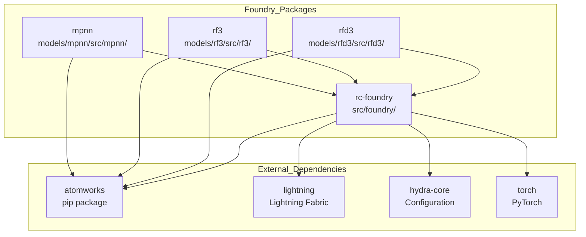
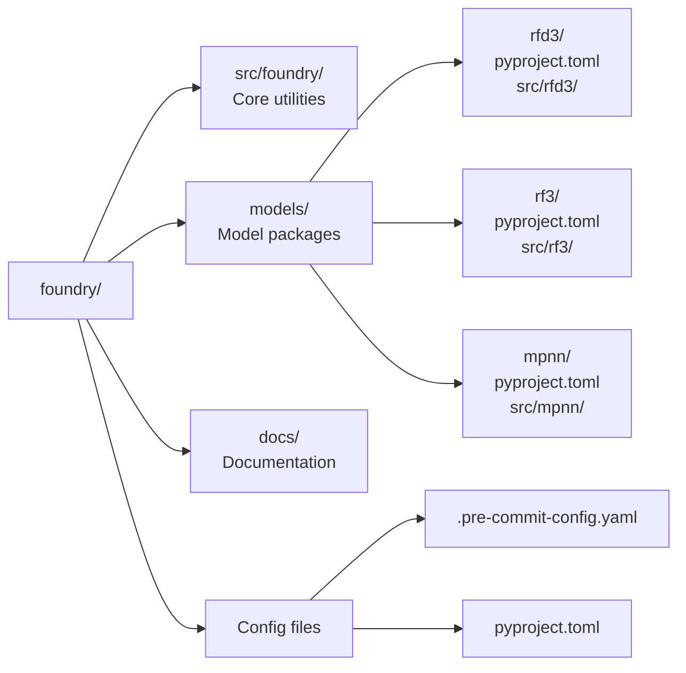
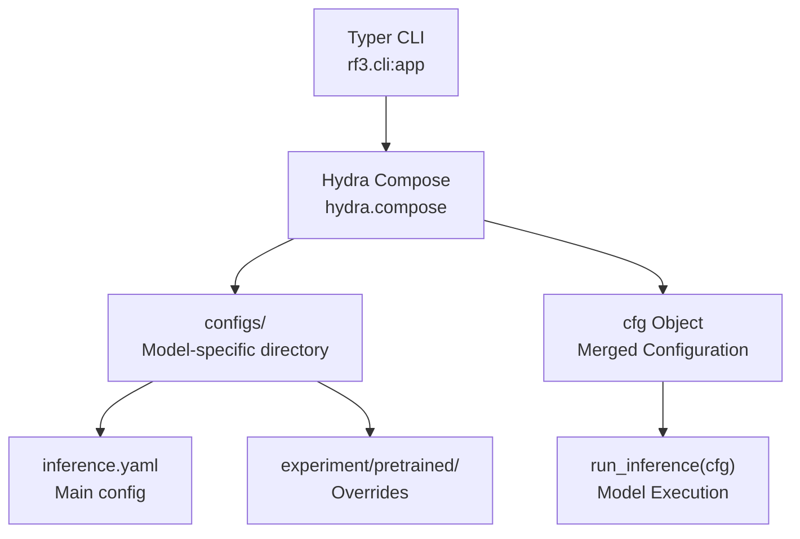

# Developer Reference

<details>
<summary>Relevant source files</summary>

The following files were used as context for generating this wiki page:

- [CONTRIBUTING.md](CONTRIBUTING.md)
- [docs/docs_requirements.txt](docs/docs_requirements.txt)
- [docs/source/_static/ga.js](docs/source/_static/ga.js)
- [docs/source/conf.py](docs/source/conf.py)
- [docs/source/contributing_link.rst](docs/source/contributing_link.rst)
- [docs/source/index.rst](docs/source/index.rst)
- [models/rf3/configs/experiment/pretrained/rf3.yaml](models/rf3/configs/experiment/pretrained/rf3.yaml)
- [models/rf3/src/rf3/callbacks/dump_validation_structures.py](models/rf3/src/rf3/callbacks/dump_validation_structures.py)
- [models/rf3/src/rf3/cli.py](models/rf3/src/rf3/cli.py)
- [models/rf3/src/rf3/utils/io.py](models/rf3/src/rf3/utils/io.py)
- [models/rfd3/src/rfd3/cli.py](models/rfd3/src/rfd3/cli.py)
- [pyproject.toml](pyproject.toml)

</details>


This section provides technical reference for developers working on the Foundry codebase itself. If you're looking to use Foundry's models for protein design, see [Getting Started](#2). If you want to train or customize models, see the model-specific documentation: [RFdiffusion3 (RFD3)](#4), [RosettaFold3 (RF3)](#5), or [ProteinMPNN and LigandMPNN](#6).

## Purpose and Scope

This developer reference covers:
- Repository organization and package architecture
- Setting up a development environment with editable installs
- Running tests and validation
- Contributing code, including style guidelines and PR workflow

For details on the project structure, see [Project Structure](#11.1). For environment setup, see [Development Setup](#11.2). For contribution guidelines, see [Contributing](#11.3).

## Repository Architecture

Foundry follows a strict dependency hierarchy: `foundry` → `atomworks`. The repository is structured as a monorepo containing:

- **`foundry/`**: Core shared utilities, training infrastructure, and base classes [CONTRIBUTING.md:16-17]()
- **`models/`**: Individual model packages (rfd3, rf3, mpnn), each independently installable [CONTRIBUTING.md:18-19]()
- **`atomworks`**: External dependency for structure I/O and preprocessing [CONTRIBUTING.md:13-16]()

Each model in `models/<model_name>/` is a standalone Python package with its own `pyproject.toml`, allowing users to install only the models they need [CONTRIBUTING.md:67-70]().

**Sources:** [CONTRIBUTING.md:10-19](), [pyproject.toml:116-124]()

### Package Dependency Graph



**Sources:** [pyproject.toml:24-51](), [CONTRIBUTING.md:12-19](), [CONTRIBUTING.md:67-70]()

### Directory Structure



**Sources:** [pyproject.toml:116-124](), [CONTRIBUTING.md:87-96]()

## Development Workflow

### Installation for Development

For developers working on multiple packages, install in editable mode using `uv`:

```bash
# Install foundry core + all models in editable mode
uv pip install -e '.[all,dev]'
```

This approach allows you to modify shared utilities and see changes immediately across all models [CONTRIBUTING.md:20-29]().

**Sources:** [CONTRIBUTING.md:20-29](), [pyproject.toml:66-70]()

### Code Organization Principles

| Principle | Description |
|-----------|-------------|
| **Strict dependency flow** | Models use the structure provided by Foundry and AtomWorks [CONTRIBUTING.md:12-19]() |
| **AtomWorks foundation** | Used for I/O, preprocessing structures, and data featurization [CONTRIBUTING.md:16-16]() |
| **Independent models** | Models are added as independent packages in `models/` [CONTRIBUTING.md:28-28]() |
| **Google Docstrings** | All docstrings should follow the Google-format [CONTRIBUTING.md:34-34]() |

**Sources:** [CONTRIBUTING.md:12-37]()

## Key Components

### Foundry Core (`src/foundry/`)

The core package provides shared utilities and training infrastructure. It includes:
- **`BaseCallback`**: Base class for system hooks like structure dumping [models/rf3/src/rf3/callbacks/dump_validation_structures.py:12-15]()
- **Logging**: Minimal inference logging and warning suppression [models/rf3/src/rf3/cli.py:21-23](), [models/rfd3/src/rfd3/cli.py:39-42]()
- **Alignment**: Utilities for `weighted_rigid_align` used in trajectory generation [models/rf3/src/rf3/utils/io.py:12-12]()

**Sources:** [models/rf3/src/rf3/cli.py:21-23](), [models/rf3/src/rf3/utils/io.py:12-12]()

### Model Package Structure

Each model package (e.g., `rf3`, `rfd3`) contains its own source code and Hydra configurations:
- **`configs/`**: Hydra YAML files for inference and experiments [models/rf3/src/rf3/cli.py:32-38]()
- **`cli.py`**: Typer-based entry points for model execution [models/rf3/src/rf3/cli.py:6-12]()
- **`inference.py`**: Model-specific inference logic [models/rf3/src/rf3/cli.py:67-69]()

**Sources:** [models/rf3/src/rf3/cli.py:25-69](), [pyproject.toml:126-129]()

### Configuration System Architecture



**Sources:** [models/rf3/src/rf3/cli.py:64-69](), [models/rf3/configs/experiment/pretrained/rf3.yaml:1-23]()

## Development Tools

### Pre-commit Hooks

Foundry uses `pre-commit` to run `ruff format` before each commit to ensure PEP8 compliance [CONTRIBUTING.md:43-49]().

```bash
# Enable pre-commit
pre-commit install
```

**Sources:** [CONTRIBUTING.md:43-49](), [pyproject.toml:132-170]()

### Testing

Tests for the Foundry source code are located in `foundry/tests`, while model tests reside in their respective directories [CONTRIBUTING.md:38-38](). Note that test files may be missing in current versions [CONTRIBUTING.md:39-41]().

**Sources:** [CONTRIBUTING.md:38-41](), [pyproject.toml:80-85]()

## Adding New Models

To add a new model to the Foundry ecosystem:
1. Create `models/<model_name>` with a `pyproject.toml` [CONTRIBUTING.md:67-67]().
2. Add `foundry` as a dependency [CONTRIBUTING.md:68-68]().
3. Implement model code in `src/` and configs in `configs/` [CONTRIBUTING.md:69-69]().
4. Register the package in the root `pyproject.toml` for wheel building [pyproject.toml:116-124]().

**Sources:** [CONTRIBUTING.md:61-71](), [pyproject.toml:116-124]()

## Core Module Reference

### Key Classes and CLI Entry Points

| Component | Code Identifier | Location |
|-----------|-----------------|----------|
| **RF3 CLI** | `rf3 = "rf3.cli:app"` | [pyproject.toml:90]() |
| **RFD3 CLI** | `rfd3 = "rfd3.cli:app"` | [pyproject.toml:91]() |
| **MPNN CLI** | `mpnn = "mpnn.inference:main"` | [pyproject.toml:93]() |
| **Foundry CLI** | `foundry = "foundry_cli.download_checkpoints:app"` | [pyproject.toml:94]() |
| **Validation Callback** | `DumpValidationStructuresCallback` | [models/rf3/src/rf3/callbacks/dump_validation_structures.py:15]() |
| **Structure IO** | `dump_structures` | [models/rf3/src/rf3/utils/io.py:97]() |

**Sources:** [pyproject.toml:89-94](), [models/rf3/src/rf3/callbacks/dump_validation_structures.py:15-40](), [models/rf3/src/rf3/utils/io.py:97-103]()

## Related Documentation

- [Project Structure](#11.1) — Repository organization and package hierarchy
- [Development Setup](#11.2) — Setting up the `uv` environment and editable installs
- [Contributing](#11.3) — Code style, PR guidelines, and documentation standards

---