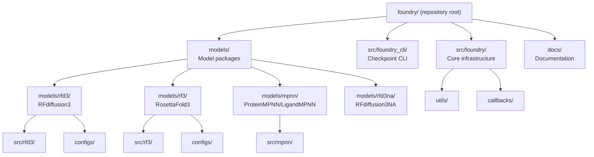
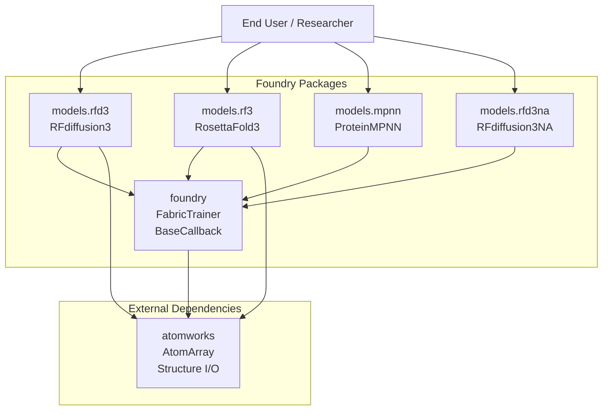
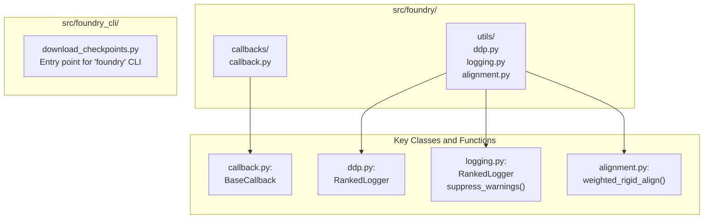
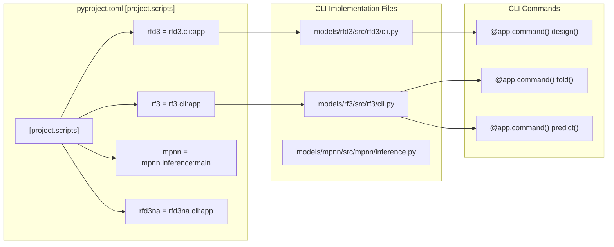
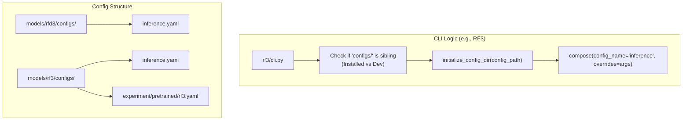
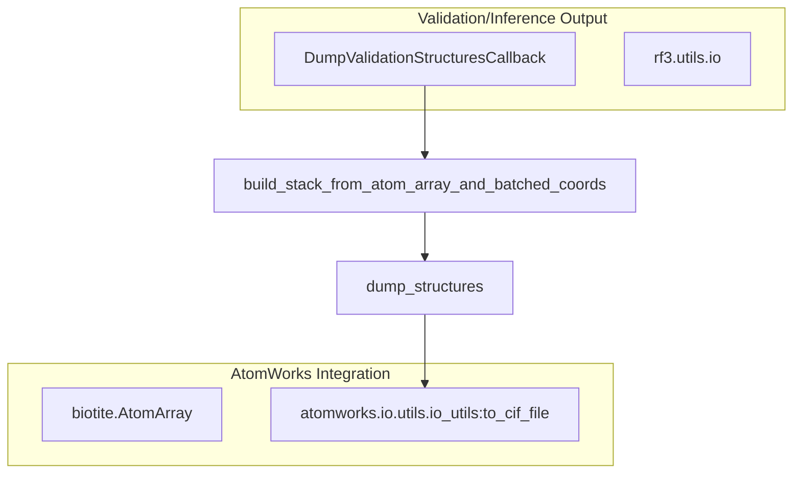

# Project Structure

<details>
<summary>Relevant source files</summary>

The following files were used as context for generating this wiki page:

- [.gitmodules](.gitmodules)
- [CONTRIBUTING.md](CONTRIBUTING.md)
- [docs/docs_requirements.txt](docs/docs_requirements.txt)
- [docs/source/_static/ga.js](docs/source/_static/ga.js)
- [docs/source/conf.py](docs/source/conf.py)
- [docs/source/contributing_link.rst](docs/source/contributing_link.rst)
- [docs/source/index.rst](docs/source/index.rst)
- [models/rf3/configs/experiment/pretrained/rf3.yaml](models/rf3/configs/experiment/pretrained/rf3.yaml)
- [models/rf3/src/rf3/callbacks/dump_validation_structures.py](models/rf3/src/rf3/callbacks/dump_validation_structures.py)
- [models/rf3/src/rf3/cli.py](models/rf3/src/rf3/cli.py)
- [models/rf3/src/rf3/utils/io.py](models/rf3/src/rf3/utils/io.py)
- [models/rfd3/src/rfd3/cli.py](models/rfd3/src/rfd3/cli.py)
- [pyproject.toml](pyproject.toml)

</details>


This page documents the organization of the Foundry repository, including the directory layout, package dependencies, and relationships between components. For information about setting up a development environment, see [Development Setup](#11.2). For details about specific model implementations, refer to [RFdiffusion3 (RFD3)](#4), [RosettaFold3 (RF3)](#5), and [ProteinMPNN and LigandMPNN](#6).

## Repository Organization

Foundry is organized as a multi-package repository with a strict dependency hierarchy. The core `rc-foundry` package provides shared training infrastructure and utilities, while individual model packages (`rfd3`, `rf3`, `mpnn`, `rfd3na`) are independently installable and depend on both `foundry` and `atomworks` [CONTRIBUTING.md:12-18]().

### Top-Level Directory Structure



**Sources:** [pyproject.toml:117-124](), [CONTRIBUTING.md:12-18]()

### Package Dependency Flow

The repository enforces a strict dependency hierarchy to maintain clean separation of concerns:



**Key principle:** `foundry` → `atomworks` (one-way dependency). All models within Foundry use AtomWorks for manipulating and processing biomolecular structures in both training and inference [CONTRIBUTING.md:12-18]().

**Sources:** [CONTRIBUTING.md:12-18](), [pyproject.toml:47-51]()

## Core Package Structure

The `foundry` package provides shared infrastructure used by all models:

**Diagram: Foundry Core Module Organization**



**Core modules:**

| Module | Key Classes/Functions | Purpose |
|--------|----------------------|---------|
| `foundry.callbacks` | `BaseCallback` | Base class for training/inference hooks [models/rf3/src/rf3/callbacks/dump_validation_structures.py:12-15]() |
| `foundry.utils.logging` | `RankedLogger`, `suppress_warnings()` | Centralized logging and warning management [models/rf3/src/rf3/cli.py:21-23]() |
| `foundry.utils.alignment` | `weighted_rigid_align()` | Rigid body alignment for trajectories [models/rf3/src/rf3/utils/io.py:12-12]() |
| `foundry_cli` | `download_checkpoints:app` | Checkpoint management CLI [pyproject.toml:94-94]() |

**Sources:** [pyproject.toml:89-94](), [models/rf3/src/rf3/callbacks/dump_validation_structures.py:12-15](), [models/rf3/src/rf3/utils/io.py:12-12]()

## Model Package Structure

Each model package under `models/` is treated as an independent package with its own `src/` and `configs/` [CONTRIBUTING.md:61-70]().

### Model-Specific Entry Points

Each model provides its own CLI entry point through `pyproject.toml`:

**Diagram: CLI Entry Points and Implementation**



| Model | Command | Entry Point | Implementation |
|-------|---------|-------------|----------------|
| RFD3 | `rfd3 design` | `rfd3.cli:app` | [models/rfd3/src/rfd3/cli.py:9-12]() |
| RF3 | `rf3 fold` / `rf3 predict` | `rf3.cli:app` | [models/rf3/src/rf3/cli.py:9-83]() |
| MPNN | `mpnn` | `mpnn.inference:main` | [pyproject.toml:93-93]() |
| RFD3NA | `rfd3na` | `rfd3na.cli:app` | [pyproject.toml:92-92]() |

**Sources:** [pyproject.toml:89-94](), [models/rfd3/src/rfd3/cli.py:1-48](), [models/rf3/src/rf3/cli.py:1-87]()

## Configuration System

Foundry uses Hydra for configuration. Model CLIs locate their configs by checking for development vs. installed modes [models/rf3/src/rf3/cli.py:25-39]().

**Diagram: Hydra Configuration Resolution**



**Key configuration handling:**
- **Dynamic Config Paths:** CLIs like `rf3` and `rfd3` automatically detect if they are running from a source checkout or an installed site-package to find the correct `configs/` directory [models/rf3/src/rf3/cli.py:28-39](), [models/rfd3/src/rfd3/cli.py:18-24]().
- **Default Engines:** CLIs ensure a default `inference_engine` is set if not provided in overrides (e.g., `inference_engine=rf3`) [models/rf3/src/rf3/cli.py:53-59](), [models/rfd3/src/rfd3/cli.py:30-34]().

**Sources:** [models/rf3/src/rf3/cli.py:25-69](), [models/rfd3/src/rfd3/cli.py:14-43]()

### Build and Packaging

The repository uses `hatchling` as the build backend and explicitly includes model source and config directories in the wheel [pyproject.toml:102-124]().

```toml
[tool.hatch.build.targets.wheel]
packages = [
  "src/foundry",
  "src/foundry_cli",
  "models/rf3/src/rf3",
  "models/rfd3/src/rfd3",
  # ...
]

[tool.hatch.build.targets.wheel.force-include]
"models/rfd3na/configs" = "rfd3na/configs"
"models/rfd3/configs" = "rfd3/configs"
"models/rf3/configs" = "rf3/configs"
```

**Sources:** [pyproject.toml:116-130]()

## Data Flow and I/O Utilities

Models share I/O patterns for structure generation and validation.

**Diagram: Structure Output Flow**



**Key I/O Functions:**
- `build_stack_from_atom_array_and_batched_coords`: Converts raw coordinates into a `biotite.AtomArrayStack` and handles `chain_id` adjustments for multiple transformations [models/rf3/src/rf3/utils/io.py:61-94]().
- `dump_structures`: High-level wrapper to save structures to CIF/PDB, supporting single or multi-model files [models/rf3/src/rf3/utils/io.py:97-138]().
- `dump_trajectories`: Handles denoising trajectories, including rigid alignment to the final prediction [models/rf3/src/rf3/utils/io.py:141-174]().

**Sources:** [models/rf3/src/rf3/utils/io.py:61-174](), [models/rf3/src/rf3/callbacks/dump_validation_structures.py:15-101]()

## Contributing a New Model

To add a new model to the Foundry ecosystem:
1. Create `models/<model_name>/` with a `pyproject.toml` [CONTRIBUTING.md:67-67]().
2. Add `rc-foundry` as a dependency [CONTRIBUTING.md:68-68]().
3. Implement logic in `models/<model_name>/src/` [CONTRIBUTING.md:69-69]().
4. Add the package to the root `pyproject.toml` wheel targets for distribution [pyproject.toml:116-124]().

**Sources:** [CONTRIBUTING.md:61-70](), [pyproject.toml:116-124]()

---