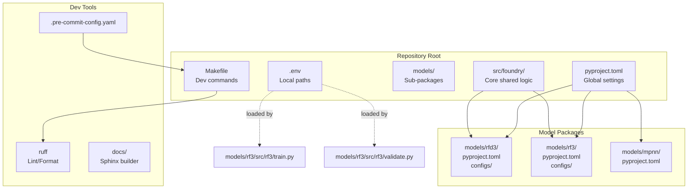
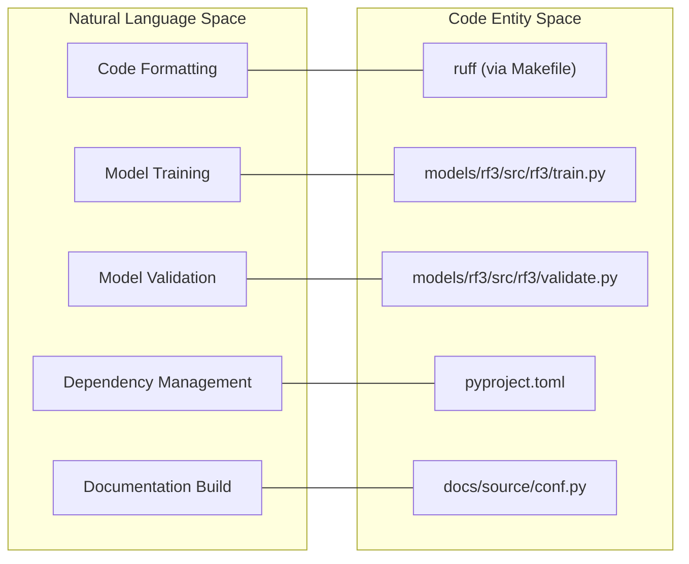

# Development Setup

<details>
<summary>Relevant source files</summary>

The following files were used as context for generating this wiki page:

- [.github/workflows/lint_production.yaml](.github/workflows/lint_production.yaml)
- [CONTRIBUTING.md](CONTRIBUTING.md)
- [Makefile](Makefile)
- [docs/docs_requirements.txt](docs/docs_requirements.txt)
- [docs/source/_static/ga.js](docs/source/_static/ga.js)
- [docs/source/conf.py](docs/source/conf.py)
- [docs/source/contributing_link.rst](docs/source/contributing_link.rst)
- [docs/source/index.rst](docs/source/index.rst)
- [models/rf3/src/rf3/train.py](models/rf3/src/rf3/train.py)
- [models/rf3/src/rf3/validate.py](models/rf3/src/rf3/validate.py)
- [models/rf3/tests/conftest.py](models/rf3/tests/conftest.py)

</details>


This page provides instructions for setting up a development environment to contribute to or extend the Foundry codebase. For basic installation and usage, see [Installation](#2.1). For project structure details, see [Project Structure](#11.1). For contribution guidelines, see [Contributing](#11.3).

## Prerequisites

**Python Version**: Foundry requires Python 3.12 or higher.

**Package Manager**: Development uses `uv`, a fast Python package installer and resolver. Install it first:

```bash
pip install uv
```

**Git Repository**: Clone the Foundry repository:

```bash
git clone https://github.com/RosettaCommons/foundry.git
cd foundry
```

**Sources**: [.github/workflows/lint_production.yaml:26-27](), [CONTRIBUTING.md:20-24]()

## Installation for Development

### Editable Installation

Install the entire Foundry ecosystem in editable mode for development. This allows you to modify shared utilities and see changes immediately across all models.

```bash
uv pip install -e '.[all,dev]'
```

This command installs:
- Core `foundry` package from `src/foundry/`
- All model packages located in `models/`
- All optional dependencies (`[all]`)
- Development tools (`[dev]`) including `ruff` and `pre-commit`

**Sources**: [CONTRIBUTING.md:20-29](), [CONTRIBUTING.md:62-65]()

### Development Dependencies

The `[dev]` extra includes tools for linting, formatting, and building documentation.

| Category | Tools |
|----------|-------|
| Linting & Formatting | `ruff`, `pre-commit` |
| Documentation | `sphinx`, `myst-parser`, `furo`, `sphinx-copybutton` |
| Build System | `Makefile` |

**Sources**: [docs/docs_requirements.txt:1-4](), [.github/workflows/lint_production.yaml:28-33](), [CONTRIBUTING.md:43-49]()

## Development Environment Structure

The following diagram illustrates the development environment setup and how the configuration flows from the environment and repository root to the specific model implementations.

**Foundry Development Architecture**


**Sources**: [CONTRIBUTING.md:12-19](), [models/rf3/src/rf3/train.py:18](), [models/rf3/src/rf3/validate.py:13](), [Makefile:16-18]()

## Environment Configuration

### Creating the .env File

Foundry relies on a `.env` file to manage local paths for data mirrors and external tools. This file is loaded at runtime by scripts using `dotenv`.

```python
# In training/inference scripts
from dotenv import load_dotenv
load_dotenv(override=True)
```

**Sources**: [models/rf3/src/rf3/train.py:18](), [models/rf3/src/rf3/validate.py:13]()

### Required Path Management

Training and validation scripts resolve project roots and configuration paths dynamically to ensure they work across different environments.

| Script | Root Resolution | Config Path |
|----------|---------|---------------|
| `train.py` | `rootutils.setup_root` | `models/rf3/configs` |
| `validate.py` | `rootutils.setup_root` | `models/rf3/configs` |

**Sources**: [models/rf3/src/rf3/train.py:16-20](), [models/rf3/src/rf3/validate.py:17-19]()

## Development Tools Setup

### Pre-commit Hooks and Formatting

Foundry uses `ruff` for both linting and formatting. A `Makefile` is provided to simplify these operations.

**Enable Git Hooks**:
```bash
pip install pre-commit
pre-commit install
```

**Manual Formatting**:
To format the `src`, `models`, and `tests` directories, run:
```bash
make format
```
This executes `ruff format` followed by `ruff check --fix`.

**Sources**: [Makefile:16-18](), [CONTRIBUTING.md:43-49](), [.github/workflows/lint_production.yaml:34-37]()

### Clean Workspace

To remove all compiled Python files, `__pycache__` directories, and test/ruff caches:
```bash
make clean
```

**Sources**: [Makefile:8-13]()

## Model Development Workflow

### Adding a New Model

To incorporate a new model into the Foundry ecosystem:
1. Create a `models/<model_name>` directory.
2. Add a `pyproject.toml` specific to the model.
3. Define `foundry` as a dependency in the model's `pyproject.toml`.
4. Implement specific logic in `models/<model_name>/src/`.
5. Install in editable mode: `uv pip install -e ./models/<model_name>`.

**Sources**: [CONTRIBUTING.md:61-70]()

### Documentation Development

Foundry documentation is built using Sphinx with the Furo theme and MyST parser for Markdown support.

**Build Requirements**:
Install dependencies from `docs/docs_requirements.txt`:
```bash
uv pip install -r docs/docs_requirements.txt
```

**Building Locally**:
```bash
cd docs
make html
```

**Sources**: [CONTRIBUTING.md:72-84](), [docs/docs_requirements.txt:1-4](), [docs/source/conf.py:17-29]()

### Model Documentation Integration

Model-specific documentation is maintained within each model's directory and symlinked to the central documentation source.

1. Create `models/<model_name>/docs`.
2. Symlink to the main source:
   ```bash
   ln -s ../../../models/<model_name>/docs docs/source/models/<model_name>
   ```

**Sources**: [CONTRIBUTING.md:86-96]()

## Code Standards and Entity Mapping

The following diagram maps natural language development concepts to the specific code entities and files that implement them in the Foundry repository.

**Development Entity Map**


**Sources**: [Makefile:16-18](), [models/rf3/src/rf3/train.py:26](), [models/rf3/src/rf3/validate.py:25](), [docs/source/conf.py:9-12]()

## Testing and Validation

Tests for the core Foundry code are located in `foundry/tests`, while model-specific tests reside in their respective directories (e.g., `models/rf3/tests`).

**Test Configuration**:
Tests use fixtures and configuration utilities defined in `conftest.py` files.
- `configure_pytest`: Sets up the environment for model-specific tests.
- `get_test_data_dir`: Locates assets for unit testing.

**Sources**: [CONTRIBUTING.md:38-41](), [models/rf3/tests/conftest.py:3-10]()

---