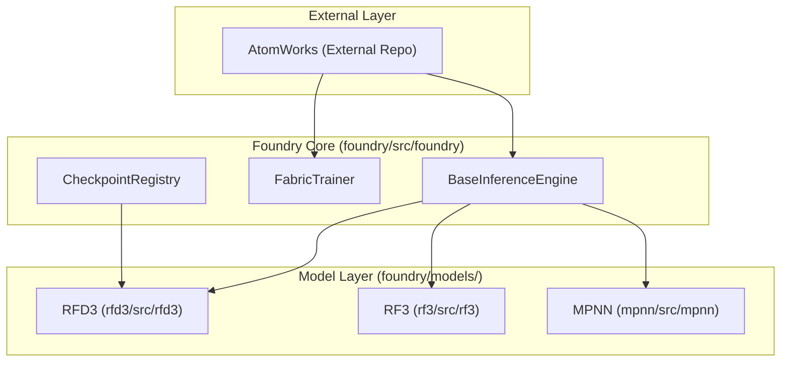
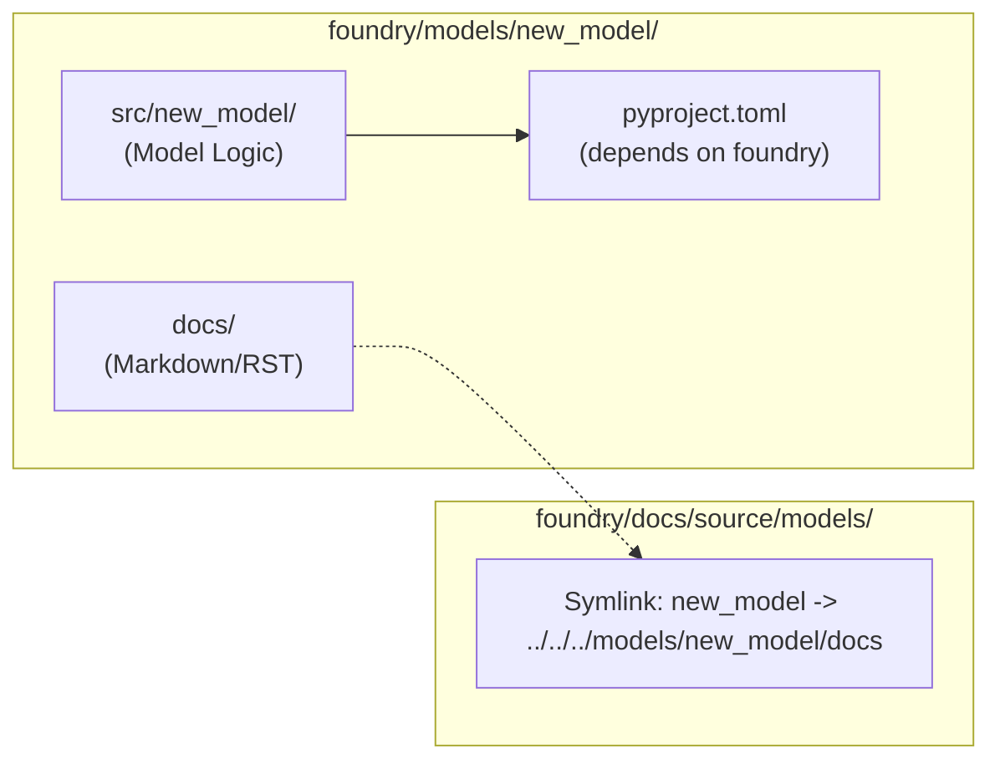

# Contributing

<details>
<summary>Relevant source files</summary>

The following files were used as context for generating this wiki page:

- [.github/ISSUE_TEMPLATE/bug_report.md](.github/ISSUE_TEMPLATE/bug_report.md)
- [.github/ISSUE_TEMPLATE/feature_request.md](.github/ISSUE_TEMPLATE/feature_request.md)
- [.github/ISSUE_TEMPLATE/question-or-unexpected-outputs.md](.github/ISSUE_TEMPLATE/question-or-unexpected-outputs.md)
- [.github/workflows/documentation.yml](.github/workflows/documentation.yml)
- [CONTRIBUTING.md](CONTRIBUTING.md)
- [docs/Makefile](docs/Makefile)
- [docs/docs_requirements.txt](docs/docs_requirements.txt)
- [docs/make.bat](docs/make.bat)
- [docs/source/_static/ga.js](docs/source/_static/ga.js)
- [docs/source/conf.py](docs/source/conf.py)
- [docs/source/contributing_link.rst](docs/source/contributing_link.rst)
- [docs/source/index.rst](docs/source/index.rst)
- [docs/source/license_link.rst](docs/source/license_link.rst)
- [docs/source/readme_link.rst](docs/source/readme_link.rst)

</details>


This page provides guidelines for contributing code, documentation, and improvements to the Foundry repository. It covers code style conventions, development workflow, and the process for adding new models.

---

## Code Contributions

### Code Organization and Dependencies
The Foundry ecosystem follows a strict dependency hierarchy to ensure modularity and maintainability. All models within Foundry utilize [AtomWorks](https://github.com/RosettaCommons/atomworks) for structural manipulation.

- **AtomWorks**: Handles I/O, preprocessing structures, and data featurization [CONTRIBUTING.md:16-16]().
- **Foundry Core**: Contains shared model architectures, training infrastructure (`FabricTrainer`), and inference abstractions (`BaseInferenceEngine`) [CONTRIBUTING.md:17-17]().
- **Models**: Released models (e.g., `rfd3`, `rf3`) reside in the `models/` directory and use the structure provided by Foundry and AtomWorks [CONTRIBUTING.md:18-18]().

### Diagram: System Dependency Flow


**Sources:** [CONTRIBUTING.md:12-19]()

---

## Development Setup

### Installing in Editable Mode
For development, install both the core foundry package and all models in editable mode using `uv`. This allows immediate visibility of changes in shared utilities or specific models [CONTRIBUTING.md:20-29]().

```bash
uv pip install -e '.[all,dev]'
```

### Coding Standards
1.  **Variable Naming**: Use meaningful, descriptive names [CONTRIBUTING.md:33-33]().
2.  **Docstrings**: Use the **Google-format** for all docstrings to ensure compatibility with the Sphinx documentation builder [CONTRIBUTING.md:34-34]().
3.  **Style Guides**: Adhere to **PEP8** (Style) and **PEP20** (Zen of Python) [CONTRIBUTING.md:35-37]().
4.  **Formatting**: Foundry uses `ruff format` via pre-commit hooks. Enable them after cloning:
    ```bash
    pip install pre-commit
    pre-commit install
    ```
    This will automatically format your code during `git commit` [CONTRIBUTING.md:44-49]().

### Testing
Tests for the Foundry source code are located in `foundry/tests`, while model-specific tests reside in their respective directories (e.g., `models/<model>/tests`) [CONTRIBUTING.md:38-38](). 
*Note: Running tests is currently undergoing updates; some test files may be missing [CONTRIBUTING.md:39-41]().*

**Sources:** [CONTRIBUTING.md:20-41](), [CONTRIBUTING.md:44-49]()

---

## Pull Request Process

### Committing Changes
- **Logical Units**: Keep each commit focused on a single task or feature [CONTRIBUTING.md:52-52]().
- **Semantic Commits**: Adhere to [conventional commits](https://www.conventionalcommits.org/) [CONTRIBUTING.md:53-53]().
- **Draft PRs**: Submit a draft PR early to solicit feedback from maintainers [CONTRIBUTING.md:54-54]().

### Finalizing the PR
- **Target**: Merge your branch into the `production` branch [CONTRIBUTING.md:57-57]().
- **Size Limit**: Keep PRs under **400 Lines of Code (LOC)** to ensure they can be reviewed within a reasonable timeframe (approx. 1 hour) [CONTRIBUTING.md:58-58]().

**Sources:** [CONTRIBUTING.md:51-58]()

---

## Adding a Model

To incorporate a new model as an independent package within the Foundry ecosystem, follow these steps:

1.  **Directory Structure**: Create `models/<model_name>` with a `pyproject.toml` [CONTRIBUTING.md:67-67]().
2.  **Dependencies**: Add `foundry` as a dependency in the model's `pyproject.toml` [CONTRIBUTING.md:68-68]().
3.  **Implementation**: Place model-specific logic in `models/<model_name>/src/` [CONTRIBUTING.md:69-69]().
4.  **Installation**: Users can then install the model via `uv pip install -e ./models/<model_name>` [CONTRIBUTING.md:70-70]().

### Diagram: Model Integration Logic


**Sources:** [CONTRIBUTING.md:61-70](), [CONTRIBUTING.md:89-94]()

---

## Documentation Contributions

External documentation is built using **Sphinx** and hosted via **GitHub Pages** [CONTRIBUTING.md:73-73]().

### Building Documentation
Install documentation-specific dependencies and build the HTML:
```bash
uv pip install -r docs/docs_requirements.txt
cd docs
make html
```
**Sources:** [CONTRIBUTING.md:75-82](), [docs/docs_requirements.txt:1-4]()

### Documentation Organization
- **Foundry Core Docs**: Located in `docs/source/`. The `index.rst` acts as the landing page [CONTRIBUTING.md:87-87]().
- **Model Docs**: Each model maintains its own `docs/` folder. To make these visible to the main Sphinx build, a symlink must be created in `docs/source/models/` pointing to the model's internal documentation directory [CONTRIBUTING.md:89-94]().
- **Format**: Supports both **Markdown** (via `myst_parser`) and **ReStructured Text** [CONTRIBUTING.md:84-84](), [docs/source/conf.py:17-19]().

### CI/CD for Docs
Documentation is automatically built and deployed to the `gh-pages` branch upon pushing to the `production` branch via GitHub Actions [ .github/workflows/documentation.yml:22-30]().

**Sources:** [CONTRIBUTING.md:72-96](), [docs/source/conf.py:1-64](), [.github/workflows/documentation.yml:1-30]()

---