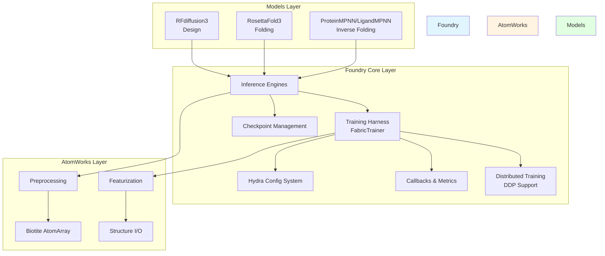
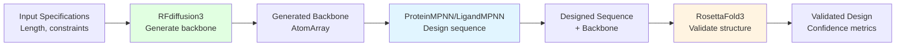

Foundry is a comprehensive framework for protein design that provides unified tooling and infrastructure for using and training deep learning models across three critical domains: **design** (RFdiffusion3), **inverse folding** (ProteinMPNN and LigandMPNN), and **protein folding** (RosettaFold3). The framework enables end-to-end protein design pipelines by integrating these models through a common interface, all built atop [AtomWorks](https://github.com/RosettaCommons/atomworks) for biomolecular structure manipulation and processing.

Sources: [README.md](README.md#L1-L9)

## Architecture and Design Philosophy

Foundry follows a strict dependency hierarchy: `foundry` → `atomworks`, where **AtomWorks** handles structure I/O, preprocessing, and featurization, while **Foundry** provides model architectures, training infrastructure, and inference endpoints. This separation of concerns enables Foundry to serve as a unified platform for multiple independent protein design models, each packaged separately in the `models/` directory while sharing core infrastructure.

Sources: [README.md](README.md#L36-L42)



The architecture is built around several core components:

- **BaseInferenceEngine**: Provides a unified interface for loading checkpoints and running inference across all models, separating expensive model setup from iterative inference execution
- **FabricTrainer**: A generic training harness built on PyTorch Lightning Fabric that supports gradient accumulation, mixed precision, distributed training, and native Exponential Moving Average (EMA) integration
- **Hydra Configuration System**: Manages complex model configurations with custom resolvers for dynamic parameter resolution
- **Checkpoint Management**: Centralized registry system for downloading and managing model weights with automatic path resolution

Sources: [base.py](src/foundry/inference_engines/base.py#L32-L66), [fabric.py](src/foundry/trainers/fabric.py#L1-L50), [resolvers.py](src/foundry/hydra/resolvers.py#L1-L25)

## Supported Models

Foundry currently integrates three state-of-the-art protein design models, each addressing a different aspect of the protein design workflow:

| Model | Type | Primary Function | Key Features |
|-------|------|------------------|--------------|
| **RFdiffusion3 (RFD3)** | Design | Generate novel protein backbones under complex constraints | All-atom diffusion, supports nucleic acid binders, small molecule binders, enzymes, symmetry |
| **RosettaFold3 (RF3)** | Folding | Predict 3D structure from amino acid sequence | Competitive with AlphaFold-3, supports protein-DNA complexes, multiple checkpoint variants |
| **ProteinMPNN/LigandMPNN** | Inverse Folding | Design sequences for fixed backbones | Lightweight, fast inference, supports ligand conditioning, soluble protein design |


Sources: [README.md](README.md#L20-L32), [all.ipynb](examples/all.ipynb#L10-L19)

### RFdiffusion3 (RFD3)

RFdiffusion3 is an all-atom generative diffusion model capable of designing protein structures under complex constraints including protein-protein, protein-DNA, protein-ligand, and enzymatic active site design. The model supports symmetric design and various conditioning modes for diverse design scenarios.


Sources: [README.md](README.md#L20-L24), [rfd3/README.md](models/rfd3/README.md#L1-L14)

### RosettaFold3 (RF3)

RosettaFold3 is a structure prediction neural network that narrows the gap between closed-source AlphaFold-3 and open-source alternatives. It includes implicit chirality representations and atom-level geometric conditioning at train-time, improving performance on tasks such as prediction of chiral ligands and protein-DNA complexes. Multiple checkpoint variants are available for different use cases (latest, preprint, and benchmark).

Sources: [README.md](README.md#L28-L32), [rf3/README.md](models/rf3/README.md#L1-L18)

### ProteinMPNN and LigandMPNN

These are lightweight inverse-folding models that design diverse sequences for backbones under constrained conditions. ProteinMPNN handles standard protein sequence design, while LigandMPNN extends this to include small molecules, ions, DNA/RNA, and other ligands. SolubleMPNN specializes in designing soluble analogues of membrane proteins. All models support legacy weight loading for backward compatibility.

Sources: [README.md](README.md#L33-L35), [mpnn/README.md](models/mpnn/README.md#L1-L20)

## Key Features

### Unified Data Model

All models within Foundry rely on AtomWorks' Biotite `AtomArray` objects for both training and inference, providing a consistent data representation across the entire pipeline. This enables seamless interoperability between models without format conversion.

Sources: [README.md](README.md#L5-L9), [all.ipynb](examples/all.ipynb#L25-L27)

### Training Infrastructure

Foundry provides a comprehensive training harness with:

- **Distributed Training**: Native support for DDP (Distributed Data Parallel) across multiple nodes and GPUs
- **Precision Control**: Support for 64-bit, 32-bit, 16-mixed, and bfloat16-mixed precision training
- **EMA Integration**: Built-in Exponential Moving Average for model weight stabilization
- **Flexible Callbacks**: Modular callback system for metrics logging, health monitoring, and custom training events
- **Gradient Management**: Gradient accumulation, clipping, and NaN checking capabilities

Sources: [fabric.py](src/foundry/trainers/fabric.py#L1-L72)

### Configuration Management

The Hydra-based configuration system enables:

- **Dynamic Resolvers**: Custom resolvers for importing modules and resolving chain type information at runtime
- **Layered Configuration**: Base configs with model-specific overrides
- **CLI Overrides**: Powerful command-line override syntax for runtime parameter tuning

Sources: [resolvers.py](src/foundry/hydra/resolvers.py#L1-L40)

### Checkpoint Management

A centralized CLI tool (`foundry install`) simplifies model weight management:

- **Automatic Registration**: Checkpoints are registered in a central registry for easy access
- **Hash Verification**: SHA256 verification ensures downloaded weights are uncorrupted
- **Progress Tracking**: Rich progress bars with download speed and time remaining
- **Flexible Installation**: Install individual models or all models at once

Sources: [download_checkpoints.py](src/foundry_cli/download_checkpoints.py#L1-L50)

## Repository Structure

```
foundry/
├── models/              # Model-specific packages (independent)
│   ├── rfd3/           # RFdiffusion3 implementation
│   ├── rf3/            # RosettaFold3 implementation
│   └── mpnn/           # ProteinMPNN/LigandMPNN implementation
├── src/
│   ├── foundry/        # Core shared infrastructure
│   │   ├── callbacks/              # Training callbacks
│   │   ├── inference_engines/      # Base inference engine
│   │   ├── metrics/                # Losses and metrics
│   │   ├── model/                  # Model layers
│   │   ├── trainers/               # FabricTrainer harness
│   │   ├── training/               # EMA, checkpoints, schedulers
│   │   ├── hydra/                  # Configuration resolvers
│   │   └── utils/                  # Utilities (DDP, datasets, etc.)
│   └── foundry_cli/   # CLI tools (checkpoint management)
├── examples/           # Jupyter notebooks (end-to-end pipelines)
└── tests/              # Test infrastructure
```

This structure enables a modular development workflow where core infrastructure (`src/foundry`) is developed once and reused across all model packages, while model-specific code remains isolated in the `models/` directory. Each model package has its own `pyproject.toml` and can be installed independently or in editable mode for development.

Sources: [README.md](README.md#L44-L59), [pyproject.toml](pyproject.toml#L65-L85)

> [!TIP]
> The modular architecture means you can install only the models you need. Use `pip install rc-foundry[rfd3]` for just RFdiffusion3, or `pip install rc-foundry[all]` for all models.

## Installation and Quick Start

### Installation

Install Foundry with all models:

```bash
pip install rc-foundry[all]
```

Or install only specific models:

```bash
pip install rc-foundry[rfd3]  # Just RFdiffusion3
pip install rc-foundry[rf3]   # Just RosettaFold3
pip install rc-foundry[all]   # All models
```

### Download Checkpoints

Download model weights to a target directory:

```bash
# All models (approximately 6GB total)
foundry install all --checkpoint-dir /path/to/ckpt/dir

# Or specific models (recommended for beginners)
foundry install rfd3 ligandmpnn rf3 --checkpoint-dir /path/to/ckpt/dir
```

This sets the `FOUNDRY_CHECKPOINTS_DIR` environment variable, allowing models to be found automatically without specifying paths.

Sources: [README.md](README.md#L12-L21), [download_checkpoints.py](src/foundry_cli/download_checkpoints.py#L1-L50)

### End-to-End Example

The complete protein design pipeline demonstrates how the models work together:



Sources: [all.ipynb](examples/all.ipynb#L23-L25)

## Next Steps

This Overview provides the foundation for understanding Foundry's architecture and capabilities. To deepen your understanding and get hands-on experience with the framework:

1. **[Quick Start](2-quick-start)** - Step-by-step installation and your first protein design pipeline
2. **[End-to-End Design Pipeline Tutorial](3-end-to-end-design-pipeline-tutorial)** - Comprehensive tutorial walking through a complete design workflow
3. **[Google Colab Quick Start](4-google-colab-quick-start)** - Interactive notebook experience without local installation

For developers interested in the architecture and extending Foundry:

- **[Architecture and Design Philosophy](5-architecture-and-design-philosophy)** - Deep dive into the design principles and technical decisions
- **[Inference Engine Architecture](6-inference-engine-architecture)** - Detailed exploration of the base inference engine
- **[Training Harness with FabricTrainer](7-training-harness-with-fabrictrainer)** - Comprehensive guide to the training infrastructure
- **[Adding New Models to Foundry](21-adding-new-models-to-foundry)** - How to integrate your own models into the Foundry framework

> [!TIP]
> For interactive learning without installing anything locally, try the [Google Colab Quick Start](4-google-colab-quick-start) notebook first. It provides a complete end-to-end design pipeline experience in your browser.
