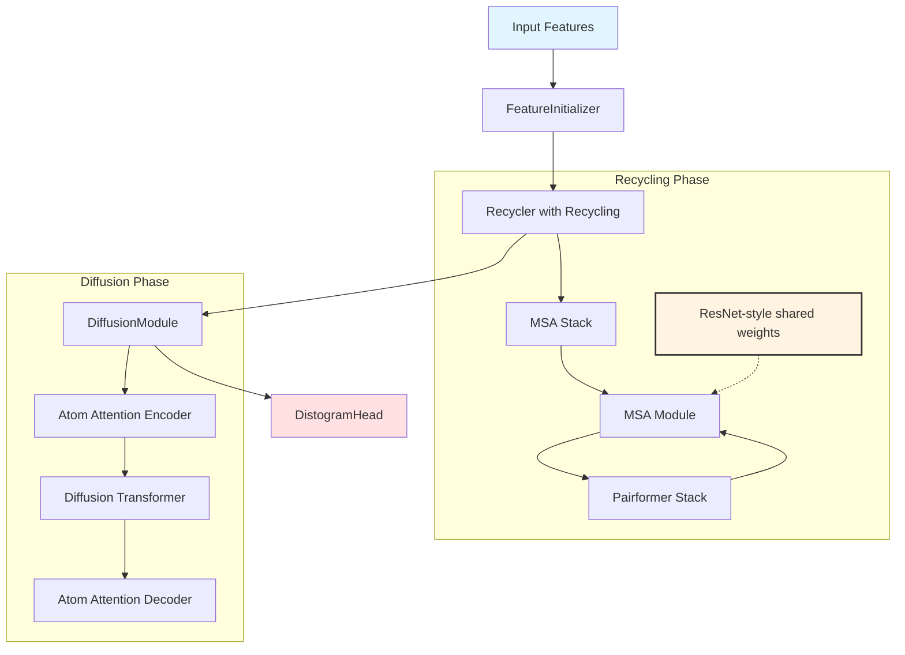

RosettaFold3 (RF3) is an all-atom biomolecular structure prediction network that leverages diffusion-based generative modeling to predict the 3D structures of proteins, nucleic acids, ligands, and their complexes. This architecture builds upon AlphaFold3 principles while incorporating implicit chirality representations and atom-level geometric conditioning for enhanced performance on chiral ligand prediction tasks.

## Core Architecture Overview


RF3 implements a multi-scale representation system that operates at both token-level (coarse-grained) and atom-level (fine-grained) resolutions. The architecture follows a dual-phase design: a trunk module with recycling for initial structure refinement, followed by a diffusion module for detailed all-atom generation.

### Shape Annotation Glossary

Understanding RF3's tensor shapes is fundamental for working with the model:

- **I**: Number of tokens (coarse representation)
- **L**: Number of atoms (fine representation)
- **M**: Number of MSA sequences
- **T**: Number of templates
- **D**: Diffusion structure batch dimension
- **C_s**: Token-level single representation channel dimension (384)
- **C_z**: Token-level pair representation channel dimension (128)
- **C_atom**: Atom-level single representation channel dimension (128)
- **C_atompair**: Atom-level pair representation channel dimension (16)

Sources: [RF3.py](models/rf3/src/rf3/model/RF3.py#L21-L34)

## Model Architecture

The RF3 model consists of five core components that work in sequence during the forward pass:



### FeatureInitializer

The `FeatureInitializer` creates initial token-level single (S) and pair (Z) representations from input features. It embeds sequence features (restype, profile, deletion_mean) and processes atom-level features through an AtomAttentionEncoder to generate coarse-grained token representations.

Key parameters:
- **c_token**: 384 channels for token representations
- **c_atom_1d_features**: 389 features including ref_pos, ref_charge, ref_mask, ref_element, ref_atom_name_chars
- **use_inv_dist_squared**: True for embedding pairwise inverse squared distances

Sources: [rf3_net.yaml](models/rf3/configs/model/components/rf3_net.yaml#L9-L26), [pairformer_layers.py](models/rf3/src/rf3/model/layers/pairformer_layers.py#L21-L77)

### Recycler

The `Recycler` implements the trunk architecture with ResNet-style recycling, running the model trunk repeatedly with shared weights. This iterative refinement process includes:

- **MSA Module**: Processes multiple sequence alignments with 4 blocks, using outer product means and MSA pair-weighted averaging to create initial pair representations
- **Pairformer Stack**: 48 blocks of triangle attention and triangle multiplication operations for intra- and inter-residue communication
- **Template Embedder**: 2-block module incorporating template information with raw_template_dim of 108

The recycling mechanism samples an independent MSA for each recycle (i_cycle), running gradients only on the final recycle to enable efficient memory usage during training.

Sources: [rf3_net.yaml](models/rf3/configs/model/components/rf3_net.yaml#L42-L109), [RF3.py](models/rf3/src/rf3/model/RF3.py#L257-L334)

### DiffusionModule

The `DiffusionModule` performs atom-level diffusion modeling using an EDM (Efficient Diffusion Model) formulation. This module takes noisy atomic coordinates and progressively denoises them through a transformer architecture with atom-level attention.

Key components:

- **AtomAttentionEncoder**: Sequence-local atom attention and aggregation to coarse-grained tokens, with optional chiral feature conditioning
- **DiffusionTransformer**: 24-block transformer with 16 attention heads for full self-attention at the token level
- **AtomAttentionDecoder**: Cross-attention transformer broadcasting token-level representations back to atom-level positions

The module supports multiple prediction strategies:
- **f_pred="edm"**: Predicts scaled positions using EDM formulation
- **f_pred="noise_pred"**: Direct noise prediction
- **f_pred="unconditioned"**: Unconditional prediction mode

> [!TIP]
> The diffusion module uses activation checkpointing throughout to balance memory efficiency and computational cost, particularly important given the L×L atom-pair representations.

Sources: [RF3_structure.py](models/rf3/src/rf3/model/RF3_structure.py#L73-L150), [rf3_net.yaml](models/rf3/configs/model/components/rf3_net.yaml#L111-L158)

### DistogramHead

The `DistogramHead` predicts distance distributions between residue pairs, providing confidence information complementary to the diffusion-based coordinate predictions. It operates on the pair representation (Z_II) with 65 distance bins.

Sources: [rf3_net.yaml](models/rf3/configs/model/components/rf3_net.yaml#L158-L160), [RF3.py](models/rf3/src/rf3/model/RF3.py#L1-L150)

## Forward Pass Mechanics

The forward pass differs significantly between training and inference modes:

### Training Mode

During training, RF3 performs a single denoising step with gradients enabled only on the final recycle:

1. Run recycling through n_recycles cycles with gradients disabled for all but the last
2. Generate distogram prediction from final pair representation
3. Pass noisy coordinates to diffusion_module for single-step denoising
4. Return predicted coordinates and distogram

```python
# Single denoising step during training
X_pred = self.diffusion_module(
    X_noisy_L=input["X_noisy_L"],
    t=input["t"],
    f=input["f"],
    S_inputs_I=recycling_outputs["S_inputs_I"],
    S_trunk_I=recycling_outputs["S_I"],
    Z_trunk_II=recycling_outputs["Z_II"],
)
```

Sources: [RF3.py](models/rf3/src/rf3/model/RF3.py#L174-L190)

### Inference Mode

During inference, RF3 performs a full diffusion rollout with gradient-free computation:

1. Complete recycling phase with disabled gradients
2. Run inference sampler through num_timesteps (default 50) steps
3. Generate trajectory of noisy and denoised coordinates for monitoring
4. Compute confidence metrics including pTM and ipTM

The inference sampler uses an AlphaFold3-style solver with parameters:
- **num_timesteps**: 50 steps for diffusion rollout
- **sigma_data**: 16.0 for EDM formulation
- **noise_scale**: 1.003 for noise schedule
- **step_scale**: 1.5 for step size scaling

Sources: [RF3.py](models/rf3/src/rf3/model/RF3.py#L190-L213), [rf3.yaml](models/rf3/configs/inference_engine/rf3.yaml#L1-L33)

## Input Features and Data Pipeline

RF3 accepts a comprehensive feature dictionary with both sequence-level and atom-level information:

### Sequence-Level Features

- **restype**: One-hot encoded residue types (20 standard + special codes)
- **profile**: Position-specific scoring matrix from MSA
- **deletion_mean**: Mean deletion probabilities from MSA
- **msa_stack**: Stack of MSAs (n_recycles × M × I), one per recycling cycle

### Atom-Level Features

- **ref_pos**: Reference atomic positions in 3D space
- **ref_charge**: Atomic charges
- **ref_mask**: Validity mask for atoms
- **ref_element**: Atomic element types
- **ref_atom_name_chars**: One-hot encoded atom names
- **ref_space_uid**: Chain/residue identifiers for masking

> [!TIP]
> The atom_to_token_map maps each atom to its corresponding token, enabling efficient aggregation from atom-level to token-level representations using indexed operations.

Sources: [RF3.py](models/rf3/src/rf3/model/RF3.py#L21-L34), [pairformer_layers.py](models/rf3/src/rf3/model/layers/pairformer_layers.py#L100-L134)

## Inference Engine

The `RF3InferenceEngine` wraps the model with configuration management and output formatting for production use:

### Configuration Parameters

| Parameter | Default | Description |
|-----------|---------|-------------|
| n_recycles | 10 | Number of recycling iterations |
| diffusion_batch_size | 5 | Batch size for diffusion sampling |
| num_steps | 50 | Number of diffusion timesteps |
| early_stopping_plddt_threshold | 0.5 | Threshold for early stopping based on confidence |

### Confidence Metrics

RF3 computes AlphaFold3-style confidence metrics:

- **pTM**: Predicted TM-score for overall structure quality (range 0-1, higher is better)
- **ipTM**: Interface pTM for multi-chain predictions, measuring interface quality
- **ranking_score**: Composite score calculated as `0.8 * ipTM + 0.2 * pTM - 100 * has_clash`

### Output Format

The inference engine outputs AlphaFold3-compatible files:

- **{example_id}_model_*.cif.gz**: Predicted structures in mmCIF format
- **{example_id}_metrics.csv**: Summary confidence metrics including pTM, ipTM, ranking_score
- **{example_id}.score**: Per-residue confidence scores (B-factor column in structure files)

Sources: [rf3.py](models/rf3/src/rf3/inference_engines/rf3.py#L1-L200), [rf3.yaml](models/rf3/configs/inference_engine/rf3.yaml#L1-L33)

## Training Configuration

Training RF3 requires careful configuration of data loaders, optimizers, and schedulers:

### Training Loop Parameters

```yaml
max_epochs: 10_000
n_examples_per_epoch: 24000
n_recycles_train: 4  # Specified in dataset config
clip_grad_max_norm: 10.0
precision: bf16-mixed
```

The training pipeline includes:
- **DiffusionLoss**: Primary loss for coordinate prediction
- **DistogramLoss**: Auxiliary loss for distance prediction
- **StructurePredictionTrainer**: Custom trainer handling RF3-specific requirements

The trainer supports prevalidation, gradient clipping, and periodic checkpointing with bf16 mixed precision for memory efficiency.

Sources: [rf3.yaml](models/rf3/configs/trainer/rf3.yaml#L1-L21), [structure_prediction.yaml](models/rf3/configs/trainer/loss/structure_prediction.yaml#L1-L5)

## Model Variants

Three model checkpoints are available, all sharing the same inference API:

| Model | Training Cutoff | Use Case |
|-------|-----------------|----------|
| Latest | 01/24 | Production use with bugfixes and improvements |
| Preprint | 01/24 | Original preprint model for reproducibility |
| Benchmark | 09/21 | Benchmarking against models with same date cutoff |

All checkpoints maintain identical architecture and inference interfaces, allowing seamless swapping without code changes.

Sources: [README.md](models/rf3/README.md#L30-L60)

## Advanced Features

### Chirality Conditioning

RF3 incorporates implicit chirality representations for improved ligand prediction:

```yaml
use_chiral_features: true
no_grad_on_chiral_center: false
```

The model computes chiral gradients during training to enforce proper stereochemistry, with optional gradient disabling on chiral centers for specific use cases.

Sources: [rf3_net.yaml](models/rf3/configs/model/components/rf3_net.yaml#L132-L133), [af3_diffusion_transformer.py](models/rf3/src/rf3/model/layers/af3_diffusion_transformer.py#L27-L29)

### Early Stopping

The inference engine supports early stopping based on confidence predictions, aborting predictions that are unlikely to succeed to save computational resources. This is controlled by `early_stopping_plddt_threshold` and is particularly useful for sequences without MSAs.

### Multi-GPU Distributed Inference

RF3 automatically distributes predictions across available GPUs when processing multiple inputs, with load balancing handled through distributed samplers. This is especially efficient for batch processing of multiple sequences.

## Next Steps

To deepen your understanding of the RF3 architecture and implementation:

1. **Architecture Context**: Review the [Architecture and Design Philosophy](5-architecture-and-design-philosophy) for Foundry's overall system design
2. **Training Infrastructure**: Explore the [Training Harness with FabricTrainer](7-training-harness-with-fabrictrainer) for distributed training details
3. **Inference System**: Study the [Inference Engine Architecture](6-inference-engine-architecture) for production deployment patterns
4. **Comparative Models**: Examine [RFdiffusion3: All-Atom Generative Model](9-rfdiffusion3-all-atom-generative-model) to understand complementary generative approaches
5. **Configuration System**: Dive into the [Hydra Configuration System](12-hydra-configuration-system) for managing complex model configurations

For practical implementation details and examples, refer to the [RF3 README](models/rf3/README.md) and explore the configuration files in `models/rf3/configs/`.