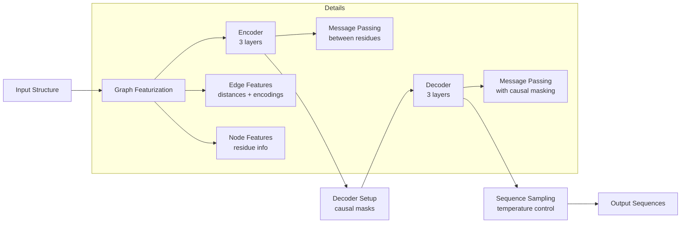
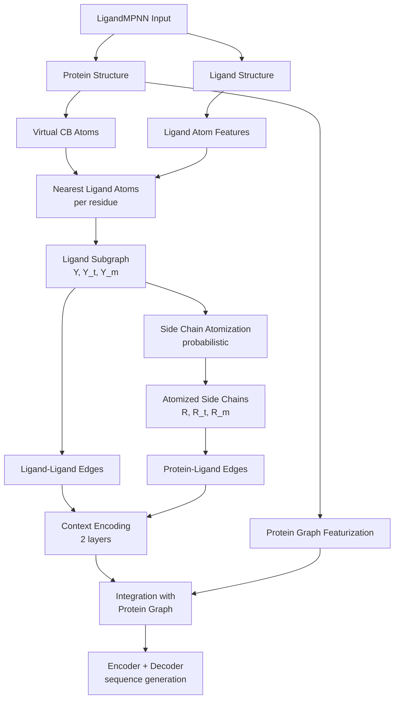
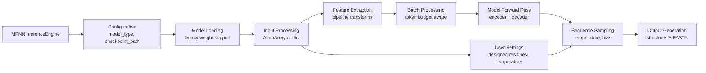
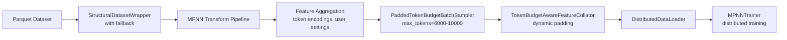
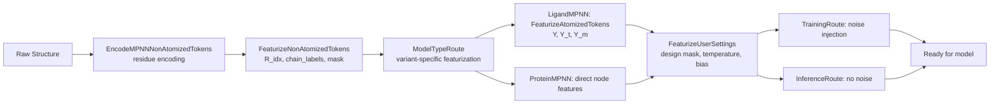

ProteinMPNN and LigandMPNN are message-passing neural network architectures for protein inverse folding—the task of designing amino acid sequences given fixed backbone structures. ProteinMPNN handles protein-only systems, while LigandMPNN extends this capability to protein-ligand complexes (small molecules, ions, DNA/RNA). This re-implementation in Foundry provides a unified framework for multiple MPNN variants with streamlined inference and training pipelines.


## Model Architecture Overview

The MPNN architecture employs a graph-based representation where protein residues serve as nodes, connected by edges based on spatial proximity. The architecture consists of three core components: a graph featurization module that encodes structural information, an encoder that processes the input graph, and a decoder that generates sequences auto-regressively with causal masking.

Sources: [mpnn.py](models/mpnn/src/mpnn/model/mpnn.py#L19-L233), [graph_embeddings.py](models/mpnn/src/mpnn/model/layers/graph_embeddings.py#L9-L690)

### Core Architecture Flow



The encoder processes the complete graph without sequence information, learning structural representations through message passing. The decoder then generates sequences one residue at a time, attending only to previously generated residues (causal masking) and encoder outputs. This architecture is shared across all MPNN variants, with specialization primarily occurring in the featurization layer.

Sources: [mpnn.py](models/mpnn/src/mpnn/model/mpnn.py#L252-L333), [message_passing.py](models/mpnn/src/mpnn/model/layers/message_passing.py#L106-L233)

### Message Passing Mechanism

The message passing layers implement the core graph neural network operations. The `EncLayer` for the encoder and `DecLayer` for the decoder use similar structures but differ in their attention patterns. Each layer performs gather operations to aggregate information from neighbors, applies attention mechanisms, and updates node representations.

Sources: [message_passing.py](models/mpnn/src/mpnn/model/layers/message_passing.py#L106-L233)

## MPNN Model Variants

The implementation provides six specialized MPNN models, all inheriting from a common `ProteinMPNN` base class. Each variant is optimized for specific design scenarios through specialized featurization and training datasets.

Sources: [mpnn.py](models/mpnn/src/mpnn/model/mpnn.py#L19-L2263)

| Model | Architecture | Specialization | Nearest Neighbors | Training Data Focus |
|-------|-------------|----------------|-------------------|---------------------|
| **ProteinMPNN** | Base | General protein design | 48 | Diverse PDB structures |
| **LigandMPNN** | Extended | Protein-ligand complexes | 32 | Structures with small molecules/DNA/RNA |
| **SolubleMPNN** | Base | Soluble protein design | 48 | Soluble protein dataset |
| **AntibodyMPNN** | Base | Antibody optimization | 48 | Antibody structures |
| **MembraneMPNN** | Extended | Membrane protein design | 48 | Membrane proteins with environment labels |
| **PSSMMPNN** | Extended | Evolution-aware design | 48 | PSSM profile integration |

Sources: [mpnn.py](models/mpnn/src/mpnn/model/mpnn.py#L2133-L2263), [graph_embeddings.py](models/mpnn/src/mpnn/model/layers/graph_embeddings.py#L763-L838)

### ProteinMPNN Base Model

The `ProteinMPNN` class implements the core inverse folding functionality. Key hyperparameters include `num_encoder_layers` and `num_decoder_layers` (default: 3 each), `hidden_dim` (default: 128), and `num_neighbors` (default: 48 for protein models). The model uses Gaussian RBF embeddings for encoding pairwise distances and positional encodings for sequence context.

Sources: [mpnn.py](models/mpnn/src/mpnn/model/mpnn.py#L43-L57), [graph_embeddings.py](models/mpnn/src/mpnn/model/layers/graph_embeddings.py#L381-L481)

### LigandMPNN Extension

`LigandMPNN` extends the base architecture to incorporate ligand context. The key innovation is the construction of a protein-ligand subgraph comprising ligand atoms and optionally atomized side chains. This subgraph is encoded through dedicated layers before being integrated into the main protein graph.

Key LigandMPNN features:
- **Context atoms**: Up to 25 nearest ligand atoms per residue (configurable via `num_context_atoms`)
- **Context encoding**: 2 dedicated encoding layers for ligand subgraph
- **Side chain atomization**: Probability-based atomization for better geometric representation
- **Hybrid representation**: Combines ligand and protein-to-ligand edge features

Sources: [mpnn.py](models/mpnn/src/mpnn/model/mpnn.py#L2263-L2292), [graph_embeddings.py](models/mpnn/src/mpnn/model/layers/graph_embeddings.py#L865-L2124)



### Specialized Variants

**MembraneMPNN** adds per-residue and global membrane environment labels through the `HAS_NODE_FEATURES` flag, enabling context-aware design for membrane-embedded proteins. **PSSMMPNN** incorporates position-specific scoring matrix (PSSM) features to guide sequence design using evolutionary information. Both variants extend the base featurization without changing the core MPNN architecture.

Sources: [mpnn.py](models/mpnn/src/mpnn/model/mpnn.py#L2149-L2263), [graph_embeddings.py](models/mpnn/src/mpnn/model/layers/graph_embeddings.py#L763-L838)

## Graph Featurization

The graph featurization process converts atomic coordinates into the graph representations required by MPNN models. The `ProteinFeatures` base class and its specialized subclasses handle this transformation with different feature sets for each variant.

Sources: [graph_embeddings.py](models/mpnn/src/mpnn/model/layers/graph_embeddings.py#L9-L690)

### Protein-Only Featurization

For protein-only models (ProteinMPNN, SolubleMPNN, AntibodyMPNN), featurization involves:

1. **Atom selection**: Backbone atoms (N, CA, C, O) and representative atoms (CA)
2. **Virtual atom construction**: Virtual CB atom calculated from backbone geometry using weighted bonds
3. **Distance computation**: Pairwise distances between representative atoms
4. **RBF embedding**: Radial basis function encoding of distances into fixed-dimensional features
5. **K-nearest neighbors**: Selection of `num_neighbors` closest residues for each position
6. **Edge features**: Concatenation of RBF embeddings, positional encodings, and chain information
7. **Node features**: Residue type encoding and backbone dihedral angles

Sources: [graph_embeddings.py](models/mpnn/src/mpnn/model/layers/graph_embeddings.py#L135-L524)

### Ligand-Aware Featurization

LigandMPNN's `ProteinFeaturesLigand` extends this process significantly:

1. **Ligand atom collection**: Extraction of all ligand atoms with type information
2. **Per-residue ligand context**: For each residue, gathering the `num_context_atoms` nearest ligand atoms
3. **Angle features**: Computation of angles between protein virtual atoms and ligand atoms for directional context
4. **Side chain atomization**: Probabilistic atomization of selected side chains for detailed geometry
5. **Subgraph construction**: Combined ligand + atomized side chain atoms form the ligand subgraph
6. **Bipartite edges**: Protein-to-ligand edges capturing cross-interactions
7. **Context encoding**: Dedicated encoding of the ligand subgraph before integration

Sources: [graph_embeddings.py](models/mpnn/src/mpnn/model/layers/graph_embeddings.py#L1285-L2124)

## Inference Engine

The `MPNNInferenceEngine` provides a high-level interface for running MPNN inference, handling model loading, preprocessing, batch processing, and output generation.

Sources: [mpnn.py](models/mpnn/src/mpnn/inference_engines/mpnn.py#L37-L133)

### Inference Workflow



### Configuration and Loading

The inference engine supports loading both legacy weights (from original repositories) and retrained weights. Key configuration parameters include:
- `model_type`: One of "protein_mpnn", "ligand_mpnn", "soluble_mpnn"
- `checkpoint_path`: Path to model weights file
- `is_legacy_weights`: Boolean flag for original repository weights (required for current public weights)
- `device`: Target compute device (CPU/GPU)

Sources: [mpnn.py](models/mpnn/src/mpnn/inference_engines/mpnn.py#L40-L91), [README.md](models/mpnn/README.md#L30-L101)

### Model Variants and Checkpoint Compatibility

| Model Type | Legacy Weights Required | Default Neighbors | Training Noise (σ) |
|------------|------------------------|-------------------|-------------------|
| protein_mpnn | True | 48 | 0.20 Å |
| ligand_mpnn | True | 32 | 0.10 Å |
| soluble_mpnn | True | 48 | 0.20 Å |

Multiple weight variants exist with different Gaussian noise levels used during training (σ = 0.02, 0.05, 0.10, 0.20, 0.30 Å), allowing users to select models appropriate for their design task's noise tolerance.

Sources: [README.md](models/mpnn/README.md#L30-L101)

> [!TIP]
> When loading original ProteinMPNN/LigandMPNN weights from the public repositories, always set `is_legacy_weights=True`. The re-implementation maintains compatibility but requires this flag for correct parameter mapping.

### Input Formats

The inference engine accepts two input formats:
1. **AtomArray**: Biological structure objects with annotations for design control (mask, temperature, bias)
2. **Input dictionary**: Direct specification of design parameters bypassing CIF annotations

Current limitations prevent saving `mpnn_bias` and `mpnn_pair_bias` annotations to CIF files due to shape constraints, requiring these to be recreated upon reload.

Sources: [mpnn.py](models/mpnn/src/mpnn/inference_engines/mpnn.py#L204-L278), [README.md](models/mpnn/README.md#L128-L137)

### Decoding Strategies

The model implements two decoding modes:

**Teacher Forcing**: Used during training or evaluation where ground-truth sequences are provided. The decoder attends to true previous residues, enabling parallel computation across the sequence.

**Auto-regressive**: Used for inference where sequences are generated token-by-token. Each position attends only to previously generated residues, ensuring causal dependency. The decoder samples from the output distribution at each step with configurable temperature.

Sources: [mpnn.py](models/mpnn/src/mpnn/model/mpnn.py#L958-L1810)

## Training Infrastructure

The MPNN training pipeline leverages Foundry's distributed training framework with specialized components for efficient protein structure processing.

Sources: [train.py](models/mpnn/src/mpnn/train.py#L25-L340), [mpnn_trainer.py](models/mpnn/src/mpnn/trainers/mpnn.py#L21-L194)

### Data Pipeline

The training pipeline uses a token budget approach to handle variable-length protein structures efficiently:



Key components:
- **PaddedTokenBudgetBatchSampler**: Groups structures into batches respecting a maximum token budget (6000 for LigandMPNN, 10000 for ProteinMPNN)
- **TokenBudgetAwareFeatureCollator**: Applies dynamic padding to batched features
- **Feature aggregation transforms**: Encodes tokens, adds user settings (design mask, temperature, bias), and applies training noise

Sources: [samplers.py](models/mpnn/src/mpnn/samplers/samplers.py#L9-L168), [feature_collator.py](models/mpnn/src/mpnn/collate/feature_collator.py#L187-L236), [mpnn_pipeline.py](models/mpnn/src/mpnn/pipelines/mpnn.py#L59-L163)

### Training Configuration

Model-specific training parameters reflect the different data distributions and requirements:

| Parameter | ProteinMPNN | LigandMPNN |
|-----------|-------------|------------|
| Batch Size (tokens) | 10,000 | 6,000 |
| Training Date Cutoff | 2021-08-02 | 2022-12-16 |
| Structure Noise (σ) | 0.2 Å | 0.1 Å |
| Gradient Clipping | None | 1.0 |

Training uses label-smoothed negative log-likelihood loss with a normalization constant of 6000 tokens. The optimizer employs Noam learning rate scheduling with warmup.

Sources: [train.py](models/mpnn/src/mpnn/train.py#L27-L41), [nll_loss.py](models/mpnn/src/mpnn/loss/nll_loss.py#L5-L123)

### Distributed Training

The `MPNNTrainer` class extends `FabricTrainer` to implement the training loop with distributed support. Key methods include:
- `training_step()`: Forward pass, loss computation, and backpropagation
- `validation_step()`: Evaluation with sequence recovery metrics
- Integration with Foundry's checkpoint management and callbacks

Sources: [mpnn_trainer.py](models/mpnn/src/mpnn/trainers/mpnn.py#L79-L194)

> [!TIP]
> The token budget batching strategy is critical for training efficiency. ProteinMPNN and LigandMPNN use different budget sizes (10,000 vs 6,000) due to the additional memory overhead of ligand featurization in LigandMPNN.

## Transform Pipeline and Feature Aggregation

The transform pipeline converts raw structures into model-ready features through a sequence of modular transforms.

Sources: [mpnn_pipeline.py](models/mpnn/src/mpnn/pipelines/mpnn.py#L38-L163)

### Pipeline Stages



### Feature Aggregation Transforms

- **EncodeMPNNNonAtomizedTokens**: Converts residue names to integer tokens using occupancy-based filtering
- **FeaturizeNonAtomizedTokens**: Adds residue indices, chain labels, and residue masks
- **FeaturizeAtomizedTokens**: (LigandMPNN only) Adds ligand atom coordinates, types, and masks
- **FeaturizeUserSettings**: Applies user-provided design constraints (mask, temperature, bias, train_structure_noise)

Sources: [mpnn_aggregation.py](models/mpnn/src/mpnn/transforms/feature_aggregation/mpnn.py#L14-L151), [user_settings.py](models/mpnn/src/mpnn/transforms/feature_aggregation/user_settings.py#L21-L348)

### Design Control Features

User settings enable precise control over the design process:
- **Design mask**: Binary mask specifying which positions to redesign
- **Temperature**: Sampling temperature controlling sequence diversity
- **MPNN bias**: Per-position, per-residue type logits for guiding design
- **MPNN pair bias**: Pairwise interaction preferences between positions
- **Train structure noise**: Gaussian noise added to coordinates during training for robustness

Sources: [user_settings.py](models/mpnn/src/mpnn/transforms/feature_aggregation/user_settings.py#L139-L348)

## Metrics and Evaluation

Sequence recovery (percentage of residues matching the ground truth sequence) serves as the primary evaluation metric for MPNN models. The implementation provides specialized metrics for both training and validation.

Sources: [sequence_recovery.py](models/mpnn/src/mpnn/metrics/sequence_recovery.py)

## Installation and Usage

### Installation

```bash
git clone https://github.com/RosettaCommons/rc-foundry.git \
  && cd rc-foundry \
  && uv python install 3.12 \
  && uv venv --python 3.12 \
  && source .venv/bin/activate \
  && uv pip install -e ".[mpnn]"
```

Sources: [README.md](models/mpnn/README.md#L25-L33)

### Downloading Weights

Download legacy weights from the original repositories:

```bash
# ProteinMPNN (48 neighbors, σ = 0.20 Å)
wget https://files.ipd.uw.edu/pub/ligandmpnn/proteinmpnn_v_48_020.pt

# LigandMPNN (32 neighbors, σ = 0.10 Å, 25 context atoms)
wget https://files.ipd.uw.edu/pub/ligandmpnn/ligandmpnn_v_32_010_25.pt

# SolubleMPNN (48 neighbors, σ = 0.20 Å)
wget https://files.ipd.uw.edu/pub/ligandmpnn/solublempnn_v_48_020.pt
```

Sources: [README.md](models/mpnn/README.md#L35-L101)

## Next Steps

For deeper architectural understanding, explore the [Inference Engine Architecture](6-inference-engine-architecture) to see how MPNN integrates with Foundry's broader infrastructure, or [Architecture and Design Philosophy](5-architecture-and-design-philosophy) for the system-level design rationale. To extend MPNN functionality, see [Model-Specific Configuration Structure](22-model-specific-configuration-structure) and [Adding New Models to Foundry](21-adding-new-models-to-foundry).