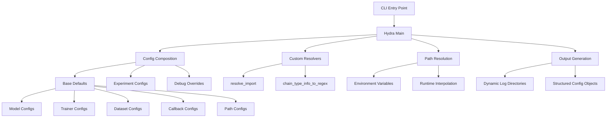
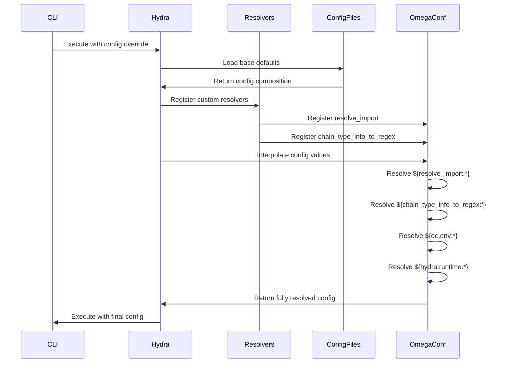

The Hydra Configuration System provides a flexible, hierarchical framework for managing training and inference parameters across Foundry's biomolecular structure prediction models. By leveraging Hydra's composition capabilities and OmegaConf's powerful interpolation, Foundry enables seamless configuration of complex machine learning workflows while maintaining reproducibility and modularity.

## Architecture Overview

Foundry's configuration architecture follows a modular, composable design where base configurations define default parameters and experiment-specific configs override them selectively. The system integrates custom resolvers for dynamic computation and environment-aware path management for distributed computing environments.



## Custom Resolvers

Foundry extends Hydra's capabilities through custom OmegaConf resolvers registered in `src/foundry/hydra/resolvers.py`. These resolvers enable dynamic computation and type-safe imports directly within configuration files.

### Import Resolver

The `resolve_import` resolver facilitates runtime module and attribute imports, enabling configuration files to reference Python classes and functions without hardcoded dependencies. This pattern decouples configuration definitions from implementation details.

Sources: [resolvers.py](/src/foundry/hydra/resolvers.py#L28-L48)

The resolver accepts a module path and optional attribute path, navigating nested attributes through dot notation. For example, `${resolve_import:torch.optim,Adam}` dynamically imports the Adam optimizer class.

### Chain Type Resolver

The `chain_type_info_to_regex` resolver converts `ChainType` and `ChainTypeInfo` enumerations into regex patterns, primarily used for filtering datasets by molecular chain types during training and validation.

Sources: [resolvers.py](/src/foundry/hydra/resolvers.py#L51-L77)

This resolver accepts multiple enumeration attributes and constructs an alternation regex pattern. For instance, `${chain_type_info_to_regex:PROTEINS,NUCLEIC_ACIDS}` generates a regex matching protein and nucleic acid chain types, enabling flexible dataset filtering in configuration expressions like:

```yaml
filters:
  - "pn_unit_1_type.astype('str').str.match('${chain_type_info_to_regex:PROTEINS}')"
```

> [!TIP]
> Custom resolvers are registered once per process using the `@run_once` decorator, preventing duplicate registration issues in distributed training scenarios where multiple processes may import the configuration module.

## Configuration Hierarchy

Foundry organizes configurations hierarchically across multiple models (RFdiffusion3, RosettaFold3, ProteinMPNN), with each model maintaining its configuration directory structure under `models/<model>/configs/`.

### Base Configuration Structure

The configuration hierarchy follows Hydra's defaults list pattern, where higher-priority configs override lower-priority ones. For RosettaFold3 training:

```yaml
defaults:
  - callbacks: default
  - logger: csv
  - trainer: ???
  - paths: default
  - datasets: ???
  - dataloader: default
  - hydra: default
  - model: ???
  - _self_
  - experiment: ???
  - debug: null
```

Sources: [train.yaml](/models/rf3/configs/train.yaml#L6-L19)

The `???` placeholder pattern enforces required configuration specification, preventing accidental omission of critical parameters. The `_self_` directive ensures local config values can override defaults before being overridden by experiment configs.

### Model-Specific Organization

Each model implements its configuration hierarchy tailored to its specific architecture:

**RosettaFold3** ([rf3/configs](/models/rf3/configs)):
- `model/`: Network architecture, optimizers, schedulers
- `trainer/`: Training strategies, loss functions, metrics
- `datasets/`: Training/validation dataset definitions
- `inference_engine/`: Inference parameters and checkpoint management
- `callbacks/`: Training callbacks and logging

**RFdiffusion3** ([rfd3/configs](/models/rfd3/configs)):
- `model/`: Diffusion network components, samplers
- `datasets/conditions/`: Conditioning strategies (DNA, PPI, unconditional)
- `trainer/`: Fabric-based training configuration
- `inference_engine/`: Design pipeline configuration

### Experiment Configurations

Experiment configs version control specific hyperparameter combinations for production training runs. These files combine base model configurations with dataset specifications and training parameters:

```yaml
defaults:
  - pretrained/rf3
  - override /datasets: pdb_only

name: quick-rf3
tags:
  - quick

trainer:
  limit_train_batches: 4
  limit_val_batches: 4
```

Sources: [quick-rf3.yaml](/models/rf3/configs/experiment/quick-rf3.yaml#L4-L14)

The `override /datasets:` syntax demonstrates Hydra's package overriding capability, selectively replacing entire configuration groups.

## Path Management System

Foundry implements environment-aware path resolution combining Hydra's runtime interpolation with environment variable references. This design supports seamless transitions between local development, HPC clusters, and cloud environments.

### Path Configuration Hierarchy

The path management system follows a three-tier structure:

| Tier | Purpose | Example |
|------|---------|---------|
| **Environment Variables** | System-specific paths | `PROJECT_ROOT`, `USER` |
| **Hydra Runtime Variables** | Dynamic run-specific paths | `${hydra:runtime.output_dir}` |
| **Config Defaults** | Application-wide paths | `log_dir`, `data_dir` |

Sources: [default.yaml](/models/rf3/configs/paths/default.yaml#L6-L21)

The root path configuration reads from the `PROJECT_ROOT` environment variable, automatically set by `rootutils` during project initialization:

```yaml
root_dir: ${oc.env:PROJECT_ROOT}
log_dir: /net/scratch/${oc.env:USER}/training/logs
output_dir: ${hydra:runtime.output_dir}
work_dir: ${hydra:runtime.cwd}
```

### Dynamic Output Directory Generation

Hydra generates unique output directories for each training run using timestamp and SLURM job ID interpolation:

```yaml
run:
  dir: ${paths.log_dir}/${task_name}/${name}/${now:%Y-%m-%d}_${now:%H-%M}_JOB_${oc.env:SLURM_JOB_ID,default}
```

Sources: [default.yaml](/models/rf3/configs/hydra/default.yaml#L8-L9)

The `${oc.env:SLURM_JOB_ID,default}` pattern defaults to "default" when not running on SLURM, enabling seamless local development.

> [!TIP]
> Logging configuration incorporates a fix from [Hydra PR #2242](https://github.com/facebookresearch/hydra/pull/2242), specifying log file paths relative to the runtime output directory rather than absolute paths.

## Configuration Composition Patterns

Foundry employs several advanced Hydra patterns for flexible configuration composition.

### Package Interpolation with Config Group Defaults

The model configuration demonstrates package interpolation syntax, enabling composition from multiple config files:

```yaml
defaults:
  - optimizers/adam@optimizer
  - schedulers/af3@lr_scheduler
  - components/ema@ema
  - components/rf3_net@net
  - _self_
```

Sources: [rf3.yaml](/models/rf3/configs/model/rf3.yaml#L1-L8)

The `@` syntax places the loaded configuration under a specific key (`optimizer`, `lr_scheduler`, `ema`, `net`) rather than merging at the top level. This pattern prevents key collisions and maintains hierarchical organization.

### Target Instantiation Pattern

Configuration files specify Python class instantiation targets using the `_target_` field:

```yaml
_target_: rf3.inference_engines.rf3.RF3InferenceEngine

ckpt_path: rf3_foundry_01_24_latest.ckpt
n_recycles: 10
diffusion_batch_size: 5
```

Sources: [rf3.yaml](/models/rf3/configs/inference_engine/rf3.yaml#L4-L7)

Hydra's structured config system automatically instantiates the specified class, passing the remaining fields as constructor arguments. This pattern enables configuration-driven dependency injection.

### Cross-Model Configuration Sharing

RFdiffusion3 demonstrates a more compact configuration structure using `@package _global_` and searchpath configuration:

```yaml
# @package _global_
hydra:
  searchpath:
    - pkg://configs

defaults:
  - model: rfd3_base
  - trainer: rfd3_base
  - datasets: design_base
```

Sources: [train.yaml](/models/rfd3/configs/train.yaml#L1-L10)

The `@package _global_` directive merges configuration at the root level rather than under a package key. The `searchpath` configuration enables loading configs from a shared package.

## Configuration Comparison Across Models

| Aspect | RosettaFold3 | RFdiffusion3 | ProteinMPNN |
|--------|-------------|--------------|-------------|
| **Training Framework** | Lightning | Fabric | Lightning |
| **Default Logger** | CSV | Default | Default |
| **Config Package** | Per-group merge | Global merge | Per-group merge |
| **Dataset Strategy** | Multiple splits (PDB, distillation) | Condition-based design | Structure-based |
| **Checkpoint Pattern** | `.ckpt` extension | `.ckpt` extension | `.pt` extension |
| **Inference Engine** | RF3InferenceEngine | RFD3Engine | Direct model inference |

Sources: [rf3/train.yaml](/models/rf3/configs/train.yaml#L1-L43), [rfd3/train.yaml](/models/rfd3/configs/train.yaml#L1-L28)

## Runtime Behavior and Execution Flow

When Foundry executes a training or inference command, Hydra orchestrates the following sequence:



The runtime output directory structure demonstrates this resolution process:

```
/net/scratch/<USER>/training/logs/train/quick-rf3/2025-01-15_14-30_JOB_12345/
├── .hydra/
│   ├── config.yaml           # Full composed config
│   ├── hydra.yaml            # Hydra configuration
│   └── overrides.yaml        # CLI overrides applied
├── checkpoints/
│   └── epoch_1.ckpt
└── experiment.log
```

## Advanced Configuration Techniques

### Conditional Configuration with Debug Overrides

The debug configuration pattern enables rapid experimentation without modifying production configs:

```yaml
defaults:
  - _self_
  - debug: null

# Production values
trainer:
  max_epochs: 10_000
  limit_train_batches: null
```

Sources: [train.yaml](/models/rf3/configs/train.yaml#L20-L21)

Setting `debug=dev.yaml` via CLI override loads debug configurations that override production parameters, enabling quick testing cycles.

### Dataset Filtering with Custom Resolvers

The chain type resolver enables complex dataset filtering expressions:

```yaml
datasets:
  val:
    af3_validation:
      dataset:
        dataset:
          filters:
            - "n_tokens_total < 500"
            - "interfaces_to_score.str.contains('protein-ligand')"
            - "pn_unit_1_type.astype('str').str.match('${chain_type_info_to_regex:PROTEINS}')"
```

Sources: [quick-rf3.yaml](/models/rf3/configs/experiment/quick-rf3.yaml#L40-L47)

This pattern demonstrates the power of combining Hydra's interpolation with custom resolvers and pandas string operations.

## Integration with Foundry Components

The configuration system integrates with Foundry's core infrastructure through several key mechanisms:

### Trainer Configuration Integration

Trainer configurations reference dataset and model configurations through interpolation:

```yaml
_target_: rf3.trainers.rf3.RF3Trainer
n_recycles_train: ${datasets.n_recycles_train}
output_dir: ${paths.output_dir}
```

Sources: [rf3.yaml](/models/rf3/configs/trainer/rf3.yaml#L4-L8)

This ensures trainer parameters remain synchronized with dataset specifications.

### Callback Configuration

Callback configurations compose multiple callback types from separate files:

```yaml
defaults:
  - train_logging
  - metrics_logging
  - dump_validation_structures
  - _self_
```

Sources: [default.yaml](/models/rf3/configs/callbacks/default.yaml#L1-L5)

Each sub-config defines a callback class and its parameters, which Hydra instantiates and passes to the trainer.

### Metric Configuration Integration

Metric configurations use target instantiation for flexible metric selection:

```yaml
by_type_lddt:
  _target_: rf3.metrics.lddt.ByTypeLDDT
all_atom_lddt:
  _target_: rf3.metrics.lddt.AllAtomLDDT
distogram:
  _target_: rf3.metrics.distogram.DistogramLoss
```

Sources: [structure_prediction.yaml](/models/rf3/configs/trainer/metrics/structure_prediction.yaml#L1-L8)

This pattern enables metric composition without modifying trainer code.

## Best Practices and Common Patterns

### Required Field Enforcement

Use the `???` placeholder pattern for fields that must be specified in experiment configs:

```yaml
project: ???
trainer: ???
datasets: ???
```

Sources: [train.yaml](/models/rf3/configs/train.yaml#L28-L30)

This pattern prevents silent failures from unspecified critical parameters.

### Configuration Overrides

Use the override syntax for selective config replacement:

```yaml
defaults:
  - pretrained/rf3
  - override /datasets: pdb_only
```

Sources: [quick-rf3.yaml](/models/rf3/configs/experiment/quick-rf3.yaml#L5-L6)

This enables swapping entire configuration groups while preserving other defaults.

### Environment-Specific Defaults

Provide environment-specific configuration through file selection:

```yaml
defaults:
  - hydra: default          # Production logging
  # - hydra: no_logging      # For inference without logs
```

Sources: [base.yaml](/models/rf3/configs/inference_engine/base.yaml#L3-L4)

The inference engine base config overrides to `no_logging` for performance-critical inference runs.

## Next Steps

Understanding the Hydra Configuration System provides the foundation for customizing Foundry for specific use cases. Continue exploring:

- **[Custom Resolvers for Dynamic Configs](13-custom-resolvers-for-dynamic-configs)**: Deep dive into resolver implementation and extension
- **[Dataset Instantiation and Sampling](14-dataset-instantiation-and-sampling)**: How configuration drives dataset loading and sampling
- **[Model-Specific Configuration Structure](22-model-specific-configuration-structure)**: Detailed breakdown of RF3 and RFD3 configuration patterns
- **[Training Harness with FabricTrainer](7-training-harness-with-fabrictrainer)**: How configuration integrates with the training infrastructure

The configuration system's modular design enables rapid experimentation while maintaining reproducibility across development, testing, and production environments.