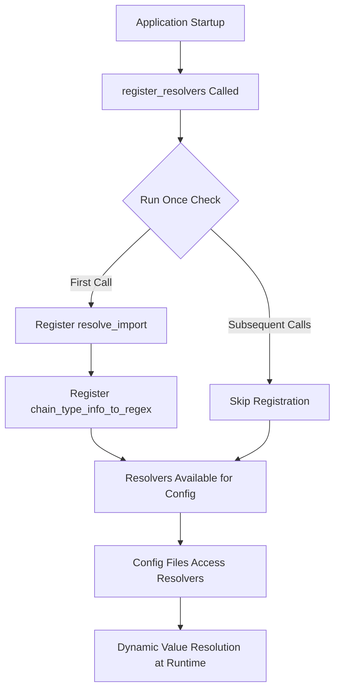

Custom resolvers extend Hydra's configuration system by enabling dynamic value resolution at runtime. These resolvers allow configuration files to reference external code, transform values dynamically, and compute derived properties without modifying the underlying configurations. Foundry implements custom resolvers to bridge the gap between static YAML configurations and dynamic Python runtime behavior, enabling sophisticated configuration patterns that adapt to different use cases and environments.

## Resolver Architecture Overview

Foundry's custom resolver system integrates with OmegaConf's resolver registration mechanism, allowing dynamic interpolation in configuration files. The resolver architecture follows a centralized registration pattern where all resolvers are registered once during application startup through a guarded registration function.



The registration process uses a decorator pattern from [`src/foundry/common.py`](src/foundry/common.py#L8-L22) that ensures idempotent execution, preventing duplicate registration across multiple imports. This pattern is critical for Hydra-based applications where the same module may be imported multiple times in different subprocesses during distributed training.

## Available Custom Resolvers

### `resolve_import`

The `resolve_import` resolver enables dynamic module and attribute imports directly from configuration files. This resolver is particularly useful for specifying classes, functions, or constants that should be instantiated at runtime without hard-coding their import paths in the application code.

**Resolver Signature:**
```yaml
${resolve_import:module_path,attribute_path}
```

**Parameters:**

| Parameter | Type | Required | Description |
|-----------|------|----------|-------------|
| `module_path` | string | Yes | Dot-notation path to the Python module (e.g., `torch.nn`, `foundry.trainers`) |
| `attribute_path` | string | No | Dot-notation path to the attribute within the module (e.g., `Linear`, `FabricTrainer`) |

**Usage Patterns:**

1. **Simple module import** (returns the module object):
```yaml
module: ${resolve_import:torch.optim}
```

2. **Attribute import** (returns a specific class or function):
```yaml
optimizer_class: ${resolve_import:torch.optim,Adam}
```

3. **Nested attribute access** (accesses attributes through multiple levels):
```yaml
custom_transform: ${resolve_import:atomworks.transforms,processing.Normalize}
```

This resolver is commonly used in [`model configuration files`](models/rfd3/configs/model/rfd3_base.yaml#L1-L9) where the model class needs to be specified dynamically, allowing the same configuration structure to instantiate different model architectures.

### `chain_type_info_to_regex`

The `chain_type_info_to_regex` resolver converts ChainType and ChainTypeInfo enum values into regex patterns for dataset filtering. This resolver is specifically designed for structural biology workflows where datasets need to be filtered by molecular chain types (proteins, nucleic acids, ligands) prior to training or validation.

**Resolver Signature:**
```yaml
${chain_type_info_to_regex:type1,type2,...}
```

**Parameters:**

| Parameter | Type | Description |
|-----------|------|-------------|
| `*args` | variable string arguments | One or more ChainType or ChainTypeInfo enum member names |

**Supported Enum Sources:**
- **ChainType**: Individual chain types (e.g., `PROTEIN`, `DNA`, `RNA`, `LIGAND`)
- **ChainTypeInfo**: Predefined groupings of chain types (e.g., `PROTEINS`, `NUCLEIC_ACIDS`, `SMALL_MOLECULES`)

**Usage Examples:**

1. **Single chain type filter:**
```yaml
filter_pattern: ${chain_type_info_to_regex:PROTEIN}
# Returns: "PROTEIN"
```

2. **Multiple chain types:**
```yaml
filter_pattern: ${chain_type_info_to_regex:PROTEIN,DNA,RNA}
# Returns: "PROTEIN|DNA|RNA"
```

3. **Using predefined groupings:**
```yaml
filter_pattern: ${chain_type_info_to_regex:PROTEINS,NUCLEIC_ACIDS}
# Returns: "PROTEIN|DNA|RNA|DNA|RNA" (expanded and combined)
```

4. **Mixed types and groupings:**
```yaml
filter_pattern: ${chain_type_info_to_regex:PROTEINS,LIGAND}
# Returns: "PROTEIN|DNA|RNA|LIGAND"
```

This resolver is typically used in [`dataset configuration files`](models/rfd3/configs/datasets/train/rfd3_monomer_distillation.yaml#L1-L39) for filtering operations, particularly in Pandas-style dataset filters:

```yaml
dataset_filter: "pn_unit_1_type.astype('str').str.match('${chain_type_info_to_regex:PROTEINS}')"
```

> [!TIP]
> The resolver automatically handles the regex alternation operator (`|`) by joining all resolved values, eliminating the need for manual string concatenation in configuration files. This provides a clean, declarative interface for complex filtering logic.

## Resolver Registration Mechanism

The registration of custom resolvers is centralized in [`src/foundry/hydra/resolvers.py`](src/foundry/hydra/resolvers.py#L11-L21) through the `register_resolvers` function:

```python
@run_once
def register_resolvers():
    resolvers = {
        "resolve_import": resolve_import,
        "chain_type_info_to_regex": chain_type_info_to_regex,
    }
    
    for name, resolver in resolvers.items():
        OmegaConf.register_new_resolver(name, resolver)
```

**Key Design Patterns:**

| Pattern | Purpose | Implementation |
|---------|---------|----------------|
| **Guarded Registration** | Prevents duplicate registration across imports | `@run_once` decorator from [`src/foundry/common.py`](src/foundry/common.py#L8-L22) |
| **Centralized Registration** | Single source of truth for available resolvers | Dictionary-based resolver mapping |
| **OmegaConf Integration** | Leverages standard Hydra resolver infrastructure | `OmegaConf.register_new_resolver` |

The `@run_once` decorator ensures thread-safe, idempotent execution by checking a `_has_run` attribute on the wrapped function. This is particularly important in Hydra's multi-process environment where configuration composition may occur in parallel subprocesses.

## Resolver Implementation Details

### `resolve_import` Implementation

The resolver implementation from [`src/foundry/hydra/resolvers.py`](src/foundry/hydra/resolvers.py#L24-L45) handles both simple module imports and nested attribute access:

```python
def resolve_import(module_path: str, attribute_path: str = None) -> Any:
    module = importlib.import_module(module_path)
    if attribute_path is not None:
        attributes = attribute_path.split(".")
        attr = module
        for attr_name in attributes:
            attr = getattr(attr, attr_name)
        return attr
    return module
```

The implementation uses Python's `importlib` for dynamic imports and iteratively resolves nested attributes using `getattr`. This approach provides flexibility for accessing deeply nested class hierarchies while maintaining error propagation through standard Python import mechanisms.

### `chain_type_info_to_regex` Implementation

The resolver implementation from [`src/foundry/hydra/resolvers.py`](src/foundry/hydra/resolvers.py#L48-L78) validates inputs against the `atomworks.enums` module and constructs the regex pattern:

```python
def chain_type_info_to_regex(*args) -> Any:
    regex_str = ""
    for arg in args:
        if hasattr(ChainType, arg):
            regex_str += f"{getattr(ChainType, arg).value}|"
        elif hasattr(ChainTypeInfo, arg):
            chain_types_list = getattr(ChainTypeInfo, arg)
            for ct in chain_types_list:
                regex_str += f"{ct.value}|"
        else:
            raise ValueError(
                f"Attribute not found for ChainType or ChainTypeInfo: {arg}."
            )
    return regex_str[:-1]  # Remove trailing '|'
```

The implementation includes runtime validation to catch typos or invalid enum references early, providing clear error messages at configuration resolution time rather than during dataset loading.

## Integration with Hydra Configuration System

Custom resolvers are deeply integrated with Hydra's configuration composition model, enabling dynamic resolution across the entire configuration hierarchy. Resolvers can be used in any YAML file within the Hydra configuration search path, including:

- Model configuration files ([`model/rfd3_base.yaml`](models/rfd3/configs/model/rfd3_base.yaml#L1-L9))
- Dataset configuration files ([`datasets/train/rfd3_monomer_distillation.yaml`](models/rfd3/configs/datasets/train/rfd3_monomer_distillation.yaml#L1-L39))
- Inference engine configurations ([`inference_engine/rfdiffusion3.yaml`](models/rfd3/configs/inference_engine/rfdiffusion3.yaml#L1-L66))
- Training pipeline configurations ([`train.yaml`](models/rfd3/configs/train.yaml#L1-L28))

**Resolver Resolution Order:**

1. **Configuration Composition**: Hydra loads and composes YAML files
2. **Default Merging**: Default values are merged according to Hydra's override rules
3. **Resolver Application**: All resolver expressions are evaluated
4. **Final Configuration**: The resolved configuration is passed to the application

This order ensures that resolvers have access to the fully composed configuration hierarchy, allowing them to reference values defined in other configuration files or through command-line overrides.

## Practical Applications

### Dynamic Model Instantiation

The `resolve_import` resolver enables configuration-driven model selection, allowing the same training pipeline to instantiate different model architectures:

```yaml
# In model config
model:
  _target_: ${resolve_import:foundry.models,RFD3Model}
  backbone_config:
    hidden_dim: 512
    num_layers: 12
```

### Dataset Filtering

The `chain_type_info_to_regex` resolver provides declarative dataset filtering for multi-modal structural datasets:

```yaml
# In dataset config
dataset:
  filter_expression: "chain_type.match('${chain_type_info_to_regex:PROTEINS,SMALL_MOLECULES}')"
```

### Environment-Specific Configuration

Resolvers enable environment-aware configuration by importing environment-specific modules:

```yaml
# In inference config
device_module: ${resolve_import:torch.cuda,${resolve_import:os,environ}.get('DEVICE_MODULE')}
```

> [!TIP]
> When combining multiple resolvers, consider the performance implications. Resolver expressions are evaluated at configuration composition time, so complex nested resolver calls can increase startup time. For performance-critical applications, pre-compute values or use simpler configuration structures.

## Error Handling and Debugging

Custom resolvers propagate errors with context about which resolver failed and what arguments were provided. Common error scenarios include:

**Import Errors:**
```python
ModuleNotFoundError: No module named 'nonexistent.module'
# Resolution: Verify module path is installed and correct
```

**Attribute Errors:**
```python
AttributeError: module 'torch.optim' has no attribute 'NonExistentClass'
# Resolution: Verify attribute_path is correct and the attribute exists
```

**Enum Validation Errors:**
```python
ValueError: Attribute not found for ChainType or ChainTypeInfo: INVALID_TYPE
# Resolution: Verify the enum name exists in atomworks.enums
```

For debugging resolver issues, enable Hydra's verbose mode to see the configuration composition process and resolver evaluation steps.

## Best Practices

1. **Use Descriptive Names**: When creating resolver aliases or grouping chain types, choose names that clearly indicate their purpose in the configuration context.

2. **Document Resolver Dependencies**: If a resolver depends on external packages (like `atomworks`), ensure these dependencies are documented and installed in the target environment.

3. **Test Resolver Expressions**: Validate resolver expressions in isolation before incorporating them into complex configuration hierarchies.

4. **Consider Resolver Performance**: For resolvers called frequently during configuration composition, ensure implementations are efficient and avoid unnecessary computation.

5. **Validate Early**: Use resolver implementations that perform input validation to catch configuration errors early in the pipeline rather than during runtime execution.

## Extending the Resolver System

To add new custom resolvers to Foundry:

1. **Implement the Resolver Function**: Create a function in [`src/foundry/hydra/resolvers.py`](src/foundry/hydra/resolvers.py#L1-L78) that accepts the necessary arguments and returns the resolved value.

2. **Register the Resolver**: Add the new resolver to the `resolvers` dictionary in [`register_resolvers()`](src/foundry/hydra/resolvers.py#L11-L21):

```python
@run_once
def register_resolvers():
    resolvers = {
        "resolve_import": resolve_import,
        "chain_type_info_to_regex": chain_type_info_to_regex,
        "your_new_resolver": your_new_resolver_function,
    }
    for name, resolver in resolvers.items():
        OmegaConf.register_new_resolver(name, resolver)
```

3. **Test the Resolver**: Ensure the resolver works correctly with Hydra's configuration composition system by testing with sample configuration files.

4. **Document the Resolver**: Provide clear documentation on the resolver's purpose, signature, parameters, and usage examples.

## Next Steps

Custom resolvers are a powerful tool for dynamic configuration, but they are just one component of Foundry's configuration ecosystem. To deepen your understanding:

- Explore the broader [Hydra Configuration System](12-hydra-configuration-system) to understand how resolvers fit into the overall configuration composition model
- Review [Dataset Instantiation and Sampling](14-dataset-instantiation-and-sampling) to see how `chain_type_info_to_regex` is used in practice for dataset filtering
- Study [Model-Specific Configuration Structure](22-model-specific-configuration-structure) to understand how `resolve_import` enables flexible model instantiation

These interconnected topics provide a comprehensive view of how Foundry's configuration system enables flexible, reproducible workflows across different domains and use cases.