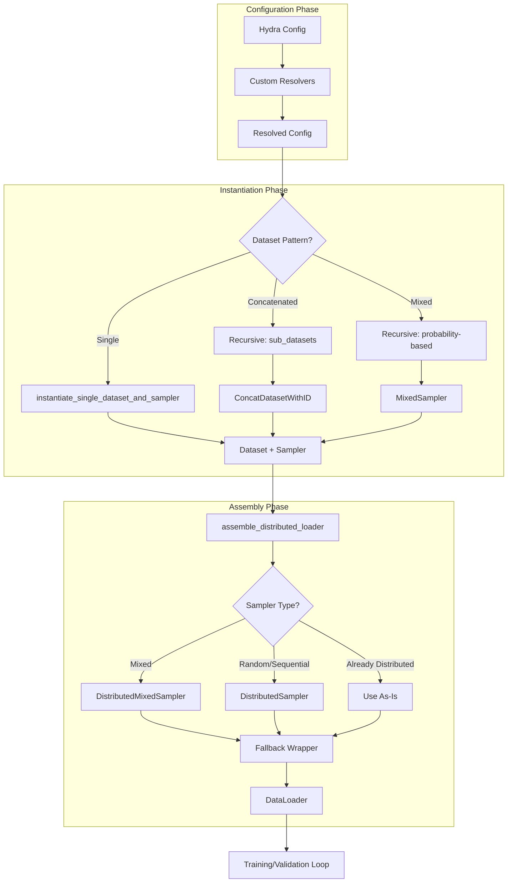

This page documents Foundry's flexible dataset instantiation and sampling system, which provides a robust, configurable framework for assembling training and validation data pipelines. The system supports multiple dataset composition strategies, distributed training, fallback mechanisms, and advanced sampling techniques through Hydra-based configuration.

## Architectural Overview

The dataset instantiation system operates as a hierarchical pipeline that transforms declarative configuration into functional PyTorch dataloaders. The architecture follows a three-phase pattern: configuration resolution, recursive instantiation, and distributed loader assembly.

Sources: [datasets.py](src/foundry/utils/datasets.py#L1-L50), [resolvers.py](src/foundry/hydra/resolvers.py#L1-L25)



## Configuration Resolution Layer

The configuration layer utilizes Hydra's extensible resolver system to enable dynamic imports and dataset filtering operations. Custom resolvers are registered at module initialization time and are available throughout the configuration lifecycle.

Sources: [resolvers.py](src/foundry/hydra/resolvers.py#L17-L25), [datasets.py](src/foundry/utils/datasets.py#L40-L42)

The `register_resolvers()` function registers two custom resolvers that extend Hydra's configuration capabilities:

```python
@run_once
def register_resolvers():
    resolvers = {
        "resolve_import": resolve_import,
        "chain_type_info_to_regex": chain_type_info_to_regex,
    }
    for name, resolver in resolvers.items():
        OmegaConf.register_new_resolver(name, resolver)
```

The `chain_type_info_to_regex` resolver is particularly useful for dataset filtering, converting ChainType enumerations into regex patterns for DataFrame filtering operations. For example, you can filter datasets to include only protein chains using:

Sources: [resolvers.py](src/foundry/hydra/resolvers.py#L51-L78)

```yaml
filters:
  - "pn_unit_1_type.astype('str').str.match('${chain_type_info_to_regex:PROTEINS}')"
```

## Recursive Dataset Instantiation

The core instantiation logic supports three distinct dataset composition patterns, determined by configuration structure. This flexibility allows training on diverse data sources while maintaining consistent sampling semantics.

Sources: [datasets.py](src/foundry/utils/datasets.py#L128-L221)

### Single Dataset Pattern

The base case instantiates a single dataset with its associated sampler. The system supports three sampler instantiation strategies:

Sources: [datasets.py](src/foundry/utils/datasets.py#L88-L127)

| Strategy | Configuration | Result |
|----------|--------------|--------|
| **Weighted Sampling** | `weights` key present | `WeightedRandomSampler` with computed weights |
| **Custom Sampler** | `sampler` key present | User-specified sampler class |
| **Uniform Default** | Neither present | `WeightedRandomSampler` with uniform weights |

The implementation handles the sampler selection logic:

```python
if "weights" in cfg and "sampler" not in cfg:
    weights = hydra.utils.instantiate(cfg.weights, dataset_df=dataset.data)
    sampler = WeightedRandomSampler(
        weights=weights,
        num_samples=len(dataset),
        replacement=True,
    )
elif "sampler" in cfg and "weights" not in cfg:
    sampler = hydra.utils.instantiate(cfg.sampler)
else:
    sampler = WeightedRandomSampler(
        weights=torch.ones(len(dataset)),
        num_samples=len(dataset),
        replacement=True,
    )
```

### Concatenated Sub-Datasets Pattern

This pattern merges multiple sub-datasets into a single unified dataset while preserving weight information. The weights are concatenated in dataset order, enabling fine-grained control over sampling proportions within a combined dataset.

Sources: [datasets.py](src/foundry/utils/datasets.py#L152-L175)

> [!TIP]
> The order of weights in the concatenated result must match the order of datasets in the `ConcatDatasetWithID`. This is a critical invariant for correct sampling behavior.

Example configuration for RFdiffusion3 training:

Sources: [design_base.yaml](models/rfd3/configs/datasets/design_base.yaml#L5-L12)

```yaml
defaults:
  - train/pdb/rfd3_train_interface@train.pdb.sub_datasets.interface
  - train/pdb/rfd3_train_pn_unit@train.pdb.sub_datasets.pn_unit
```

The implementation recursively instantiates each sub-dataset, then combines them:

```python
datasets_info = []
for sub_dataset_name, sub_dataset_cfg in cfg.sub_datasets.items():
    datasets_info.append(
        recursively_instantiate_datasets_and_samplers(
            sub_dataset_cfg, name=sub_dataset_name
        )
    )

concatenated_dataset = ConcatDatasetWithID(
    datasets=[info["dataset"] for info in datasets_info]
)
concatenated_weights = torch.cat(
    [info["sampler"].weights for info in datasets_info]
)
```

### Mixed Sampling Pattern

This pattern samples from multiple independent datasets according to specified probabilities. Each dataset must define a `probability` key, and the system validates that probabilities sum to 1.0 before instantiation.

Sources: [datasets.py](src/foundry/utils/datasets.py#L176-L221)

Example from RosettaFold3 training configuration:

Sources: [pdb_and_distillation.yaml](models/rf3/configs/datasets/pdb_and_distillation.yaml#L14-L25)

```yaml
train: 
  pdb:
    probability: 0.50
  monomer_distillation:
    probability: 0.46
  na_complex_distillation:
    probability: 0.02
  disorder_distillation:
    probability: 0.02
```

The implementation validates probability sums and creates a `MixedSampler`:

```python
assert (
    abs(1 - sum(dataset_info["probability"] for dataset_info in datasets_info))
    < 1e-5
), "Sum of probabilities must be 1.0"

composed_train_dataset = ConcatDatasetWithID(
    datasets=[dataset["dataset"] for dataset in datasets_info]
)
composed_train_sampler = MixedSampler(datasets_info=datasets_info, shuffle=True)
```

## Distributed Loader Assembly

The assembly phase converts instantiated datasets and samplers into distributed-ready dataloaders. This involves conditional sampler conversion based on the sampler type and training environment.

Sources: [datasets.py](src/foundry/utils/datasets.py#L222-L326)

### Sampler Conversion Logic

The `assemble_distributed_loader()` function applies different conversion strategies based on sampler type:

Sources: [datasets.py](src/foundry/utils/datasets.py#L240-L279)

| Input Sampler Type | Conversion Strategy | Required Parameters |
|-------------------|---------------------|---------------------|
| `MixedSampler` | `DistributedMixedSampler` | `rank`, `world_size`, `n_examples_per_epoch` |
| `RandomSampler`/`SequentialSampler` | `DistributedSampler` | `rank`, `world_size` |
| `DistributedSampler`/`DistributedMixedSampler` | Use as-is | None |

The conversion logic ensures proper data distribution across GPUs:

```python
if isinstance(sampler, MixedSampler):
    sampler = DistributedMixedSampler(
        datasets_info=sampler.datasets_info,
        num_replicas=world_size,
        rank=rank,
        n_examples_per_epoch=n_examples_per_epoch,
        shuffle=shuffle,
        drop_last=drop_last,
    )
elif isinstance(sampler, (RandomSampler, SequentialSampler)):
    sampler = DistributedSampler(
        dataset=dataset,
        num_replicas=world_size,
        rank=rank,
        shuffle=shuffle,
        drop_last=drop_last,
    )
```

### Fallback Mechanism

The system implements a robust fallback mechanism for dataloading failures. When configured, datasets and samplers are wrapped with fallback wrappers that automatically retry failed loads with a fallback dataset.

Sources: [datasets.py](src/foundry/utils/datasets.py#L43-L87), [datasets.py](src/foundry/utils/datasets.py#L280-L295)

```python
if (
    "n_fallback_retries" in loader_cfg
    and loader_cfg.n_fallback_retries > 0
    and sampler is not None
):
    dataset, sampler = wrap_dataset_and_sampler_with_fallbacks(
        dataset_to_be_wrapped=dataset,
        sampler_to_be_wrapped=sampler,
        dataset_to_fallback_to=dataset,
        sampler_to_fallback_to=sampler,
        n_fallback_retries=loader_cfg.n_fallback_retries,
    )
```

The fallback wrapper creates a `LazyWeightedRandomSampler` for the fallback dataset with replacement enabled to support an arbitrary number of retry attempts.

> [!TIP]
> Fallback sampling uses replacement (`replacement=True`) to enable drawing a huge number of samples from the fallback dataset when retrying failed loads.

## Validation Loader Configuration

Validation loaders support additional features for balanced evaluation across GPUs. The `assemble_val_loader_dict()` function creates a dictionary of named validation loaders with optional load balancing.

Sources: [datasets.py](src/foundry/utils/datasets.py#L340-L406)

### Load-Balanced Sampling

When datasets contain variable-length examples, `LoadBalancedDistributedSampler` ensures even computational load distribution across processes. This prevents scenarios where one GPU receives many small examples while another receives fewer large examples.

Sources: [datasets.py](src/foundry/utils/datasets.py#L366-L385)

```python
if "key_to_balance" in val_dataset and val_dataset.key_to_balance:
    key_to_balance = val_dataset.key_to_balance
    sampler = LoadBalancedDistributedSampler(
        dataset=dataset,
        num_replicas=world_size,
        rank=rank,
        key_to_balance=key_to_balance,
    )
else:
    sampler = DistributedSampler(
        dataset,
        num_replicas=world_size,
        rank=rank,
        shuffle=False,
        drop_last=False,
    )
```

The `key_to_balance` parameter is typically set to a token count or sequence length column in the dataset's metadata DataFrame.

## Configuration Examples

### RosettaFold3 Multi-Source Training

This example demonstrates combining PDB structures with multiple distillation datasets using probability-based mixed sampling:

Sources: [pdb_and_distillation.yaml](models/rf3/configs/datasets/pdb_and_distillation.yaml)

```yaml
defaults:
  - base
  - train/pdb/train_interface@train.pdb.sub_datasets.interface
  - train/pdb/train_pn_unit@train.pdb.sub_datasets.pn_unit
  - train:
    - monomer_distillation
    - na_complex_distillation
    - disorder_distillation

pipeline_target: rf3.data.pipelines.build_af3_transform_pipeline

train: 
  pdb:
    probability: 0.50
  monomer_distillation:
    probability: 0.46
  na_complex_distillation:
    probability: 0.02
  disorder_distillation:
    probability: 0.02
```

### RFdiffusion3 Design Training

This example shows concatenated sub-datasets for protein interface and protein-nucleic acid unit training:

Sources: [design_base.yaml](models/rfd3/configs/datasets/design_base.yaml)

```yaml
defaults:
  - train/pdb/rfd3_train_interface@train.pdb.sub_datasets.interface
  - train/pdb/rfd3_train_pn_unit@train.pdb.sub_datasets.pn_unit
  - val/unconditional@val.unconditional
  - val/unconditional_deep@val.unconditional_deep
  - val/indexed@val.indexed

global_transform_args:
  train_conditions:
    unconditional:
      frequency: 5.0
    sequence_design:
      frequency: 2.0
    island:
      frequency: 1.0
```

## Dataset Subsetting

The system supports subsetting datasets to specific example IDs for targeted validation or debugging. The `subset_dataset_to_example_ids()` function maps example IDs to their corresponding dataset indices.

Sources: [datasets.py](src/foundry/utils/datasets.py#L327-L338)

```python
def subset_dataset_to_example_ids(
    dataset: Dataset,
    example_ids: list[str] | ListConfig,
) -> Dataset:
    indices = []
    for example_id in example_ids:
        index = get_row_and_index_by_example_id(dataset, example_id)["index"]
        indices.append(index)
    return Subset(dataset, indices)
```

This capability is useful for:
- Validation on specific test sets
- Debugging problematic examples
- Ablation studies on curated subsets

## Integration with Training Pipeline

Dataset instantiation occurs within the FabricTrainer's training loop setup. The trainer accepts `train_loader` and `val_loaders` parameters, which are typically constructed externally using the dataset utilities described in this document.

Sources: [fabric.py](src/foundry/trainers/fabric.py#L304-L310)

```python
def fit(
    self,
    train_loader: torch.utils.data.DataLoader,
    val_loaders: dict[str, torch.utils.data.DataLoader] | None = None,
    ckpt_config: CheckpointConfig | None = None,
) -> None:
```

The trainer's `train_loop()` and `validation_loop()` methods consume these dataloaders, with the validation loop supporting multiple named validation datasets:

Sources: [fabric.py](src/foundry/trainers/fabric.py#L565-L577)

```python
def validation_loop(
    self,
    *,
    val_loaders: dict[str, _FabricDataLoader],
    limit_batches: int | float = float("inf"),
):
    for val_loader_name, val_loader in val_loaders.items():
        # Process each validation dataset independently
```

## Key Design Patterns

### Resolver-Based Dynamic Imports

Custom resolvers enable late binding of dataset classes and transform functions, allowing configuration files to reference classes without importing them directly. This reduces coupling between configuration and implementation.

Sources: [resolvers.py](src/foundry/hydra/resolvers.py#L28-L50)

### Recursive Configuration Traversal

The recursive instantiation pattern naturally handles nested dataset configurations, enabling arbitrarily complex dataset hierarchies while maintaining a single entry point for instantiation.

Sources: [datasets.py](src/foundry/utils/datasets.py#L128-L221)

### Conditional Sampler Adaptation

The distributed loader assembly automatically adapts sampler types based on the training environment (single vs. multi-GPU), abstracting distributed training complexity from dataset configuration.

Sources: [datasets.py](src/foundry/utils/datasets.py#L240-L279)

## Next Steps

To understand how datasets are consumed during training, see the [Training Harness with FabricTrainer](7-training-harness-with-fabrictrainer) documentation. For model-specific dataset configurations, refer to the [Model-Specific Configuration Structure](22-model-specific-configuration-structure) page. To learn about advanced sampling strategies, explore the [Distributed Training with DDP](15-distributed-training-with-ddp) documentation.