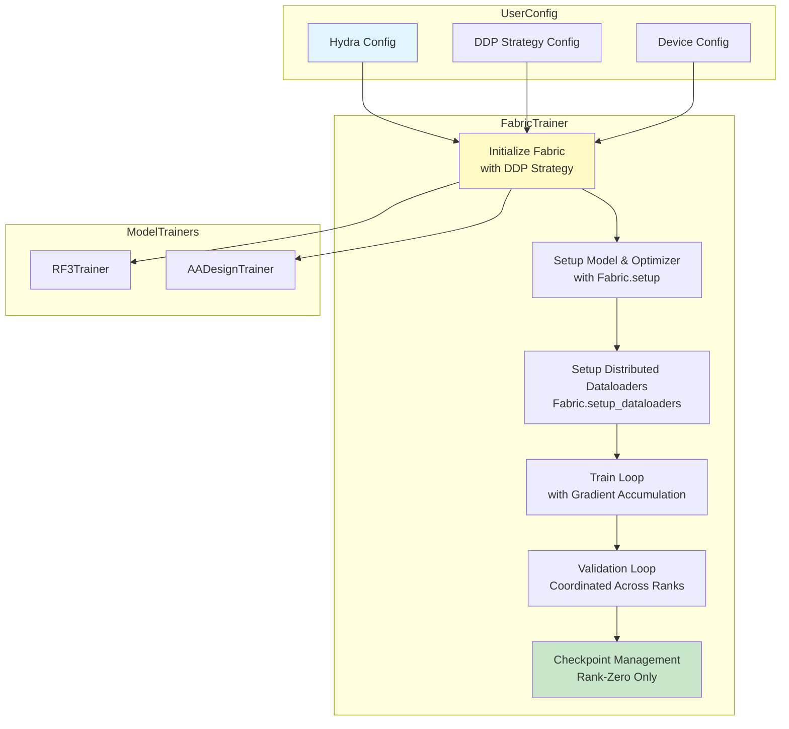

Foundry provides a comprehensive distributed training infrastructure built on PyTorch Lightning Fabric's Distributed Data Parallel (DDP) strategy. This implementation abstracts the complexity of multi-GPU training while providing fine-grained control over distributed execution parameters, enabling efficient training of large-scale protein models across multiple devices and nodes.

Sources: [fabric.py](src/foundry/trainers/fabric.py#L52-L171), [rf3.py](models/rf3/src/rf3/trainers/rf3.py#L36-L153)

## Architecture Overview

The distributed training architecture centers on the `FabricTrainer` abstract base class, which serves as the foundational harness for all model-specific trainers. This class integrates PyTorch Lightning Fabric to handle DDP initialization, gradient synchronization, and distributed state management automatically.

The architecture follows a layered design where Fabric manages low-level distributed primitives while model-specific trainers implement domain training logic. Key architectural components include strategy selection logic, distributed dataloader setup, and coordinated checkpoint management across processes.



Sources: [fabric.py](src/foundry/trainers/fabric.py#L1-L7), [fabric.py](src/foundry/trainers/fabric.py#L52-L171)

## DDP Strategy Configuration

The `FabricTrainer` constructor provides comprehensive DDP configuration through several key parameters. The `strategy` parameter accepts "ddp" as the primary distributed training strategy, with additional support for "dp", "ddp_spawn", "deepspeed", and "fsdp". When DDP is selected in non-interactive multi-device environments, the trainer automatically instantiates a custom `DDPStrategy` with configurable options.

Two critical DDP-specific parameters enable fine-tuning for various training scenarios: `nccl_timeout` (default: 3200 seconds) controls the timeout for NCCL collective operations, while `find_unused_parameters` (default: False) determines whether DDP should search for and skip gradient synchronization on parameters that don't receive gradients. Setting `find_unused_parameters=True` incurs a performance penalty but is essential for specialized use cases like partial model freezing.

The trainer intelligently adapts strategy selection based on runtime environment detection—automatically switching to "auto" in interactive environments or single-device setups while applying the custom DDP configuration for production multi-GPU training.

Sources: [fabric.py](src/foundry/trainers/fabric.py#L125-L136)

| Parameter | Type | Default | Description |
|-----------|------|---------|-------------|
| `strategy` | str | `"ddp"` | Distributed training strategy (ddp, dp, ddp_spawn, deepspeed, fsdp) |
| `devices_per_node` | int/list/str | `"auto"` | Number of GPUs per node or specific GPU IDs |
| `num_nodes` | int | `1` | Number of machines for multi-node training |
| `accelerator` | str | `"auto"` | Hardware accelerator (cpu, cuda, mps, gpu, tpu, auto) |
| `precision` | str | `"bf16-mixed"` | Precision mode (64, 32, 16-mixed, bf16-mixed) |
| `nccl_timeout` | int | `3200` | NCCL operation timeout in seconds (DDP only) |
| `find_unused_parameters` | bool | `False` | Allow DDP to skip unused parameter gradients |

Sources: [fabric.py](src/foundry/trainers/fabric.py#L52-L124)

## Distributed Setup and Initialization

The distributed training lifecycle begins with strategic setup of models, optimizers, and schedulers through Fabric's distributed context. The `setup_model_optimizers_and_schedulers()` method wraps model and optimizer components using `fabric.setup()`, which automatically handles DDP model wrapping and optimizer distribution across processes. This setup must occur after model construction but before training begins.

Dataloader distribution is managed through `fabric.setup_dataloaders()` with the critical `use_distributed_sampler=False` flag. Foundry's architecture employs custom distributed samplers within dataloaders rather than relying on Fabric's default sampler injection, enabling more sophisticated data distribution strategies tailored to protein modeling requirements.

> [!TIP]
> The trainer computes effective examples per epoch by multiplying the configured examples by the number of GPUs across all nodes: `len(train_loader) * self.fabric.world_size`. This ensures consistent epoch definitions regardless of distributed setup, with automatic warnings if the requested examples exceed available data.

Sources: [fabric.py](src/foundry/trainers/fabric.py#L278-L302), [fabric.py](src/foundry/trainers/fabric.py#L330-L351)

## Training Loop with Distributed Coordination

The distributed training loop implements sophisticated coordination for gradient accumulation and synchronization across processes. The `train_loop()` method processes batches with gradient accumulation support, controlling when optimizer steps occur and when gradients are synchronized via DDP's all-reduce operations.

The loop tracks `is_accumulating` state passed to `training_step()`, which indicates whether the current batch is part of an accumulation sequence. When accumulation completes (determined by `batch_idx + 1 % grad_accum_steps == 0`), the optimizer steps and gradients are synchronized across all processes. This pattern allows effective batch sizes larger than what fits in GPU memory while maintaining DDP's efficient gradient aggregation.

Fabric automatically handles critical distributed details: calling `set_sampler_epoch()` when iterating dataloaders ensures each epoch uses different random permutations, while the `_FabricOptimizer` wrapper triggers appropriate callbacks during optimizer steps. The trainer also maintains rank-aware global step tracking, where each process independently increments its step counter after optimization.

Sources: [fabric.py](src/foundry/trainers/fabric.py#L477-L563)

## Validation in Distributed Contexts

Validation loops execute identically across all distributed ranks, with each rank processing its shard of the validation dataset. The `validation_loop()` method accepts a dictionary of named validation loaders, enabling comprehensive multi-metric evaluation in a single distributed pass.

Unlike training, validation doesn't involve gradient synchronization or optimizer steps, making it simpler but still requiring coordination for metrics aggregation. Fabric's context manager ensures each rank processes its allocated validation samples independently, with rank-zero logging typically handling output aggregation when needed.

The `validate_every_n_epochs` parameter controls validation frequency during training, with optional pre-validation before the first training epoch. This enables baseline metrics collection and early problem detection without affecting the training schedule.

Sources: [fabric.py](src/foundry/trainers/fabric.py#L565-L626), [fabric.py](src/foundry/trainers/fabric.py#L920-L923)

## Distributed Checkpoint Management

Checkpoint management in DDP environments requires careful coordination to ensure consistent state across processes. Foundry implements a rank-zero checkpointing strategy where only the primary process writes checkpoints to disk, preventing file corruption from concurrent writes.

The `save_checkpoint()` method uses `ranked_logger` (configured with `rank_zero_only=True`) to ensure checkpointing operations execute only on the designated primary process. The saved state includes model weights, optimizer state, scheduler state, and training metadata like current epoch and global step. Fabric's `save()` method handles the underlying serialization, automatically calling `state_dict()` on registered components.

During checkpoint loading, the `load_checkpoint()` method accepts either a path to a checkpoint file or a pre-loaded dictionary, supporting both training resumption and inference scenarios. The loading process provides flexible control through `reset_optimizer` and `weight_loading_config` parameters, enabling scenarios like fine-tuning from pretrained weights without restoring optimizer state. Weight loading policies handle architectural mismatches gracefully through size-aware partial loading.

Sources: [fabric.py](src/foundry/trainers/fabric.py#L782-L895)

## Configuration Examples

DDP configuration is typically specified through YAML configuration files using Hydra's composition system. Both RF3 and RFD3 models provide `ddp.yaml` templates that can be composed with training configurations.

### RF3 DDP Configuration

```yaml
# models/rf3/configs/trainer/ddp.yaml
strategy: ddp
accelerator: gpu
devices_per_node: 1
num_nodes: 1
```

This configuration is then composed into the full trainer configuration:

```yaml
# models/rf3/configs/trainer/rf3.yaml
defaults:
  - ddp
  - loss: structure_prediction
  - metrics: structure_prediction

_target_: rf3.trainers.rf3.RF3Trainer
validate_every_n_epochs: 1
max_epochs: 10_000
n_examples_per_epoch: 24000
precision: bf16-mixed
```

### RFD3 DDP Configuration

RFD3 provides similar configuration with additional hyperparameters for design-specific training:

```yaml
# models/rfd3/configs/trainer/ddp.yaml
strategy: ddp
accelerator: gpu
devices_per_node: 1
num_nodes: 1
```

```yaml
# models/rfd3/configs/trainer/rfd3_base.yaml
defaults:
  - ddp
  - loss/losses/diffusion_loss@loss.diffusion_loss
  - metrics: design_metrics

_target_: rfd3.trainer.rfd3.AADesignTrainer
n_examples_per_epoch: 2400
checkpoint_every_n_epochs: 10
validate_every_n_epochs: 4
max_epochs: 100_000
grad_accum_steps: 3
skip_optimizer_loading: True
precision: bf16-mixed
```

Sources: [ddp.yaml](models/rf3/configs/trainer/ddp.yaml), [rf3.yaml](models/rf3/configs/trainer/rf3.yaml), [ddp.yaml](models/rfd3/configs/trainer/ddp.yaml), [rfd3_base.yaml](models/rfd3/configs/trainer/rfd3_base.yaml)

## Model-Specific Trainer Implementations

Model-specific trainers extend `FabricTrainer` to implement domain logic while inheriting all distributed training capabilities. The `RF3Trainer` class implements AF3-style structure prediction training with specialized loss computation and metric collection methods.

The `training_step()` method in `RF3Trainer` handles forward passes, loss computation, and backward propagation while respecting DDP's accumulation state. Similarly, `validation_step()` performs inference and metrics collection without gradient computation. These methods receive the `is_accumulating` parameter from the training loop, enabling conditional logic for accumulation steps if needed.

RFD3's `AADesignTrainer` follows the same pattern but implements design-specific logic for sequence generation and structural metrics. Both trainers demonstrate how domain expertise integrates seamlessly with the distributed training foundation without needing to implement DDP-specific logic.

Sources: [rf3.py](models/rf3/src/rf3/trainers/rf3.py#L36-L486), [rfd3.py](models/rfd3/src/rfd3/trainer/rfd3.py#L32-L486)

## Performance Optimization Considerations

Several critical factors impact DDP training performance in Foundry's architecture. Gradient accumulation effectively increases batch size while reducing memory pressure, with the tradeoff of longer effective latency between parameter updates. The `n_examples_per_epoch` parameter should be carefully calibrated based on the product of per-GPU batch size, number of GPUs, and accumulation steps.

Mixed precision training (`precision: "bf16-mixed"` or `"16-mixed"`) provides significant speedups and memory savings on modern GPUs with minimal accuracy impact. The `clip_grad_max_norm` parameter enables gradient clipping for training stability, particularly important with large effective batch sizes in distributed scenarios.

> [!TIP]
> When training with `find_unused_parameters=True` (necessary for partially frozen models), monitor performance carefully as DDP incurs additional overhead to identify unused parameters at each step. Consider alternative approaches like parameter filtering if performance degradation is significant.

For multi-node training, ensure network infrastructure supports the NCCL collective operations efficiently. The `nccl_timeout` parameter can be increased for large-scale deployments but may hide underlying connectivity issues. Systematic profiling with tools like `nccl-tests` helps identify bottlenecks before production training runs.

Sources: [fabric.py](src/foundry/trainers/fabric.py#L52-L124), [rf3.yaml](models/rf3/configs/trainer/rf3.yaml#L15-L21)

## Troubleshooting Common DDP Issues

**Timeout Errors**: NCCL timeout errors typically indicate network connectivity issues or blocked processes. Increase `nccl_timeout` for debugging, but investigate underlying network problems. Ensure firewall rules allow all necessary ports and that all nodes have identical PyTorch and CUDA versions.

**Gradient Sync Issues**: When models have frozen or partially used parameters, set `find_unused_parameters=True` to prevent DDP errors. However, be aware of performance implications. For production training with unused parameters, consider architectural refactoring to avoid this flag.

**Inconsistent Metrics**: If validation metrics differ across ranks, ensure dataloader samplers use consistent random seeds or implement rank-zero metric aggregation. The `ranked_logger` with `rank_zero_only=True` helps coordinate output but doesn't aggregate computations.

**Checkpoint Loading Failures**: When resuming training with different GPU counts or architectures, use `reset_optimizer=True` and `weight_loading_config` parameters to handle state mismatches gracefully. The system provides detailed logging for missing or extra keys to diagnose issues.

Sources: [fabric.py](src/foundry/trainers/fabric.py#L114-L117), [fabric.py](src/foundry/trainers/fabric.py#L835-L895)

## Integration with Training Pipeline

The DDP implementation integrates seamlessly with Foundry's broader training infrastructure. The `FabricTrainer` coordinates with callbacks, loggers, and metrics systems through Fabric's hook system. Callbacks like `on_train_epoch_start`, `on_train_batch_end`, and `on_save_checkpoint` provide extension points for custom distributed behavior.

The training harness also integrates with the [Checkpoint Management System](8-checkpoint-management-system) for state persistence and [Callbacks and Metrics Logging](17-callbacks-and-metrics-logging) for monitoring distributed training progress. Hydra's configuration system enables flexible composition of DDP parameters with model-specific settings across different training scenarios.
